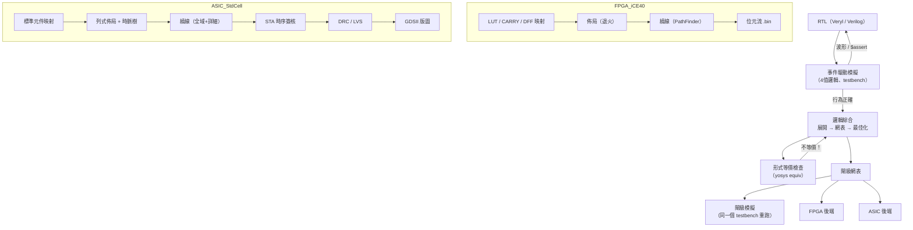
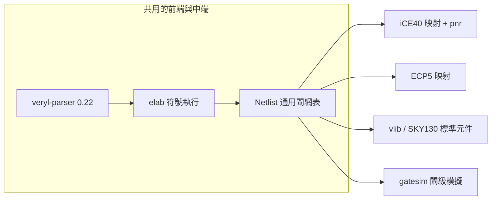

# 1.1 晶片設計流程總覽：從 RTL 到 GDS

> 本章是全書的地圖。我們先走一遍「一個數位電路設計從想法到晶片」的完整流程，
> 說明每個階段的**輸入、輸出、核心問題**，以及 EDA 工具在其中扮演的角色。
> 之後每一章都會回到這張地圖上，深入其中一個方塊——而本書的特別之處是：
> 每個方塊我們都有自己寫的實作（veryl2chip 的 Rust 原始碼）可以對照閱讀。

## 1.1.1 前端與後端

工業界的數位晶片設計流程粗分為兩段：

| 段 | 名稱 | 工作內容 | 主要輸出 |
|---|---|---|---|
| front-end | 設計與驗證 | 用 HDL（Verilog/VHDL/Veryl…）寫出**行為**，模擬驗證其正確性 | RTL 原始碼 + 通過的 testbench |
| 中端 | 邏輯綜合 | 把行為描述轉成「由哪些邏輯閘組成」的**結構**描述 | 閘級網表（netlist） |
| back-end | 實體設計 | 把網表放到晶片上：擺哪裡、怎麼連線、時序滿不滿足、能不能製造 | 版圖（GDSII）或 FPGA 位元流 |

```
RTL ──模擬──► 通過 ──綜合──► 網表 ──佈局──► 放置 ──繞線──► 連線 ──簽核──► GDS
        ▲                          ▲                        ▲
        └── 行為對不對？            └── 結構等不等價？        └── 物理可製造嗎？
```

注意每一關都是一個「轉換 + 檢查」的組合。**轉換**產生新的表示法，
**檢查**證明新表示法與舊表示法等價（或至少滿足規格）。
整個 EDA 的本質就是：*在不斷降低抽象層級的同時，用數學方法保住正確性*。

## 1.1.2 完整流程圖



## 1.1.3 每個階段的輸入與輸出

### 模擬（simulation）

* **輸入**：RTL + testbench（veryl2chip 約定：帶 `#[test(...)]` 屬性的 module）。
* **輸出**：文字輸出、斷言結果、VCD 波形檔。
* **數學模型**：把電路當成「事件驅動的離散系統」。訊號值只在事件（值改變）時被重算；
  為了正確處理 Verilog 式的非阻塞賦值（`<=`），同一個時刻內要反覆迭代到收斂——
  這就是 **delta 週期**（第 2.1 節）。

veryl-sim 的核心狀態非常小，值得先看一眼：

```rust
// veryl-sim/src/sim.rs:82 附近
pub nba: Vec<(usize, u32, u32, Val)>,   // 本時刻累積的非阻塞賦值
```

```rust
// veryl-sim/src/sim.rs:447-451 附近
if nb { self.nba.push((sig, lo, w, v)); } else { self.write_bits(sig, lo, w, v); }
pub fn apply_nba(&mut self) {
    let q = std::mem::take(&mut self.nba);
    ...
}
```

賦值分兩種：阻塞式直接寫入 `sigs`；非阻塞式先累積在 `nba`，等這個時刻的所有
程序都跑完再一次套用。這一個小資料結構就是整個事件驅動模擬語意的支點。

### 邏輯綜合（synthesis）

* **輸入**：RTL（的語法樹）。
* **輸出**：閘級網表——由 `$_AND_`、`$_MUX_`、`$_DFF_P_` 這類通用閘組成。
* **核心難題**：RTL 描述的是「*當*時脈來時做什麼」，網表描述的是「*由哪些閘連成*」。
  中間的鴻溝靠兩件事跨越：
  1. **精細化（elaboration）**：展開層次（module 實例化）、展開迴圈、內嵌函式；
  2. **控制流 → 資料流**：`if`/`case` 變成多工器，`always_ff` 推斷成正反器。

veryl-eda 用了一個比較少見的做法：**符號執行**。它不建中間的「行為模型」再轉換，
而是直接把 RTL 當成一段程式「執行」，只是所有值都是**電路節點**而不是數字：

```rust
// veryl-eda/src/elab.rs:1178-1194 附近（推斷正反器種類）
format!("$_DFF_{}_", c)
...
if asynch { format!("$_DFF_{}{}{}_", c, rp, v) } else { format!("$_SDFF_{}{}{}_", c, rp, v) }
```

同步重置推斷成 `$_SDFF_*`（帶同步 reset 的 DFF）、非同步推斷成 `$_DFF_*` 帶 reset 腳，
細節在第 3.4 節。符號執行的好處是實作直觀、天然支援迴圈展開；
代價是每個控制流分支都要走一遍（第 3.2 節會詳細分析）。

綜合之後並非直接可用：網表裡有大量**佔位別名**（一個訊號被多處驅動時先記成別名）、
死邏輯、可折疊的常數。最佳化器反覆重建網表直到不動點：

```rust
// veryl-eda/src/netlist.rs:406 附近
pub fn optimize(b: Builder, alias: &HashMap<u32, Bit>, ...) -> R<Netlist> {
    let mut nl = rebuild(b, alias, ports, nets, name)?;
    loop {
        ...
        if stuck.is_empty() { stuck = const_nodes(&nl); }   // 常數節點證明
        if stuck.is_empty() { return Ok(nl); }              // 不動點：收斂
        ...
    }
}
```

其中 `const_nodes` 用「隨機模擬 + 對 ≤16 輸入支援窮舉」來**證明**某節點恆為常數——
這是以驗證驅動最佳化的一個小例子（第 3.8 節）。

### FPGA 後端

FPGA 的硬體資源是固定的（LUT4、進位鏈、正反器、RAM、可程式互連），後端工作是把
網表「塞」進這些資源：

1. **技術映射**：通用閘 → 目標元件。iCE40 是 4 輸入 LUT，問題變成「用最少/最淺的
   4 輸入切割覆蓋整個布林網路」——一個受限的樹覆蓋問題：

   ```rust
   // veryl-eda/src/ice40.rs:19-27 附近
   const K: usize = 4;
   const CUTS: usize = 16;
   pub(crate) struct Cut {
       pub leaves: Vec<u32>, // sorted wire ids
       depth: u32,
       flow: f32,
   }
   ```

   另外還要**認出加法器**：`SB_CARRY` 只有在網表裡剛好呈現
   `(a & b) | ((a ^ b) & c)` 的形狀時才能用（`ice40.rs` 的 `find_carries`）。
2. **佈局（placement）**：每個元件放到晶片上的哪個實體位置？目標是最小化總線長＋滿足
   時序。精確解是 NP-hard，實務用**模擬退火**。
3. **繞線（routing）**：在有限的線段與開關盒資源裡，把每條 net 的所有 pin 連起來且
   互不衝突。標準演算法是 **PathFinder**：先讓多條 net 共用資源、記下衝突成本，
   反覆以 A* 重繞直到零衝突。
4. **位元流**：把最終的晶片組態（每個 tile 的 SRAM 位元）編碼成 `.asc`/`.bin`。

### ASIC 後端

ASIC 沒有「可重組態」的資源，只有**標準元件庫**（standard cell）：
每個閘是一塊預先畫好的版圖，等高、可並排。後端工作：

1. 映射到元件庫（樹覆蓋 DP，`asic/map.rs`）；
2. **列式佈局**：元件必須落在預先切好的 row 上（`asic/place.rs`）；
3. **時脈樹合成（CTS）**：時脈要平衡地分給每個正反器，否則 skew 吃掉時序餘量；
4. 繞線、**STA（靜態時序分析）**、hold 修復；
5. **DRC（設計規則檢查）**：線寬、間距、包圍……這些是製程的物理底線；
6. 產出 **GDSII**——送去晶圓廠的最終交付物。

## 1.1.4 為什麼要「檢查」這麼多關？

每一個轉換都可能出錯，而錯誤的代價隨抽象層級下降**指數上升**：

| 發現錯誤的階段 | 修正成本 |
|---|---|
| RTL 模擬 | 改幾行程式碼 |
| 綜合後閘級模擬 | 重跑一次合成（分鐘級） |
| FPGA 位元流 | 重新燒錄（分鐘級） |
| ASIC GDS 之後（流片） | 一套光罩，**數十萬到數百萬美元** |

所以流程裡安排了多層檢查：testbench 斷言（行為層）、閘級模擬（同一個 testbench
重跑）、形式等價檢查（數學證明兩網表等價）、STA（時序）、DRC（物理）。
veryl2chip 的 `test.sh` 正是照這個哲學安排的：每個範例設計都會
綜合 → 閘級模擬 → yosys 形式等價，確保我們自己寫的每一層轉換都沒有改變行為。

## 1.1.5 為什麼這樣設計：抽象層級的取捨

一個值得反覆思考的問題：*為什麼不直接從 RTL 產生 GDS，跳過所有中間表示？*

答案是每一個中間表示（IR）都是一次**問題分解**：

* 通用閘網表把「製程無關」與「製程相關」分開——同一份網表可以映射到 iCE40、
  ECP5、vlib 或 SKY130。veryl2chip 的 `Netlist` 就扮演這個角色，四個後端共用它。
* 通用閘也讓形式等價檢查變可行：兩個網表等價 <=> 每個輸出對輸入的布林函式相同，
  這在通用閘表示下是個良定義的 SAT 問題。
* 「一個 IR、多個後端」的架構讓新增一個目標（如 v2.2 加入 ECP5）不需要動到
  前端與中端。



## 本章重點

1. 數位設計流程 = 一連串「降低抽象層級的轉換 + 等價性檢查」；
   錯誤越晚發現越貴，所以檢查點密布全程。
2. 模擬的核心是事件驅動 + delta 週期 + NBA 排程（一個 `nba` 向量就足以表達）。
3. 綜合 = elaboration + 控制流→資料流 + 正反器/記憶體推斷 + 網表最佳化；
   veryl-eda 用符號執行直接把 RTL「跑」成閘。
4. FPGA 後端 = LUT 覆蓋 + 退火佈局 + PathFinder 繞線 + 位元流；
   ASIC 後端 = 標準元件映射 + 列式佈局 + CTS + STA/DRC + GDS。
5. 通用閘網表是全流程的樞紐 IR：製程無關、可形式驗證、多後端共用。
