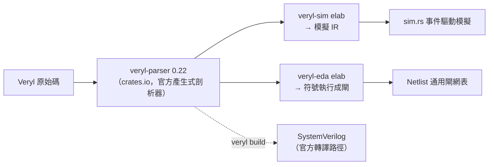

# 1.2 從 Verilog 到 Veryl：為何需要新的 HDL 工具鏈

> 本章回答兩個問題：(1) 有了 Verilog 為什麼還要 Veryl？
> (2) veryl2chip 為什麼選擇 crates.io 上的 `veryl-parser` 作為前端，
> 而且刻意把支援範圍收窄？後半列出的語法陷阱，是我們在實作中
> 逐一撞過、並對照 `veryl check` 驗證過的——寫 Veryl 時務必記住。

## 1.2.1 Verilog 的歷史包袱

Verilog 誕生於 1984 年，比 Java、Python 都早。它身上累積的問題不是設計不良，
而是**設計目標已經過時**：

1. **它是給模擬器設計的，不是給編譯器設計的。**
   語法鬆散：`begin/end` 可省略、大小寫敏感但無模組系統、`reg` 與 `wire`
   的區別靠記憶、可綜合子集要靠「coding style 公約」約定俗成。
2. **巨集系統是文字層級的。** `` `define `` 在預處理階段做字串替換，
   工具之間對展開時機的解釋不一致，是許多神秘 bug 的來源。
3. **沒有真正的套件與命名空間**（SystemVerilog 補上了，但語言因此變得
   龐大到沒有任何開源工具能完整支援）。
4. **免費且完整的開源工具鏈長期缺席**，導致教學與個人專案難以起步。

Veryl（https://veryl-lang.org）的定位是「現代化的硬體描述語言」：
語法接近 Rust、有真正的 package / interface / modport、編譯器輸出**可讀的
SystemVerilog** 作為中間產物。0.22 版的關鍵特性：

| 特性 | Verilog 對應 | 好處 |
|---|---|---|
| `mod` / `inst` | module / 實例化 | 語法統一，層次關係顯式 |
| `package` + `Pkg::Name` | 无 / SV package | 命名空間真實存在 |
| `enum` / `struct` | SV 的 enum/struct | 型別安全，成員路徑 `Pkg::Enum::Member` |
| `interface` + `modport` | SV interface | 匯整匯流排埠 |
| `always_ff` / `always_comb` | 同名 | 可綜合性由語法區分 |
| `#[test(...)]` | 无（自己寫 tb） | testbench 是語言的一部分，模擬器可直接發現 |
| `generate for` | 同名 | 迴圈變數是編譯期常數 |

## 1.2.2 為什麼以 crates.io 的 `veryl-parser` 為前端

veryl2chip **沒有自己寫 Veryl 語法剖析器**。三個 crate 的共同依賴是：

```toml
# veryl-sim/Cargo.toml:22
veryl-parser = "0.22"
# veryl-eda/Cargo.toml:27-28
veryl-parser = "0.22"
veryl-sim = { package = "veryl2chip-sim", path = "../veryl-sim", version = "2.1.0" }
# veryl-wasm/Cargo.toml:13-15
veryl-parser = "0.22"
veryl-sim = { package = "veryl2chip-sim", path = "../veryl-sim" }
veryl-eda = { package = "veryl2chip-eda", path = "../veryl-eda" }
```

理由：

1. **語法正確性不該重複投資。** `veryl-parser` 是官方語言專案維護的產生式剖析器
   （parser generator 產出 `veryl_grammar_trait`），跟著語言版本走。
   自己手寫一份等價剖析器要數千行，且永遠落後語言演進。
2. **我們要的是「語意」，不是「語法」。** veryl-sim 的 elab 拿到語法樹後直接
   用 walker 收集 token、做自己的型別推斷與層次展開：

   ```rust
   // veryl-sim/src/elab.rs:1-19 附近
   //! Elaboration: walks the veryl-parser syntax tree, flattens the module
   //! hierarchy and lowers it into the simulator IR.
   use veryl_parser::veryl_grammar_trait::*;
   use veryl_parser::veryl_walker::VerylWalker;
   use veryl_parser::TokenCollector;

   /// Collect the source tokens (as text) of any syntax node via the Veryl walker.
   fn toks<F: FnOnce(&mut TokenCollector)>(f: F) -> Vec<String> {
       let mut c = TokenCollector::new(false);
       f(&mut c);
       c.tokens.iter().map(|t| t.to_string()).collect()
   }
   ```

   `toks()` 這個小工具把任一語法節點的原始 token 收成字串向量——
   識別符就變成 `["Pkg", "::", "Name"]` 再 `join("")`，剖析樹的複雜度
   被隔離在這一層之後。
3. **縮小支援範圍是特性不是缺陷。** 官方 Veryl 是「Veryl → SystemVerilog」的
   轉譯器，語言全集都要吃下。veryl-sim 是**模擬器**，只需要可模擬的子集；
   veryl-eda 是**綜合器**，只需要可綜合的子集。遇到不支援的語法時，我們輸出
   明確的「not supported」錯誤——注意這不是語言錯誤，是我們工具的邊界
   （AGENTS.md 特別提醒這一點）。



## 1.2.3 表示式剖析：剖析器之後還要一層 Pratt

`veryl-parser` 給的是**語法樹**，但語法樹的運算子優先序藏在樹形裡，
對「求值」或「符號執行」都不方便。兩個 crate 各自把表示式降成
自己的 Pratt 表示式樹。veryl-sim 的實作：

```rust
// veryl-sim/src/expr.rs:55 與 121 附近
pub fn parse_expr(toks: &[String], r: Resolver, f: Fielder) -> Result<Expr, String> { ... }

fn unary(&mut self) -> Result<Expr, String> {
    if let Some(op) = self.peek() {
        if matches!(op, "+" | "-" | "!" | "~" | "&" | "|" | "^" | "~&" | "~|" | "~^" | "^~") {
            let op = op.to_string();
            self.i += 1;
            let e = self.unary()?;
            return Ok(Expr::Un(op, Box::new(e)));
        }
    }
    self.primary()
}
```

Pratt 剖析的好處是優先序表（`binprec`）一張表寫完，新運算子加一行；
缺點是**它吃的是 token 序列，不再有括號與優先序的保護**——
這正是下一節第一個陷阱的根源。

## 1.2.4 Veryl 0.22 的語法陷阱（實測筆記）

以下是對照 `veryl check`（官方語意檢查，我們的 ground truth）驗證過的行為，
書中與專案程式碼都依此假設。

### 陷阱一：`function` 內的裸 `<` `>` 會破壞 parser

Veryl 的 scanner 是**泛型的**（generic scanner）：`<` 可能是型別參數的開括號，
也可能是小於。在 `function` 本體裡出現裸的 `<`（例如 `a < b`）會讓 scanner
誤判而整個 parser 崩潰。安全的替代寫法：

* 用 `<=` / `>=`（比較）；
* 用 `<:`（less）與 `>:`（greater）——Veryl 提供的顯式比較運算子。

這也是為什麼 our `binprec` 表裡會同時看到 `<` 與 `<:`。

### 陷阱二：enum 成員是 `Pkg::EnumName::Member`

Veryl 0.22 的 enum 成員**必須用三段路徑**取用：

```veryl
package Pkg {
    enum State { A, B }
}
// 正確：Pkg::State::A
// 錯誤：Pkg::A
```

veryl-sim 的 elab 在解析識別符時按這個規則查表（`elab.rs` 的
`PkgDef.enums`），寫測試或範例時寫錯層數會得到「unknown identifier」。

### 陷阱三：`bit` 是保留字

`bit` 是 Veryl 的型別關鍵字，**不能**當識別符（變數、參數、欄位都不行）。
想叫 `bit_count` 沒問題，單獨的 `bit` 不行。

### 陷阱四：testbench 的慣用寫法

veryl-sim 對 testbench 的支援是刻意收窄的，慣用形式固定為：

```veryl
#[test(TestAdder)]
mod TestAdder {
    inst clk: $tb::clock_gen;          // inst 本身就是時脈
    inst rst: $tb::reset_gen(clk);     // rst.assert() 不帶參數時用它
    initial {
        rst.assert();
        clk.next(10);
        $assert(out == 3, "adder wrong");
    }
}
```

**不要**自己宣告 `var clk: clock` 再手動翻轉——模擬器不支援那種寫法。
`rst.assert()` 不帶參數時，使用 `inst rst: $tb::reset_gen(clk)` 記錄下來的時脈。

### 陷阱五：未重置的 RAM/陣列會觸發 warning

`veryl check` 會對「always_ff 裡有寫、但沒有 reset 路徑」的 RAM/陣列發出
`missing_reset_statement` 警告。RAM 本來就不該 reset，語意上這是誤報，
官方建議（我們也採用）是在該 `always_ff` 上加
`#[allow(missing_reset_statement)]` 壓掉。

### 陷阱六：packed struct 第一個欄位在 MSB

```veryl
struct Packed { a: logic<4>, b: logic<4> }   // a 是位元 7..4，b 是位元 3..0
```

這與 SystemVerilog 的 packed struct 一致。veryl-eda 在做位域
（`elab.rs` 的 `TypeInfo.fields: (name, bit offset, width)`）時就按此慣例。

## 1.2.5 為什麼這樣設計：站在官方剖析器上，還是全部自寫？

一個誠實的權衡。自寫剖析器的好處是零依賴、錯誤訊息可控；
壞處是 **Veryl 是活的語言**——0.22 的每一版 grammar 都在動。
veryl2chip 選擇「官方 parser + 自己的語意層」，把風險從「語法跟不上」
換成「**語意子集**要明確宣告」。AGENTS.md 裡那張支援／不支援清單
就是這個決策的文件化：寧可清楚說明邊界，也不要假裝支援全部。

另一個好處常被忽略：**`veryl check` 因此可以直接當 ground truth**。
當 veryl-sim 說某段程式「不支援」，你可以立刻用官方工具分辨
「是我們不支援」還是「語法本身有錯」——這是第 1.4 節除錯流程的第一步。

## 本章重點

1. Verilog 的問題源自「給模擬器設計的語言被拿去當綜合輸入」；
   Veryl 以現代語法與顯式可綜合性回應，編譯目標是 SystemVerilog。
2. veryl2chip 三個 crate 共用 crates.io 的 `veryl-parser` 0.22，
   只在語意層（elab）分道：模擬 IR vs 符號執行成閘。
3. 剖析器之後還要一層 Pratt 表示式樹，才能被求值／符號執行。
4. 六個實測陷阱：function 內裸 `<`/`>` 用 `<:`/`>:`；
   enum 成員三段路徑；`bit` 保留字；testbench 用 `$tb::clock_gen` 慣用法；
   RAM 誤報用 `#[allow(...)]`；packed struct 首欄位在 MSB。
5. 支援範圍收窄是刻意的：用 `veryl check` 分辨「語言錯誤」與「工具邊界」。
