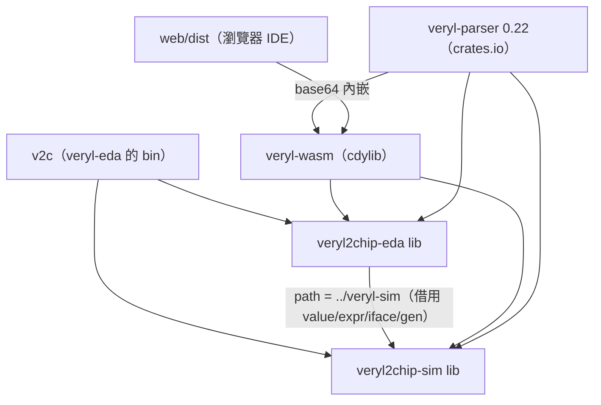
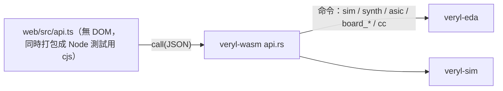
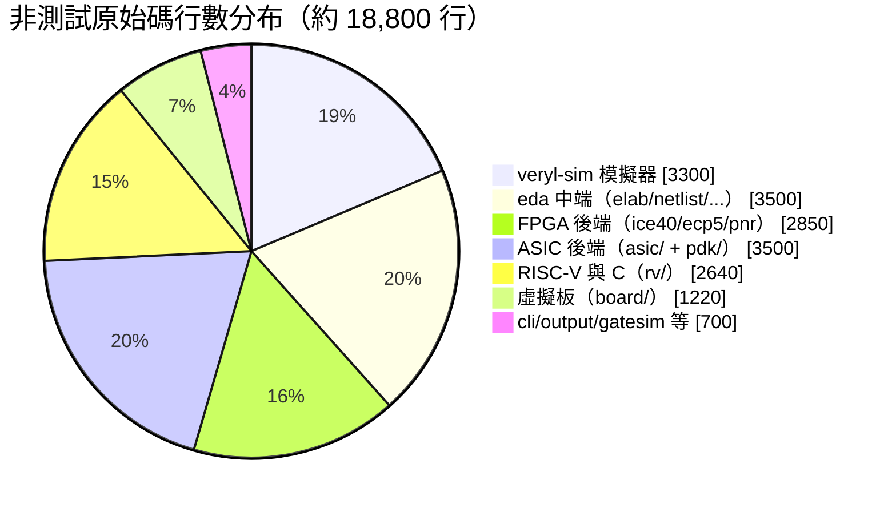

# 1.3 veryl2chip 專案架構：三個 crate 與程式碼地圖

> 本章把整個專案攤開：三個 crate 怎麼分工、彼此怎麼依賴，
> 以及 `src/` 下每個檔案（以實際 `wc -l` 行數標注）各自負責什麼。
> 之後各章引用原始碼時，都能在這張地圖上定位。

## 1.3.1 三個 crate 的分工

| crate（crates.io 名） | 目錄 | 角色 |
|---|---|---|
| `veryl2chip-sim` | `veryl-sim/` | 模擬器：解析 Veryl → 精細化 → 事件驅動模擬（含閘級模擬） |
| `veryl2chip-eda` | `veryl-eda/` | 綜合與後端：符號執行成閘、iCE40/ECP5/ASIC 映射與 P&R、C 編譯器、虛擬板 |
| `veryl-wasm` | `veryl-wasm/` | 把上面兩者編成 WebAssembly（C ABI、零 imports），供網頁 IDE 使用 |

依賴是**單向的樹**，而且 veryl-eda 對 veryl-sim 是**路徑依賴**——
它直接借用 veryl-sim 的 `value.rs`（位元向量）與 `expr.rs`（Pratt 剖析）、
`iface.rs`、`gen.rs`，避免兩套 crates 各自維護一份：



```toml
# veryl-eda/Cargo.toml:27-28
veryl-parser = "0.22"
veryl-sim = { package = "veryl2chip-sim", path = "../veryl-sim", version = "2.1.0" }
```

注意 crates.io 的 package 名與目錄名不同（`veryl2chip-sim` vs `veryl-sim`），
Cargo.toml 裡用 `package = "..."` 轉名，並用 `[lib] name` 保留
`veryl_sim` / `veryl_eda` 的模組名（AGENTS.md：`veryl-*` 前綴屬於官方 Veryl 專案）。

## 1.3.2 veryl-sim：模擬器（共約 3,300 行）

| 檔案 | 行數 | 職責 |
|---|---|---|
| `value.rs` | 218 | 四值（0/1/x）位元向量；固定寬度多字組整數 `Bits`，上限 `MAXW = 256` |
| `expr.rs` | 331 | Pratt 表示式剖析（token 序列 → `Expr` 樹） |
| `elab.rs` | 1172 | 語法樹 → 模擬 IR：層次展開、介面/modport、型別推斷 |
| `sim.rs` | 835 | 事件驅動引擎：delta 週期、NBA 排程、時脈、VCD 輸出、`initial` |
| `gates.rs` | 273 | 閘級模型：讓同一個模擬器跑綜合後的網表（保持 x 傳播） |
| `iface.rs` | 109 | interface 實例展開與 modport 解析（與 veryl-eda 共用） |
| `gen.rs` | 24 | generate-for 迴圈變數（const param）處理 |
| `cli.rs` | 52 | 命令列：被 `v2c` 的 `sim` / `list` 子命令呼叫 |
| `lib.rs` / `main.rs` | 117 / 4 | 模組宣告與薄包裝 |

一個值得注意的設計：`value.rs` 用**固定寬度、編譯期常數 limbs** 的位元向量，
而不是任意精度整數：

```rust
// veryl-sim/src/value.rs:6-12 附近
/// 64-bit words per value: MAXW = 64 × LIMBS bits
pub const MAXW: u32 = 64 * LIMBS as u32;
/// A fixed-width unsigned integer of MAXW bits (little-endian 64-bit words).
pub struct Bits(pub [u64; LIMBS]);
```

每個值固定 4 個 `u64`（256 bits），分配在堆疊上、無 GC 壓力——
模擬器每秒要算數百萬次位元運算，這個取捨是速度的基礎（第 2.4 節詳述）。

## 1.3.3 veryl-eda：綜合與後端（核心約 12,000 行）

### 中端（第 3 章）

| 檔案 | 行數 | 職責 |
|---|---|---|
| `elab.rs` | 1742 | **符號執行**：語法樹直接執行成閘；if/case→mux、迴圈展開、函式內嵌、DFF 推斷 |
| `netlist.rs` | 666 | 網表資料結構：別名解析、常數折疊、雜湊共用、組合迴路偵測、死邏輯清除、隨機模擬+窮舉證明 |
| `output.rs` | 147 | 寫 yosys JSON 與結構性 Verilog |
| `expr.rs` | 278 |eda 側的 Pratt 表示式（與 sim 的類似但節點型別不同） |
| `value.rs` | 5 | 轉 re-export veryl-sim 的位元向量 |
| `netsim.rs` | 256 | 二值閘級模擬器（generic / iCE40 / vlib 元件皆可），測試用 |
| `gatesim.rs` | 66 | 把 Netlist 轉成 veryl-sim 的閘級模型（Web 的「模擬合成結果」選項） |
| `bram.rs` | 246 | 同步讀的記憶體 → iCE40 `SB_RAM40_4K` 映射 |
| `power.rs` | 69 | 簡單功耗估算 |
| `tests.rs` | 1251 | 整套整合測試：每個範例設計綜合 + 閘級模擬 + 斷言重驗 |

### FPGA 後端（第 4 章）

| 檔案 | 行數 | 職責 |
|---|---|---|
| `ice40.rs` | 319 | iCE40 映射：cut-based LUT4 覆蓋、`SB_CARRY` 認出加法器、`SB_DFF*` |
| `ecp5.rs` | 203 | ECP5 映射：`LUT4`/`CCU2C`/`TRELLIS_FF`（字串參數處理） |
| `pnr/mod.rs` | 409 | 自家 P&R 框架：讀 chipdb、流程編排、`Opts` |
| `pnr/chipdb.rs` | 249 | 解析 IceStorm 的 `chipdb-5k.txt`（tile / bel / pip 資料庫） |
| `pnr/pack.rs` | 339 | LUT+carry+FF 打包成 logic cell |
| `pnr/place.rs` | 313 | 模擬退火佈局（含時序驅動第二輪） |
| `pnr/route.rs` | 174 | PathFinder 繞線 |
| `pnr/sta.rs` | 375 | 佈局後時序分析（icetime 對照） |
| `pnr/bitstream.rs` | 289 | 寫 `.asc`（含 UP5K tile 25,14 的 DSP/IPCON 預設位元例外） |
| `pnr/power.rs` | 44 | 電源 tile 處理 |

### ASIC 後端（第 5 章）

| 檔案 | 行數 | 職責 |
|---|---|---|
| `asic/mod.rs` | 280 | 流程編排（映射→佈局→CTS→繞線→STA，含 SKY130 低利用率重試） |
| `asic/map.rs` | 298 | 標準元件映射（樹覆蓋 DP；fanout>12 插 BUF 樹） |
| `asic/place.rs` | 342 | 列式退火佈局（線長，之後時序驅動） |
| `asic/cts.rs` | 143 | 時脈樹合成 |
| `asic/route.rs` | 212 | 全域繞線（gcell、Prim 生成樹 + A* + PathFinder） |
| `asic/detail.rs` | 473 | 詳細繞線（含 SKY130 規則：blocked nodes、via mask、halo） |
| `asic/sta.rs` | 266 | 靜態時序分析（NLDM 查表當 Liberty 可用） |
| `asic/lib.rs` | 135 | vlib 教學元件庫定義 |
| `asic/layout.rs` | 188 | 由佈局產生形狀（供 DRC/GDS） |
| `asic/drc.rs` | 185 | 設計規則檢查（用 LEF 的 pin/OBS） |
| `asic/gds.rs` | 158 | GDSII 寫出 |
| `asic/pdn.rs` | 191 | 電源網 |
| `asic/power.rs` | 157 | 功耗 |

### PDK、RISC-V 與虛擬板（第 6 章）

| 檔案 | 行數 | 職責 |
|---|---|---|
| `pdk/mod.rs` | 487 | `Tech` 抽象：row/site/tracks、cell 寬度、pin access、`is_vlib()` |
| `pdk/liberty.rs` | 423 | Liberty (.lib) 解析：NLDM timing/constraint/cap |
| `pdk/lef.rs` | 254 | LEF 解析：cell 尺寸、pin、OBS |
| `pdk/def.rs` | 190 | DEF 寫出 |
| `rv/cc.rs` | 1718 | C 子集編譯器（含 `asm!`、naked 函式） |
| `rv/asm.rs` | 547 | RISC-V 組譯器 |
| `rv/iss.rs` | 364 | 指令集模擬器（與 RTL 週期級對齊，含中斷） |
| `board/mod.rs` | 695 | 虛擬開發板：真值表+FF+RAM 的 Design / Engine / Board |
| `board/bitstream.rs` | 271 | 解碼 `.bin`/`.asc` → Design（板上「燒錄」） |
| `board/periph.rs` | 170 | UART / 七段 / VGA 週邊 |
| `board/icebreaker.rs` | 86 | iCEBreaker 腳位表與預設 PCF |
| `cli.rs` | 373 | `synth`/`fpga`/`asic`/`gatesim`/`cc`/`pdk` 子命令實作 |

`v2c` 這個執行檔（`src/bin/v2c.rs`）是唯一的入口：`sim`/`list` 轉給
`veryl_sim::cli::main`，其餘轉給 `veryl_eda::cli::main`——
兩個舊執行檔 `veryl-sim`/`veryl-eda` 只是薄包裝。

## 1.3.4 veryl-wasm：網頁版（約 850 行）

| 檔案 | 行數 | 職責 |
|---|---|---|
| `api.rs` | 777 | C ABI：`alloc` / `call(JSON)` / `result_len` / `dealloc`；每個網頁指令一個 JSON 進出口 |
| `lib.rs` | 75 | panic 訊息通道等膠水 |



設計原則是「**zero imports**」：wasm 模組不 import 任何環境函式，
一切輸入輸出都走 JSON 字串，panic 訊息靠 `panic_message` 帶回。
這讓 wasm 可以同時在瀏覽器與 Node（`npm test`）裡跑，而且
`api.ts` 不碰 DOM、可以單獨測。

## 1.3.5 一個關鍵型別：`Bit` 與 `Netlist`

後端之間幾乎不認識彼此，唯一的共通語言是 `netlist.rs` 的兩個型別：

* `Bit` —— 一根「線」的值，三種可能：常數 0、常數 1、或某根 wire `Bit::W(usize)`；
* `Netlist` —— cells（每個 cell 有型別字串如 `$_AND_`、`$mem:RAM:...` 與連線表）、
  ports、nets。

從第 3 章到第 6 章你會不斷看到 `Bit` 在函式簽名裡出現。它把「電路的每一條線」
變成可以用 `HashMap<u32, Bit>` 索引的小整數，讓別名解析、雜湊共用、
常數傳播都變成普通的圖操作。例如 `netlist.rs` 的最佳化迴圈裡：

```rust
// veryl-eda/src/netlist.rs:406 附近（節錄）
let cand: std::collections::HashSet<Bit> = nl.cells.iter()
    .filter(|c| is_stuck(c)).map(|c| c.out()).collect();
```

`is_stuck` 認出「上電為 0 且輸入接回自己輸出（或接 0）」的正反器——
在 iCE40 上這是成立的（正反器上電為 0），所以可以安全移除。
這類「硬體假設寫進最佳化器」的例子還有：從未寫入的記憶體被保留成 ROM
供 `patch_ram` 填入程式（AGENTS.md：optimizer keeps never-written memories）。

## 1.3.6 行數分布告訴我們的事

把上面的行數畫成分布（僅計 `src/`，不含測試與 wasm）：



三個觀察：

1. **中端與後端平分秋色**：綜合（符號執行+最佳化）約 3,500 行，
   兩個實體後端合計也差不多——「把閘放對位置」並不比「把 RTL 變成閘」簡單。
2. **最大的單一檔案是 `rv/cc.rs`（1,718 行）**：一個 C 編譯器再小也不小；
   它在結構上卻是孤島（不依賴任何 EDA 部分），只透過 `asm.rs` 產生位元流。
3. **wasm 只有 852 行**：橋接層薄的代價是 api.rs 裡每個命令的 JSON
   schema 要手寫維護——這是刻意選擇的簡單性（零依賴、可用 `serde` 之外
   的最小工具）。

## 1.3.7 為什麼這樣設計：三個 crate 而不是一個？

* **veryl-sim 與 veryl-eda 分開**：兩者的 elab 是**故意不共用**的
  （AGENTS.md 開宗明義）。模擬器要保留 x 值、層次、事件語意；
  綜合器要的是把一切壓平成布林網路。共用 elab 會做出兩頭不討好的 IR。
  真正通用的只有位元向量與表示式剖析——這四個檔案（`value`/`expr`/`iface`/`gen`）
  用路徑依賴單向借用。
* **veryl-wasm 不含任何邏輯**：它只做 JSON ↔ Rust 的橋接。
  所有演算法仍在 lib crate 裡，命令列與網頁測的是同一份程式——
  這是「CLI 與 Web 結果相同」承諾的架構保證。
* **後端各自成目錄**（`pnr/`、`asic/`、`pdk/`、`rv/`、`board/`）：
  它們只依賴 `Netlist` 這一個樞紐型別，彼此之間幾乎不認識，
  所以新增 ECP5（v2.2）時完全不必動 iCE40 或 ASIC 的程式碼。

## 本章重點

1. 三個 crate：sim（模擬）、eda（綜合+後端）、wasm（C ABI 橋接），
   依賴為單向樹，eda 以路徑依賴借用 sim 的四個通用檔案。
2. 全流程的樞紐型別是 `Netlist`（通用閘網表）；四個後端只認識它。
3. 兩套 elab 刻意不共用：模擬語意與綜合語意的最佳 IR 不同。
4. wasm 零 imports + JSON 介面 ⇒ CLI 與瀏覽器行為由同一份程式保證一致。
5. 行數分布反映工作量重心：`rv/cc.rs` 1718 行與兩個 `elab.rs`
   （1172+1742）是三個最大的檔案。
