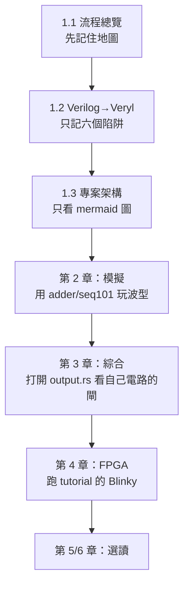

# 1.4 閱讀路線與實驗環境

> 這本書的每一章都配得上機的實驗。本章先給不同背景讀者的閱讀路線，
> 再說明如何用 `examples/` 與 `v2c` 指令重現書中實驗，
> 最後是除錯技巧。深入的逐步操作（安裝、燒板、IDE 使用）留給 `manual/`，
> 這裡只給「讓書跑起來」的最小指令集。

## 1.4.1 兩種讀者，兩條路線

### 學生（第一次接觸 EDA）

目標：建立「設計 → 驗證 → 實體化」的完整心智模型，動手為主。



建議節奏：**每讀完一章就跑一次對應的指令**，把輸出檔案留著對照。
例如讀完第 3 章後，把 `adder.veryl` 的網表 JSON 打開來數一數有幾顆 `$_AND_`。

### 工程師（已會 Verilog，想知道工具內部）

目標：理解演算法與資料結構，以便改工具或寫自己的。

* 1.1 快讀，1.3 當地圖隨查；
* 直接跳第 3 章（綜合）——`elab.rs` 的符號執行是全書最有原創性的部分；
* 第 4 章重點讀 `pnr/place.rs`（退火）與 `pnr/route.rs`（PathFinder）；
* 第 5 章重點讀 `asic/detail.rs` 與 `pdk/`；
* 隨時用 `wc -l` + 本章 1.3 的表格定位檔案。

## 1.4.2 建置與最小實驗

全書實驗只需要三件事（安裝細節見 `manual/02-install.md`）：

```sh
./build.sh          # 編譯 veryl-sim、veryl-eda（release）與 web/dist；--no-web 可跳過網頁
cd examples && veryl check    # 官方語意檢查（需要 Veryl.toml，examples/ 已內建）
v2c help            # 唯一的指令入口：sim list synth fpga asic gatesim cc pdk
```

> **為什麼一定要 `--release`**：模擬與退火佈局都是計算密集的，
> debug 版慢一到兩個數量級，會讓你誤以為演算法太慢。

### 書中實驗對照表

| 章 | 實驗 | 指令 |
|---|---|---|
| 2 | 跑 testbench、看波型 | `cd veryl-sim && cargo run --release -- --vcd /tmp/a.vcd ../examples/src/adder.veryl` |
| 2 | 四值邏輯 / x 傳播 | 同上，改用 `../examples/src/gates.veryl` |
| 2 | 有限狀態機 | `../examples/src/seq101.veryl`（偵測 101 序列） |
| 3 | 看綜合結果 | `cd veryl-eda && cargo run --release -- -o /tmp/adder.json ../examples/src/adder.veryl` |
| 3 | 結構性 Verilog | 加 `--verilog /tmp/adder.v` |
| 3 | 閘級模擬同一 testbench | `v2c gatesim opt ../examples/src/adder.veryl` |
| 4 | iCE40 映射＋位元流 | `v2c fpga ../examples/src/adder.veryl`（深入見 `veryl-eda/test.sh`、`fpga/flow.sh`） |
| 4 | 自家 P&R | `PNR=veryl ./fpga/flow.sh` |
| 5 | vlib ASIC 全流程 | `v2c asic ../examples/src/adder.veryl`（`-v` 看過程） |
| 5 | SKY130 + GDS | 先 `tools/sky130.sh` 下載 PDK，再加 `--gds` |
| 6 | RISC-V SoC + C | `v2c cc examples/c/xxx.c --run`；SoC 模擬需 `examples/src/rvsoc.veryl` + 其 rom |

兩個特殊範例要注意路徑依賴：

* `rv32i.veryl` 是完整的單週期 RV32I 核心，它的 testbench 從生成的
  `rv32i_rom.veryl` 讀程式，所以模擬要**兩個檔案一起給**：
  `veryl-sim ../examples/src/rv32i.veryl ../examples/src/rv32i_rom.veryl`。
* 同理 `rvsoc.veryl` / `rvsoc_rom.veryl`。

## 1.4.3 測試套件當「可以執行的教科書」

`veryl-eda/tests.rs`（1251 行）本身就是閱讀材料：每個場景都是
「綜合 → 閘級模擬 → 檢查斷言」的完整流程，跑一遍：

```sh
cd veryl-eda && cargo test --release
```

`./test.sh` 更進一步：對每個範例設計做 yosys 形式等價
（我們的網表 vs `veryl build` 的輸出，用 `-set-init-zero` 因為
最佳化器假設正反器上電為 0）。**看懂一個 test = 看懂一章。**

## 1.4.4 除錯技巧

### 技巧一：`veryl check` 是語法的 ground truth

當 veryl-sim 或 veryl-eda 報錯時，第一步永遠是分辨「語言錯誤」還是「工具邊界」：

```sh
cd examples && veryl check
```

* 官方也報錯 → 修你的程式（回顧 1.2 的六個陷阱）；
* 官方通過、veryl2chip 報「not supported」→ 我們的邊界，可考慮改寫避開，
  或（工程師讀者）擴充實作。

注意 `veryl check` 必須在**有 Veryl.toml 的目錄**下執行
（`examples/`、`tutorial/` 都是獨立專案）。

### 技巧二：`--vcd` 波形是唯一的真相

行為對不對，不要靠印表達式猜，直接看波型：

```sh
cd veryl-sim
cargo run --release -- --vcd /tmp/x.vcd --max-time 1000 ../examples/src/uart.veryl
gtkwave /tmp/x.vcd
```

`--list` 先看有哪些 module、哪些是 testbench；`--top MODULE` 指定要跑的測試。
除錯節奏：`--list` → `--top` 縮小範圍 → `--vcd` 找第一個錯誤的時刻 →
回 RTL 對照該時刻的訊號。

### 技巧三：合成結果逐層檢查

綜合後行為不對時，按表示法層級往下找：

1. **elaborated 網表**（第 3.6 節的 `elaborated()`）：別名尚未解析的原始形狀，
   最接近你寫的 RTL；
2. **最佳化後網表**：常數折疊、死邏輯清除後的形狀；
3. **映射後**（iCE40/vlib）：只有目標元件；
4. **閘級模擬**：`v2c gatesim` 用**同一個 testbench** 重跑——
   如果 RTL 模擬過、閘級不過，錯在綜合的某個轉換；這是二分問題範圍最快的切法。

### 技巧四：時序問題看 STA 與 icetime

FPGA 路線上，`pnr/sta.rs` 會印出關鍵路徑；外部驗證可用 icetime
（記得 `-C <chipdb>`）。ASIC 路線上 `asic/sta.rs` 的 setup/hold 報告
（Liberty 可用時用 NLDM 查表）是時序收斂的依據。

### 技巧五：網頁 IDE 當視覺化除錯器

`web/dist/index.html` 直接用瀏覽器打開（front-end only、無需 server），
每一個合成階段都有圖。但要注意：**瀏覽器預覽 pane 會把 `file://` 頁面的
腳本截掉**，若要自動化測試網頁請走 HTTP（`.claude/launch.json` 已提供
8766 埠的靜態伺服器）。

## 1.4.5 實驗環境的目錄習慣

書中所有指令都假設你照專案原本的目錄結構工作。幾個容易踩的點：

* **`examples/` 是獨立的 Veryl 專案**（有自己的 Veryl.toml/lock），
  `veryl check` 必須在其中執行；`tutorial/` 同理，兩者的 module 名不能撞
  （`veryl-eda/test.sh` 會把 designs 複製進同一個 gold 專案）。
* **chipdb 位置**：自家 P&R 需要 IceStorm 的 `chipdb-5k.txt`，
  環境變數 `VERYL_EDA_CHIPDB` 可指向它，預設取 oss-cad-suite 的
  `share/icebox`。沒有它時 `v2c fpga` 仍可做映射與外部 nextpnr 流程。
* **輸出檔案都建議放 `/tmp`**：JSON/Verilog/asc/bin 加起來不小，
  且皆可再生，不必汙染工作目錄。

## 1.4.6 範例設計一覽與它在流程中的用途

`examples/src/` 的每個設計在書中都有戲份，先混個臉熟：

| 範例 | 內容 | 書中用途 |
|---|---|---|
| `adder.veryl` | 最小的加法器 + testbench | 第 2/3 章的「Hello World」 |
| `gates.veryl` | 各種邏輯閘與 x 傳播 | 第 2 章四值邏輯 |
| `seq101.veryl` | 有限狀態機（偵測 101） | 第 3 章 DFF 推斷與狀態編碼 |
| `fifo.veryl` / `ram.veryl` / `sync_ram.veryl` | 記憶體類設計 | 第 3.5 節記憶體推斷 |
| `uart.veryl` / `sevenseg.veryl` / `vga.veryl` | 對外週邊 | 第 4 章 FPGA 流程（腳位、pcf） |
| `pkt_reg.veryl` / `gen_rev.veryl` / `max3.veryl` | 語言特性練習 | 第 2 章 Veryl 語法 |
| `rv32i.veryl`（+ rom） | 單週期 RV32I 核心 | 第 3 章綜合壓力測試 |
| `rvsoc.veryl`（+ rom） | 多週期 RV32IMA SoC | 第 6 章 SoC 與 C 編譯器 |
| `traffic.veryl` / `button_counter.veryl` | 虛擬實驗課設計 | 第 6 章虛擬板 |

選實驗材料的原則：**先小後大、先時序後實體**。小設計（adder）讓你能在
一屏之內讀完整個網表 JSON；大設計（rvsoc）只值得看統計數字
（閘數、層數、Fmax），讀內部反而迷失。

## 1.4.7 讀原始碼前先跑 `wc -l` 與 `grep`

本書引用原始碼時標了檔名與大約行號，但程式碼會演化。動手前的兩個小習慣：

```sh
wc -l veryl-eda/src/elab.rs          # 先看規模，決定整讀還是選讀
grep -n "fn always_ff" veryl-eda/src/elab.rs   # 用函式名定位章節對應程式碼
```

`elab.rs` 這種上千行的檔案，`grep -n "^    fn "`（縮排兩層以上的方法）
可以快速列出一張目錄。第 1.3 節的表格＋`grep` 就足以在數千行裡定位任何主題。

## 1.4.8 為什麼這樣設計：書為什麼長這樣

本書刻意把「原理」與「操作」分家：`manual/` 告訴你**怎麼做**，
本書告訴你**為什麼這樣做、演算法長什麼樣、原始碼在哪一行**。
實驗全部使用專案自己的 `examples/`，不引入外部依賴——因為
所有環節（模擬器到 GDS）都是這份程式碼，書中引用的每一個片段
你都能打開原始檔、設中斷點、親眼看它執行。這是「教科書 + 可執行教科書」
的組合：`tests.rs` 與 `test.sh` 是可以跑的習題解答。

## 本章重點

1. 學生路線按章順讀、每章跑一次對應指令；工程師直接跳第 3 章的符號執行。
2. 最小環境：`./build.sh`、`veryl check`（在 examples/ 下）、`v2c help`。
3. 特殊範例要連 rom 一起給：`rv32i.veryl + rv32i_rom.veryl`、`rvsoc.veryl + rvsoc_rom.veryl`。
4. 除錯鐵律：先 `veryl check` 分辨語言錯誤與工具邊界；`--vcd` 找第一個錯誤時刻；
   RTL 過而閘級不過 ⇒ 錯在綜合轉換，用 gatesim 做二分。
5. `cargo test --release` 與 `test.sh` 是可執行的教科書：看懂一個測試＝看懂一章。
