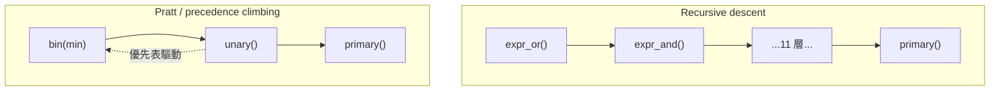

# 2.2 Pratt 表示式剖析

> 原始碼：`veryl-sim/src/expr.rs`
> 上一節：[2.1 Delta 週期與 NBA 排程](02.1-delta週期與NBA排程.md)　下一節：[2.3 精細化與層次展開](02.3-精細化與層次展開.md)

---

## 2.2.1 問題：表示式剖析放在哪一層？

veryl-sim 用 crates.io 的 `veryl-parser` 0.22 取得語法樹，但那棵樹是**完整的** Veryl 語法樹——`Expression` 節點下的二元運算、優先序全部展開，處理它要寫幾百行的 match。veryl-sim 的取捨是：只從語法樹把表示式的 **token 流**收集出來（`elab.rs` 的 `toks()` + `TokenCollector`），再用自己的小型 parser 重新剖析成模擬 IR。這樣：

1. 模擬 IR（`Expr` 列舉）與官方 parser 的內部型別完全解耦；
2. 同一個 parser 可以服務「語法樹的表示式」與「型別寬度 `[hi:lo]`」等多種 token 流；
3. 修改 IR 不必動官方 parser。

```rust
// veryl-sim/src/expr.rs
pub struct P<'a> {
    pub t: &'a [String],   // token 流（veryl-parser 的 TokenCollector 產出）
    pub i: usize,          // 游標
    pub r: Resolver<'a>,   // 名稱 -> 訊號/常數/函數 的回呼（elab 提供）
    pub f: Fielder<'a>,    // struct 欄位回呼
}

pub type Resolver<'a> = &'a dyn Fn(&[String]) -> Option<Res>;
pub type Fielder<'a> = &'a dyn Fn(usize, &str) -> Option<(u32, u32)>;
```

注意這是**語意回呼式**的 parser：它不知道什麼是 package、enum 或訊號，全部委託給 `Resolver`。這使得 `expr.rs` 只有 331 行，而且被 veryl-sim 與 veryl-eda 共用。

## 2.2.2 Pratt parser 與 binding power

Pratt parser（Vaughan Pratt, 1973，"Top down operator precedence"）的核心思想：**每個 infix 運算子帶一個數值「結合力」（binding power），遞迴函式用一個最小門檻 `min` 決定要不要把右側吸進來**。

剖析 `a + b * c`：

1. `unary()` 取得 `a` 為 lhs。
2. 看到 `+`，優先級 9 ≥ min(0)，吃掉；以 `min = 10` 遞迴剖析右側。
3. 右側取得 `b`；看到 `*`，優先級 10 ≥ 10，吃掉；`c` 成為它的 rhs。
4. 回到外層：lhs = `a + (b*c)`。

結合力高於門檻才綁定，這一行就是整個優先序系統：

```rust
// veryl-sim/src/expr.rs
fn binprec(op: &str) -> Option<(u8, bool)> {
    Some(match op {
        "||" => (1, false),
        "&&" => (2, false),
        "|" => (3, false),
        "^" | "~^" | "^~" => (4, false),
        "&" => (5, false),
        "==" | "!=" | "==?" | "!=?" | "===" | "!==" => (6, false),
        "<:" | "<=" | ">:" | ">=" => (7, false),
        "<<" | ">>" | "<<<" | ">>>" => (8, false),
        "+" | "-" => (9, false),
        "*" | "/" | "%" => (10, false),
        "**" => (11, true),
        _ => return None,
    })
}
```

回傳 `(優先級, 右結合?)`。主迴圈：

```rust
// veryl-sim/src/expr.rs
fn bin(&mut self, min: u8) -> Result<Expr, String> {
    let mut lhs = self.unary()?;
    loop {
        let op = match self.peek() { Some(o) => o.to_string(), None => break };
        let Some((p, right)) = binprec(&op) else { break };
        if p < min { break; }
        self.i += 1;
        let rhs = self.bin(if right { p } else { p + 1 })?;   // ★ 核心
        lhs = Expr::Bin(op, Box::new(lhs), Box::new(rhs));
    }
    Ok(lhs)
}
```

`p + 1` 對左結合運算子強制「同級不右吸」：剖析 `a - b - c` 時右側 `bin(10)` 遇到第二個 `-`（優先級 9 < 10）就停，所以得到 `(a-b)-c`。`**` 右結合，回傳 `p` 本身，`a ** b ** c` 得到 `a ** (b ** c)`——與數學慣例一致。

### 運算子優先表（expr.rs 的實際值）

| 層級 | 運算子 | 結合 | 備註 |
|---|---|---|---|
| 11 | `**` | 右 | 指數（模擬器以平方乘法計算） |
| 10 | `*` `/` `%` | 左 | |
| 9 | `+` `-` | 左 | |
| 8 | `<<` `>>` `<<<` `>>>` | 左 | `<<<`/`>>>` 為算術移位 |
| 7 | `<:` `<=` `>:` `>=` | 左 | Veryl 用 `<:`/`>:` 避開泛型掃描器問題 |
| 6 | `==` `!=` `==?` `===` … | 左 | |
| 5 | `&` | 左 | |
| 4 | `^` `~^` `^~` | 左 | |
| 3 | `\|` | 左 | |
| 2 | `&&` | 左 | |
| 1 | `\|\|` | 左 | |

三元 `? :` 不在表裡——它由 `expr()` 特別處理（見 2.2.4）。

## 2.2.3 與 recursive descent 的比較

教科書的另一個選擇是 recursive descent：每個優先級寫一個函式 `expr_or → expr_and → expr_bitor → ...`。兩者比較：



| 面向 | Recursive descent | Pratt |
|---|---|---|
| 程式碼量 | 每個優先級一個函式（~10 層） | 一個 `bin()` + 優先表 |
| 新增運算子 | 改兩層函式與層級順序 | 表中加一行 |
| 閱讀優先序 | 需讀函式呼叫鏈 | 一張表看盡 |
| 特殊語法（`? :`、後綴） | 容易插入 | 也可插入，但要繞過 `bin` |
| 效能 | 相當（皆為 O(n) 單遍） | 相當 |

Pratt 實際上是 recursive descent 的**表格化壓縮**：把 10 個同構函式折疊成 `bin(min)` 加一張表。veryl-sim 選 Pratt 的決定性理由是「Veryl 的優先序已在語法樹/規格中定死，模擬器只需要忠實重現，不必為每層寫儀式」。

## 2.2.4 特殊形式：三元、一元、後綴

**三元運算子**走 `expr()` 的特別路徑（Veryl 語法是 `if c ? a : b`）：

```rust
// veryl-sim/src/expr.rs
pub fn expr(&mut self) -> Result<Expr, String> {
    if self.peek() == Some("if") {
        self.i += 1;
        let c = self.bin(0)?;         // 條件：完整二元層
        self.expect("?")?;
        let a = self.expr()?;         // 兩分支允許巢狀三元（右結合）
        self.expect(":")?;
        let b = self.expr()?;
        return Ok(Expr::Tern(Box::new(c), Box::new(a), Box::new(b)));
    }
    self.bin(0)
}
```

**一元運算子**（含約化：`&a`、`|a`、`^a` 及其反相）在 `unary()` 中右遞迴：

```rust
fn unary(&mut self) -> Result<Expr, String> {
    if let Some(op) = self.peek() {
        if matches!(op, "+" | "-" | "!" | "~" | "&" | "|" | "^" | "~&" | "~|" | "~^" | "^~") {
            let op = op.to_string();
            self.i += 1;
            let e = self.unary()?;
            return Ok(Expr::Un(op, Box::new(e)));
        }
    }
    self.primary()
}
```

**後綴**（struct 欄位 `.f`、位選 `[i]`、切片 `[hi:lo]`、重複串接 `{n{a}}`）在 `primary()` 尾端用迴圈疊加，支援鏈式組合如 `s.field[i]`：

```rust
// veryl-sim/src/expr.rs  primary() 尾端（節錄）
while self.peek() == Some(".") {
    let Expr::Sig(sig) = e else { return Err("field access on non-signal".into()) };
    self.i += 1;
    let fname = self.next()...;
    let Some((lo, w)) = (self.f)(sig, &fname) else { ... };
    // 欄位存取直接降為 Slice：struct 是連續位元的窗口
    e = Expr::Slice(Box::new(Expr::Sig(sig)), ..., 0);
}
while self.peek() == Some("[") { ... Expr::Index / Expr::Slice ... }
```

一個值得注意的設計：struct 欄位存取**不在 IR 中留節點**，直接變成位元切片（`Expr::Slice`）。因為 packed struct 的欄位只是連續位元的窗口（第一欄在 MSB），切片語意已完整覆蓋，省去一層間接。

## 2.2.5 識別字解析：路徑與介面成員

`primary()` 的識別字分支處理三種形態：

```rust
// veryl-sim/src/expr.rs（節錄、註解改寫）
_ if c.is_ascii_alphabetic() || c == '_' => {
    // 1. 可能帶 scope 的路徑：a、a::b、a::b::c
    let mut path = vec![t.clone()];
    while self.peek() == Some("::") && /* 下一個是識別字 */ {
        self.i += 1;
        path.push(self.next().unwrap());
    }
    // 2. 介面成員：`inst.member` 變成單一名稱訊號
    while path.len() == 1 && self.peek() == Some(".") {
        let cand = format!("{}.{}", path[0], m);
        if (self.r)(&[cand.clone()]).is_none() { break; }
        self.i += 2;
        path[0] = cand;
    }
    match (self.r)(&path) {
        Some(Res::Sig(i)) => Expr::Sig(i),
        Some(Res::Arr(i)) => Expr::Elem(i, ...),
        Some(Res::Const(v)) => Expr::Num(v),
        Some(Res::Fn(name)) => { let args = self.args()?; return Ok(Expr::Call(name, args)); }
        None => return Err(format!("undeclared identifier '{}'", ...)),
    }
}
```

`inst.member` 的處理是「嘗試性」的：先問 Resolver 這個合成名存不存在，存在才消費 `.`——不存在就把 `.` 留給後面的 struct 欄位處理。一個 `.` 在 Veryl 裡有兩種語意（介面成員 vs struct 欄位），模擬器用「哪個解析得通」來區分，這正是 AGENTS.md 所述「非 struct 欄位的 `x.y` 是訊號 `x.y`」的實作。

## 2.2.6 數字字面值

`parse_num()` 支援 Veryl 的完整字面值語法：寬度前綴 `'h`、有號 `'s`、底線分隔、`'0 '1 'x` 全位元字面值、以及十六進位中的 x 位元：

```rust
// veryl-sim/src/expr.rs（節錄）
let bits = match c.to_ascii_lowercase() { 'b' => 1, 'o' => 3, 'h' => 4, 'd' => 0, ... };
let (mut v, mut x) = (Bits::ZERO, Bits::ZERO);
...
for d in digits {
    v = v << bits;
    x = x << bits;
    match d {
        'x' | 'X' | 'z' | 'Z' | '?' => x = x | ((1u128 << bits) - 1),  // 該 digit 全 x
        _ => v = v | d.to_digit(1 << bits)? as u128,
    }
}
```

`'h1x` 之類的字面值直接產生帶 x 位元的 `Val`（v/x 雙軌表示，見 2.4 節），不需要事後轉換。**貪心無寬度整數**（無 `'`）至少取 32 位：`let need = (128 - v.leading_zeros()).max(1); ... need.max(32)`，符合「無寬度字面值至少 32 bit」的 Verilog 慣例。

## 2.2.7 錯誤恢復與 `parse_expr` 的完整性檢查

```rust
pub fn parse_expr(toks: &[String], r: Resolver, f: Fielder) -> Result<Expr, String> {
    let mut p = P { t: toks, i: 0, r, f };
    let e = p.expr()?;
    if p.i != toks.len() {
        return Err(format!("unexpected token '{}' in expression `{}`", toks[p.i], toks.join(" ")));
    }
    Ok(e)
}
```

剖析完必須消費完所有 token——這句檢查會抓出「`a + )`」之類的殘留。所有錯誤以 `String` 回報（帶 token 上下文），沒有錯誤恢復：模擬器輸入是已被官方 parser 驗證過的語法樹，語法錯誤極少，遇到就整批中止即可。

## 為什麼這樣設計

1. **token 流 + 自有 parser，而非用官方語法樹**：IR 穩定、兩個 crate 共用、行數少。代價是 token 化掉失了原始位置資訊——錯誤訊息只能引用 token 文字而非行列號（模擬器的錯誤通常在語意層，可接受）。
2. **Pratt 而非 recursive descent**：優先序是一張 12 行的表，改動集中；`bin(min)` 一個函式承載全部二元邏輯。
3. **語意回呼（Resolver/Fielder）**：parser 不認識 scope 與型別，與 elab 完全解耦；`expr.rs` 因此能被 veryl-eda 直接重用（它有自己的 `resolve_path`）。
4. **struct 欄位降為切片**：少一個 IR 節點、少一層 eval case，且位元視窗語意與 packed struct 的記憶體布局一一對應。

## 本章重點

- Pratt parser = 一個帶門檻 `min` 的遞迴函式 + 優先表；`p < min` 停、`p + 1` 保左結合、`p` 保右結合。
- `expr.rs` 的 `binprec` 表是 Veryl 優先序的單一真實來源（`**` 最高且右結合，`||` 最低）。
- 三元在 `expr()` 特判、一元在 `unary()`、後綴在 `primary()` 尾端疊加。
- `Resolver`/`Fielder` 回呼讓 parser 與語意層解耦；`inst.member` 用「嘗試解析」與 struct 欄位共存。
- 數字字面值剖析直接產出 x 位元雙軌 `Val`，與 4 值邏輯無縫銜接。
