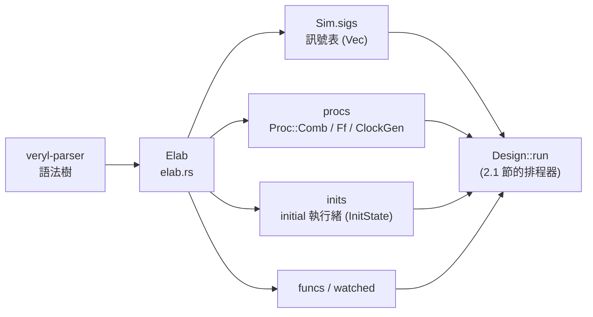
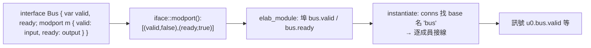

# 2.3 精細化與層次展開

> 原始碼：`veryl-sim/src/elab.rs`（主體）、`iface.rs`（modport）、`gen.rs`（generate-for）
> 上一節：[2.2 Pratt 表示式剖析](02.2-Pratt表示式剖析.md)　下一節：[2.4 四值邏輯位元向量](02.4-四值邏輯位元向量.md)

---

## 2.3.1 精細化（elaboration）在做什麼

語法樹描述的是「怎麼寫」，模擬器需要的是「怎麼跑」。精細化把原始碼轉換成可執行的模擬 IR：



具體工作有四件：

1. **展開層次**：`inst` 實例化子模組，把子模組的訊號/程序複製進來，埠用組合程序接線。
2. **代入參數**：`#(W: 8)` 之類的參數覆寫在展開時固定為常數。
3. **解決名字**：所有識別字綁到訊號索引（`usize`），之後執行不再查表。
4. **降級語法**：`if_reset` 變成普通 `if`，產生區塊展開、函式註冊、modport 拆成逐成員埠。

關鍵決策：**層次被完全攤平**。實例 `u0.core.pc` 是一個訊號的完整名字，不是「core 物件的 pc 欄位」。沒有實例樹、沒有動態查詢——模擬時每個訊號就是 `sigs[i]`。

## 2.3.2 訊號表與 Scope

```rust
// veryl-sim/src/sim.rs
pub struct Signal {
    pub name: String,          // 展開後的完整名（"u0.core.pc"）
    pub w: u32,
    pub signed: bool,
    pub kind: Kind,            // Normal / Clock / Reset
    pub val: Val,
    pub arr: Option<u32>,      // 陣列：本訊號是第 0 元素，後面 n 個連續
    pub fields: Vec<(String, u32, u32)>,   // struct 欄位 (名, 位元偏移, 寬)
}
```

```rust
// veryl-sim/src/elab.rs
#[derive(Default, Clone)]
pub struct Scope {
    pub prefix: String,                    // 層次前綴，如 "u0.core"
    pub sigs: HashMap<String, usize>,      // 區域名 -> 訊號索引
    pub params: HashMap<String, Val>,      // 參數/常數
    pub ports: Vec<(String, Dir, usize)>,  // 埠（供上層接線）
    pub imports: HashMap<String, String>,  // import Pkg::* 的別名
}
```

`Scope` 是精細化的「局部環境」。子模組展開時建立新的 `Scope`，`prefix` 串上實例名——訊號全名的產生就在 `declare()`：

```rust
// veryl-sim/src/elab.rs  declare()（節錄）
let full = if sc.prefix.is_empty() { name.to_string() } else { format!("{}.{}", sc.prefix, name) };
let id = self.sim.sigs.len();
self.sim.sigs.push(Signal { name: full, ..., val, ... });
sc.sigs.insert(name.to_string(), id);
```

陣列的表示特別值得一提：**`arr: Some(n)` 的訊號後面緊跟著 n 個元素訊號**，`name[i]` 在 `sim.rs` 的 eval 中是 `self.sigs[*base + idx.v.sat() as usize]`——陣列存取退化成一次加法與一次索引，沒有間接層。

## 2.3.3 兩遍掃描

`elab_module` 分兩遍處理模組項目：

```rust
// veryl-sim/src/elab.rs
pub fn elab_module(&mut self, m: &'a ModuleDeclaration, prefix: &str, ov: &HashMap<String, Val>) -> R<Scope> {
    let mut sc = Scope { prefix: prefix.to_string(), ..Default::default() };
    if let Some(wp) = &m.module_declaration_opt1 { self.params(&mut sc, &wp.with_parameter, ov)?; }
    // 埠（含 modport 拆解，見 2.3.6）
    ...
    // pass 1: 宣告（其他項目可能引用）
    for it in &items { self.pass1(&mut sc, it)?; }
    // pass 2: 行為
    let cx = Cx { reset: None };
    for it in &items { self.pass2(&mut sc, it, &cx)?; }
    Ok(sc)
}
```

**為什麼要兩遍？** Veryl 允許 `always_comb` 引用在檔案中較晚宣告的訊號（硬體描述沒有「先宣告後使用」的執行序概念）。pass 1 處理 `var`/`const`/`let`/`import`/`$tb::*` 實例這類「宣告」；pass 2 處理 `always_comb`/`always_ff`/`initial`/`inst` 這類「行為」。若單遍處理，先出現的行為區塊將引用到未宣告的訊號。

## 2.3.4 參數代入

參數在展開時變成 `Scope::params` 裡的常數 `Val`：

```rust
// veryl-sim/src/elab.rs  params()（節錄）
let mut val = if let Some(v) = ov.get(&name) { *v }                 // 實例的 #(...) 覆寫
              else if let Some(o) = &it.with_parameter_item_opt {
                  let t = toks(|c| c.expression(&o.expression));
                  self.const_in(&sc, &t)?                            // 預設值（可引用前面的參數）
              } else { return Err(format!("parameter '{}' has no value", name)) };
if let Some(ty) = ty { val = val.resize(ty.w).signed(ty.signed); }
sc.params.insert(name, val);
```

兩個要點：

1. **參數不求值於執行期**。`const_in()` 用一個全新的 `Sim` 核心求值表示式（`elab.rs`），得到的 `Val` 存進 `params`；之後 `resolve_path` 看到 `W` 就直接回 `Res::Const`，表示式剖析器把它變成 `Expr::Num`。**參數在 IR 裡已消失**——型別寬度 `logic<W>`、陣列大小、case 條件全部在精細化時固化。這使模擬熱路徑零參數查找。
2. **同一模組的不同參數化各自完整展開**。`counter #(W: 8)` 與 `counter #(W: 16)` 是兩份獨立的訊號與程序；沒有「模組型別」共享。這是空間換簡單，RTL 模擬的展開數量通常可接受。

## 2.3.5 inst 展開與埠連接

`instantiate()`（elab.rs）是層次展開的核心。對普通模組：

```rust
// veryl-sim/src/elab.rs（節錄）
let prefix = if sc.prefix.is_empty() { iname.clone() } else { format!("{}.{}", sc.prefix, iname) };
let csc = match (&gate, child) {
    (Some(g), _) => self.elab_gates(g, &prefix)?,       // 閘級網表（2.7 節）
    (None, Some(m)) => self.elab_module(m, &prefix, &ov)?,   // 遞迴展開 RTL
    _ => unreachable!(),
};
for (pname, dir, psig) in &csc.ports {
    let (base, member) = match pname.split_once('.') { Some((b, m)) => (b.to_string(), Some(m.to_string())), None => (pname.clone(), None) };
    let Some((_, expr)) = conns.iter().find(|(n, _)| *n == base) else { continue };
    ...
    let e = self.parse_in(sc, &t)?;
    match dir {
        Dir::In  => self.procs.push(Proc::Comb(vec![Stmt::Assign(LValue { sig: *psig, ... }, e)])),
        Dir::Out => self.procs.push(Proc::Comb(vec![Stmt::Assign(lv, Expr::Sig(*psig))])),
        Dir::Inout => return Err("inout ports are not supported".into()),
    }
}
```

**埠連接就是組合程序**：輸入埠「每個 delta 輪把父層運算式寫入子層訊號」，輸出埠反向。沒有專屬的連接機制——接線與 `assign` 用同一套 `Proc::Comb`，語意天然一致（包含 delta 延遲的行為）。輸出埠的 `port: _` 允許懸空（直接 `continue`）。

```mermaid
flowchart TB
    subgraph Parent["父層 (prefix="")"]
        W["wire data[7:0]"]
    end
    subgraph Child["inst u0: Counter (prefix=u0)"]
        P1["port din (In)"]
        P2["port cnt (Out)"]
    end
    W -- "Proc::Comb: u0.din = data" --> P1
    P2 -- "Proc::Comb: data = u0.cnt" --> W
```

## 2.3.6 介面與 modport（iface.rs）

Veryl 的介面把一組訊號打包。veryl-sim 不建介面物件，而是**把實例的成員直接命名為 `inst.member` 訊號**：

```rust
// veryl-sim/src/elab.rs  instantiate() 的介面分支（節錄）
if let Some(&d) = self.ifaces.get(&kind) {
    // an interface instance: its variables become `inst.member` signals here
    ...
    let mut isc = Scope { prefix, ..Default::default() };
    if let Some(wp) = &d.interface_declaration_opt1 { self.params(&mut isc, &wp.with_parameter, &ov)?; }
    let items = crate::iface::items(d);
    for it in &items { self.pass1(&mut isc, it)?; }
    for it in &items { self.pass2(&mut isc, it, &cx)?; }
    for (n, id) in &isc.sigs { sc.sigs.insert(format!("{}.{}", iname, n), *id); }
    return Ok(());
}
```

`iface.rs` 負責從語法樹抽取介面的兩種資訊：`items()`（介體的變數與邏輯）與 `modport()`（成員與方向）。modport 解析的關鍵：**方向是「從使用模組這一側看」**：

```rust
// veryl-sim/src/iface.rs  modport()（節錄）
/// members of modport `mp`: (member, is output from the module's side)
pub fn modport(d: &InterfaceDeclaration, mp: &str) -> Result<Vec<(String, bool)>, String> {
    ...
    while i < body.len() {
        if body[i] == ".." {
            // ..input / ..output：其餘成員全部同方向
            // ..same(other) / ..converse(other)：沿用另一 modport 的方向（或反轉）
        }
        let (member, dir) = (body[i].clone(), ...);
        match dir {
            "input" => out.push((member, false)),
            "output" => out.push((member, true)),
            "import" => {} // a function import: nothing to connect
            o => return Err(...),
        }
        i += 3;
    }
```

modport 的使用端在 `elab_module` 的埠迴圈：`port bus: modport Bus::master` 拆成**每個成員一個埠**，埠名 `bus.valid`、`bus.ready`……：

```rust
// veryl-sim/src/elab.rs（節錄）
Direction::Modport(_) => {
    // `bus: modport Bus::master`: one port per member, named `bus.member`
    ...
    for (member, out) in crate::iface::modport(d, &mp)? {
        let ty = types.get(&member)...;
        let full = format!("{}.{}", name, member);
        let id = self.declare(&mut sc, &full, &ty);
        sc.ports.push((full, if out { Dir::Out } else { Dir::In }, id));
    }
    continue;
}
```

之後實例連接時，`split_once('.')` 找出 `bus` 是連接的基礎名，把 `u0.bus` 展開成 `u0.bus.valid` 等逐一接線（`instantiate()` 中的 member 邏輯）。整條路徑：



介面在運算式中的讀取也順手解決：`x.ready` 若 `x.ready` 是訊號名（介面成員）就用它，否則落到 struct 欄位路徑（2.2.5 節的嘗試式解析）。

## 2.3.7 generate-for：迴圈變數是常數參數

`gen.rs` 只有 24 行，是兩個 crate 共用的純函式——把 `for i in 0..N` 的範圍展開成索引列表：

```rust
// veryl-sim/src/gen.rs（節錄）
pub fn for_indices(from: u128, to: u128, inclusive: bool, rev: bool, step: Option<(&str, u128)>) -> Result<Vec<u128>, String> {
    let end = if inclusive { to.checked_add(1)... } else { to };
    let mut v = vec![];
    let mut i = from;
    while i >= from && i < end {
        v.push(i);
        if v.len() > 1 << 20 { return Err("generate loop runs away".into()); }
        let next = match step {
            None | Some(("+=", _)) => i.checked_add(step.map(|s| s.1).unwrap_or(1)),
            Some(("-=", k)) => i.checked_sub(k),
            ... // *= <<= >>= 皆支援
        };
        match next { Some(n) if n != i => i = n, _ => break }
    }
    if rev { v.reverse(); }
    Ok(v)
}
```

使用它的是 `elab.rs` 的 `gen_for()`，其手法是本節最重要的一課：

```rust
// veryl-sim/src/elab.rs  gen_for()（節錄）
for i in idx {
    let mut inner = Scope { prefix: sc.prefix.clone(), sigs: sc.sigs.clone(),
                            params: sc.params.clone(), ports: vec![], imports: sc.imports.clone() };
    inner.params.insert(var.clone(), Val::new(32, i));   // ★ 迴圈變數 = 常數參數
    for it in &items { self.pass1(&mut inner, it)?; }
    for it in &items { self.pass2(&mut inner, it, cx)?; }
    // merge any newly declared signals back
    for (k, v) in &inner.sigs { sc.sigs.entry(k.clone()).or_insert(*v); }
}
```

**每個展開次克隆一份 Scope，把迴圈變數 `i` 塞進 `params`**。於是迴圈體內 `genblk[i].reg[i]` 之類的引用，在 `resolve_path` 看來與普通參數無異——`Expr::Num` 常數。宣告的新訊號名字裡自然含有展開的索引，合併回外層 scope（`or_insert` 保證不覆蓋已有名稱）。

代價是「每個展開次複製整個 scope」——對 1024 次展開的設計，這是 O(N²) 的 HashMap 複製。這是刻意取捨：generate-for 的常見用法（十到百次展開）完全無感，而克隆讓每個展開次是一個封閉、可獨立精細化的世界，不用處理「迴圈變數是活的」的各種邊角。

generate-if 則簡單得多：條件用 `const_eval` 判真假，**只精細化選中的分支**，未選分支完全不存在於 IR（`gen_if()`）。

## 2.3.8 函式與 if_reset 的降級

函式（`decl_function`）註冊進 `sim.funcs`，參數與回值都是普通訊號（`$ret`），呼叫時綁參、執行 body、讀回 `ret_val`（見 sim.rs `call_user`）。函式內部禁止遞迴（`in_call` 檢查）。

`if_reset` 在 `lower_stmt` 中降級為普通 if，條件由精細化時注入的 reset 上下文（`Cx::reset`）決定：

```rust
// veryl-sim/src/elab.rs（節錄）
Statement::IfResetStatement(x) => {
    let (r, low) = cx.reset.ok_or("if_reset used without a reset signal")?;
    let active = Expr::Bin("==".into(), Box::new(Expr::Sig(r)), Box::new(Expr::Num(Val::new(1, if low { 0 } else { 1 }))));
    ...
}
```

`Cx` 沿著區塊遞迴下傳，所以巢狀的 `if_reset` 也得到同一個 reset 訊號——`always_ff` 的 reset 感知只寫一次（`always_ff()` 中從型別 `Kind::Reset` 推斷，或從 body 是否含 `if_reset` token 反查）。

## 為什麼這樣設計

1. **完全攤平層次**：模擬熱路徑上只有 `sigs[i]` 與程序陣列；沒有實例樹遍歷、沒有動態名字查找。名字只在精細化時有意義。
2. **埠連接 = 組合程序**：一種機制服務 assign、接線、介面成員連接三種語法，delta 行為處處一致。
3. **modport 拆成逐成員埠**：不保留介面物件，埠的方向語意（從使用端看）在拆解時固化；`inst.member` 訊號命名使運算式解析零特判。
4. **參數與迴圈變數在精細化時消失**：所有「可變的常數」在展開時固化為 `Val`，IR 只剩訊號與程序。這是「精細化 = 特殊化」的一貫哲學：把編譯期能算的全算完。
5. **克隆 scope 換封閉性**：generate 每次展開是獨立世界，合併只做 `or_insert`；不支援的邊角（如跨次引用彼此的局部訊號）寧可報錯也不引入半吊子行為。

## 本章重點

- 精細化把語法樹降為扁平 IR：`sigs`（訊號表）、`procs`（Comb/Ff/ClockGen）、`inits`、`funcs`、`watched`。
- 兩遍掃描（宣告→行為）解決前向引用；參數透過 `const_in` 在展開時固化為常數。
- 實例展開遞迴 `elab_module`，prefix 串接產生全名；埠連接就是 `Proc::Comb` 指派。
- 介面實例的成員變成 `inst.member` 訊號；modport 在使用端拆成逐成員埠，方向從使用端看（`iface::modport`）。
- generate-for 的迴圈變數是塞進克隆 Scope 的常數參數（`gen::for_indices` + `gen_for`）；每次展開精細化一個封閉世界。
- `if_reset` 依 `Cx::reset` 降級為普通 if；reset 屬性由訊號型別 `Kind::Reset` 提供。
