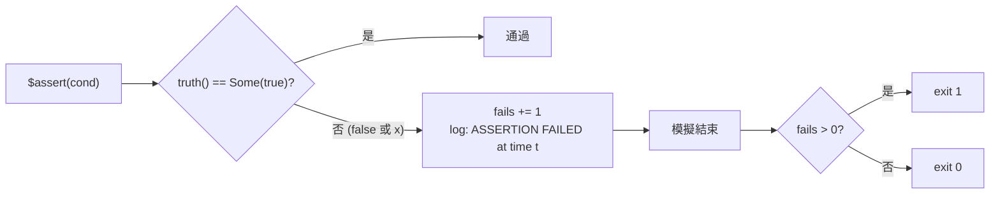
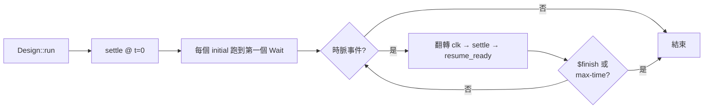

# 2.5 時脈與測試平台

> 原始碼：`veryl-sim/src/elab.rs`（`$tb::*` 與 initial）、`veryl-sim/src/sim.rs`（執行、斷言）
> 上一節：[2.4 四值邏輯位元向量](02.4-四值邏輯位元向量.md)　下一節：[2.6 VCD 波型輸出](02.6-VCD波型輸出.md)

---

## 2.5.1 測試平台的形狀

Veryl 沒有獨立的 testbench 語言；testbench 就是**帶 `#[test(...)]` 屬性的模組**，實例化被測模組（DUT），用兩個內建「元件」驅動時脈與 reset：

```veryl
#[test(TestCounter)]
module TestCounter {
    var clk: clock;
    var rst: reset;

    inst clk_gen: $tb::clock_gen;         // 實例本身就是時脈
    inst rst_gen: $tb::reset_gen(clk);    // 括號裡告訴它跟哪個時脈

    inst dut: Counter;                    // 被測模組

    initial {
        rst_gen.assert();                 // 拉低 reset 兩個時脈
        clk_gen.next(10);                 // 跑 10 個 posedge
        $assert(dut.cnt == 10, "count mismatch");
    }
}
```

veryl-sim 對這兩個 `$tb::*` 實例有特殊處理（pass1，elab.rs）：

```rust
// veryl-sim/src/elab.rs  pass1()（節錄）
GenerateItem::InstDeclaration(x) => {
    ...
    match kind.as_str() {
        "$tb::clock_gen" => {
            let mut half = 5;
            if let Some(p) = &ci.component_instantiation_opt1 {
                ... // 參數 PERIOD 可覆寫半週期
            }
            let ty = TypeInfo::scalar(1);
            let id = self.declare(sc, &name, &TypeInfo { kind: Kind::Clock(true), two_state: true, ..ty });
            self.procs.push(Proc::ClockGen { sig: id, half });
        }
        "$tb::reset_gen" => {
            let id = self.declare(sc, &name, &TypeInfo { kind: Kind::Reset { low: true, asynch: true }, two_state: true, ..ty });
            self.sim.sigs[id].val = Val::new(1, 1);      // 上電為 1（高有效的 reset）
            // `inst rst: $tb::reset_gen(clk);` — remember the clock
            if let Some((_, first)) = conns.first() {
                if let Some(c) = sc.sigs.get(&t[0]) { self.tb_clk.insert(id, *c); }
            }
        }
        _ => {}
    }
```

三個細節：

1. **「實例就是時脈」**：`inst clk_gen: $tb::clock_gen` 產生的訊號 `clk_gen` 本身被宣告成 `Kind::Clock(true)`，`Proc::ClockGen { sig: id, half }` 每 `half` 個時間單位翻轉它。Testbench 直接引用 `clk_gen` 當時脈，不需要額外的 `assign clk = clk_gen;`。AGENTS.md 所述「the inst IS the clock」即此。
2. **預設半週期 5**（PERIOD 10），時間尺度由 `--max-time` 與 VCD 的 `1ns` 標籤解讀。
3. **reset_gen 記住時脈**：連接埠 `reset_gen(clk)` 的第一個參數被存進 `tb_clk` 表，之後 `rst_gen.assert()` 不帶參數也知道要等哪個時脈。

## 2.5.2 rst.assert() 的展開

`rst_gen.assert()` 不是函式呼叫，而是精細化時**降級為三條敘述**：

```rust
// veryl-sim/src/elab.rs  lower_ident_stmt()（節錄）
"assert" => {
    let clk = match args.first() {
        Some(t) => *sc.sigs.get(&t[0])...,
        None => *self.tb_clk.get(&inst).ok_or("rst.assert() needs a clock ...")?,
    };
    let lv = LValue { sig: inst, sel: Sel::All };
    out.push(Stmt::Assign(lv.clone(), Expr::Num(Val::new(1, 0))));   // reset 拉低
    out.push(Stmt::Wait(clk, Expr::Num(Val::new(32, 2))));           // 等 2 個 posedge
    out.push(Stmt::Assign(lv, Expr::Num(Val::new(1, 1))));           // 釋放
    return Ok(());
}
```

展開結果等價於：

```veryl
rst = 0; clk.next(2); rst = 1;
```

低有效非同步 reset 的 DUT 收到 0 就進入 reset 狀態；兩個 posedge 後釋放。寫成內建而非讓使用者手寫，是為了消除「reset 釋放與時脈緣同時」的 race（`clk.next(2)` 保證在 edge 之間釋放）。

## 2.5.3 clk.next(n)：initial 的等待機制

`clk_gen.next(n)`（或任何實例 `.next(n)`）降級為 `Stmt::Wait(inst, n)`，由 `compile_initial` 編成 `Op::Wait`：

```rust
// veryl-sim/src/sim.rs  compile_initial()（節錄）
pub fn compile_initial(stmts: &[Stmt], ops: &mut Vec<Op>, watched: &mut Vec<usize>) {
    for s in stmts {
        if !has_wait(s) { ops.push(Op::Exec(s.clone())); continue; }   // 無等待：內聯
        match s {
            Stmt::Wait(c, n) => { watched.push(*c); ops.push(Op::Wait(*c, n.clone())); }
            Stmt::If(arms, els) => { /* 編成 JmpIfNot / Jmp */ }
            Stmt::For { .. } => { /* 編成回圈：Jmp / JmpIfNot */ }
            ...
        }
    }
}
```

含 `Wait` 的敘述（及其所在的 if/for）被「攤平」為 op 序；不含 Wait 的敘述整塊內聯為 `Op::Exec`（執行時一次 exec）。控制流程用 `Op::Jmp`/`Op::JmpIfNot`——**一個小虛擬機**，而非遞迴直譯，因為 `Wait` 需要在任意巢狀深度「暫停並稍後從原處恢復」，平坦 op 序 + pc 是最簡單的暫停點表示。

執行側（2.1.5 節已述）：

```rust
// veryl-sim/src/sim.rs  run_init()（節錄）
Op::Exec(s) => {
    self.sim.exec(std::slice::from_ref(&s), false);
    self.settle();                       // ★ 每條敘述後收斂
}
Op::Wait(clk, n) => {
    let n = self.sim.eval(&n, 0).v.sat();
    if n > 0 { self.inits[k].wait = Some((clk, n)); return; }   // 暫停
}
```

`Wait` 的計數在 `settle()` 每輪偵測到 watched 訊號的 posedge 時遞減；歸零後由 `resume_ready()` 恢復執行。多個 initial 各自持有 `InitState`，互不干擾（協作式，不搶佔）。

## 2.5.4 斷言與 exit code

`$assert(expr, "msg")` 的執行（sim.rs `call()`）：

```rust
// veryl-sim/src/sim.rs
"$assert" => {
    let ok = args.first().map(|e| self.eval(e, 0).truth() == Some(true)).unwrap_or(false);
    if !ok {
        let msg = if args.len() > 1 { self.format(&args[1..]) } else { String::new() };
        self.say(&format!("ASSERTION FAILED at time {} {}", self.time, msg), true);
        self.fails += 1;
    }
}
```

重點在 `truth() == Some(true)`：**x 條件算失敗**。`$assert(a == b)` 在 a 或 b 含 x 時，`==` 回 x（2.4.4 節），`truth()` 回 `None`，斷言失敗——正確行為，因為「不知道」不該被當成通過。

失敗計入 `sim.fails`；CLI 依它決定 exit code（main 的收尾：`fails > 0` → 1）。這使 `cargo test`/CI 可以直接用 exit code 判斷模擬結果。`$error`/`$fatal` 同樣計入（`$fatal` 額外設 `finished` 終止模擬）；`$finish` 只終止不計失敗。



## 2.5.5 為什麼每條 initial 敘述後都收斂

標準 Verilog 模擬器只在「時間槽」邊界做排程；`initial` 中連續兩條阻塞敘述之間**不會**有組合邏輯更新——這導致經典的 testbench 寫法必須在賦值後加 `#1` 之類的延遲才能觀察組合結果。

veryl-sim 做了不同的選擇：`run_init` 的 `Op::Exec` 之後**立即 `settle()`**。效果：

```veryl
initial {
    a = 1;              // 驅動 DUT 輸入
    $display(b);        // 立刻看到組合傳播後的 b —— 不需要任何延遲
}
```

這使得**時脈less 組合 testbench** 成為自然結果：DUT 是純組合邏輯（無 `always_ff`）時，testbench 不需要例項化任何時脈，賦值→讀值→斷言一氣呵成，`Design::run` 的主迴圈甚至沒有時脈事件可排（堆積空，立即結束）。

實作代價：每條敘述一次完整 `settle()`（組合收斂 + edge 檢查）。對 testbench 語句數量而言可忽略；換來的是語意上「模擬器總是給你穩定後的世界」，testbench 程式碼大幅簡化。這是 AGENTS.md 所述「The sim settles combinational logic after every `initial` statement (delta cycles), so clock-less comb testbenches work」的來源。

## 2.5.6 多個 initial 與執行緒間的次序

多個 `initial` 區塊的排程是**確定性**的：`Design::run` 先依序把每個 initial 跑到第一個 `Wait`（或跑完）：

```rust
// veryl-sim/src/sim.rs  Design::run（節錄）
self.sim.time = 0;
self.settle();                                    // t=0：組合邏輯初值
for k in 0..self.inits.len() { self.run_init(k); } // 依宣告順序，各跑到第一個等待
self.settle();
while self.resume_ready() && !self.sim.finished { self.settle(); }
```

SystemVerilog 說「同一時間槽內多個程序的相對次序未定義」；veryl-sim 選擇宣告順序——相同程式碼永遠得到相同結果，可重現性是驗證工具的德性。需要跨 initial 同步時，用共同的 `clk.next(n)` 對齊即可（這也是 testbench 的慣用手法）。

一個典型的雙 initial 協作：

```veryl
initial { rst_gen.assert(); clk_gen.next(4); }          // thread A: reset
initial { clk_gen.next(20); $assert(dut.done); }        // thread B: 檢查
```

執行序：A 與 B 各自跑到 `next()` 掛起 → 主迴圈數時脈 → A 在第 4 個 posedge 恢復並結束 → B 在第 20 個 posedge 恢復、斷言。`resume_ready()` 在每次 `settle()` 後檢查有沒有 initial 的等待歸零，歸零者恢復執行直到下一個等待。

## 2.5.7 Top 模組選擇與執行流程

CLI 的 top 選擇規則：有 `#[test]` 模組則全部執行；否則最後一個模組。`collect_modules`（elab.rs）在收集模組時就記下 is_test：

```rust
// veryl-sim/src/elab.rs
pub fn collect_modules<'a>(g: &'a DescriptionGroup, out: &mut Vec<(&'a ModuleDeclaration, bool)>) {
    let is_test = g.description_group_list.iter().any(|a| {
        let t = toks(|c| c.attribute(&a.attribute));
        t.iter().skip(1).any(|x| x == "test")
    });
    ...
}
```

每個 top 模組各自精細化成一個 `Design`，依序執行；任何一個失敗使整體 exit code 為 1。`--vcd` 為每個 Design 開啟 VCD 記錄（2.6 節）。`--list` 則只印模組與其 is_test 標記，不執行——用來在跑模擬前確認哪些 testbench 會被挑中。



## 2.5.8 與 official veryl test 的差異

`veryl test`（官方 0.22）有自己的模擬器。veryl-sim 刻意不追平：

| 面向 | veryl-sim | official veryl test |
|---|---|---|
| `$tb::clock_gen` | inst 即時脈 | 亦支援 |
| 時脈less comb testbench | 天然支援（每敘述收斂） | 需要時脈 |
| x 語意 | 完整 4 值 | 完整 |
| 介面模擬 | 正確（2.3.6 節） | 有已知 bug（TestHs 為 0） |
| `$assert` x 條件 | 失敗 | 失敗 |

AGENTS.md 記錄的介面差異（`veryl test` 對 `TestHs` 給 0，iverilog 與 veryl-sim 給 145）正是「自家模擬器」價值的例子：介面成員連接（`inst.member` 訊號 + modport 拆解）在 veryl-sim 是一等公民。

另外 `$display`/`$write`/`$info`/`$warning` 的格式化（sim.rs 的 `format()`）支援 `%d %h %b %o %t %c %s %m` 與寬度/零填充語法，輸出進 `Sim::log`（`RefCell<String>`）並可 `echo` 到 stdout——wasm 版用 log 而不用 stdout，testbench 的可見行為在兩個宿主一致。`$random`/`$urandom` 用 xorshift（種子固定 `0x2545F4914F6CDD1D`），模擬完全可重現；`$time`/`$stime` 回傳目前模擬時間；`$clog2`/`$signed`/`$unsigned`/`$bits` 在 `eval_call` 中以常數語意處理。

## 為什麼這樣設計

1. **testbench = 模組 + 屬性**：不引入第二種檔案格式或語言；`#[test]` 讓模擬目標可以與 DUT 同檔（`examples/counter.veryl` 一檔即測）。
2. **兩個魔術實例**（clock_gen/reset_gen）取代 SystemVerilog 的 `#10 clk = ~clk;` 手寫時脈：時脈是排程器的一級公民（`Proc::ClockGen` + 事件堆積），不是使用者程序，效率與正確性都更好。
3. **`.next()` 編譯成 VM op 而非函式呼叫**：暫停/恢復是 initial 的本質需求，平坦 op 序是最簡表示；`compile_initial` 順便把無 Wait 的程式塊內聯，減少執行期分派。
4. **每敘述收斂**：以模擬器端的固定開銷，換 testbench 端「永不寫 #1」的簡單性；時脈less comb testbench 是免費推論。
5. **x 條件斷言失敗**：與 4 值語意一貫——「未知」不得視為通過，否則 x 傳播的偵錯價值（2.4.1 節）被斷言層丟掉。

## 本章重點

- `inst clk: $tb::clock_gen` 的 inst 訊號本身就是 `Kind::Clock` 訊號，由 `Proc::ClockGen` 在事件堆積中自我重排驅動。
- `inst rst: $tb::reset_gen(clk)` 記下時脈（`tb_clk`）；`rst.assert()` 精細化時降級為「拉低、等 2 個 posedge、釋放」三條敘述。
- `clk.next(n)` 是 `Stmt::Wait` → `compile_initial` 編成 `Op::Wait`；initial 是平坦 op VM 的協作執行緒。
- `$assert` 用 `truth() == Some(true)`：x 條件即失敗；`fails` 決定 exit code 1。
- 每條 initial 敘述後 `settle()`：組合結果立即可見，時脈less 組合 testbench 因此可行。
