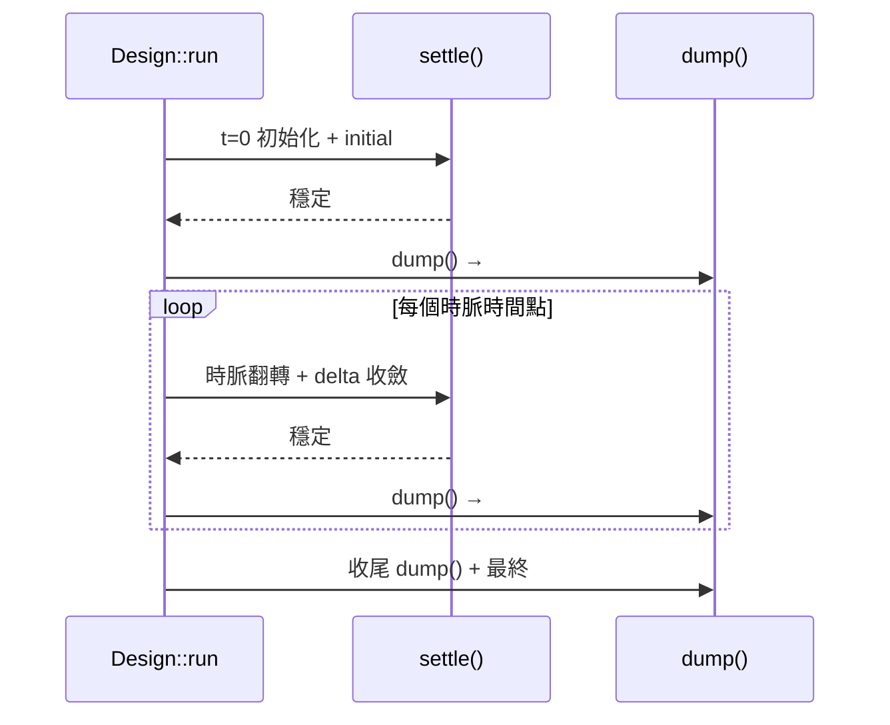

# 2.6 VCD 波型輸出

> 原始碼：`veryl-sim/src/sim.rs`（`Vcd` 結構、`Design::enable_vcd` / `dump` / `take_vcd`）
> 上一節：[2.5 時脈與測試平台](02.5-時脈與測試平台.md)　下一節：[2.7 閘級模擬](02.7-閘級模擬.md)

---

## 2.6.1 VCD 格式入門

VCD（Value Change Dump）是 Verilog 標準（IEEE 1364）附錄定義的文字波形格式，所有波形檢視器（GTKWave、Surfer、WaveTrace…）都支援。一個最小的 VCD 長這樣：

```vcd
$date ... $end
$timescale 1ns $end
$scope module top $end
$var wire 1 ! clk $end
$var wire 8 " cnt $end
$upscope $end
$enddefinitions $end
#0
x!
bxxxxxxxx "
#5
1!
#10
0!
b00001010 "
```

三個組成部分：

1. **標頭**：`$timescale`（時間單位）、`$scope`（層次容器）、`$var`（變數宣告：寬度、識別碼、名字）。
2. **識別碼（identifier code）**：每個訊號一個短字串（`!`、`"`、`#`…），後續值變化用它引用，避免重複寫訊號名。
3. **值變化區**：`#時間戳` 開一個時間點，其後每行一個變化——單位元用 `1!`，多位元用 `b0010 "`（二進位 + 識別碼）。

## 2.6.2 veryl-sim 的實作

VCD 寫入器極小——三個欄位的 struct，輸出累積在記憶體的 `Vec<u8>`：

```rust
// veryl-sim/src/sim.rs
pub struct Vcd {
    out: Vec<u8>,          // 累積的 VCD 文字
    ids: Vec<String>,      // 訊號索引 -> 識別碼
    last: Vec<Option<Val>>,  // 每訊號上次 dump 的值（變化偵測）
}

pub struct Design {
    ...
    pub watched: Vec<usize>,
    prev: Vec<u8>,         // edge 偵測用的前值（watched 訊號）
    vcd: Option<Vcd>,      // None = 未啟用
}
```

標頭由 `enable_vcd()` 一次寫完：

```rust
// veryl-sim/src/sim.rs
pub fn enable_vcd(&mut self) -> std::io::Result<()> {
    let mut out = Vec::new();
    writeln!(out, "$timescale 1ns $end\n$scope module top $end")?;
    let mut ids = vec![];
    for (i, s) in self.sim.sigs.iter().enumerate() {
        let id = vcd_id(i);
        writeln!(out, "$var wire {} {} {} $end", s.w, id, s.name.replace(' ', "_"))?;
        ids.push(id);
    }
    writeln!(out, "$upscope $end\n$enddefinitions $end")?;
    self.vcd = Some(Vcd { out, ids, last: vec![None; self.sim.sigs.len()] });
    Ok(())
}
```

設計取捨：

1. **每個 Design 一個 `$scope module top`**：veryl-sim 攤平了層次（2.3 節），層次資訊留在訊號全名（`u0.core.cnt`）裡，直接做成扁平的 var 名。GTKWave 會把 `u0.core.cnt` 顯示為一個長名訊號——可讀性略遜於巢狀 scope，但實作只需一個 loop。
2. **訊號名中的空格換底線**：`s.name.replace(' ', "_")`——陣列元素的命名（如 `mem[0]`）在精細化時可能帶空格，VCD 的 var 名不允許空白。
3. **`wire` 型別、實際寬度**：`s.w` 是邏輯寬度；GTKWave 依此決定顯示為單位元線還是匯流排。

### 識別碼產生

```rust
// veryl-sim/src/sim.rs
fn vcd_id(mut i: usize) -> String {
    let mut s = String::new();
    loop {
        s.push((b'!' + (i % 94) as u8) as char);
        i /= 94;
        if i == 0 { break; }
    }
    s
}
```

把訊號索引編碼為 94 進位（`!` 到 `~`——VCD 規定識別碼是 ASCII 33–126 的可列印字元）：`!`、`"`、`#`、…、`!A`、`!B`…。零填充、無衝突、順序穩定（索引 0 永遠是 `!`），波形檔案在模擬間可重現。

## 2.6.3 寫入時機：值變化偵測

`dump()` 在每個「模擬時間點結束」時被呼叫（`run()` 的三個位置：t=0 初始化後、每個時脈時間點後、最後收尾）：

```rust
// veryl-sim/src/sim.rs
fn dump(&mut self) {
    let t = self.sim.time;
    let Some(v) = self.vcd.as_mut() else { return };
    let mut wrote_t = false;
    for (i, s) in self.sim.sigs.iter().enumerate() {
        if v.last[i] == Some(s.val) { continue; }          // 值沒變：跳過
        if !wrote_t { let _ = writeln!(v.out, "#{}", t); wrote_t = true; }
        if s.w == 1 {
            let c = if s.val.x & 1 == 1 { 'x' } else if s.val.v & 1 == 1 { '1' } else { '0' };
            let _ = writeln!(v.out, "{}{}", c, v.ids[i]);
        } else {
            let _ = writeln!(v.out, "b{} {}", s.val.fmt_bin(), v.ids[i]);
        }
        v.last[i] = Some(s.val);
    }
}
```

要點：

1. **時間戳惰性寫入**（`wrote_t` 旗標）：只有真的有訊號變化才寫 `#t`，避免大量空時間戳膨脹檔案。
2. **變化偵測以整個 `Val` 為單位**：`last[i] == Some(s.val)` 比較 `(v, x, w, s)`——x 位元的出現/消失也是變化（VCD 支援 `x` 值），偵測粒度與模擬語意一致。
3. **同一時間點只有一個快照**：delta 週期內的中間值（例如兩層組合之間的過渡）**不會**進 VCD。這是刻意簡化——VCD 的時間粒度是模擬時間，delta 是時間內部的；多數波形除錯只關心時脈緣後的穩定值。若需要 delta 級波形，得在 `settle()` 每輪加 dump（代價是指數膨脹）。
4. **x 的編碼**：單位元直接 `x!`；多位元用 `fmt_bin()`，其中 x 位元印 `x`（VCD 允許 `bx` 表示全 x，`b10x0` 表示部分 x——GTKWave 兩者都接受）。



## 2.6.4 收尾與取用

```rust
// veryl-sim/src/sim.rs
pub fn run(&mut self, max_time: u64) {
    ...
    if self.sim.finished { self.sim.say(&format!("$finish called at time {}", self.sim.time), true); }
    self.dump();
    if let Some(v) = self.vcd.as_mut() { let _ = writeln!(v.out, "#{}", self.sim.time); }
}

impl Design {
    pub fn take_vcd(&mut self) -> Option<Vec<u8>> { self.vcd.take().map(|v| v.out) }
}
```

模擬結束時補一個最終時間戳（讓波形檢視器知道模擬持續到哪裡，即使最後沒有值變化），然後 `take_vcd()` 把位元組序列整體交出。**輸出在記憶體而非檔案**：CLI 把它寫到 `--vcd` 指定的路徑；wasm 版（web 前端）直接把同一份 `Vec<u8>` 給瀏覽器下載——一個生產點、兩個消費端，不需要 trait 抽象。

## 2.6.5 GTKWave 相容性

GTKWave 對 VCD 的解析相當寬容，但幾個地雷 veryl-sim 都避開了：

| GTKWave 要求 | veryl-sim 處理 |
|---|---|
| 識別碼為可列印 ASCII 33–126 | `vcd_id` 用 `b'!' + i%94`，正好落在 33–126 |
| var 名不可含空白 | `replace(' ', "_")` |
| 值變化須在時間戳之後 | `dump` 先寫 `#t` 再寫變化行 |
|多位元值 `b` 前綴 + 空格 + 識別碼 | `"b{} {}"` 格式 |
| 檔案須以時間戳或 EOF 結束 | 收尾補 `#t` |

不寫 `$date`/`$version`/`$comment`（皆可選）；GTKWave 不需要。`$timescale 1ns` 是固定值——模擬時間單位本身是抽象的（半週期 5 的「5」沒有物理單位），1ns 只是讓 GTKWave 的時間軸標籤有個單位。

## 2.6.6 VCD vs FST

FST（Fast Signal Trace）是 GTKWave 作者開發的二進位格式，專為大型波形設計：

| 面向 | VCD | FST |
|---|---|---|
| 編碼 | 文字 | 二進位 + 依值字典壓縮 |
| 檔案大小 | 基準 | 約 1/10 – 1/50 |
| 寫入速度 | 快（格式化文字） | 快（搭配壓縮） |
| 讀取/隨機存取 | 線性掃描 | 有索引，快 |
| 通用性 | 所有工具 | GTKWave 系（及部分現代工具） |
| 實作複雜度 | ~100 行 | 需要壓縮/索引層（通常鏈結 libfst） |

veryl-sim 選 VCD 的理由：

1. **依賴最小**：FST 需要外部函式庫或數千行編碼器；VCD 是 30 行的 `writeln!`。veryl-sim 的定位是輕量模擬器（AGENTS.md：a deliberately smaller simulator）。
2. **測試平台的波形不大**：RTL 測試動輒數十萬時間點、數千訊號的 VCD 約數十 MB，gzip 後數 MB——可接受。晶片級全波除錯（GB 級）不是它的使用場景。
3. **通用性**：VCD 可被任何工具（包括 `grep` 與自製腳本）直接處理；測試自動化（例如 tutorial 的檢查腳本）受益。

若未來需要大型波形的互動檢視，合理的路徑是在 CLI 層把 VCD 轉檔為 FST（`vcd2fst` 工具隨 GTKWave 提供），模擬器本身不動。

## 2.6.7 實際產出的範例

以一個半加器 testbench 為例，`--vcd ha.vcd` 產生的檔案（節錄、加註解）：

```vcd
$timescale 1ns $end
$scope module top $end
$var wire 1 ! a $end            ← 訊號索引 0 → 識別碼 "!"
$var wire 1 ! " b $end          ← （示意）索引 1 → "\""
$var wire 1 # sum $end
$var wire 1 $ carry $end
$var wire 1 % t_a $end          ← 介面/陣列成員的攤平全名
$upscope $end
$enddefinitions $end
#0                              ← t=0 快照：initial 跑完後的穩定值
0!
0"
0#
0$
#5                              ← 第一個 posedge（半週期 5）
1!                               ← a 由 0 變 1
0"
1#
0$
#10
1"                               ← b 由 0 變 1
1#
1$                               ← sum=1, carry=1
```

對照 `dump()` 的行為即可還原每行的來源：時間戳只在「有至少一個訊號變化」時寫入；每個變化訊號一行；x 值以 `x!`（單位元）或 `bx`/`b1x0`（多位元）出現。

### 用 VCD 除錯一個綜合 bug 的實例

假設 RTL 模擬通過、閘級模擬（2.7 節）失敗。打開兩份 VCD 對照：

1. 找第一個斷言失敗的時間點（`ASSERTION FAILED at time 35`）；
2. 在 GTKWave 中跳到 `#35`，回溯追訊號錐（cone of logic）；
3. 常見模式：某 FF 的 Q 在 reset 釋放後是 `x` 而非預期值——表示非同步 reset 沒有被網表正確連接（`gates.rs` 的 `rst` 解析或綜合器映射出錯）；
4. x 傳播會把整條下游染成 x，波形上一目了然——這正是 4 值閘級模擬（相對 netsim 全 0 上電）的除錯優勢。

## 為什麼這樣設計

1. **記憶體累積 + take**：輸出目的地（檔案/wasm/記憶體）由呼叫端決定，模擬核心不知道 I/O 存在；也讓同一份程式碼同時服務 CLI 與瀏覽器。
2. **快照式 dump 而非增量事件流**：VCD 本質是「值變化」流，但 veryl-sim 的排程（輪詢式 settle）天然只提供時間點快照；在每個時間點後 diff 上次快照即可重構出合法的 VCD。省去了在 `write_bits` 裡埋 hook 的侵入性。
3. **x 是一等公民**：`last[i]` 比較整個 `Val`，x 的出現/清除都產生波形事件——x 傳播的可見性（2.4 節）延伸到波形上，這正是 4 值模擬的除錯價值所在。
4. **delta 不入波形**：時間點穩定值是 RTL 除錯需要的粒度；delta 級波形會讓檔案大一到兩個數量級，且 GTKWave 的時間軸也無法表達。

## 本章重點

- VCD = 標頭（`$timescale`/`$scope`/`$var`）+ 識別碼 + `#t` 時間戳下的值變化行；veryl-sim 以 `Vec<u8>` 記憶體累積、`take_vcd()` 交出。
- 識別碼是索引的 94 進位編碼（`!`~`~`），零填充且穩定；訊號全名（攤平層次）直接做為 var 名。
- `dump()` 在每個模擬時間點後做快照 diff（`last: Vec<Option<Val>>`），x 進出都算變化；時間戳惰性寫入。
- delta 中間值不入波形；時間點穩定值是除錯所需粒度。
- 選 VCD 而非 FST：零依賴、波形規模可控、通用性；大波形可用 `vcd2fst` 後處理。
