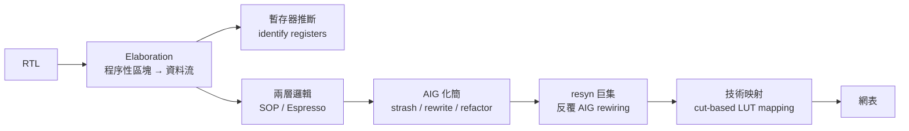
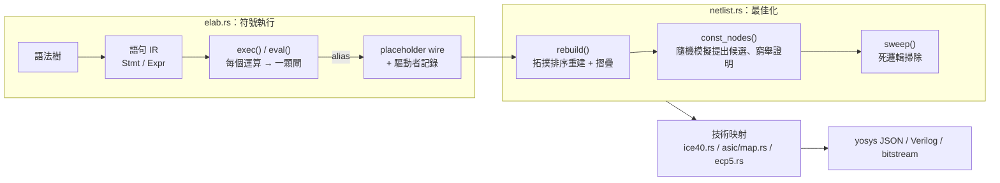

# 3.1 綜合總論：從行為描述到閘級網表

> 本章及其後五節講解 veryl-eda 邏輯綜合引擎的**原理**：它如何把 Veryl 行為描述
> 直接 lowering 成 yosys 內部閘（`$_AND_`、`$_MUX_`、`$_DFF_P_` …），再經最佳化
> 與技術映射變成可以放到 FPGA 或 ASIC 上的網表。操作面的使用方式請見
> `manual/06-synth.md`；這裡看的是「引擎室」。

## 3.1.1 傳統 academic 綜合管線

教科書上的邏輯綜合（Berkeley ABC、學術工具）大致是這條路：



核心想法：

- **AIG**（And-Inverter Graph）：所有組合邏輯先化成只有 AND 與 NOT 兩種節點的
  有向無環圖，大小與深度都可以用圖演算法（cut enumeration、priority cuts）
  系統性地縮小。
- **BDD**（Binary Decision Diagram）：布耳函數的規範形表示，變數序固定後
  表示唯一，等價檢查是 O(1) 的指標比較——但變數序不佳時會指數膨脹。
- **SAT sweeping**：用 SAT solver 證明 AIG 內部節點互相等價，再合併等價類。
- 正規化的好處是**演算法有理論保證**；代價是整條管線需要多個中介表示
  （SOP → AIG → cut → LUT），每一步都是一次完整重寫。

## 3.1.2 veryl-eda 的路線：符號執行 + 增量摺疊

veryl-eda 刻意走另一條路：**沒有 AIG、沒有中介圖**。語句被直接「執行」，
每執行到一個運算就立刻產生一顆閘，並馬上做常數摺疊與結構雜湊共用
（hash-consing）。整個流程只有兩個階段：



兩階段的輸出都值得記住：`raw`（`elaborated()`）**已解析 alias、已掃死邏輯，
但未做任何進一步簡化**；`opt`（`optimize()`）則是反覆 rebuild 到不動點。
「raw 有多蠢、opt 有多聰明」的差距就是最佳化引擎的成績單。

入口在 `elab::synthesize_stages_with`（elab.rs 尾端）：

```rust
pub fn synthesize_stages_with(lib: &Lib, top: &str, ov: &HashMap<String, Val>) -> R<Stages> {
    let (m, _) = lib.modules.get(top)...?;
    let mut b = Builder::new();
    let mut s = Synth::new(lib, &mut b);
    let sc = s.module(m, "", ov)?;          // 符號執行整個階層
    ...
    let raw = elaborated(&b, &alias, &ports, &nets, top)?;  // 別名解析後的原始網表
    let opt = optimize(b, &alias, ports, nets, top)?;        // 最佳化後的網表
    Ok(Stages { insts, ports: pinfo, signals, raw, opt, warnings })
}
```

注意 `Stages` 同時保留了 `raw` 與 `opt`——這是網頁 IDE 的「綜合前/後」檢視，
也方便驗證最佳化沒有改變行為。

### 虛擬碼：整條流程一頁看懂

```
synthesize(lib, top):
    b   = Builder::new()                 # 位級閘產生器（hash-consing）
    s   = Synth::new(lib, b)             # 符號執行器
    sc  = s.module(top, "", overrides)   # 遞迴走訪整個實例階層
        #  pass1: 宣告（var/const/fn/import）→ placeholder wires
        #  pass2: 行為（assign/always_comb/always_ff/inst/generate）
        #      exec()      → Stmt 逐條執行，if → mux，for → 展開
        #      eval()      → Expr 求值，每個運算 → Builder 一顆閘
        #      always_ff() → 兩遍執行得 D 與 R → $_DFF_* / $_SDFF_*
    #   陣列使用模式 → $mem:NAME:{clk,we,wa,wd,raN,rdN} 命名網標籤
    raw = elaborated(b, alias, ports, nets, top)   # 別名解析、無最佳化
    opt = optimize(b, alias, ports, nets, top)     # rebuild + 常數證明 + sweep
    return Stages { insts, ports, signals, raw, opt, warnings }
```

## 3.1.3 一個小設計的全程示範

```veryl
module Adder {
    input  a: logic<4>;
    input  b: logic<4>;
    output s: logic<4>;
    always_comb {
        s = a + b;
    }
}
```

| 步驟 | 發生的事 | 產物 |
|---|---|---|
| `lower` | `always_comb` 體 → `Stmt::Set { s, All, Bin("+", a, b) }` | 1 條語句 |
| `eval` | `eval_bin("+")` → `Builder::add_c(a.bits, b.bits, C1 無)` | 4 組 xor/and/or（p, g, c 鏈） |
| `commit` | `drive(s.placeholder[i], sum[i])` | 4 條 alias |
| `elaborated` | `resolve` 把 s 的 placeholder 指向加法器輸出 | raw 網表：~11 顆閘 |
| `optimize` | `rebuild` 重造 + `sweep`（s 直達輸出，全活） | 同一網表 |

同樣的設計若 `b` 是常數 `4'd3`：`add_c` 的第二運算元全是 `Bit::C0/C1`，
`xor(C1, x)` 被摺成 `not(x)`、`and` 全摺成 `C0/C1`——**raw 網表出來就已
是 `not` 鏈**，最佳化只是確認。這展示了「立即摺疊」的典型收益：常數
不會像 AIG 管線那樣先長成結構再被刪，而是**根本不誕生**。

## 3.1.4 兩條路線的比較

| 面向 | AIG 管線 | veryl-eda |
|---|---|---|
| 中介表示 | SOP → AIG → cut → LUT | 一個位級 `Builder`，從頭到尾 |
| 化簡時機 | 映射前集中化簡 | 產生每顆閘時**立即**摺疊（hash-consing） |
| 控制流 | 先轉資料流再化簡 | 執行時直接變 mux（見 §3.3） |
| 常數證明 | SAT sweeping | 隨機模擬 + ≤16 輸入支援的窮舉（§3.6） |
| 記憶體 | 獨立的 memory inference pass | 記錄成命名網 `$mem:…`，映射期轉換（§3.5） |
| 錯誤定位 | 內部節點編號 | 源碼名稱、逐語句 |
| 適用規模 | 百萬閘級 | 數萬閘級（RV32I SoC 量級） |
| 等價保證 | 管線各步有學理基礎 | 以 `test.sh` 的 yosys 等價檢查作為外部 oracle |

## 3.1.5 為什麼走符號執行路線？

**1. 目標規模。** 本專案的目標是「一顆 RV32I 核心放進 iCE40」，電路規模是
數千閘，不是數百萬閘。AIG 演算法的優勢在大規模；小規模時，一次性的
hash-consing + 死邏輯掃除已經能拿到大部分收益（見 §3.6 的實測數字）。

**2. 實作複雜度。** `Builder` 的核心不到 400 行（netlist.rs:45-307），
卻已內含：

```rust
pub fn mux(&mut self, s: Bit, a: Bit, b: Bit) -> Bit {
    if a == b { return a; }
    match (s, a, b) {
        (Bit::C0, _, _) => a,
        (Bit::C1, _, _) => b,
        (_, Bit::C0, Bit::C1) => s,
        (_, Bit::C1, Bit::C0) => self.not(s),
        (_, Bit::C0, _) => self.and(s, b),      // s & b
        (_, _, Bit::C1) => self.or(s, a),       // s | a
        ...
    }
}
```

mux 在本引擎裡出現的頻率遠高於其他閘（每個 `if`、每個三元運算子、每個
陣列索引都會產生 mux），對它做九種 case 的特化摺疊，等效於 AIG 管線裡
反覆跑的 `rewrite`——但不需要建 AIG。

**3. 正確性可以外部驗證。** 最終輸出是 yosys JSON，所以正確性不是靠管線
內部的不變量保證，而是靠 `veryl-eda/test.sh` 用 yosys + slang plugin 對
`veryl build` 的輸出做形式等價檢查。這讓內部表示可以自由取捨簡單性。

**4. 錯誤訊息定位。** 符號執行逐語句走訪，遇到不支援的結構（例如巢狀
select 賦值）能立刻用源碼名字報錯：

```rust
_ => Err("nested select in assignment target is not supported".into()),
```

AIG 管線裡這類錯誤會在 lowering 之後才爆出來，使用者看到的只是一個
內部節點編號。

**5. 位元向量 vs 圖結構。** `Bit::W(u32)` 讓「一條線」只是一個整數：雜湊
鍵是陣列、等價是整數比較、排序（`a.min(b)`）是 integer min。AIG 節點
需要指標/索引加互斥標記；這裡連「反相器邊」都用 `inv` 快取的整數對
表示。當最佳化規則數十條時，表示法的簡單性直接決定正確性信心。

**6. 位寬固定的位級處理。** 寬度 >256 位直接拒絕（`MAXW`），因此每個
運算可以用定長迴圈實作、wasm 記憶體配置可預測。學術工具必須處理
任意寬度（BDD 變數爆炸、AIG 深度管理），本專案用「不支援」換簡單。

**7. 技術映射共用前置。** `ice40.rs` 的 LUT 覆蓋（`lut_cover`）、進位鏈
辨識（`find_carries`）被 ECP5 後端共享；ASIC 的樹覆蓋 DP 也是同一份
`Bit` 網表的消費者。單一 IR 意味著新目標只需要新的映射器，前置全部
免改。

## 3.1.6 為什麼不用 yosys 從頭做？

一個合理的問題：既然輸出是 yosys JSON，為何不直接把 Veryl lowering 成
SystemVerilog 交給 yosys？原因有三：

1. **可控性**。yosys 對 SystemVerilog 的支援取決於前端（slang/verific），
   對 Veryl 的 enum cast、package 函式等結構需要外部 plugin
   （`YOSYS_SLANG`）；自有前端把這些在 elab 期就吃掉，輸出純結構網表。
2. **測試即綜合**。`cargo test` 直接把每個例子綜合、放進 netsim/gatesim
   跑測試台（`veryl-eda/tests/`），不需要外部工具。等價檢查反而變成
   「外加的加值驗證」而非依賴。
3. **教學與網頁**。本專案的核心使命是在瀏覽器（wasm）裡跑完整流程：
   符號執行 + 位級 Builder 對 wasm 的體積與速度都友善；yoys 的 AIG 管線
   體積與記憶體開銷則大得多。

## 3.1.7 與模擬器共享什麼？

雖然 elab 刻意分家，兩個 crate 仍有交集（透過 path dependency
`veryl-sim`）：

| 共享 | 來源 | 用途 |
|---|---|---|
| `value::Val` / `Bits` | veryl-sim | 常數求值（參數、enum 值） |
| `iface::items / modport` | veryl-sim | 介面成員與 modport 方向 |
| `gen::for_indices` | veryl-sim | generate for 的索引序列 |

**有意識地不共享**的是 elaborator 本身：模擬器的 IR 要支援 delta cycle、
x 傳播、VCD——綜合器一概不需要，反之綜合器要的 alias/placeholder 概念
對模擬是純負擔。兩份程式碼各 1000+ 行，比一套「萬用 IR」便宜。

## 3.1.8 六節導覽

$$
\text{語法樹} \xrightarrow[\text{lower}]{\S3.2} \text{Stmt IR}
\xrightarrow[\text{exec/eval}]{\S3.2,\ \S3.3} \text{mux + 閘}
\xrightarrow[\text{always\_ff}]{\S3.4} \text{DFF}
\xrightarrow[\text{陣列}]{\S3.5} \$mem\text{ → SB\_RAM40\_4K}
\xrightarrow[\text{rebuild}]{\S3.6} \text{最佳化網表}
\xrightarrow{\text{ice40/asic/ecp5}} \text{技術映射}
$$

- **§3.2**：`elab.rs` 的符號執行核心——placeholder wire、alias 驅動記錄、
  語句執行與閘生成的一一對應。
- **§3.3**：控制流到資料流——`exec_chain` 的優先 mux 樹、case 的 one-hot
  合併、迴圈展開、函式內嵌。
- **§3.4**：正反器推斷——`$_DFF_*` / `$_SDFF_*` 的選擇、non-blocking 語意、
  clock-enable 的形成。
- **§3.5**：記憶體推斷——`$mem:NAME:...` 命名網協定、`bram.rs` 的
  `find_mems` / `infer`、`MEM_SLOT` 與程式燒錄。
- **§3.6**：網表資料結構——`rebuild` 的拓撲重建、常數摺疊、結構雜湊、
  `const_nodes` 的窮舉證明、死邏輯掃除。

## 本章重點

- veryl-eda 的綜合只有兩個階段：**符號執行**（elab.rs，直接產閘）與
  **網表最佳化**（netlist.rs 的 `optimize` → `rebuild`），沒有 AIG 等中介圖。
- 所有閘建構都經過 `Builder`，它是 hash-consing + 常數摺疊的單一入口，
  所以「化簡」不是一個 pass，而是**建閘時的副作用**。
- 正確性由外部 oracle（yosys 形式等價）保證，內部表示以簡單為第一優先。
- 這條路線的取捨：放棄大規模電路的最優化能力，換取實作簡單、錯誤訊息
  精確、以及與 yosys JSON 生態的無縫銜接。
- 「立即摺疊」使常數從不長成結構再被刪除——參數化設計的收益在 raw
  網表階段就全部兌現。
- 兩個 crate 各自為政（elab 分家）是刻意的：模擬要 delta cycle 與 x 傳播，
  綜合要 alias 與 placeholder，混在一套 IR 只會兩頭不到岸。
