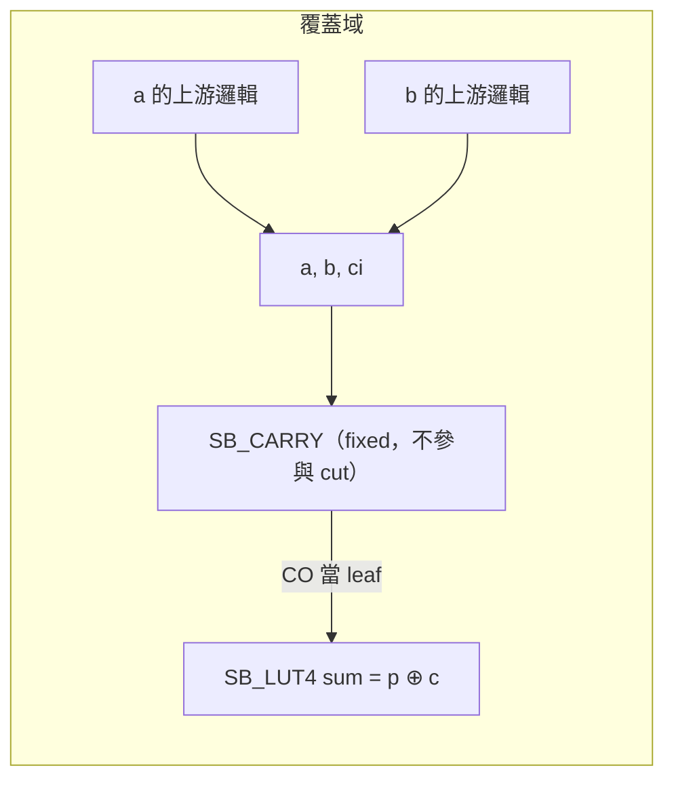

# 3.10 進位鏈辨識：全加器 pattern 與 `SB_CARRY`

> 來源：`veryl-eda/src/ice40.rs` 的 `find_carries()`（26–49 行）與 `map()` 的 packing 邏輯；`netlist.rs::add_c` 是 pattern 的源頭

## 3.10.1 為什麼進位鏈對加法器效能是關鍵

一個 $N$ 位元 ripple-carry 加法器的關鍵路徑是進位穿越路徑。第 $i$ 位：

$$c_{i+1} = (a_i \land b_i) \lor \big((a_i \oplus b_i) \land c_i\big)$$

若 $c_{i+1}$ 由 4-LUT 實現，每級 1 個 LUT，$N=32$ 時進位路徑 = 32 個 LUT 級 —— 這在 8 MHz 的 iCE40 上已經是整個 RV32I 核心最慢的一段。

iCE40 提供專用**進位鏈硬體**：每個邏輯塊（LAB）內有一條固定的快速進位走線，`SB_CARRY` cell 讀 `I0, I1, CI` 輸出 `CO`，相鄰 cell 的 `CI → CO` 走專用金屬線，每級延遲遠小於一個 LUT + 通用布線。nextpnr-ice40 只有在看到 `SB_CARRY` 鏈時才會用這條走線；若加法器被映射成一串 `SB_LUT4`，佈局器把每級當普通邏輯放置，關鍵路徑退化數倍。

三個實現層級的深度比較（量級）：

$$\text{32-bit 進位路徑：} \underbrace{32 \times t_{\mathrm{LUT+routing}}}_{\text{純 LUT}} \;\gg\; \underbrace{32 \times t_{\mathrm{carry}} + 2\times t_{\mathrm{LUT}}}_{\text{SB_CARRY 鏈}}$$

這也是 AGENTS.md 反覆強調的重點：iCE40 的 RISC-V SoC 能跑到目標頻率，靠的就是進位鏈被正確辨識與打包。

## 3.10.2 pattern 的源頭：`netlist.rs::add_c`

`Builder::add_c`（`netlist.rs:166-178`）用固定的式子生成每位的進位：

```rust
// netlist.rs:169-177
for i in 0..a.len().max(b.len()) {
    let (x, y) = (at(a, i), at(b, i));
    let p = self.xor(x, y);              // propagate  = a ^ b
    out.push(self.xor(p, c));            // sum        = p ^ c
    let g = self.and(x, y);              // generate   = a & b
    let pc = self.and(p, c);             // p & c
    c = self.or(g, pc);                  // carry-out  = maj(a, b, c)
}
```

所以映射器要找的 pattern 在閘級長這樣（進位輸出端）：

$$\mathrm{CO} = \underbrace{(g \lor t)}_{\$_\mathrm{OR\_}} \quad\text{其中}\quad g = a \land b \;(\$_\mathrm{AND\_}),\quad t = (a \oplus b) \land c\;(\$_\mathrm{AND\_} \text{ 餵 } \$_\mathrm{XOR\_})$$

注意這是 **maj（多數函數）** 的一個因式分解，而不是唯一的寫法 —— yosys 的 ABC 可能輸出 `(a&b) | (a&c) | (b&c)` 或 `(a&b) | ~(~(a|b) & ~(a&c) & ~(b&c))` 等等。veryl-eda 的優勢在於它**控制了上游**：`add_c` 永遠產生同一種形狀，pattern 比對因此可以窄而精。

## 3.10.3 `find_carries`：三層巢狀的結構比對

```rust
// ice40.rs:26-49
/// full-adder carries `(a & b) | ((a ^ b) & c)` by carry-out wire: (a, b, c, the a ^ b wire)
pub(crate) fn find_carries(gates: &[&Cell], node: &HashMap<u32, usize>) -> HashMap<u32, (Bit, Bit, Bit, u32)> {
    let gate_of = |b: Bit| -> Option<&Cell> { if let Bit::W(w) = b { node.get(&w).map(|i| gates[*i]) } else { None } };
    let pins = |c: &Cell| (c.port("A").unwrap(), c.port("B").unwrap());
    let mut carry: HashMap<u32, (Bit, Bit, Bit, u32)> = HashMap::new();
    for c in gates {
        if c.typ != "$_OR_" { continue; }
        let (u, v) = pins(c);
        for (g, t) in [(u, v), (v, u)] {
            let (Some(g), Some(t)) = (gate_of(g), gate_of(t)) else { continue };
            if g.typ != "$_AND_" || t.typ != "$_AND_" { continue; }
            let (x, y) = pins(g);
            let (t0, t1) = pins(t);
            for (p, ci) in [(t0, t1), (t1, t0)] {
                if let Some(px) = gate_of(p).filter(|g| g.typ == "$_XOR_") {
                    let (p0, p1) = pins(px);
                    if (p0, p1) == (x, y) || (p1, p0) == (x, y) {
                        if let (Bit::W(n), Bit::W(pw)) = (c.out(), p) { carry.insert(n, (x, y, ci, pw)); }
                    }
                }
            }
        }
    }
    carry
}
```

比對條件逐條拆解：

| 條件 | 對應數學 |
|---|---|
| 根是 `$_OR_`，兩個 fanin 都是 `$_AND_` | $\mathrm{CO} = g \lor t$，兩個乘積項 |
| $g$ 的兩個輸入記為 $(x, y)$ | $g = x \land y$（generate 項）|
| $t$ 的某個輸入 $p$ 驅動自一個 `$_XOR_`，其輸入恰為 $(x, y)$（可交換） | $t = (x \oplus y) \land c_i$（propagate 項）|
| $t$ 的另一個輸入就是進位輸入 $c_i$ | — |

命中時記錄 `(x, y, ci, pw)`：三個 carry 腳位候選加上 $a \oplus b$ 這條線的編號 —— sum LUT 需要它（見 3.10.5）。

### 為什麼這樣設計（精確匹配而非邏輯等價）

學術做法（例如用 BDD/SAT 找所有 maj 函數實例）能抓到重寫過的進位，但成本高、且容易把「碰巧等價於 maj」的無關邏輯也抓進來，反而妨害其他最佳化。veryl-eda 選擇**結構模式匹配**：

- **誤報近乎為零**：要同時命中 OR(AND, AND(XOR(同一對), x)) 的機率，除了真的全加器外極低。
- **漏報可接受**：凡是本專案自己生成的加法（`add_c`、`sub`、`ult`、`slt`、`mul` 內部的部分積加法、`udivmod` 的減法）都走同一個 `add_c`，shape 必定匹配。等價性檢查（第 3.12 節）證明被抽出來的進位鏈與原電路功能相同。
- `find_carries` 是 `pub(crate)`，被 `ecp5.rs` 共用（那邊把同一個 pattern 映射成 `CCU2C` 的兩級鏈）—— 一份 pattern、兩個平台。

## 3.10.4 抽出進位後的覆蓋互動

`map()` 拿到 carry 表後，重畫了 LUT 覆蓋的邊界：

```rust
// ice40.rs:188-200（節錄）
// full-adder carries go to the dedicated carry chain; their outputs are
// leaves for LUT mapping, their a/b/c are roots
let carry: HashMap<u32, (Bit, Bit, Bit)> = find_carries(&gates, &node).into_iter().map(|(n, (x, y, c, _))| (n, (x, y, c))).collect();
for n in carry.keys() { node.remove(n); }
let fixed: HashMap<u32, Vec<Bit>> = carry.iter().map(|(n, (x, y, c))| (*n, vec![*x, *y, *c])).collect();

// roots: everything sequential logic and output ports look at
let mut roots: Vec<Bit> = ...;
let (best, used, used_carry) = lut_cover(&gates, &node, &fixed, &roots)?;
```

三個動作：

1. **`node.remove(n)`**：進位 cell 從「LUT 可以計算的節點」名單中刪除 —— 覆蓋演算法不會把它變 LUT。
2. **進位輸出當 leaf**：下游的 sum LUT 看到的是一條不可再分的固定線（與 FF 輸出、模組輸入同等待遇）。
3. **`(x, y, ci)` 當 roots**：`lut_cover` 的 `cover()` 順著 `fixed` 表走進 carry 的輸入，保證生成 $a, b, c_i$ 的邏輯仍被覆蓋。



`cover()` 的處理（`ice40.rs:285-299`）明確分流：

```rust
while let Some(w) = work.pop() {
    if let Some(ins) = fixed.get(&w) {
        if used_carry.insert(w) {
            work.extend(ins.iter().filter_map(|b| if let Bit::W(v) = b { Some(*v) } else { None }));
        }
        continue;
    }
    if !node.contains_key(&w) || !used.insert(w) { continue; }
    work.extend(best[&w].leaves.iter().copied());
}
```

## 3.10.5 sum LUT 與 carry 的腳位配對

nextpnr-ice40 有一個打包規則：LUT 與 carry 可以合併成一個邏輯 cell，條件是 **LUT 的 `I1`/`I2` = carry 的 `I0`/`I1`，且 LUT 的 `I3` = carry 的 `CI`**（`map()` 註解原文：*"nextpnr packs LUT and carry into one cell when LUT I1/I2 = carry I0/I1 and I3 = CI"*）。為了讓每個 sum LUT 都有機會被這樣打包，`map()` 在生成 LUT 時做**腳位重排**：

```rust
// ice40.rs:203-224（節錄）
// carry-in by (a, b) pair, to line sum LUTs up with their SB_CARRY:
let by_ab: HashMap<(u32, u32), u32> = carry.values().filter_map(|(x, y, c)| match (x, y, c) {
    (Bit::W(a), Bit::W(b), Bit::W(ci)) => Some(((*a.min(b), *a.max(b)), *ci)),
    _ => None,
}).collect();
let mut placed: Vec<(usize, Cell)> = vec![];
for n in used {
    let mut leaves: Vec<Option<u32>> = best[&n].leaves.iter().map(|w| Some(*w)).collect();
    leaves.resize(K, None);
    'pair: for i in 0..K {
        for j in 0..K {
            let (Some(a), Some(b)) = (leaves[i], leaves[j]) else { continue };
            if a >= b { continue; }
            if let Some(ci) = by_ab.get(&(a, b)) {
                if leaves.contains(&Some(*ci)) {
                    let rest: Vec<Option<u32>> = ...;
                    leaves = vec![rest.first().copied().flatten(), Some(a), Some(b), Some(*ci)];
                    break 'pair;
                }
            }
        }
    }
    ...
}
```

`by_ab` 把「$(a,b)$ 有序對 → 進位輸入 $c_i$」建成索引；生成某個 LUT 時若它的 leaves 恰好同時含有一個 carry 的 $a$、$b$、$c_i$ 三者（這正是 sum LUT 的特徵），就把腳位強制排成：

$$[I_0 = \text{其餘葉},\; I_1 = a,\; I_2 = b,\; I_3 = c_i]$$

而 sum 函數 $p \oplus c = (a \oplus b) \oplus c$ 的真值表恰好是 LUT 內建的 mux-on-carry 結構，與 carry 的走線在硬體上共享同一組輸入 —— 打包後一個 bit 的 sum+carry 只佔一個 LE，且走專用鏈。

### 為什麼要在映射器裡做腳位配對，而不是交給 nextpnr？

nextpnr 的打包是**條件匹配**：它不會（也不能）重排 LUT 的輸入腳位 —— 真值表 `LUT_INIT` 已經把輸入位置定死了。重排腳位必須連同真值表一起改，所以只能在映射時做。`truth()` 以 `leaves` 的位置套 `PAT`，因此 `leaves` 一被重排，`LUT_INIT` 自然跟著正確 —— 這是「真值表遞推」架構的免費好處。

## 3.10.6 與 LUT 覆蓋的其他互動點

- **覆蓋的評分**：area flow 的 `refs` 把 `used_fixed`（carry 的輸入消耗）也算進 fanout（`recount`，`ice40.rs:61-66`），所以 carry 鏈會正確「拉住」上游邏輯不被過度複製。
- **`sub` / 比較器**：`Builder::sub`、`ult` 都是 `add_c` 加反相（`netlist.rs:180-247`），所以減法器與 `<` 比較器的進位鏈同樣被辨識。
- **乘法器**：`mul` 的每位部分積加法走 `add`（`netlist.rs:223-234`），每個部分積加法器的進位鏈都會被抓出 —— 陣列乘法器是 `SB_CARRY` 大戶。
- **環上的可預測性**：因為 carry cell 已從 `node` 移除，它們不在 cut enumeration 的閘集合裡，不會干擾支配剪枝的統計。

## 3.10.7 偽代碼與不變式

```
find_carries(gates, node):
    carry = {}
    for c in gates where c.typ == "$_OR_":
        for (g, t) in [(A, B), (B, A)]:          # OR 的兩個輸入可交換
            g, t 必須都是 "$_AND_"
            (x, y) = g 的輸入                      # generate 項的 a, b
            for (p, ci) in [(t.A, t.B), (t.B, t.A)]:
                if p 驅動自 "$_XOR_" px 且 px 的輸入 == {x, y}:
                    carry[c.Y] = (x, y, ci, px.Y)
    return carry
```

三個值得強調的不變式，由後續管線維持：

1. **沒有任何 LUT 計算進位**：`node.remove(n)` 保證 `lut_cover` 的 cut 枚舉根本看不到這些 cell；`truth()` 的 `panic!("unexpected cell")`（ice40.rs:315）是最後一道防線 —— 若覆蓋域意外混進非 `$_*` 基本閘，直接崩潰而非輸出錯誤網表。
2. **carry 輸出單一驅動**：進位線 `n` 在抽走 OR 閘後由 `SB_CARRY` 的 `CO` 驅動；sum LUT 以它為 leaf。若同一條線還有別的驅動者，`read_json; check -assert` 會在 yosys 檢查時報多驅動。
3. **cover 封閉**：`cover()` 對 `fixed` 節點只展開一次（`used_carry.insert`），其輸入進 worklist，因此從任何 root 出發都能到達所有供電邏輯。

## 3.10.8 抽象語義：為什麼 maj 分解是「安全替換」

形式上，`find_carries` 做的是**模式驅動的邏輯重寫**：

$$(a \land b) \lor ((a \oplus b) \land c) \;\longrightarrow\; \mathrm{SB\_CARRY}(a, b, c)$$

替換正確性的證明是一個真值表等式（3 輸入、8 行，讀者可自行驗證）：maj 函數對所有組合成立。`test.sh` 的 `fpga` kind（對 `FPGA_EQ` 設計）把這個證明擴展到整個設計層級：yosys 用 `+/ice40/cells_sim.v` 的 `SB_CARRY` 模型（`assign CO = sel ? I1 : I0` 風格）參與 SAT miter，所以「進位鏈 ≡ 原電路」是**被證明的**，不是被假設的。

要理解為何這個重寫值得做，看資源帳：

| | 純 LUT 覆蓋 | carry 抽出後 |
|---|---|---|
| 每個 bit 的 cell | 2 個 SB_LUT4（sum + carry-out）| 1 個 SB_LUT4（sum）+ 1 個 SB_CARRY |
| 進位路徑延遲 | 每級一個完整 LUT + 通用布線 | 每級專用快走線 |
| nextpnr 打包 | 不可能 | LUT+CARRY → 1 個 LE（若腳位配對成功）|

cell 數沒有淨減少，但**關鍵路徑的每級延遲**與**每 bit 佔用的 LE 數**都大幅改善 —— 這說明技術映射的目標從來不是「cell 最少」，而是「時序與面積的聯合品質」。

## 3.10.9 ECP5 的對照：`CCU2C`

`find_carries` 被聲明為 `pub(crate)` 正是為了 ECP5 共用（AGENTS.md：「the iCE40 covering, shared as `ice40::lut_cover` / `find_carries` / `truth`」）。ECP5 的 `CCU2C` 是兩級進位 cell，AGENTS.md 描述了映射規則的微妙處：

> a COUT feeds at most one CIN, extra carry-ins go through a buffer LUT — nextpnr-ecp5 rejects a branching chain as "CCU2C unsupported"

也就是說同一個 pattern 抽出來的 carry 集合，在 iCE40 上是每 bit 一個 `SB_CARRY` 的簡單鏈，在 ECP5 上要考慮「一個 `COUT` 只能餵一個 `CIN`」的拓撲約束。這是模式抽取（平台無關）與 cell 生成（平台相關）分層的價值：上層只認 `$_OR_`/`$_AND_`/`$_XOR_` 的形狀，下層各自處理打包限制。

## 3.10.10 驗證方式

- `netsim.rs` 與 veryl-sim 的 `gates.rs` 都實作了 `SB_CARRY` 的行為模型（AGENTS.md：「netsim and veryl-sim's gates.rs model the three cells」），`test.sh` 的 gatesim 對每個設計跑 `opt` / `ice40` 兩種網表的 testbench，斷言相同。
- `test.sh` 的形式等價性（`kind = fpga`，對 `FPGA_EQ` 中的設計）用 yosys 讀回 `SB_CARRY` 模型（`+/ice40/cells_sim.v`）對 gold 證明等價 —— 進位鏈的抽取正確性由 SAT 保證，不靠模擬抽樣。
- `fpga/flow.sh` / `pnr_test.sh` 從 nextpnr 的報告與 icetime 的 Fmax 反映實際收益。

## 3.10.11 效能量化：一個思考實驗

用 RV32I 核心的 ALU 估算（`examples/src/rv32i.veryl` 的 `Alu`）：

- 32 位元加法器：32 個 full adder。每個 FA 的 sum + carry。
- 純 LUT 映射：sum 是 4 輸入（$a, b, c_{in}$ + 折疊）→ 1 LUT；carry-out 是 3 輸入 maj → 1 LUT。進位路徑 = 32 級 LUT + 32 級通用布線。
- carry 抽出後：32 個 `SB_CARRY` + 32 個 sum LUT；進位路徑 = 32 級專用快走線 + 1 級 LUT（最後的 sum 到 FF 的 D）。

iCE40 的專用進位走線延遲約為 LUT + 通用布線的 1/3 ~ 1/4（icetime 的報告可直接對照），因此僅加法器一項就把 ALU 關鍵路徑縮短約一半以上。AGENTS.md 提到 RvBoard / RvVgaBoard「only just make 12 MHz」，其中進位鏈的正確辨識是達標的先決條件之一。

值得記住的是：這個收益**不來自更聰明的演算法**，而來自兩件樸素的事 —— (1) 認出一個固定 pattern；(2) 讓 nextpnr 能把它們排成一條鏈。EDA 裡很多「最佳化」本質上都是這種「把結構意圖傳遞給下游」的簿記工作。

## 3.10.12 本章重點

- 進位是 maj 函數 $c_{i+1} = (a_i \land b_i) \lor ((a_i \oplus b_i) \land c_i)$；`find_carries` 對這個 shape 做**精確結構匹配**，因為 `add_c` 保證了上游形狀，所以又快又準。
- 進位 cell 被抽到 `fixed`：LUT 覆蓋不碰它，其輸出是 leaf、其輸入被納入 roots 與扇出統計。
- `map()` 用 `by_ab` 索引重排 sum LUT 的腳位（`I1/I2 = carry I0/I1, I3 = CI`），讓 nextpnr 能把 sum+carry 打包成一個 LE 走專用進位鏈 —— 這對 32 位元 RV32I 的 Fmax 至關重要。
- 同一個 `find_carries` 被 ECP5 的 `CCU2C` 映射共用；正確性由 netsim、gatesim 與 yosys 形式等價性三重把關。
