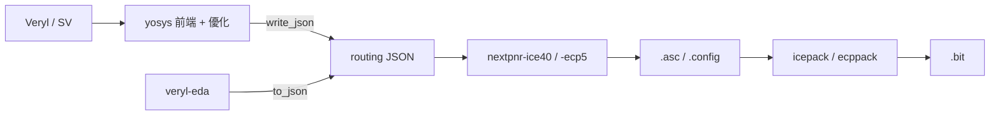

# 3.11 網表輸出格式：yosys JSON 與結構化 Verilog

> 來源：`veryl-eda/src/output.rs`（`numbering`、`to_json`、`to_verilog`）；下游：`test.sh` 的 `read_json`、nextpnr-ice40 / nextpnr-ecp5、iverilog 閘級模擬

## 3.11.1 為什麼 JSON 是與 nextpnr 溝通的標準介面

nextpnr（ice40 / ecp5 / …）不接受 RTL、也不接受任意 Verilog —— 它的統一前端是 **yosys 的 JSON 後端格式**（`write_json`）。流程是：



yosys JSON 的設計重點：

1. **純網表**：只有 cell 實例、埠、具名網，沒有行為描述 —— 正好是 nextpnr 需要的全部（每個 cell 的型別、參數、連線）。
2. **平台無關**：同一格式承載 `SB_LUT4`（ice40）、`LUT4/CCU2C/TRELLIS_FF`（ecp5）、甚至ASIC 標準單元；nextpnr 用 `--json` 讀，yosys 用 `read_json` 讀回做檢查。
3. **位元層連線**：連線不是「訊號名」而是**整數位編號**，一條匯流排就是一列編號 —— 這讓位碎片化（一個訊號的一部分接到這裡、一部分接到那裡）不需要中間層。

所以 `to_json` 的任務是：把我們的 `Netlist`（`Bit::W(u32)` 網線 + `Cell`）忠實翻成這份格式，並通過 `read_json; check -assert` 的往返測試（`test.sh:62`）。

## 3.11.2 位元編號：`numbering`

```rust
// output.rs:7-15
/// Compact net numbering (2, 3, ...) in order of first appearance.
fn numbering(nl: &Netlist) -> HashMap<u32, u32> {
    let mut m = HashMap::new();
    let mut add = |b: Bit| if let Bit::W(w) = b { let n = m.len() as u32 + 2; m.entry(w).or_insert(n); };
    for p in &nl.ports { p.bits.iter().for_each(|b| add(*b)); }
    for c in &nl.cells { c.conns.iter().for_each(|(_, b)| add(*b)); }
    for (_, bits) in &nl.nets { bits.iter().for_each(|b| add(*b)); }
    m
}
```

三個細節：

- **從 2 開始**。yosys JSON 的慣例：0/1 是特殊編號（對應 `"0"`/`"1"` 字串），正數是網線。`netlist.rs` 的 `Bit::W` 本來就從 2 起（`Builder::new` 的 `next_wire: 2`），這裡再緊湊化一次（重編成連續 2, 3, …），輸出檔案更小。
- **首次出現順序**：埠 → cells → 具名網。這讓輸出有穩定的確定性（同輸入同輸出，npm test 還逐位元組比對 GDS/JSON）。
- `or_insert` 保證同一個內部編號只會得到一個外部編號 —— 這是 hash-consing 之後的本來面目，一條物理網一個號。

常數的編碼（`to_json` 的 `bit` 閉包，output.rs:25-29）：

```rust
let bit = |b: &Bit| match b {
    Bit::C0 => "\"0\"".to_string(),
    Bit::C1 => "\"1\"".to_string(),
    Bit::W(w) => num[w].to_string(),
};
```

注意常數在 JSON 裡是**字串** `"0"` / `"1"`，不是數字 —— 這樣與網線編號（數字）在型別上就能區分。

## 3.11.3 JSON 的四大區塊

`to_json` 產生的模組結構（output.rs:32-67）：

```json
{
  "creator": "veryl-eda x.y.z",
  "modules": {
    "Counter": {
      "attributes": { "top": "00000000000000000000000000000001" },
      "ports":     { "clk": { "direction": "input",  "bits": [2] },
                     "led": { "direction": "output", "bits": [7] } },
      "cells":     { "$veryl$0": { "type": "SB_LUT4", "parameters": {"LUT_INIT": "0000000000000001"},
                                   "port_directions": {"I0":"input","O":"output"},
                                   "connections": {"I0": [3], "I1": ["0"], "I2": ["0"], "I3": ["0"], "O": [7]} } },
      "netnames":  { "count[0]": { "hide_name": 0, "bits": [5], "attributes": {} } }
    }
  }
}
```

逐區塊對照原始碼：

### ports（output.rs:36-39）

```rust
format!("        \"{}\": {{ \"direction\": \"{}\", \"bits\": {} }}", esc(&p.name), if p.dir == Dir::In { "input" } else { "output" }, bits(&p.bits))
```

`bits` 陣列的一個元素對應一個位元，lsb 在前（與 veryl-eda 內部向量一致）。

### cells（output.rs:41-59）

三件值得細看的事：

**（1）`NAME[i]` 腳位的匯流排合併。** `SB_RAM40_4K` 有 11 條 `WADDR[0]`…`WADDR[10]`（`bram.rs:16-20`）。寫成 11 個 cell 腳位在 JSON 語義上是錯的 —— 它們其實是一條 11 位匯流排。`to_json` 把帶 `[i]` 的腳位按 base 名分組、依索引排序、合併成陣列：

```rust
// output.rs:43-48
for (p, b) in &c.conns {
    let (base, i) = match p.split_once('[') { Some((n, r)) => (n, r.trim_end_matches(']').parse().unwrap_or(0)), None => (*p, 0) };
    match groups.iter_mut().find(|g| g.0 == base) { Some(g) => g.1.push((i, b)), None => groups.push((base, vec![(i, b)])) }
}
for g in &mut groups { g.1.sort_by_key(|x| x.0); }
```

**（2）字串參數的尾隨空格。** ECP5 的 `TRELLIS_FF` 參數（`CLKMUX`、`REGSET`…）是**字串**，而 yosys JSON 的慣例是：值為全 0/1 的**字串**要加一個尾隨空格，否則 `read_json` 會把它當成位元向量。`ecp5::is_string_param` 判斷哪些是字串（`ice40.rs` 的註解：「`is_string_param` tells the JSON / Verilog writers」）：

```rust
// output.rs:52-55
let params: Vec<String> = c.params.iter().filter(|(k, _)| *k != crate::bram::SLOT).map(|(k, v)| {
    let sp = if crate::ecp5::is_string_param(&c.typ, k) && v.chars().all(|ch| ch == '0' || ch == '1') { " " } else { "" };
    format!("\"{}\": \"{}{}\"", k, v, sp)
}).collect();
```

這種「一個空格決定語義」的坑，正是 `test.sh` 每個設計都跑 `read_json; check -assert` 往返的原因。

**（3）`MEM_SLOT` 參數變屬性。** `bram::SLOT`（`"MEM_SLOT"`）在內部參數表裡，但輸出時被抽出寫成 `"attributes": {"veryl_mem": "..."}`（output.rs:56）—— 因為它是 veryl-eda 自己的簿記資訊（哪個記憶體的哪一塊，供 `bram::set_mem_init` / `pnr::patch_ram` 填程式用），不是 iCE40 的硬體參數，nextpnr 不該看到它。

### netnames（output.rs:61-66）

具名網只是**除錯資訊**（波型圖上顯示 `count[0]` 而不是 `$5`），nextpnr 忽略它們，但 yosys 的 `check` 會用它們對位元單一驅動做檢查。`seen` 集合去重 —— `rebuild` 之後 alias 已解，同一名字重複出現的可能已經很低，這裡仍是防禦性的。

### attributes 的 top 標記（output.rs:34）

```rust
writeln!(s, "      \"attributes\": {{ \"top\": \"00000000000000000000000000000001\" }},")
```

yosys 慣例：top 模組的 `top` 屬性值是字串化的 1。下一節的等價性檢查腳本裡 `hierarchy -top miter` 也依賴類似機制。

## 3.11.4 結構化 Verilog：`to_verilog`

第二個輸出通道（`--verilog out.v`）服務**閘級模擬**（iverilog、yosys 讀回）而非 P&R。它的形狀由讀者決定：

- `$_AND_` 等內部閘直接寫成 `assign` 表示式（output.rs:97-102），不需要 cell 庫：

```rust
"$_NOT_" => writeln!(s, "  assign {} = ~{};", y, g("A")),
"$_AND_" => writeln!(s, "  assign {} = {} & {};", y, g("A"), g("B")),
"$_OR_"  => writeln!(s, "  assign {} = {} | {};", y, g("A"), g("B")),
"$_XOR_" => writeln!(s, "  assign {} = {} ^ {};", y, g("A"), g("B")),
"$_MUX_" => writeln!(s, "  assign {} = {} ? {} : {};", y, g("S"), g("B"), g("A")),
```

注意 `$_MUX_` 的 Semantics 是 `Y = S ? B : A`，翻譯時 `g("B")` 在前 —— 語義對應靠這個順序保證。

- FF 寫成 `always` 塊，`$_DFF_PN0_` / `$_SDFF_PP1_` 等型別名稱逐字元解碼成邊緣、極性、同步/非同步、0/1（output.rs:130-142）—— 這正是第 3.7 節 `is_stuck` 用 `c.typ.ends_with("0_")` 判斷重置值的同一套命名規則。

- 平台 cell（`SB_LUT4`、`CCU2C`、`sky130_fd_sc_hd__*`、`SB_RAM40_4K`）實例化，參數用 `#(.LUT_INIT(16'b0000...))`；字串參數（ECP5）用 `#(.CLKMUX(\"CLK\"))`（output.rs:106-108）。行為模型由讀方提供：yosys techlib 的 `cells_sim.v`，或 ASIC 流程的 `asic::lib::verilog_models`（註解明寫）。

- 匯流排腳位與懸空輸出：`RDATA[i]` 這類分位腳位合併成 `{...}` 拼接；未使用的 RDATA 位（`bram.rs:168` 給了新編號的假線）在輸出時變成 `nc0_1` 這類命名 wire（output.rs:119-126）—— iverilog 不允許未宣告的接腳。

- 識別字跳脫：`ident()` 對含非英數字元的階層名寫成 `\escaped name `（output.rs:78），Veryl 的訊號名可以含點（`iface.member`）。

### JSON vs Verilog：分工

| | yosys JSON | 結構化 Verilog |
|---|---|---|
| 讀者 | nextpnr、yosys `read_json` | iverilog、yosys `read_verilog` |
| 內部閘 `$_*` | 保留（yosys 內部格式） | `assign` 表示式 |
| 檢查 | `read_json; check -assert`（test.sh:62）| gatesim / iverilog 模擬 |
| 常數 | 字串 `"0"` | `1'b0` |
| 匯流排 | bits 陣列 | `[N:0]` + `{}` 拼接 |

## 3.11.7 yosys JSON 格式的簡史與設計哲學

理解這份格式為何長這樣，有助於記住它的細節。yosys 內部有一個更豐富的 RTLIL 中間表示（模組、wire、記憶體、行程、cell），`write_json` 是它的**投影**：只保留 P&R 需要的部分。投影的三個原則：

1. **扁平化位元層**。RTLIL 的 wire 是位元向量，JSON 進一步降到「整數 = 一個位元」。匯流排只是慣例（netnames 的 bits 陣列），硬性結構只有位元。這讓「一條訊號的一部分接到 A、另一部分接到 B」不需要任何特殊語法。
2. **cell 是黑盒**。JSON 不表達行為；`LUT_INIT` 是參數、真值表由讀者解釋。這是為什麼 ASIC 流程必須另行提供 Liberty（SAT 檢查）或 Verilog 模型（模擬）—— JSON 本身對 `sky130_fd_sc_hd__and2` 一無所知。
3. **屬性隨處可掛**。`attributes` 出現在模組、cell、netname 三個層級，是字串→字串的袋。`MEM_SLOT` → `veryl_mem`（output.rs:56）就是利用這個逃生口傳遞私有資訊。

nextpnr 選擇這份格式作為前端，正是因為它足夠啞：P&R 工具不需要知道電路的行為，只需要「每個 cell 的每個腳位接哪條線」。

## 3.11.8 位元編號的數學：單射與逆映射

`numbering` 構造的是一個**單射**：

$$\nu: \{w \in \mathbb{N} : w \text{ 是內部網線編號}\} \to \{2, 3, 4, \ldots\}, \quad \nu(w) = 2 + |\{w' : w' \prec w\}|$$

其中 $w' \prec w$ 表示 $w'$ 在輸出遍歷（埠 → cells → nets）中先於 $w$ 首次出現。由於 hash-consing 之後每個內部編號恰好對應一條物理網，$\nu$ 是良定義且可逆的 —— 逆映射由讀方自行維護（nextpnr 的 net 索引就是 $\nu$ 的像）。

常數不在 $\nu$ 的域裡：`Bit::C0/C1` 映射到字串 `"0"`/`"1"`，這使 JSON 的 `connections` 陣列是**異質的**（混合數字與字串）—— 解析時必須用 duck typing。這個設計有些尷尬，但它是 yosys 社群的既成標準，兼容性優於美感。

## 3.11.9 往返驗證：`read_json; check -assert`

`test.sh:62` 對每個設計做：

```bash
"$YOSYS" -q -p "read_json $OUT/$m.json; check -assert" && printf "| yosys read_json ok | "
```

`check -assert` 檢查的是網表**一致性**而不只是語法：

- 每條網至多一個驅動者（多驅動 = 錯誤）；
- 每個被引用的位元都存在（懸空引用 = 錯誤）;
- cell 腳位方向與 `port_directions` 一致。

這一行是第 3.11 節所有格式陷阱（尾隨空格、匯流排合併、屬性抽出）的總守門員：任何一格寫錯，`read_json` 要嘛解析失敗、要嘛在 `check` 階段爆不一致。

## 3.11.10 與第 3.12 節的銜接：格式即驗證的基礎

等價性檢查（下一節）對 gate 側的第一步是 `read_json $OUT/$m.json` —— 也就是說，**形式證明建立在本節輸出的正確性之上**。這形成一條信任鏈：

```
Builder 的閘語義（netlist.rs）
  → rebuild 的拓撲重建（結構不變）
    → to_json 的編碼（位元一一對應）
      → yosys read_json 的解碼（check -assert 驗證一致性）
        → sat miter 的證明（gold vs gate）
```

鏈上任何一環錯了，後面的證明就是對錯誤對象的證明。幸運的是鏈上每一環都有獨立檢查：`check -assert` 驗證前四環，`DESIGNS` 裡 `comb` 設計的完備 SAT 證明驗證最後一環。這也是為什麼 AGENTS.md 說 yosys formal check「needs a yosys with the slang frontend」—— 信任鏈的兩端（gold 讀入與 JSON 讀入）都依賴 yosys 的解析正確性，slang 是其中最挑剔的一環。

## 3.11.11 為什麼這樣設計

- **雙通道而非單通道**：nextpnr 只吃 JSON；iverilog 對 yosys 內部閘名（`$_AND_`）一無所知。兩種輸出共享同一個 `numbering`，所以兩邊的網線編號一一對應 —— `test.sh` 可以用 JSON 餵 yosys、用 Verilog 餵模擬器，兩邊指涉同一物理網。
- **常數折疊後直接輸出**：`Bit::C0/C1` 直寫 `"0"`/`"1"`，沒有插入 tie cell —— nextpnr 與 yosys 都原生理解常數連線。
- **`port_directions` 一律給出**（output.rs:49）：nextpnr 的某些後端靠它分辨 cell 腳位的方向（尤其是 RAM 的 RDATA 多位輸出），yosys 的 `check` 也用它驗證單驅動。多寫幾十個字元換兼容性，划算。
- **確定性輸出**：`numbering` 按首次出現、`stats`/`cells` 依序迭代 —— 這讓 `web` 的 npm test 能逐位元組比對 CLI 與 wasm 的輸出（AGENTS.md：npm test「compares the GDS byte for byte with the CLI」，同一原則延伸到 JSON）。

## 3.11.6 偽代碼：一次輸出的完整流程

```
to_json(nl):
    num = numbering(nl)                     # 內部 u32 → 外部 2,3,4,...
    print creator, modules[nl.name]
    print attributes.top = 1
    for p in ports:        print (p.name, direction, bits→num)
    for i, c in cells:
        groups = 按 base 名合併 NAME[i] 腳位
        params = 除 MEM_SLOT 外全部參數（字串型全 0/1 加尾空格）
        attrs  = MEM_SLOT → veryl_mem
        print cell "$veryl$i" with type, params, attrs, port_directions, connections
    for n in nets (去重):   print netnames with bits→num
```

## 3.11.12 一個輸出實例的逐欄解讀

以一個只有一個 LUT 的微型模組為例，展示內部 `Netlist` 到 JSON 的每一層對應：

內部（Rust）：

```rust
Cell { typ: "SB_LUT4",
       conns: [("I0", W(3)), ("I1", C0), ("I2", C0), ("I3", C0), ("O", W(7))],
       params: [("LUT_INIT", "0000000000000001")] }
```

輸出（JSON）：

```json
"$veryl$0": {
  "hide_name": 1,
  "type": "SB_LUT4",
  "parameters": { "LUT_INIT": "0000000000000001" },
  "attributes": {},
  "port_directions": { "I0": "input", "I1": "input", "I2": "input", "I3": "input", "O": "output" },
  "connections": { "I0": [3], "I1": ["0"], "I2": ["0"], "I3": ["0"], "O": [7] }
}
```

對應 Verilog：

```verilog
SB_LUT4 #(.LUT_INIT(16'b0000000000000001)) c0 (.I0(n3), .I1(1'b0), .I2(1'b0), .I3(1'b0), .O(n7));
```

三點對照：

1. cell 名 `$veryl$0`（JSON）對應實例名 `c0`（Verilog，由 `enumerate` 的索引 `i` 生成，output.rs:128 的 `c{} `格式）—— 兩邊的索引一致，交叉引用方便。
2. `hide_name: 1` 表示這個 cell 沒有使用者可見的名字；netnames 的 `hide_name: 0` 則相反。
3. `LUT_INIT` 在兩邊都是二進位字串；Verilog 版多了位寬前綴 `16'b`，JSON 版靠 cell 型別約定位寬（`SB_LUT4` 恆為 16）。

## 3.11.13 本章重點

- yosys JSON 是 nextpnr 的唯一前端介面；核心結構 = `ports`（direction + bits 陣列）、`cells`（type/parameters/port_directions/connections）、`netnames`、位元以整數編號、常數為字串 `"0"`/`"1"`。
- `numbering` 從 2 起按首次出現緊湊編號，輸出確定、可重現。
- `NAME[i]` 分位腳位合併成匯流排；字串參數加尾隨空格防 `read_json` 誤讀；`MEM_SLOT` 以屬性形式輸出。
- 結構化 Verilog 把 `$_*` 內部閘翻成 `assign`/`always`，平台 cell 實例化並掛 techlib 模型，服務閘級模擬；與 JSON 共用編號，兩邊對得上。
- 每個設計的 `read_json; check -assert` 往返（test.sh）是輸出正確性的日常檢查；等價性檢查（下一章）則在 JSON 與 Verilog 之上做數學級保證。
