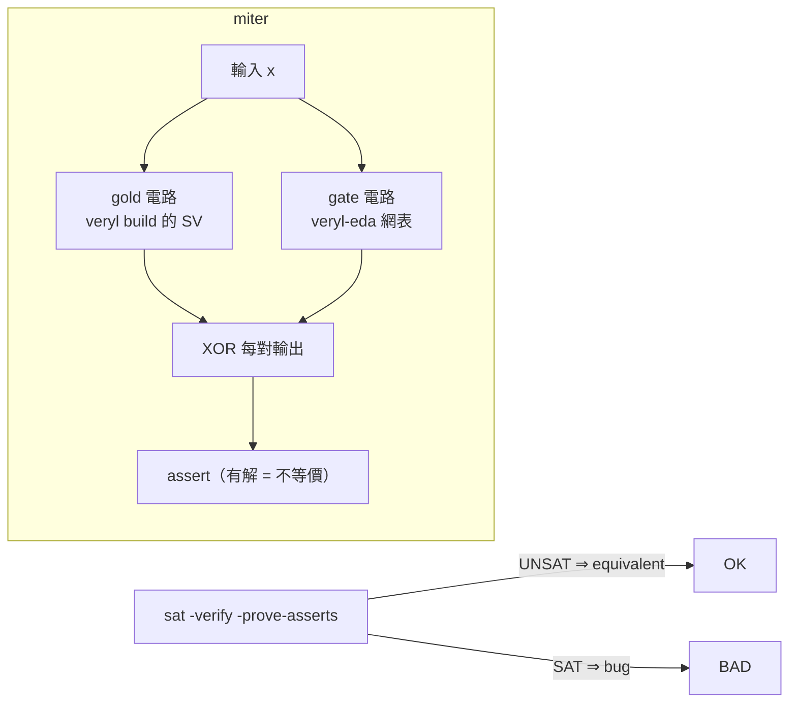
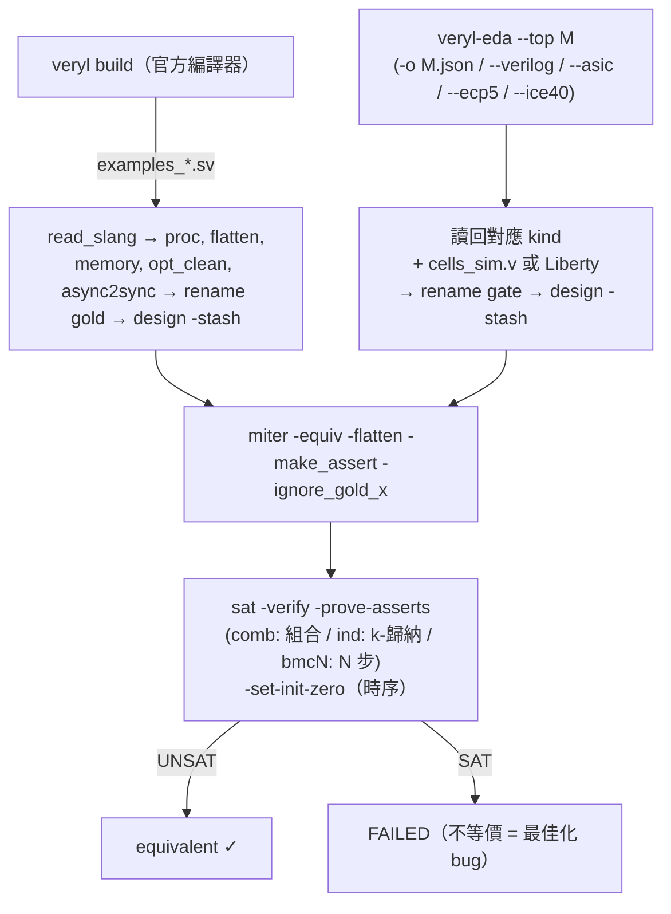

# 3.12 等價性檢查：miter 電路與 yosys SAT 證明

> 來源：`veryl-eda/test.sh`（第 125–173 行）、yosys `sat`/`miter` 指令；gold 來源：`veryl build` 的 SystemVerilog

## 3.12.1 為什麼需要形式等價性檢查

本書到目前為止的驗證都是**模擬**：隨機或定向圖樣，跑斷言。模擬能證明「有 bug」卻不能證明「沒 bug」。第 3.7、3.8、3.9、3.10 節的所有最佳化 —— sweep、stuck-at-0 FF 移除、常數證明、LUT 覆蓋、進位鏈抽取 —— 每一步都在改電路，每一個都可能有 off-by-one。等價性檢查用數學回答一個問題：

$$\forall \text{輸入序列 } x, \forall \text{時間 } t:\quad \mathrm{gold}(x, t) = \mathrm{gate}(x, t)\ ?$$

其中 gold 是**被信任的參考**（`veryl build` —— 官方 Veryl 編譯器產生的 SystemVerilog），gate 是**被驗證的對象**（veryl-eda 的閘網表或其映射結果）。這是教科書上最乾淨的架構：兩個獨立實作互相比對，任何一方的 bug 都會顯形。

## 3.12.2 miter 電路：把「等價」變成「不可滿足」

**miter** 是一種比較電路：把兩個設計的同名輸入並聯，輸出接到一個 XOR（組合等價）或一個帶狀態比較的時序監視器（時序等價），若存在輸入使 XOR 輸出 1，則兩者不等價。

$$\mathrm{equiv} \iff \neg\exists x:\ \bigvee_o \big(\mathrm{gold}_o(x) \oplus \mathrm{gate}_o(x)\big)$$

也就是說，「等價」對應 SAT 問題的 **UNSAT**（不可滿足）。

`test.sh:165` 生成 miter：

```bash
miter -equiv -flatten -make_assert -ignore_gold_x gold gate miter
hierarchy -top miter
```

逐旗標解讀：

| 旗標 | 意義 |
|---|---|
| `-equiv` | 建立等價 miter（兩個模組同名輸出相比較）|
| `-flatten` | 兩側先展平成扁平閘級再比較 |
| `-make_assert` | 把「輸出不等」寫成 SystemVerilog `assert`，供 `sat -prove-asserts` 消費 |
| `-ignore_gold_x` | gold 的 x（未初始化位元）不算不等 —— 這對 `-set-init-zero` 是必要補充 |



## 3.12.3 gold 的準備：slang 前端

等價性檢查需要能讀 Veryl 官方編譯器輸出的 yosys。`test.sh:125-128`：

```bash
if ! "$YOSYS_SLANG" -m slang -p "help read_slang" > /dev/null 2>&1; then
    echo "== skipping equivalence check: no yosys with slang at $YOSYS_SLANG"
    exit $fail
fi
```

slang 是 SystemVerilog 前端（外掛形式載入 `-m slang`）。Homebrew 的 yosys 沒有這個 plugin，所以固定用 oss-cad-suite 的版本（`YOSYS_SLANG` 變數，預設 `/Users/Shared/ccc/oss-cad-suite/bin/yosys`）。AGENTS.md 特別提醒：「Homebrew `yosys` cannot parse veryl's enum casts/functions」—— veryl build 的輸出用了 enum cast 與函數，只有 slang 能吃。

gold 模組名有個約定（`test.sh:149`）：

```
read_slang $gold --top examples_$m
```

`veryl build` 從 `examples/` 專案編譯，產生的模組名前綴是專案名 —— gold 模組叫 `examples_Adder` 這種形式；腳本隨後 `rename examples_$m gold` 把它改成中立的名字，與 gate 側配對。

## 3.12.4 時序設計：`-set-init-zero` 的原因

`test.sh:139-143` 的三種證明模式：

```bash
case $mode in
    comb) prove="sat -verify -prove-asserts miter" ;;
    ind)  prove="sat -verify -prove-asserts -set-init-zero -tempinduct -seq 1 miter" ;;
    bmc*) prove="sat -verify -prove-asserts -set-init-zero -seq ${mode#bmc} miter" ;;
esac
```

`comb` 是純組合設計（加法器、ALU），一個時間步就夠。時序設計（`ind` = k-歸納、`bmcN` = N 步有界模型檢查）需要兩個額外的決定：

**（1）`-set-init-zero`。** SAT 引擎不知道每個 FF 的上電值 —— SystemVerilog 裡它們是 x。若讓 SAT 自由選擇初值，它會挑一個讓兩側分歧的初值而誤報不等價（gold 與 gate 對 x 的處理不同：gold 保留 x 傳播，gate 是 2 值邏輯）。把兩側的初值都釘在 0，問題變成有界的、可判定的。這背後正是第 3.7 節說的平台假設：

> The optimizer assumes flip-flops power up at 0 (true on iCE40); never-written registers become constants.

最佳化器刪掉了「永不離開 0」的 FF；等價性檢查若不給兩邊同樣的 0 初始化，這條最佳化根本無法對帳。**兩側共享同一假設，檢查才公平** —— 這就是 `-set-init-zero` 存在的數學理由。

**（2）`-seq N` 與 `-tempinduct`。** 時序等價一般需要無界時間的證明；`sat` 指令的 `-seq N` 只檢查前 N 個週期（BMC，bounded model checking）—— 不完備但快，對 `RiscvSoc` 用 `bmc80`（80 週期，足夠跑一條指令的取指-譯碼-執行-訪存全程）。`-tempinduct` 做 k-歸納（`-seq 1`：假設任意 1 週期狀態對成立、證明下一週期仍成立），通過則是**無界**證明 —— 只有結構相近的設計（如 `Seq101` 序列偵測器）才歸納得動。

ECP5 側還有一行（`test.sh:157`）：

```
attrmap -remove init
```

AGENTS.md 解釋：「ECP5 flip-flops power up at `REGSET`, so the formal check drops yosys' init values (attrmap -remove init)」—— ECP5 的 FF 上電值由 `REGSET` 參數決定而非 0，yosys JSON 裡的 `init` 屬性與 gold 側（被 `-set-init-zero` 钉 0）不一致，刪掉它讓檢查回到「初值不比較」的狀態。

## 3.12.5 五種 kind：驗證整條後端

`test.sh:135` 的外層迴圈：`for kind in gate asic sky130 ecp5 fpga`。gate 側的準備各不相同：

```bash
case $kind in
    (gate)   echo "read_json $OUT/$m.json" ;;
    (asic)   echo "read_verilog $OUT/${m}_asic.v; hierarchy -top $m; proc; flatten; memory; opt_clean" ;;
    (sky130) echo "read_liberty .../sky130_fd_sc_hd__tt_025C_1v80.lib; read_verilog ${m}_sky130.v; ..." ;;
    (ecp5)   echo "read_json ${m}_ecp5.json; read_verilog -lib +/ecp5/cells_sim.v; ...; attrmap -remove init" ;;
    (fpga)   echo "read_json ${m}_ice40.json; read_verilog -lib -specify +/ice40/cells_sim.v; ..." ;;
esac
```

意義分層：

1. **gate**：generic 閘網表本身 —— 驗證第 3.7/3.8 節的所有最佳化。
2. **asic**：vlib 標準單元映射 —— 驗證樹覆蓋映射器。
3. **sky130**：PDK 標準單元，行為模型來自 **Liberty 檔的 function 屬性**（`read_liberty`）—— 順帶驗證 PDK 綁定表。
4. **ecp5**：`LUT4`/`CCU2C`/`TRELLIS_FF`，模型來自 yosys techlib。
5. **fpga**：iCE40 網表，含 `SB_RAM40_4K` —— 驗證第 3.10 節的進位鏈與 `bram.rs` 的 RAM 推斷（只對 `FPGA_EQ` 中的 RAM 設計跑，因為 SAT 對 4K 位記憶體很貴）。

兩側共同的準備（`test.sh:150, 160`）：`proc; flatten; memory; opt_clean; async2sync`。`async2sync` 把非同步重置轉成同步邏輯 —— SAT 引擎處理不了非同步事件。

## 3.12.6 完整流程圖



## 3.12.7 檢查矩陣與成本

`DESIGNS` 表（test.sh:29-36）給每個設計指定證明模式，是**成本 vs 覆蓋**的手工調優：

| 模式 | 設計 | 理由 |
|---|---|---|
| `comb` | Adder, Max3, AluUnit, GrayConv, BitRev, Shifter, Funcs, Wide, Div… | 純組合，SAT 一次搞定，最強證明 |
| `ind` | Seq101, PktReg, Counter | 狀態少、結構規整，k-歸納能收斂 |
| `bmcN` | Ram(bmc8), RiscvCore(bmc2), RiscvSoc(bmc80), Fifo(bmc6), UartLoop(bmc24)… | 狀態空間大（RAM、寬計數器），只能有界；N 選到能覆蓋一個「有意思的行為窗口」 |

BMC 不完備的風險由**多樣性**緩解：同一最佳化 bug 幾乎不可能只在一個 N 窗口顯形；加上 `test.sh` 的 gatesim 全型別模擬與 `cargo test` 的閘級 testbench，三層覆蓋互相補位。AGENTS.md 對此的總結：「The yosys formal checks (`veryl-eda/test.sh`) are not in CI」—— 因為它們需要 oss-cad-suite 與 20 分鐘級的 SAT 時間，CI 只跑模擬層；正式檢查在本地全跑。

## 3.12.9 SAT-based 組合等價性的原理

最後補齗數學底層。`sat -verify -prove-asserts miter` 的內部流程：

1. **位元 blast**：每個 cell 的語義被寫成 CNAT 子句。`$_AND_` 是 3 個子句（Tseitin 編碼）：

$$y \leftrightarrow a \land b \;\equiv\; (\bar y \lor a) \land (\bar y \lor b) \land (y \lor \bar a \lor \bar b)$$

`$_MUX_`、`$_XOR_`、FF 的轉移關係同理。整個 miter 電路 → 一個大的 CNAT 公式 $F$。

2. **斷言條件**：`-prove-asserts` 把 miter 的 assert（兩側輸出不等）加入為 $\neg A$，求解目標是 $F \land \neg A$ 是否可滿足。
3. **時序展開**：`-seq N` 把 FF 轉移關係複製 N 次（時間幀展開），初值子句由 `-set-init-zero` 固定為 0：

$$F_{\mathrm{unroll}} = T(s_0, s_1) \land T(s_1, s_2) \land \cdots \land T(s_{N-1}, s_N) \land (s_0 = 0) \land \bigvee_{t \le N} \neg A_t$$

4. **SAT 求解**：UNSAT ⇒ 前述蘊含式成立 ⇒ 等價（在 N 步內）；SAT ⇒ 求解器直接給出反例圖樣（waveform 上可以重放）。

為什麼 SAT 對**結構相近**的兩個電路特別有效：CDCL 求解器的衝突學習（learned clauses）很快推出「兩側內部訊號恆等」的子句，等價類像波一樣從輸入向輸出傳播 —— 若 gold 與 gate 的差異只在一兩個最佳化步驟，證明近乎線性時間。這也是為什麼 `comb` 模式對大 ALU 也只要幾秒，而 `RiscvSoc` 的 bmc80 要幾分鐘（RAM 展開讓子句數爆炸）。

## 3.12.10 信任鏈與本書各章的對應

```
gold:  Veryl 原始碼 → veryl build → .sv → read_slang（官方語義）
gate:  Veryl 原始碼 → elab 符號執行 → netlist 最佳化（3.7, 3.8）
                                     → LUT 覆蓋 + carry（3.9, 3.10）
                                     → JSON / Verilog（3.11）→ yosys 讀回
兩側  → miter → sat → UNSAT?
```

每個最佳化章節的「為什麼敢做」最終都指向本章：

| 最佳化 | 可能錯法 | 被哪個 kind 抓 |
|---|---|---|
| sweep 砍錯 cell | 輸出少了一條依賴 | gate / 全部 |
| stuck-at-0 FF 誤刪 | 時序行為改變 | comb 以外的模式（需要 `-set-init-zero` 對齊假設）|
| `const_nodes` 假警報 | 組合函數被改掉 | gate（comb 設計完備證明）|
| LUT 覆蓋 / `LUT_INIT` 算錯 | 映射函數錯 | ecp5 / fpga |
| 進位鏈腳位配對錯 | sum 或 carry 錯 | fpga |
| RAM 推斷漏了模式 | 讀寫行為錯 | fpga（只對 `FPGA_EQ` 的 RAM 設計）|

## 3.12.11 局限與未來

誠實地列出這套檢查的邊界：

- **BMC 不完備**：`bmcN` 只證 N 步；理論上存在「第 N+1 步才分歧」的 bug。緩解：N 的選擇覆蓋設計的一個行為週期（如 UART 一幀、SoC 一條指令）。
- **記憶體大設計不敢全證**：`FPGA_EQ` 只有四個 RAM 設計；`SKY130_MAP_ONLY` 裡的深記憶體（Bram2048x2）在 SKY130 上是數千個 FF，等價性只跑映射、不跑 P&R 後。
- **初值假設是公理不是定理**：若真實晶片的 FF 上電值不是 0（如某些製程的隨機初值），stuck-at-0 移除與等價性檢查同時失效 —— 這是整個方法論的地基，iCE40 恰好滿足。
- **不驗證 P&R 本身**：佈局布線的檢查走另一條路（`fpga/cosim.py` 把 `.asc` 用 icebox_vlog 反讀回模擬），那是物理驗證的領域，超出本章。

## 3.12.12 偽代碼：eq_\<M\>.ys 的完整骨架

把 `test.sh:148-168` 的 heredoc 展開成一個等價性腳本的通用骨架：

```
# gold 側
read_slang gold/target/<files>.sv --top examples_<M>
proc; flatten; memory; opt_clean; async2sync
rename examples_<M> gold
design -stash gold

# gate 側（kind 決定輸入）
read_json M.json                     # 或 read_verilog + read_liberty + techlib
hierarchy -top M; proc; flatten; memory; opt_clean
async2sync
rename M gate
design -stash gate

# 合併與證明
design -copy-from gold -as gold gold
design -copy-from gate -as gate gate
miter -equiv -flatten -make_assert -ignore_gold_x gold gate miter
hierarchy -top miter
sat -verify -prove-asserts [-set-init-zero] [-tempinduct] [-seq N] miter
```

`design -stash` / `-copy-from` 是 yosys 的多設計工作區：兩個設計各自整理好、存起來，最後一起放進 miter 的命名空間。整個腳本沒有一行 veryl-eda 自己的程式 —— 驗證完全建立在第三方工具之上，這正是它可信的原因。

## 3.12.13 為什麼這樣設計

- **gold 用官方編譯器而非自寫的參考**：自寫參考會共享同一批對 veryl 語義的誤解（共模失效）；`veryl build` 是語義的權威定義（`veryl check` 同源）。
- **miter + SAT 而非 BDD**：BDD 在乘法器上爆炸；SAT 對結構等價（本專案的所有改動都是結構級）幾乎線性收斂。yosys 的 `sat` 指令一行搞定，不必寫 CNAT 導出。
- **檢查「映射後」而非只檢查「最佳化後」**：五種 kind 覆蓋到 bitstream 前的最後一層網表，任何映射 bug（例如第 3.10 節腳位配對錯了）都會在 SAT 上現形，而不需要真的上板。
- **`-ignore_gold_x`**：gold 是 4 值語義、gate 是 2 值；不忽略 x 的話連「gold 未初始化」都會誤報。這與 `-set-init-zero` 一起構成「兩側語義對齊」的完整配方。

## 3.12.14 失敗時會看到什麼

等價性檢查失敗時，`test.sh` 的輸出是：

```
gate  RiscvCore   bmc2  FAILED (see /tmp/.../eq_gate_RiscvCore.log)
```

打開 log，yosys 的 `sat` 會印出**反例**：哪個輸入序列、第幾個時間步、哪個輸出訊號兩側分歧。實務排查路徑：

1. 分歧在**第 0 步、輸出埠** → 組合邏輯被改壞：先懷疑 `const_nodes` 或映射真值表（3.8/3.9 節）。
2. 分歧在**第 0 步、FF 輸出** → 初始化問題：檢查 `-set-init-zero` 是否漏加、stuck FF 判定是否誤傷（3.7 節）。
3. 分歧在**第 N>0 步** → 時序行為差：常見是重置極性/同步性（`async2sync`）、或 ECP5 的 `init` 屬性沒刪。
4. 只在某一個 kind 失敗 → 該後端的問題：`ecp5` 的字串參數尾空格、`fpga` 的 RAM 模式、`sky130` 的 Liberty 綁定。

這個「分歧位置 → 嫌疑範圍」的映射是除錯等價性失敗的實用起點，也是本書把等價性放在最佳化各章之後的原因：每章的「為什麼敢做」在這裡都有對應的失效模式。

## 3.12.15 本章重點

- 等價性 = miter 電路的 UNSAT；`miter -equiv -flatten -make_assert` + `sat -verify -prove-asserts` 是 yosys 的標準配方。
- gold 來自官方 `veryl build` 的 SystemVerilog，經 slang plugin 讀入 —— 避免共模失效，且金標準與語義定義同源。
- `-set-init-zero` 把「FF 上電值為 0」這一最佳化假設同時施加到兩側；`-ignore_gold_x` 對齊 4 值與 2 值語義；ECP5 還要 `attrmap -remove init`（其 FF 上電值是 `REGSET`）。
- 三種證明模式：`comb`（完備）、`ind`（k-歸納，無界）、`bmcN`（N 步有界，不完備但可擴展到大設計如 RiscvSoc bmc80）。
- 五種 kind（gate/asic/sky130/ecp5/fpga）把驗證延伸到映射後網表，Liberty function 與 techlib cells_sim.v 充當標準單元的行為模型。
