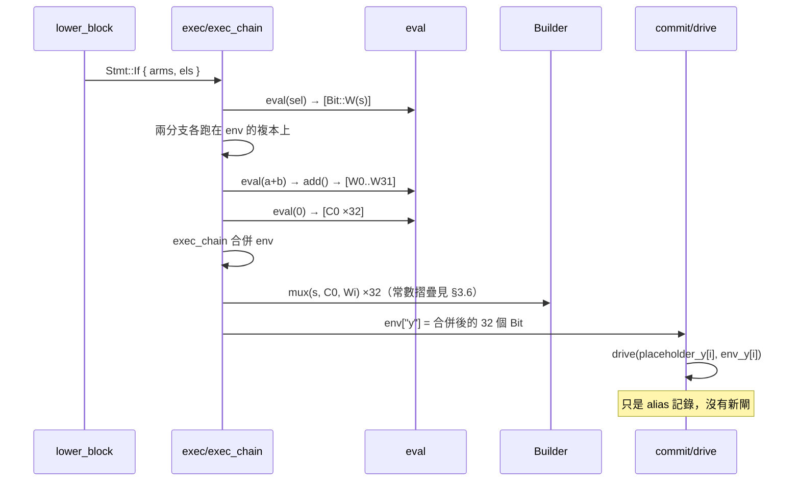

# 3.2 符號執行成閘：elab.rs 的核心機制

> el化器（elaborator）的檔頭註解一句話講完它的哲學：
>
> ```text
> //! Deliberately separate from veryl-sim's elaborator: synthesis needs a
> //! name-based statement IR that is *symbolically executed* (if/case become
> //! muxes, loops are unrolled, functions are inlined), not a simulator IR.
> ```
>
> 模擬器（veryl-sim）在**執行期**求值；綜合器在**編譯期**對「符號」（尚未
> 知道的位）做同樣的求值——求值結果不是數值，而是**閘輸出的線網編號**。

## 3.2.1 兩種語義、同一套執行骨架

模擬器把 `a + b` 算成一個 `Bits` 值；綜合器把 `a + b` 算成 `w` 條線，每條線
是 ripple-carry 加法器的對應輸出。關鍵是兩者共用同一個「敘述逐條執行、
環境逐項更新」的骨架：

| | veryl-sim | veryl-eda（本章） |
|---|---|---|
| 環境中的值 | `Bits`（4 態位向量） | `Vec<Bit>`（常數或線網） |
| 執行一次 `if` | 跳到選中的分支 | **兩個分支都執行**，結果用 mux 合併 |
| 執行一次 `for` | 迭代 | 邊界必須是常數，直接展開 |
| 函式呼叫 | 建立呼叫框 | 內嵌執行（§3.3） |

「符號」就是 `netlist::Bit`：

```rust
/// A single bit: compile-time constant or a wire (net id >= 2, as in yosys JSON).
pub enum Bit {
    C0,
    C1,
    W(u32),   // 線網編號
}
```

`Bit::C0` / `Bit::C1` 是編譯期常數；`Bit::W(w)` 是一條（可能是閘輸出的）線。
**一個 32 位訊號就是 32 個 `Bit` 的 lsb-first 向量**——這是整個引擎的基本資料型。

## 3.2.2 Placeholder wire：先宣告、後驅動

每個被宣告的訊號在 `declare()` 時就拿到一批 placeholder 線（elab.rs:781）：

```rust
fn declare(&mut self, sc: &mut Scope, name: &str, ty: TypeInfo) -> Vec<Bit> {
    let total = ty.w * ty.arr.unwrap_or(1);
    let bits = self.b.wires(total);
    self.nets.push((sc.qual(name), bits.clone()));
    sc.sigs.insert(name.to_string(), SigInfo { bits: bits.clone(), ty });
    sc.order.push(name.to_string());
    bits
}
```

這些線一開始**沒有驅動者**。為什麼要這樣？

1. **項目順序無關**。Veryl 允許 `assign y = x;` 出現在 `var x` 之前、模組項目
   之間互相引用。先把所有訊號變成已存在的線，`items()` 就能分兩趟走：
   `pass1` 收集宣告（變數、常數、函式、import），`pass2` 處理行為。
2. **驅動只是記帳**。賦值不把線「接走」，而是登記一條 alias。

## 3.2.3 Alias：驅動 = 一條別名

`drive()` 是所有賦值的最終落點（elab.rs:791）：

```rust
/// Record that placeholder bit `p` is driven by `d`.
fn drive(&mut self, p: Bit, d: Bit, what: &str) -> R<()> {
    if p == d { return Ok(()); }
    let Bit::W(w) = p else { return Err(format!("'{}' cannot be driven", what)) };
    if !self.driven.insert(w) { return Err(format!("'{}' has multiple drivers", what)); }
    self.alias.insert(w, d);
    Ok(())
}
```

三件事：

- placeholder `w` 的驅動者是 `d`（可能是常數、另一條線、或某顆閘的輸出）；
  這條關係存進 `Synth.alias: HashMap<u32, Bit>`。
- `driven` 集合做**多驅動檢查**——同一條 placeholder 被驅動兩次就是硬體錯誤
  （two drivers），這在符號執行期就能報出來。
- `p == d`（自我驅動，例如 `assign x = x;`）靜默忽略。

alias 在建網表時才被解析。`netlist::elaborated` 裡的 `resolve` 順著 alias
鏈走到盡頭（netlist.rs:374）：

```rust
let resolve = |mut x: Bit| -> R<Bit> {
    let mut n = 0;
    while let Bit::W(w) = x {
        match alias.get(&w) { Some(&y) => x = y, None => break }
        n += 1;
        if n > alias.len() + 1 { return Err(format!("combinational loop through net {}", w)); }
    }
    Ok(x)
};
```

步數上限 `alias.len() + 1` 同時是**組合迴圈偵測**：alias 鏈理論上是樹，
走超過總長度代表有環。

## 3.2.4 一次賦值的完整旅程

以組合區塊

```veryl
always_comb {
    if sel {
        y = a + b;
    } else {
        y = 0;
    }
}
```

為例，`pass2` → `AlwaysCombDeclaration` 分支（elab.rs:962）：

```rust
GenerateItem::AlwaysCombDeclaration(x) => {
    let body = lib.lower_block(sc, &x.always_comb_declaration.statement_block)?;
    let mut env = Env::new();
    self.exec(sc, &body, &mut env)?;
    self.commit(sc, &env)?;
}
```

執行軌跡：



**這就是「賦值 = 對閘輸出的符號賦值」**：`y = a + b` 沒有「把值存進 y」，
而是讓 y 的 placeholder 線**別名**到加法器輸出線。硬體上 y 與加法器輸出
是同一條線——這正是 Verilog 連續賦值的語義。

## 3.2.5 Env：符號執行的工作暫存器

`Env = HashMap<String, Vec<Bit>>` 記錄「本區塊已指派、尚未 commit」的值。
讀取時優先看 env，再查訊號表（`cur()`，elab.rs:1215）：

```rust
fn cur(&self, sc: &Scope, env: &Env, name: &str) -> R<Vec<Bit>> {
    if let Some(v) = env.get(name) { return Ok(v.clone()); }
    match sc.sigs.get(name) {
        Some(si) if !si.bits.is_empty() || si.ty.w == 0 => Ok(si.bits.clone()),
        _ => Err(format!("undeclared signal '{}'", name)),
    }
}
```

env 的另一個角色出現在 `always_ff`：`registered()`（elab.rs:1210）規定區塊內
讀模組訊號**永遠繞過 env、直接讀 placeholder**（即暫存器輸出）——這是
non-blocking 語意的實作，詳見 §3.4。

## 3.2.6 write()：部分賦值如何變成閘

整訊號賦值只是 alias；**部分賦值**（陣列元素、位切片）必須造閘。`write()`
（elab.rs:1248）處理三種 `Sel`：

```rust
Sel::All   => nv = pad(val, w),                       // 整條換掉：無閘
Sel::Index(i) => { ...每個元素 k:
    let hit = match const_of(&idx) { Some(c) => Bit::of(c as usize == k),
                                      None => self.b.decode(&idx, k) };
    for j in 0..ew { nv[k*ew + j] = self.b.mux(hit, cur[k*ew + j], at(val, j)); }
}
Sel::Range(..) | Sel::Plus(..) | Sel::Minus(..) => {  // 常數界：直接改位
    for k in lo..=hi { nv[k] = at(val, k - lo); }
}
```

- 常數索引/範圍：純位替換，**零閘**。
- 動態索引 `a[i] = v`：每個元素一個 `decode(idx, k)`（其實是等值比較）與
  一個 mux——寫入多工器。若 `i` 是常數，`decode` 摺疊成 `Bit::C0/C1`，
  mux 隨之被 `Builder::mux` 的摺疊規則吃掉，最後只留該元素的賦值。
  這就是「符號執行 + 立即摺疊」相對於先建大 mux 樹再化簡的優勢實例。

## 3.2.7 階層與命名

模組實例不產生新網表，而是**遞迴符号執行**並以層級路徑為字首：
`self.module(child, &sc.qual(&iname), &ov)?`（elab.rs:1066）。所有訊號的
`net` 名稱是 `inst.inst.sig` 展平後的字串，所以最終網表是單一模組——
層級只存在於名字裡。介面同理：`inst b: Bus;` 變成訊號 `b.member`。

## 3.2.8 名稱解析：從 token 序列到 Expr

符號執行的輸入不是 veryl-parser 的語法樹節點，而是先經 `Lib::parse`
（elab.rs:240）轉成 `expr.rs` 的 `Expr`：

```rust
pub fn parse(&self, sc: &Scope, t: &[String]) -> R<Expr> {
    parse_expr(t, &|p| self.resolve(sc, p), &|sig, f| {
        sc.sigs.get(sig)?.ty.fields.iter().find(|(n, _, _)| n == f).map(|(_, lo, w)| (*lo, *w))
    })
}
```

- 第一個回呼 `resolve`：把識別字路徑解析成 `Res::Const`（參數/enum 值，
  立即折疊）、`Res::Fn`（可呼叫函式）或 `Res::Sym`（訊號——留待執行期）。
- 第二個回呼：struct 欄位的位偏移（packed struct、**第一欄位是 MSB**，
  與 SystemVerilog 一致）。

`Expr` 是 `Num / Sym / Index / Slice / Un / Bin / Tern / Concat / Call`
的簡單 enum；`Expr::Bin` 的運算子字串直接取自源碼（`"<:"`、`">:"` 等，
繞開 Veryl 0.22 解析器對裸 `<`/`>` 的限制）。語句層的 `Stmt`（elab.rs:403-411）
同樣精簡：

```rust
pub enum Stmt {
    Set { name: String, sel: Sel, rhs: Expr },
    Local { name: String, w: u32 },
    If { arms: Vec<(Expr, Vec<Stmt>)>, els: Vec<Stmt> },
    IfReset { reset: Vec<Stmt>, arms: Vec<(Expr, Vec<Stmt>)>, els: Vec<Stmt> },
    Case { sel: Expr, arms: Vec<(Vec<CaseItem>, Vec<Stmt>)>, def: Vec<Stmt> },
    Switch { arms: Vec<(Vec<Expr>, Vec<Stmt>)>, def: Vec<Stmt> },
    Return(Expr),
}
```

**7 個變體**涵蓋全部可綜合語句。lowering（`lower_stmt`）只是把語法樹的
巢狀 list 結構壓平：`if/else-if/else` → `arms + els`、`case` 條件的
`lo..hi` 範圍 → `CaseItem::R(lo, hi, incl)`、`for` 的常數界檢查與迴圈
變數注入。值得注意的是 `$display` 等系統任務在此被靜默丟棄：

```rust
if lhs.first().map(|t| t.starts_with('$')).unwrap_or(false) {
    return Ok(()); // $display etc.: no hardware
}
```

## 3.2.9 eval：運算子到閘的對照表

`Synth::eval`（elab.rs:1484）是運算式求值的總入口，`eval_bin` 是對照表：

| 源碼運算子 | Builder 呼叫 | 硬體 |
|---|---|---|
| `+` / `-` | `add` / `sub` | ripple-carry（`add_c`，進位鏈辨識留給映射器） |
| `*` | `mul` | shift-and-add 陣列乘法器 |
| `/` `%` | `udivmod` / `sdivmod` | restoring 除法（每步 sub + compare） |
| `<<` `>>` | `shift` | log 深度桶形移位器 |
| `==` | `eq` | `xnor` 逐位 + `reduce_and`（平衡樹） |
| `<` | `ult` / `slt` | `a + ~b + 1` 的進位輸出取反 |
| `&&` `||` `!` | `reduce_or` + `and`/`or` | 歸約成 1 位再算 |
| `? :` | `muxv` | 逐位 mux |

幾個語意細節值得記住：

- **位寬語意**：`ctx` 參數是「上下文位寬」（0 = self-determined）；
  `fit()` 依 `signed()` 判斷補 0 或符號擴充，`signed()` 沿用 Verilog 規則
  （全部運算元有號結果才有號）。
- **移位量的常數摺疊**：`shift_const` 在移位量是常數時純位重排，零閘；
  動態時才產生桶形移位器，且超寬的剩餘移位量用 `reduce_or` 飽和
  （elab.rs:1667）。
- **`**` 只在兩運算元皆常數時可綜合**，否則報錯——指數沒有合理的組合
  電路形態。

## 3.2.10 寬度與型別資訊

`Scope`（elab.rs:370-380）是符號執行的符號表：

```rust
pub struct Scope {
    pub prefix: String,                        // 層級路徑，如 "soc.core"
    pub consts: HashMap<String, Val>,          // 參數 / 常數 / 迴圈變數
    pub sigs: HashMap<String, SigInfo>,        // 訊號 → placeholder bits + 型別
    pub order: Vec<String>,                    // 宣告順序（找預設 clock/reset）
    pub fns: HashMap<String, Rc<FnDef>>,       // 函式定義
    pub imports: HashMap<String, String>,      // import 的全名映射
    pub ports: Vec<(String, Dir)>,
}
```

`TypeInfo` 帶 `Kind`（`Clock(bool)` / `Reset { low, asynch }`）——這讓
`always_ff` 能在**沒有明寫時鐘**時自動找到模組的 clock/reset（§3.4.4），
也讓 reset 型別的極性/同步性直接決定 `$_SDFF_` 與 `$_DFF_*R*_` 的選擇。

## 為什麼這樣設計

- **alias 延後解析**讓 lowering 完全不用管驅動順序，多驅動錯誤又在執行期
  就被抓到；解析成本只是一次 HashMap 查表的鏈。
- **placeholder 即硬體線**：最佳化後某條線若被摺成常數，`net` 名稱仍然保留
  訊號語意，波形與除錯都靠它。
- **env 複本 + mux 合併**（§3.3 詳述）把「程式控制流」翻譯成「資料路徑」
  的責任完全集中在 `exec_chain` 一個函式，其他程式碼可以假設自己在寫
  直線程式。

## 本章重點

- 符號執行的「值」是 `Vec<Bit>`：常數位或線網編號；執行語句就是在組裝閘。
- 每個訊號先拿 placeholder 線，驅動關係以 `alias: HashMap<u32, Bit>` 記帳，
  解析與迴圈偵測延到 `elaborated`/`rebuild`。
- 賦值的三種形態：整訊號 = alias（零閘）、常數部分 = 位替換（零閘）、
  動態部分 = decode + mux 樹。
- env 是區塊內的符號暫存器，`commit` 才把 env 內容 alias 到 placeholder。
