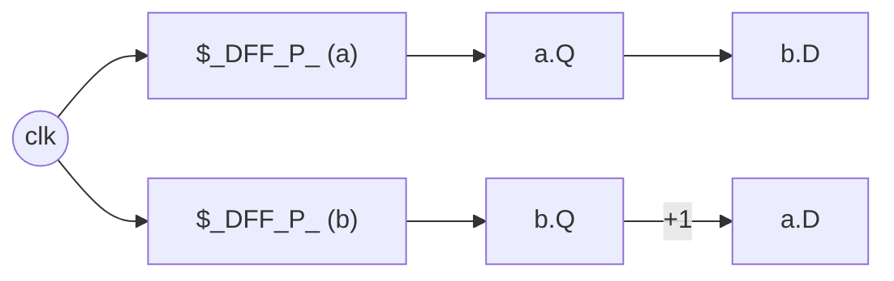
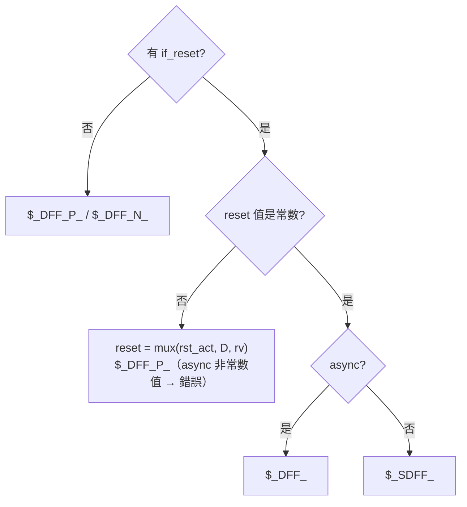

# 3.4 正反器推斷：always_ff 的 non-blocking 語意

> 組合區塊裡「賦值」是 alias（§3.2）；時序區塊裡「賦值」是**接一顆 DFF 的
> D 腳**。`Synth::always_ff`（elab.rs:1102-1204）是本引擎唯一產生 flip-flop
> 的地方，不到一百行，卻處理了 clock 極性、sync/async reset、reset 值與
> clock enable 的全部組合。

## 3.4.1 執行兩遍：normal 與 reset 環境

`always_ff` 的策略是把區塊體執行**兩次**（elab.rs:1143-1148）：

```rust
self.ff = Some((self.ff_blocks, ck, pos));
let reset = if let Some(Stmt::IfReset { reset, arms, els }) = body.first() {
    ...
    self.exec(sc, reset, &mut env_r)?;                                  // reset 分支
    self.exec(sc, &[Stmt::If { arms: arms.clone(), els: els.clone() }], &mut env_n)?; // 正常路徑
    Some((rb, low, asynch))
} else {
    self.exec(sc, &body, &mut env_n)?;
    None
};
```

- `env_n`：**下一態** $D$——時鐘沿到達、且沒有 reset 時的值。
- `env_r`：**reset 態**——`if_reset` 主體執行後的值。

若 `if_reset` 是區塊的第一個語句（Veryl 要求它必須是唯一的頂層語句），
`env_r` 只吃 reset 主體，`env_n` 吃其餘部分；沒有 `if_reset` 時 `env_r`
是空的。每個訊號的 reset 值 $R$ 與下一態值 $D$ 由此分開取得。

## 3.4.2 non-blocking 語意：區塊內讀到的是暫存器輸出

核心在 `registered()`（elab.rs:1210）與讀取路徑的協作：

```rust
/// inside always_ff, a module signal reads as its register output (the
/// assignments are non-blocking), not as the value assigned so far
fn registered(&self, sc: &Scope, n: &str) -> bool {
    self.ff.is_some() && sc.sigs.get(n).map(|s| !s.bits.is_empty()).unwrap_or(false)
}
```

`eval()` 讀訊號時的優先序（elab.rs:1489-1497）：

```rust
Expr::Sym(n) => {
    if let Some(v) = env.get(n) { if !self.registered(sc, n) { return Ok(v.clone()); } }
    if let Some(si) = sc.sigs.get(n) { ... return Ok(si.bits.clone()); }
    ...
}
```

組合區塊：env 有值就讀 env（blocking，最後一次賦值生效）。
**always_ff 內：即使 env 有值也讀 `si.bits`**——也就是 placeholder 線，
亦即該訊號 flip-flop 的 Q 輸出。考慮

```veryl
always_ff {
    a = b + 1;
    b = a;          // non-blocking: 讀到的是「上一拍的 a」
}
```

兩次賦值產生兩顆 DFF：`a` 的 D 是 `b.Q + 1`，`b` 的 D 是 `a.Q`——
沒有環、沒有優先序問題，這正是 non-blocking 語義的定義：

$$
a^{+} = b + 1,\qquad b^{+} = a \qquad(\text{同步更新，右邊全是舊值})
$$



## 3.4.3 cell 型別的選擇矩陣

每個訊號的每個位元，依 $(D, R, \text{reset 屬性})$ 決定 cell（elab.rs:1174-1196）：

```rust
let typ = match reset {
    None => {
        if dn == *qb { continue; }                    // 永遠不變：不產生 DFF
        conns.push(("D", dn));
        format!("$_DFF_{}_", c)                       // $_DFF_P_ / $_DFF_N_
    }
    Some((rb, low, asynch)) => {
        let rp = if low { 'N' } else { 'P' };
        if rv == *qb || !rv.is_const() {
            // no constant reset value: the reset is a mux in front of D
            if asynch && rv != *qb { return Err(...); }
            let act = if low { self.b.not(rb) } else { rb };
            let d = self.b.mux(act, dn, rv);
            if d == *qb { continue; }
            conns.push(("D", d));
            format!("$_DFF_{}_", c)                   // reset 變成 D 路徑上的 mux
        } else {
            let v = if rv == Bit::C1 { '1' } else { '0' };
            conns.push(("D", dn));
            conns.push(("R", rb));
            if asynch { format!("$_DFF_{}{}{}_", c, rp, v) }   // $_DFF_PN0_ 等
            else       { format!("$_SDFF_{}{}{}_", c, rp, v) } // $_SDFF_PN0_ 等
        }
    }
};
```

決策樹：



- `$_SDFF_*`（sync reset DFF）只在 reset 值是**常數**且 reset 是同步時使用；
  async reset 用 `$_DFF_*R*_`。這些命名直接沿用 yosys 內部 cell，JSON 輸出
  不需轉換，`techmap`/`dffunmap` 也能讀。
- **reset 融合**：若 reset 值非常數（例如 reset 到另一個訊號），reset 條件
  被吸收成 D 路徑上的 mux：$D' = \text{MUX}(rst_{act}, D, R)$。
- **無 reset 的 DFF** 在 iCE40 上電值為 0（§3.6 的 stuck-at-0 掃除依賴這點）。
- `if dn == *qb { continue; }`：下一態等於自己的輸出 ⇒ 這個位元永遠保持
  初值，**連 DFF 都不產生**（優化階段還有更強的版本，§3.6）。

## 3.4.4 clock 與 reset 的來源

```rust
let clk = match clk { Some(c) => c,
    None => self.find_kind(sc, |k| matches!(k, Kind::Clock(_))).ok_or("always_ff: no clock found")? };
let pos = !matches!(ci.ty.kind, Kind::Clock(false));
```

- `always_ff @(posedge clk)` 明寫就用明寫的；否則找模組裡第一個 `clock`
  型別的訊號（`find_kind` 按宣告順序掃 `sc.order`）。
- 極性來自型別：`clock_negedge` ⇒ `'N'`；reset 的 `low`/`asynch` 也來自
  型別（`reset_sync_low` ⇒ `Kind::Reset { low: true, asynch: false }`，
  見 `parse_type`，elab.rs:282-287）。

## 3.4.5 clock enable 從哪裡來？

注意 `always_ff` **不產生** `$_DFFE_*` cell——enable 不是這裡的機制，而是
**資料路徑自然形成的**。典型寫法：

```veryl
always_ff {
    if_reset {
        cnt = 0;
    } else if en {
        cnt = cnt + 1;
    }
}
```

`env_n` 只執行 `arms`（else-if 鏈），`en` 為假時 `cnt` 不在 env_n 的賦值裡，
`exec_chain` 合併時以 `base = cnt.Q` 填入：

$$
D = \text{MUX}(en,\; cnt.Q + 1,\; cnt.Q)
$$

$$D = Q \Rightarrow \text{「保持」}\quad\Longleftrightarrow\quad
D = en \cdot (Q+1) + \overline{en}\cdot Q
$$

映射器（`ice40::lut_cover` / `asic::map`）之後會把 `D = MUX(en, x, Q)`
這個 pattern 認成 flip-flop 的 clock-enable：iCE40 的 `SB_DFFE*`、vlib 的
帶 CE cell、ECP5 的 `CEMUX=1` string param。§3.3 的 one-hot hold 最佳化
正是為了讓這個 pattern 在多分支 case 下依然乾淨地浮出來。

換句話說，**CE 推斷被下放給技術映射**，elab 只負責把「else 什麼都不做」
忠實地翻譯成 `D = MUX(cond, new, old)`。這樣 elab 不需要懂任何目標
cell 庫的 enable 語法。

## 3.4.6 多驅動檢查

```rust
if !self.driven.insert(qw) { return Err(format!("'{}' has multiple drivers", full)); }
```

每個訊號位元在一個設計裡只能被一個 `always_ff`（或一個 `always_comb`/`assign`）
驅動；`drive()`（§3.2.3）與這裡共用同一個 `driven` 集合，所以「同一訊號
兩處賦值」在符號執行期就變成編譯錯誤，而不是網表期才發現懸空線。

## 3.4.7 沒被賦值的位元

```rust
let dn = env_n.get(&r).map(|v| at(v, i)).unwrap_or(*qb);
let rv = env_r.get(&r).map(|v| at(v, i)).unwrap_or(*qb);
```

若區塊沒賦值整個訊號（例如只寫了低 8 位），缺的位元 $D=Q$ ⇒ 直接
`continue`，不產生 DFF——訊號的高位在網表裡就是懸空 placeholder，最佳化
階段由 `sweep` 清理。

## 3.4.8 逐步追蹤：一個帶 enable 與 async reset 的計數器

```veryl
module Counter {
    input clk: clock;
    input rst: reset_async_low;
    input en: logic;
    output cnt: logic<8>;
    var r: logic<8>;
    always_ff {
        if_reset {
            r = 0;
        } else {
            r = r + 1;
        }
    }
    assign cnt = r;
}
```

執行軌跡（對照原始碼行號）：

1. `pass1`：`r` 得 8 條 placeholder 線（`declare`），`cnt` 是 1 位寬的
   output placeholder。
2. `pass2` → `always_ff`：
   - clock：明寫 `clk`，`Kind::Clock(true)` ⇒ `pos = true` ⇒ `'P'`；
   - `body.first()` 是 `Stmt::IfReset`，reset 訊號由型別找出：`rst` ⇒
     `Kind::Reset { low: true, asynch: true }` ⇒ `(rb, low=true, asynch=true)`；
   - `env_r`：`r = 0` ⇒ `rv = [C0; 8]`（常數！）；
   - `env_n`：`r = r + 1`，其中 `r` 因 `registered()` 讀到 placeholder ⇒
     `dn = add(r.Q, 1)`——ripple-carry 加法器，`cin = C1`。
3. cell 選擇（elab.rs:1190-1195）：`rv` 是常數 `C0` ⇒
   `format!("$_DFF_{}{}{}_", 'P', 'N', '0')` = **`$_DFF_PN0_`**，
   conns = `[(C, clk), (D, dn), (R, rst), (Q, r[i])]`。
4. `commit`：`cnt` 的 placeholder 經 `drive` alias 到 `r` 的 placeholder——
   輸出埠與暫存器是同一條線。

若把 reset 改成 `reset_sync_high`：`asynch = false` ⇒ **`$_SDFF_PN0_`**。
若 reset 值改成非常數（`r = init_val;`）：走 elab.rs:1182-1189 的 mux 分支，
`D = MUX(~rst, r.Q + 1, init_val)`，cell 退回 `$_DFF_P_`。

### 虛擬碼：cell 選擇一覽

```
for 每個訊號 r、每個位元 i:
    dn = env_n[r][i]  或  r.Q        # 下一態
    rv = env_r[r][i]  或  r.Q        # reset 態
    if 無 reset:
        if dn == r.Q: continue        # 永遠不變 → 無 DFF
        emit $_DFF_P/N_(C=clk, D=dn, Q=r.Q)
    else if rv 非常數 或 rv == r.Q:
        d = mux(rst_active, dn, rv)   # reset 融入 D 路徑
        if d == r.Q: continue
        emit $_DFF_P/N_(C=clk, D=d, Q=r.Q)
    else:                             # 常數 reset 值
        emit $_DFF_/$_SDFF_<C><RP><v>_(C=clk, D=dn, R=rst, Q=r.Q)
```

## 為什麼這樣設計

- **兩遍執行**（normal/reset）比「在 IR 上標記 reset 分支」簡單得多：
  reset 值就是 reset 主體的符號執行結果，與資料路徑共用同一套求值器。
- **non-blocking 靠 `registered()` 一個謂詞**實作，而不是改寫語句——
  讀取時繞過 env，寫入照常進 env，`commit` 時才 alias 到 placeholder。
- reset cell 的選擇完全依 yosys 內部 cell 語法，讓下游客態（yosys、
  nextpnr、自家映射器）零轉換。

## 本章重點

- `always_ff` 執行兩遍得 $D$（env_n）與 $R$（env_r）；`if_reset` 必須是
  區塊唯一的頂層語句。
- non-blocking 語意 = 區塊內讀模組訊號永遠讀 placeholder（Q 輸出），
  由 `registered()` 控制。
- cell 選擇：無 reset → `$_DFF_P_/N_`；常數 reset → `$_DFF/SDFF_<C><RP><v>_`；
  非常數 reset → 融合進 D 的 mux（async 非常數值直接報錯）。
- clock enable 不在 elab 產生；`D = MUX(cond, new, old)` 型態留給映射器
  認出 CE。
- 下一態等於自身輸出的位元不產生 DFF；多驅動在執行期即報錯。
