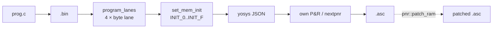

# 3.5 記憶體推斷：$mem 命名網協定與 SB_RAM40_4K

> 陣列是綜合裡最尴尬的結構：預設把它精細化成幾百顆 flip-flop + 解碼器，
> 小則浪費、大則放不進晶片。veryl-eda 的做法分三層：**elab 期記錄使用
> 模式** → **以 `$mem:…` 命名網標記記憶體埠** → **映射期（bram.rs）把符合
> 條件者換成 block RAM**。全程 flip-flop 網表始終有效，block RAM 只是
> 「換掉它」的可選變換。

## 3.5.1 什麼樣的陣列算是記憶體？

判據在 `elab::MemInfo` 的註解裡（elab.rs:750-763）：

```rust
/// How an array is used, recorded while it is elaborated as flip-flops: if
/// it is written only as whole elements from one always_ff (at most one
/// write per cycle) and read only as whole elements, it is a memory with one
/// write port and read ports.
#[derive(Default)]
struct MemInfo {
    bad: bool,
    /// (block, clock, rising edge, we, waddr, wdata)
    write: Option<(usize, Bit, bool, Bit, Vec<Bit>, Vec<Bit>)>,
    /// (address, data placeholder wires)
    reads: Vec<(Vec<Bit>, Vec<Bit>)>,
}
```

| 使用形態 | 判定 |
|---|---|
| `always_ff { ram[addr] = data; }`（整元素、單一區塊、每拍至多一次） | ✔ 寫埠 |
| `x = ram[addr];`（整元素讀） | ✔ 讀埠 |
| 位切片寫 `ram[a][2:0] = v`、非索引整體讀、同拍多次寫 | ✘ `bad = true` |

`write()`（elab.rs:1249-1266）在賦值瞬間記錄寫埠：

```rust
let ok = matches!(sel, Sel::Index(_)) && val.len() == ew as usize && self.ff.is_some()
    && env.get(&we).map(|v| v[0] == Bit::C0).unwrap_or(false) && !env.contains_key("$done");
if ok {
    env.insert(we, vec![Bit::C1]);
    env.insert(mem_key(name, "wa"), pad(&idx, wa));
    env.insert(mem_key(name, "wd"), val.to_vec());
} else {
    self.mems.entry(key).or_default().bad = true;
}
```

四個條件：必須是**元素選擇**（非切片）、寫入寬度恰為元素寬、**在
always_ff 內**、且本拍**尚未寫過**（每拍至多一個寫埠）。讀埠在
`eval()` 的 `Expr::Index` 分支記錄（elab.rs:1512-1525）：

```rust
if let Some((_, r)) = self.mems.get(&key).and_then(|m| m.reads.iter().find(|(a, _)| *a == idx)) {
    return Ok(r.clone());
}
let r = self.b.wires(v.len() as u32);
for (p, d) in r.iter().zip(&v) { if let Bit::W(w) = p { self.alias.insert(*w, *d); } }
self.mems.entry(key).or_default().reads.push((idx, r.clone()));
return Ok(r);
```

同一個位址運算式第二次出現（`ram[addr]` 兩處讀）會共用同一批 placeholder，
`alias` 把它們指向同一棵 mux 樹——所以**讀埠數按「位址運算式的個數」計**，
而不是按程式中出現次數計。

## 3.5.2 `$mem:NAME:{clk,we,wa,wd,raN,rdN}` 命名網協定

`synthesize_stages_with` 尾端把合格的 `MemInfo` 攤平成命名網（elab.rs:1721-1735）：

```rust
for (q, m) in mems {
    let (_, ck, _, we, wa, wd) = m.write.as_ref().unwrap();
    mem_nets.push((format!("$mem:{}:clk", q), vec![*ck]));
    mem_nets.push((format!("$mem:{}:we",  q), vec![*we]));
    mem_nets.push((format!("$mem:{}:wa",  q), wa.clone()));
    mem_nets.push((format!("$mem:{}:wd",  q), wd.clone()));
    for (i, (ra, rd)) in m.reads.iter().enumerate() {
        mem_nets.push((format!("$mem:{}:ra{}", q, i), ra.clone()));
        mem_nets.push((format!("$mem:{}:rd{}", q, i), rd.clone()));
    }
}
```

協定一覽（`NAME` 為層級化訊號名，例如 `soc.mem`）：

| 網名 | 內容 |
|---|---|
| `$mem:NAME:clk` | 寫時鐘（1 位） |
| `$mem:NAME:we` | 寫使能 |
| `$mem:NAME:wa` / `:wd` | 寫位址 / 寫資料 |
| `$mem:NAME:raN` / `:rdN` | 第 N 個讀埠的位址 / 資料 |

**關鍵設計**：此刻陣列本身仍被精細化成 flip-flop（名為 `NAME` 的網，共
`depth×width` 位），讀資料 `rdN` 是 alias 到位址解碼 mux 樹的 placeholder。
`$mem:` 網只是**標籤**，宣告「這些東西可以被換掉」。所以：

- 不用 block RAM 的流程（ASIC、gatesim、gatesim 前的最佳化）完全不受影響；
- `rebuild` 特別保護這些網：記憶體寫埠邏輯即使尚未被讀也保留（因為映射器
  可能把它變成 RAM），netlist.rs:536-547 的 `roots` 擴充就是幹這件事；
- stuck-at-0 掃除（§3.6）明文豁免**從未被寫過**的記憶體——它可以被
  `set_mem_init` 灌入程式，是 ROM 而不是常數 0。

## 3.5.3 bram.rs：從網表裡「認出」記憶體

`bram::find_mems`（bram.rs:49）反向操作：掃描網表，找 `$mem:…:clk` 標籤，
然後**驗證**底下的 flip-flop 結構長得像一塊 RAM：

```rust
let plain_ff = |i: usize| nl.cells[i].typ == "$_DFF_P_" && nl.cells[i].port("C") == Some(clk);
// the storage: rising-edge flip-flops on the write clock ...
for (k, b) in store.iter().enumerate() {
    match q_cell.get(b) { Some(&i) if plain_ff(i) => elems.push(i),
                          Some(_) => continue 'mem,       // 結構不符：放棄
                          None => missing[k % width] = true }
}
```

儲存體必須是寫時鐘上的 `$_DFF_P_`（資料位元沒有讀者時其 flip-flop 已被
sweep 清掉，這種「缺失」是允許的，`missing` 陣列記錄之）。接著每個讀埠的
`rd` 位元必須直接驅動：

1. 一顆 plain DFF 的 D（**同步讀暫存器**），或
2. 一顆 `$_MUX_` 再驅動 DFF 的 D，且 mux 型態為 `D = en ? rd : Q`
   （**讀使能**），

```rust
} else if p == "B" && c.typ == "$_MUX_" && !port_bits.contains(&c.out()) {
    // enable: D = en ? rd : Q
    let uu = users.get(&c.out())...;
    if uu.len() != 1 || uu[0].1 != "D" || !plain_ff(uu[0].0)
        || c.port("A") != Some(nl.cells[uu[0].0].out()) { continue 'mem; }
    gone.push(i);
    (uu[0].0, c.port("S").unwrap())
}
```

這正是 §3.4.5 的 clock-enable pattern！同步讀 = 「`always_ff { rd <= ram[addr]; }`」
經過 §3.4 的 DFF 推斷自然長成的形狀。**非同步讀**（組合塊裡直接
`x = ram[addr]`）的 `rd` 位元會驅動一般的組合邏輯，不滿足模式 ⇒ 留在
flip-flop 實作——因為 iCE40 block RAM 只有暫存讀埠。

其他檢查：深度必須是 2 的冪（`depth != 1 << abits` 則放棄）、位址高出
`abits` 的位必須常數 0、超過 2048 深度的記憶體在 `infer` 裡被剔除重來
（保持 flip-flop）。通過全部檢查後，元素 DFF、讀暫存器、enable mux 一律
標記 `dead`，`sweep` 清走。

## 3.5.4 拼成 SB_RAM40_4K

`bram::infer`（bram.rs:136）把每個讀埠複製一份完整記憶體（iCE40 block RAM
是單讀埠的），寬度方向並聯多顆：

```rust
let mode = match m.depth { 0..=256 => 0, 257..=512 => 1, 513..=1024 => 2, _ => 3 };
let bw = 16 >> mode;               // 16/8/4/2 bits per word
let blocks = m.width.div_ceil(bw);
for r in &m.reads {
    for k in 0..blocks {
        let mut conns = vec![("RCLK", m.clk), ("RCLKE", r.en), ("RE", Bit::C1),
                             ("WCLK", m.clk), ("WCLKE", Bit::C1), ("WE", m.we)];
        for i in 0..11 { conns.push((RADDR[i], a(&r.addr, i))); conns.push((WADDR[i], a(&m.waddr, i))); }
        ...
        let mut params = vec![("READ_MODE", format!("{:032b}", mode)),
                              ("WRITE_MODE", format!("{:032b}", mode))];
        for name in INIT { params.push((name, "0".repeat(256))); }
        params.push((SLOT, format!("{}:{}", m.name, k)));
        rams.push(Cell { typ: "SB_RAM40_4K".into(), conns, params });
    }
}
```

- 深度決定 `READ_MODE/WRITE_MODE`（256×16 … 2048×2），`data_pin(mode, d)`
  按 yosys `cells_sim.v` 的規則把資料位元接到正確的 WDATA/RDATA 腳。
- `RCLKE = r.en`：讀使能被放進 clock-enable 腳。

## 3.5.5 MEM_SLOT 與程式燒錄

映射之後，網表裡只剩 `SB_RAM40_4K` cell 與它的 `MEM_SLOT = "NAME:k"` 參數
（bram.rs:185）：

```rust
pub const SLOT: &str = "MEM_SLOT";
```

它不是 iCE40 的硬體參數——yosys JSON 會把它當**屬性**寫出。有了它，
後端可以在任意階段把初始內容灌進 RAM：

```rust
/// Give memory `name` initial contents in a mapped iCE40 netlist
pub fn set_mem_init(nl: &mut Netlist, name: &str, words: &[u64]) -> usize {
    for c in nl.cells.iter_mut().filter(|c| c.typ == "SB_RAM40_4K") {
        let Some((m, k, mode)) = slot_of(c) else { continue };
        if m != name { continue; }
        let init = init_strings(mode, k, words);
        for (p, v) in c.params.iter_mut() {
            if let Some(i) = INIT.iter().position(|x| x == p) { *v = init[i].clone(); }
        }
    }
}
```

`init_strings` 處理 iCE40 那套著名的位址重排（word `a` 的 bit `d` 對應
RAM bit `(d << mode) | lane`，`lane = a >> 8`）。更高層的
`program_lanes`（bram.rs:227）把 RISC-V 的 4 條 byte lane
（`rvsoc.b0.mem`…`b3.mem`）從一段 `.bin` 一次填齊——這就是 RISC-V SoC
流程「C 編譯 → bitstream 上電即跑」的最後一環：



`pnr::patch_ram` 延伸到**已佈局的 bitstream**：連 place & route 都做完後
仍能改 RAM 初值（佈局不變，只改 INIT 位元）。

## 3.5.6 數值例子：一個 64×8 的讀寫記憶體

```veryl
module TinyMem {
    input clk: clock;
    input we: logic<1>;
    input waddr: logic<6>;
    input wdata: logic<8>;
    input raddr: logic<6>;
    output rdata: logic<8>;
    var mem: logic<8>[64];
    always_ff {
        if we { mem[waddr] = wdata; }
    }
    always_ff {
        rdata = mem[raddr];        // 同步讀：rdata 是暫存器
    }
}
```

三個階段的樣貌：

1. **elab 後**：`mem` 是 512 位 flip-flop（64 顆 `$_DFF_P_` × 8）；
   寫入側 64 組 `decode(waddr, k)` + mux；`rdata` 的 D 來自 64:1 的
   `select()` mux 樹（`Builder::select`，netlist.rs:277，log 深度逐級
   二分）。網表標上 `$mem:mem:{clk,we,wa,wd,ra0,rd0}`。
2. **`bram::find_mems`**：`we` 恆真？否——`we` 是輸入，OK；儲存體 512 顆
   plain DFF ✔；`rd0` 的 8 個位元各自驅動一顆 plain DFF 的 D（`rdata`
   暫存器）✔ ⇒ Mem { depth: 64, width: 8, 1 read port }。
3. **`bram::infer`**：depth 64 ≤ 256 ⇒ mode 0（256×16），bw = 16，
   `blocks = 1`。單顆 `SB_RAM40_4K`，WDATA[0..8] 接 `wd`、
   RDATA[0..8] 接 `rdata` 的 D、MASK 全 0、RCLKE 接 `C1`。
   **netlist 從 ~600 閘塌縮到 1 個 RAM block + 少量粘合邏輯。**

## 3.5.7 netsim / gatesim 如何看待兩種形態

同一份 flip-flop 網表可以被兩種方式模擬（`netsim.rs`）：

- **generic**：直接跑 flip-flop 網表——記憶體就是 64×8 顆 DFF。
- **iCE40**：跑 `SB_RAM40_4K` cell 的模型（依 yosys `cells_sim.v` 的
  READ_MODE/WRITE_MODE 行為）。

`test.sh` 用 icebox_vlog / co-simulation 把「RAM 版 bitstream」與「flip-flop
版網表」互相對照——這正是 §3.5.4 所說「flip-flop 是 ground truth」的驗證
閉環：兩種形態模擬一致，才證明 `find_mems` 的結構辨識沒有看走眼。

## 為什麼這樣設計

- **flip-flop 是 ground truth，block RAM 是變換**：所有流程共用一個網表；
  記憶體轉換可以嘗試、失敗、退回，不需要分支的 IR。
- **驗證而非信任**：`find_mems` 不相信 elab 的標籤，逐一檢查 flip-flop
  結構——這使 gatesim / netsim 用同一份 flip-flop 網表模擬時與 RAM 版本
  行為一致（`test.sh` 的 co-simulation oracle 靠這點）。
- **`$done` / 每拍一寫的限制**在 elab 期就淘汰不合法的使用（`bad = true`），
  錯誤可以指出確切陣列名，而不是讓映射器莫名其妙失敗。

## 本章重點

- 記憶體資格：單一 `always_ff`、整元素寫、每拍至多一寫、整元素讀；讀埠
  按位址運算式去重。
- `$mem:NAME:{clk,we,wa,wd,raN,rdN}` 是**標籤網**，flip-flop 精細化始終
  存在；不轉 RAM 的流程完全不受影響。
- `bram::find_mems` 依結構驗證（plain DFF 儲存體 + `D = en ? rd : Q` 的
  同步讀）——與 §3.4 的 CE pattern 是同一件事的兩面。
- 非同步讀、深度非 2 冪、深度 > 2048 都留在 flip-flop。
- `MEM_SLOT` 屬性讓 `set_mem_init` / `program_lanes` / `pnr::patch_ram`
  能在映射、甚至佈局之後灌入程式內容。
