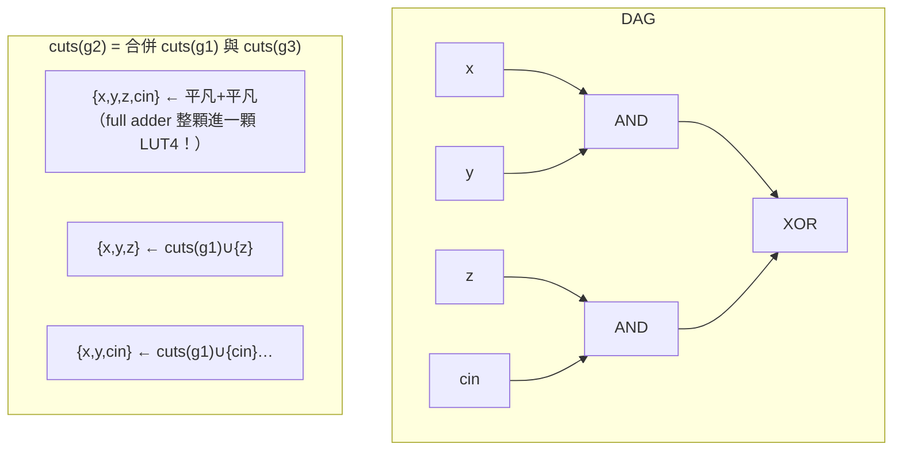

# 3.9 LUT 覆蓋演算法：從理論到 `ice40.rs`

> 來源：`veryl-eda/src/ice40.rs`（`Cut`、`lut_cover`、`cover`、`truth`、`map`）

## 3.9.1 問題定義：k-LUT 覆蓋是 NP-hard

iCE40 的基本邏輯單元是 `SB_LUT4`：一個 4 輸入、16 位元真值表（`LUT_INIT`）的可編程函數。技術映射（technology mapping）要回答：給定 generic 閘網表，**每個節點由哪個 ≤4 輸入的子電路（cut）計算，使得用最少的 LUT 或最淺的深度實現整個設計？**

形式化：把組合網表看成有向無環圖（DAG）$G=(V,E)$。一個節點 $v$ 的 **k-cut** 是一個節點集合 $C(v)$，滿足：

1. $C(v)$ 不含 $v$，且 $|C(v)| \le k$；
2. $v$ 的每個 fanin 要嘛在 $C(v)$ 裡，要嘛其自身也有一個 cut 的全部 leaves 在 $C(v)$ 裡（遞迴定義）；
3. $C(v)$ 是 $v$ 與 DAG 主輸入之間的「切割面」—— 任何從主輸入到 $v$ 的路徑都會穿過 $C(v)$。

一個 **k-LUT 覆蓋** 就是替每個需要的節點選一個 cut，LUT $v$ 計算 $f_{C(v)}$。選哪些 cut 使總 LUT 數最少（面積最佳化）或最大深度最小（延遲最佳化）都是 NP-hard。直觀理由：LUT 覆蓋可以把共用邏輯複製到多個錐裡，這個取捨蘊含了 set-cover 類的難題；面積恢復（area recovery）階段尤其明顯。

因此所有實用的映射器（CutMap、FlowMap、PackMap…）都靠 **cut enumeration + 動態規劃 + 啟發式**：枚舉每個節點的少量（例如 16 個）優質 cut，在其上做 DP。

## 3.9.2 cut 的合併：枚舉是怎麼長出來的

節點 $n$ 的候選 cut 由其 fanin 的 cut 集做**聯集合併**產生。`ice40.rs` 的做法（`lut_cover`，70–126 行）：

```rust
// ice40.rs:70-96（節錄）
for _pass in 0..2 {
    cuts.clear();
    for c in gates {
        let Bit::W(n) = c.out() else { continue };
        if !node.contains_key(&n) { continue; }
        // candidate cut sets of each fanin (a leaf wire only has itself)
        let mut sets: Vec<Vec<Vec<u32>>> = vec![];
        for f in fanins(c) {
            let Bit::W(fw) = f else { continue };
            let mut v = vec![vec![fw]];
            if let Some(fc) = cuts.get(&fw) { v.extend(fc.iter().map(|x| x.leaves.clone())); }
            sets.push(v);
        }
        let mut merged: Vec<Vec<u32>> = vec![vec![]];
        for s in &sets {
            let mut next = vec![];
            for m in &merged {
                for l in s {
                    let mut u = m.clone();
                    for x in l { if !u.contains(x) { u.push(*x); } }
                    if u.len() <= K { next.push(u); }
                }
            }
            next.sort();
            next.dedup();
            merged = next;
        }
```

每個 fanin 貢獻一組候選：**平凡 cut `{fw}`**（把 fanin 當葉）加上 fanin 自己的 cut 集。把它們做笛卡兒聯集，大小 ≤ K=4 的留下。這正是 cut enumeration 的標準遞推：

$$\mathrm{cuts}(n) = \bigcup_{\text{fanin } f}\bigcup_{C \in \mathrm{cuts}(f)} \left\{\{f\} \cup C\right\}_{\le 4}$$

平凡 cut `{fw}` 必須保留 —— 它讓「上一級 LUT 的輸出直接當這一級 LUT 的輸入」成為可能，沒有它映射會漏掉最平凡的接法。



全加器進位(sum) 的 4 個 fanin 聯集剛好 = 4，一顆 `SB_LUT4` 吃下整個 sum —— 這是 cut enumeration 能自動「發現」加法器 bit 的機制（但進位鏈另有專門處理，見 3.10）。

## 3.9.3 支配性剪枝與 depth / area flow

枚舉出的候選先排序、去重，然後做**支配性剪枝**：

```rust
// ice40.rs:110-114
// drop dominated cuts (a superset of another cut is never better)
cand.sort_by(|a, b| a.leaves.len().cmp(&b.leaves.len()));
let mut kept: Vec<Cut> = vec![];
for c in cand {
    if !kept.iter().any(|k| k.leaves.iter().all(|x| c.leaves.contains(x))) { kept.push(c); }
}
```

支配規則：若 cut $C_1 \subseteq C_2$，$C_2$ 永遠不需要 —— $C_1$ 的函數支撐更小、深度遞推不更差。這一步把候選數從指數級壓到實用的個位數。

留下的每個 cut 計算兩個評分（`ice40.rs:97-108`）：

$$\mathrm{depth}(C) = 1 + \max_{\ell \in C} \mathrm{depth}(\ell), \qquad \mathrm{flow}(C) = 1 + \sum_{\ell \in C} \frac{\mathrm{flow}(\ell)}{\max(\mathrm{refs}(\ell), 1)}$$

- `depth` 是以這個 cut 為葉時的 LUT 級數 —— **延遲的代理量**。
- `flow` 是 **area flow**：把每個 leaf 的成本除以它的 fanout 數再累加。如果一個 leaf 被 5 個地方引用，用它的「複製成本」只算 1/5。這就是 CutMap/FlowMap 系列處理**邏輯複製**的關鍵：深度優先的覆蓋會把共用子電路複製進每個錐，area flow 用扇出折算，讓 DP 在「深度」與「複製面積」之間有個連續的旋鈕。

排序鍵（`ice40.rs:116`）是三級字典序：

```rust
kept.sort_by(|a, b| a.depth.cmp(&b.depth).then(a.flow.partial_cmp(&b.flow).unwrap()).then(a.leaves.len().cmp(&b.leaves.len())));
```

深度優先，同深度比 area flow，再比 cut 大小。

### 為什麼只保留 16 個 cut？

`CUTS=16` 是枚舉完整性的妥協。全枚舉在某些網（例如多層 XOR 樹）是天文數字；保留策略（`ice40.rs:117-122`）取前 `CUTS/2` 個淺的 + 後半中 flow 最小的 `CUTS/2` 個 —— 一半保證延遲路徑上的選項，一半保證面積恢復時有便宜的選項。只留一個最好的是不行的：**area recovery 需要歷史候選**，這也是 `cuts` 與 `best` 分開存的原因。

## 3.9.4 兩趟迭代：用真實覆蓋重估扇出

area flow 的 `refs`（fanout 計數）起初來自原網表，但覆蓋之後真正的扇出變了（複製的邏輯扇出下降、被吸收的邏輯消失）。所以 `lut_cover` 跑兩遍（`for _pass in 0..2`），每遍結束用 `cover()` 從 roots 反向找出實際使用的 LUT/carry，重算 `refs`：

```rust
// ice40.rs:127-130
// re-estimate fanouts from the current cover for the second pass
let (used, used_fixed) = cover(roots, node, &best, fixed);
recount(&mut refs, &best, &used, &used_fixed);
```

這是 EMACS 式的固定點迭代：評分函數依賴覆蓋，覆蓋依賴評分。兩遍就夠了 —— 第三遍的改動在實驗上微小，成本卻是線性的。

## 3.9.5 Area recovery：required time 反向傳播

深度優先的第一選擇（`best[n] = kept[0]`）會把共用邏輯**複製**進每個需要它的錐（每個錐都想要「到自己輸入最近的 cut」）。面積恢復在深度已定之後放寬：

1. 從 roots 的最大深度算出 `dmax`，相當於「全局 required time」。
2. 反向傳播 required time：每個 LUT 給它的 leaves 要求 `r - 1`（`ice40.rs:139-150`）。
3. 正向重選：在 `depth <= required` 的 cut 裡挑 `flow` 最小的（`ice40.rs:151-169`）。

```rust
// ice40.rs:166-168
let pick = cs.iter().filter(|c| c.depth <= r).min_by(|a, b| a.flow.partial_cmp(&b.flow).unwrap().then(a.depth.cmp(&b.depth)))
    .or_else(|| cs.iter().min_by_key(|c| c.depth)).unwrap().clone();
```

`or_else` 的 fallback 是重要的保險：如果 required time 傳播因為某種原因偏緊（例如固定電路的輸入深度被低估），寧可犧牲面積也不要超過原深度 —— **這輪恢復不允許讓延遲變差**。

這整個結構就是 **FlowMap** 思想的實用變體：FlowMap 用網路流證明「在最小深度約束下可達的面積下界」，本實作則用 area flow + required time 做貪心恢復 —— 沒有最優性證明，但實現簡單、效果在教學規模的設計上已經很好。

## 3.9.6 從 cut 到 SB_LUT4：真值表與固定電路

映射的收尾（`ice40.rs::map`）：

- `cover()` 決定哪些 wire 變成 LUT（`used`）、哪些交給 carry chain（`used_carry`）。
- `truth()` 遞迴計算每個 LUT 的 16 位元真值表 —— 葉節點按其在 `leaves` 中的位置套上 `PAT` 位樣：

```rust
// ice40.rs:22-23, 226-228
/// truth-table patterns of LUT inputs I0..I3
pub(crate) const PAT: [u16; 4] = [0xAAAA, 0xCCCC, 0xF0F0, 0xFF00];
...
let mut memo: HashMap<u32, u16> = HashMap::new();
for (i, l) in leaves.iter().enumerate() { if let Some(l) = l { memo.insert(*l, PAT[i]); } }
let tt = truth(n, &gates, &node, &mut memo);
```

`PAT[i]` 是「第 i 個輸入本身」的 16 位元真值表（輸入 $x_i$ 在位址低→高的排序中每 $2^i$ 位翻轉）。以 PAT 為邊界條件自頂向下遞推 `&`/`|`/`^`/mux 的語義，就是**以真值表為域的函數求值** —— 與 yosys 的做法一致，也與第 3.8 節 `eval` 的位元平行模擬同構（那邊是 64 位寬的模擬，這邊是 16 位寬的真值表）。

- 未使用的輸入腳位接 `Bit::C0`（`leaves.resize(K, None)` 之後 `map(Bit::W).unwrap_or(Bit::C0)`），LUT 對常數 0 的依賴使真值表正確退化。

## 3.9.7 面積 vs 深度：取捨的總結

| 情境 | 選擇的 cut | 後果 |
|---|---|---|
| 深度優先（第一輪） | 淺的 cut | 共用邏輯被複製，面積↑，Fmax↑ |
| 面積恢復（第三輪） | required time 內 flow 最小的 | 複製的邏輯重新合併，面積↓，深度不變 |
| cut 被支配剪掉 | — | 枚舉空間可控 |
| support > 4 | 不可能成為單一 LUT | 被拆成多層，深度自然增加 |

數學上，這是雙目標優化：

$$\min\; |L| \quad \text{s.t.} \quad \mathrm{depth}(L) \le D^*$$

其中 $D^*$ 是深度優先解給出的深度。精確求解 NP-hard；本實作用「先定深度、再貪心恢復面積」的兩階段策略取得帕累托折衷。

## 3.9.8 完整虛擬碼

把整個 `lut_cover` 的控制流收攏成一段偽代碼，方便與 `ice40.rs:55-175` 對照：

```
lut_cover(gates, node, fixed, roots):
    # 初始扇出：原網表 + roots
    refs = fanout_count(gates, roots)

    for pass in 1..2:                       # 兩趟：第二趟用真實覆蓋重估 refs
        for n in gates (拓撲序):             # 只看 node 裡的（LUT 可計算的）
            sets = [ {fw} ∪ cuts(fw) for fw in fanins(n) ]      # 每個 fanin 的候選
            merged = 逐步笛卡兒聯集, 保留 |cut| <= 4
            去重 → 支配性剪枝（超集刪除）
            for each cut C:
                C.depth = 1 + max(depth(leaf) for leaf in C)
                C.flow  = 1 + Σ flow(leaf)/refs(leaf)
            按深度排序 → 保留前 8 淺 + 後半 flow 最小 8（共 CUTS=16）
            best[n], cuts[n] = kept[0], kept
        (used, used_fixed) = cover(roots, node, best, fixed)
        refs = recount(used, used_fixed, roots)

    # ---- area recovery ----
    dmax = max depth over roots
    for round in 1..2:
        (used, used_fixed) = cover(...)
        req[roots] = dmax                   # 全局 required time
        for n in used (反向拓撲序):
            req[leaf] = min(req[leaf], req[n] - 1)
        for n in gates (正向):
            pick = argmin{ flow(c) : depth(c) <= req[n] }
                   fallback argmin{ depth(c) }        # 寧可超面積不超深度
            best[n] = pick
        refs = recount(...)
    return best, cover(...)
```

可以驗證幾個設計不變式：`cover()` 走的每一條邊都對應一個物理連線；每個 `used` 節點的 cut leaves 都在 `best` 裡（遞迴封閉）；carry 的輸入沿 `fixed` 表被推進 worklist，因此 carry 上游的邏輯絕不會被漏蓋。

## 3.9.9 一個具例：2 位元計數器的映射

考慮一個 2 位元計數器的組合部分（下一狀態邏輯）：

$$n_0 = \bar q_0, \qquad n_1 = q_0 \oplus q_1$$

- 節點 $n_0$：fanin 是 FF 輸出 $q_0$（leaf）→ 唯一 cut $\{q_0\}$，depth 1。
- 節點 $n_1$：fanins 是 $q_0, q_1$（都是 leaf）→ cut $\{q_0,q_1\}$，depth 1；沒有更深的候選，因為 `cuts` 表裡 $q_0$、$q_1$ 沒有條目（FF 輸出不在 `node` 裡，`lut_cover` 第 74 行的 `if !node.contains_key(&n) { continue; }` 跳過它們）。

覆蓋結果：2 個 `SB_LUT4`，深度 1。加一個 8 位元計數器的 $n_7 = q_0 q_1 \cdots q_6 \oplus q_7$：

- 8 個輸入 > K=4，單一 cut 不可能；枚舉會產生 $\{q_4,q_5,q_6,q_7\}$（吸收 $\{q_0..q_3\}$ 的 AND）與多個 4 葉 cut。
- depth 遞推自然選出：一級 4 輸入 AND（$q_0..q_3$）→ 一級最終 XOR，總深度 2 —— 正是 4-LUT 樹對 8 輸入函數的最優 $\lceil \log_4 8\rceil = 2$。

這個例子也說明 `truth()` 的遞迴必要：最終 LUT 的真值表要把「中間 AND」的 16 位元真值表與 PAT 邊界條件組合，才能得到正確的 `LUT_INIT`。

## 3.9.10 為什麼這樣設計（與 yosys/abc 的對照）

yosys 對 iCE40 的映射走 `abc -dff -lut 4`（甚至是 `abc9`），ABC 內部有完整的重定時、resub、cut 映射。veryl-eda 不調 ABC，理由有三：

1. **自包含**：教學專案不依賴外部二進位，wasm 版更是只能帶 Rust。
2. **可讀性**：`lut_cover` 不到 200 行，把 cut enumeration、支配剪枝、area flow、required time 恢復全放在一個函數裡，學生可以逐行對照教科書。
3. **與進位鏈協同**：`find_carries` 先把進位 cell 抽出（第 3.10 節），LUT 覆蓋把他們的輸入當 roots、輸出當 leaf，這種緊耦合在「外部工具映射再回貼」的流程裡很難做乾淨。

代價是映射品質：與 ABC 相比，超大設計的 LUT 數可能多 10–20%。但 veryl-eda 的目標設計（iCE40 UP5K、RV32I SoC）在 nextpnr 的 Fmax 報告中與 ABC 映射相當 —— 因為**關鍵路徑往往是進位鏈與 FF 的組合**，而那正是本映射器特別處理的部分。

## 本章重點

- k-LUT 覆蓋是 NP-hard；實用解法 = cut enumeration + DP + 啟發式恢復。
- cut 遞推：$\mathrm{cuts}(n) = \bigcup_f \{\{f\} \cup C \mid C \in \mathrm{cuts}(f)\}_{\le 4}$；支配剪枝（超集必非更優）控制候選數。
- `depth` 是延遲代理、`area flow = 1 + Σ flow(leaf)/fanout(leaf)` 是考慮複製的面積代理；兩趟迭代用真實覆蓋重估扇出。
- Area recovery 用 required time 反向傳播，在「不劣化深度」的硬約束下貪心選最小 flow cut —— FlowMap 思想的簡化實作。
- 真值表以 `PAT` 為邊界條件遞推，與位元平行模擬同構；`truth()`/`cover()` 與進位鏈抽取互相配合（下一節）。
