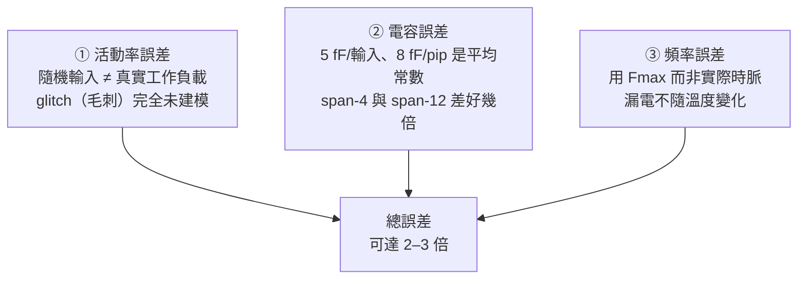

# 4.10 功率估算：活動率驅動的粗略模型

> 對照原始碼：`veryl-eda/src/pnr/power.rs`（44 行）與
> `src/power.rs`（活動率取樣，69 行）。
> 功率是 EDA 裡「最容易被高估自己」的領域：精確功率需要電路級模擬
> （SPICE）或向量相關的閘級功率庫。自製工具玩不起，也不必——
> 本工具的目標是給設計者一個**相對指標**：改一版 RTL，功率漲了還是跌了、
> 差幾成。本章講這個模型是怎麼搭的、每個數字從哪來、以及它**不能**用來做什麼。

## 4.10.1 動態功率：公式與拆解

CMOS 動態功率的基本公式：

$$
P_{\mathrm{dyn}} \;=\; \alpha \, C \, V^2 \, f
\qquad
\left(\text{更精確地：}\; P = \tfrac{1}{2}\,\alpha\, C\, V^2\, f_{\text{switch}}\right)
$$

* $\alpha$：**活動率**——這條網每個時鐘週期實際翻轉幾次（0 與 2 之間，
  含 0 與 2：雙翻轉算 2 次充放電）。
* $C$：被驅動的總電容（負載閘的輸入電容 + 導線電容）。
* $V$：電壓——iCE40UP5K 的核心是 1.2 V，$V^2 = 1.44$。
* $f$：切換頻率。

`power.rs` 把它改寫成「**每週期能量**」的形式，避開每網頻率不同的問題：

```rust
// pnr/power.rs:11-43
const V: f64 = 1.2;

pub fn estimate(nl: &Netlist, nets: &[RNet], bits: &[Bit], routes: &[Vec<u32>], extra: usize, act: &Activity, freq_mhz: f64) -> FpgaPower {
    let (mut e_nets, mut e_clock) = (0.0, 0.0);
    for (i, net) in nets.iter().enumerate() {
        let pips = routes[i].iter().filter(|p| **p < u32::MAX - extra as u32).count() as f64;
        let c = 5.0 * net.sinks.len() as f64 + 8.0 * pips; // fF
        if net.global.is_some() && act.rate.get(&bits[i]).copied().unwrap_or(0.0) == 0.0 {
            // a clock: global network + the tiles' clock muxes, every cycle
            e_clock += (500.0 + c) * V * V;
        } else {
            e_nets += 0.5 * c * V * V * act.rate.get(&bits[i]).copied().unwrap_or(0.0);
        }
    }
```

逐項拆：

* **每個負載輸入 5 fF**（`5.0 * net.sinks.len()`）：LC 輸入腳的典型閘電容
  量級。
* **每個 pip/wire 段 8 fF**（`8.0 * pips`）：繞線的電容——**這是 FPGA 功率
  的主角**。span-4 段的實際電容在幾十 fF 級別，且隨長度變化；這裡用
  一個常數平均。注意 `pips` 數字來自**實際繞線結果**（`routes[i]`）——
  這是本模型比「RTL 估計」強的地方：繞得越遠、功率越大，真實反映了。
* $\tfrac12 \alpha C V^2$：每個翻轉充放電各一次，能量是 $\frac12CV^2$
  充 + $\frac12CV^2$ 放，每週期淨耗 $CV^2$；乘活動率 $\alpha$、
  取「翻轉即半個 $CV^2$ 對」的約定後成為程式裡的 `0.5 * c * V * V * rate`。
* **時脈網特判**：`act.rate == 0`（隨機輸入下從不翻轉的網）且走全域
  → 認定是時脈。時脈**每個週期翻兩次**（$\alpha = 2$，與那個 `0.5`
  相抵消），且要加上全域網 ~0.5 pF 的固定電容：

$$
E_{\mathrm{clock}} = (500\,\mathrm{fF} + C_{\mathrm{sinks}}) \cdot V^2
\quad \text{fJ/週期}
$$

## 4.10.2 活動率：netsim 的 toggle 計數

$\alpha$ 從哪來？`src/power.rs` 把**映射後的網表**丟給 netsim
（2-值閘級模擬器）跑幾百個週期的**隨機輸入**，數每條 wire 的翻轉：

```rust
// src/power.rs:46-66
for cyc in 0..cycles + 2 {
    for &(n, w) in &ins {
        if is_clock(n) { continue; }
        let v = if is_reset(n) { if (cyc < 2) == active_low { 0 } else { u128::MAX } }
                else { (rnd() as u128) << 64 | rnd() as u128 };
        s.poke(n, ...);
    }
    s.settle();
    ... // 統計 RAM 的 RE/WE
    s.step();
    for (k, b) in wires.iter().enumerate() {
        let v = s.bit(*b);
        if cyc >= 2 && v != prev[k] { toggles[k] += 1; }
        prev[k] = v;
    }
}
let rate = wires.iter().zip(&toggles).filter(|(_, t)| **t > 0)
    .map(|(b, t)| (*b, *t as f64 / cycles as f64)).collect();
```

三個值得注意的設計：

1. **重置極性自動偵測**（`power.rs:19-26`）：先各用 low/high 重置各跑
   40 週期的試探，比較哪種讓總活動大——動起來的那種才是對的極性。
   （設計在 `active` 極性下前兩拍是「凍結」的，活動自然小。）
2. **前 2 週期不計**（`cyc >= 2`）：重置釋放後電路才進入穩態行為，
   上電的初始翻轉會污染統計。
3. **週期數自適應**（`mod.rs:331`）：功率估算在 P&R 流程的最後跑，
   預算與設計大小掛鉤：

```rust
let act = crate::power::activity(nl, (2_000_000 / nl.cells.len().max(1)).clamp(100, 1000), 1);
```

   大設計少跑（100 週期）、小設計多跑（1000 週期），統計誤差
   $\propto 1/\sqrt{N}$。

活動率同時記 **RAM 讀寫次數**（`acc` 裡的 `(re, we)`），BRAM 的能量
按次計費：

```rust
let e_ram: f64 = act.ram.values().map(|(r, w)| (r + w) * 24_000.0).sum::<f64>().max(0.0); // fJ
```

~24 pJ/次存取（= 24 000 fJ），對應資料手冊裡 BRAM 約 20 µA/MHz @1.2 V
的量級——一次 4K-bit 存取的週期攤提。

## 4.10.3 總功率

```rust
let e = e_nets + e_clock + e_ram; // fJ per cycle
let dynamic = e * 1e-15 * freq_mhz * 1e6 * 1e3;
let static_mw = 75e-6 * V * 1e3;
FpgaPower { freq_mhz, e_nets: e_nets / 1e3, e_clock: e_clock / 1e3, e_ram: e_ram / 1e3, dynamic, static_mw, total: dynamic + static_mw }
```

$$
P_{\mathrm{dyn}} = E_{\mathrm{cycle}} \cdot f_{\mathrm{clk}},
\qquad
P_{\mathrm{static}} \approx 75\,\mu\mathrm{A} \times 1.2\,\mathrm{V} = 0.09\,\mathrm{mW},
\qquad
P_{\mathrm{total}} = P_{\mathrm{dyn}} + P_{\mathrm{static}}
$$

頻率用 **STA 的 $F_{max}$**（`mod.rs:332`：`act` + `timing.fmax`）。
這是刻意的保守選擇：用最壞（最快）的頻率，功率數字是「這個設計能跑多快
就吃多少」的上界概念；實際設計多半降頻跑，功率等比下降（$P_{\mathrm{dyn}} \propto f$）。

漏電的 75 µA 是 UP5K 在 25 °C 的典型值，**一個常數**。它與設計無關、
與溫度強相關（矽上漏電隨溫度指數成長）——自製工具不建模這些。

## 4.10.4 一個手算的例子

用一個可心算的小設計驗證量綱：假設 200 條 routed nets、平均每網
3 個 sink 與 4 個 pip、活動率平均 0.2；50 個 FF；1 個 BRAM 每週期
0.25 次讀寫；$F_{max} = 40$ MHz。

每網每週期能量：

$$
e_{\text{net}} = 0.5 \times (5 \times 3 + 8 \times 4)\,\mathrm{fF} \times 1.44
= 0.5 \times 47 \times 1.44 \approx 33.8\ \mathrm{fJ}
$$

乘活動率 0.2 → ~6.8 fJ；200 條 → $e_{\mathrm{nets}} \approx 1360$ fJ。
時脈：全域網 $(500 + 5\times 50)\times1.44 \approx 1080$ fJ，加上
FF 的 $50 \times 2 = 100$ fJ，共 ~1180 fJ。BRAM：$0.25 \times 24000$
= 6000 fJ——**一顆 BRAM 吃掉訊號網的四倍**，這在小型 SoC 上是真實的
（也是為什麼 `FpgaPower` 把三分量分開報告）。

$$
P_{\mathrm{dyn}} = (1360 + 1180 + 6000)\,\mathrm{fJ} \times 40\,\mathrm{MHz}
\approx 0.34\ \mathrm{mW},
\qquad
P_{\mathrm{static}} = 0.09\ \mathrm{mW}
$$

量級檢查：UP5K 在 40 MHz、輕載下實測約 1–3 mA @1.2 V（1.2–3.6 mW），
這個粗估落在同一個數量級、偏低——隨機輸入低估了真實資料的活動，
但至少不會荒謬。

## 4.10.5 模型的三層不確定性

把這個數字當**絕對值**用之前，先數一數誤差從哪裡來：



1. **活動率**：最大宗。真實電路的輸入不是均勻隨機（計數器低位元高活動、
   狀態機有偏向）；**glitch 完全沒有**——組合邏輯的毛刺翻轉在先進製程
   可佔動態功率的一半。netsim 是零延遲模型，天生看不到毛刺。
2. **電容**：5/8 fF 是「好猜的常數」。同一設計換一種繞線（4.7 的收斂
   路徑不同），pip 數就不同——這其實是特性不是缺陷（見下）。
3. **頻率與靜態**：用 $F_{max}$、漏電常數、不隨溫度/電壓變化。

所以檔頭註解自己就說了（`power.rs:1-5`）：

> A rough iCE40UP5K power estimate: every routed net that toggles charges
> the inputs it drives (~5 fF each) and the routing it uses (~8 fF per
> pip / wire segment)...

——**rough** 是產品的誠實標籤。

## 4.10.6 那為什麼還要做？相對指標的價值

如果絕對值不可信，這 44 行存在的理由是三種**可比較性**：

1. **跨版本**：同一個設計改一行 RTL 重跑，$P_{\mathrm{dyn}}$ 變化
   大半來自活動率與繞線長度——模型對兩版用了**同一套常數**，
   常數誤差在差分中消掉。這是工程上最有用的用法：「把狀態機編碼從
   binary 改成 one-hot，功率降了 ~15%」這種結論是可信的。
2. **跨結構**：`e_nets / e_clock / e_ram` 三分量分開報告
   （`FpgaPower` 的欄位），設計者能看出「功率都在時脈網上」還是
   「都在 BRAM」——優化方向的診斷，比總數有用。
3. **教學**：這個模型把 $P = \alpha C V^2 f$ 的每個字母都對到一段
   可讀的程式碼與一個可量測的來源（`act.rate`、`net.sinks`、`pips`），
   是本書「每個公式都有原始碼對照」的典範。

工業簽核工具（如 Synopsys PrimePower）與它的差距不在公式——公式一樣
——而在三件事：**真實向量**（不是隨機）、**NLDM 電容/延遲庫**、
**毛刺建模**（含延遲的模擬）。自製工具未來若要提升精確度，順序是：
先真實向量（testbench 驅動的活動率），再分型別電容，毛刺最後
（需要時序精確的閘級模擬，netsim 就要改成 event-driven）。

## 4.10.7 虛擬碼

```text
activity(netlist, cycles, seed):
    偵測重置埠；兩種極性各試跑 40 週期，取活動大的極性
    netsim + 隨機輸入（非時脈、非重置埠）跑 cycles 週期：
        每週期 settle 後數每條 wire 的翻轉 → rate[w] = toggles/cycles
        數每個 RAM 的 RE/WE → ram[i] = (reads, writes)/cycles

power::estimate(netlist, nets, routes, act, fmax):
    for 每個 routed net:
        c = 5fF·|sinks| + 8fF·|pips|
        時脈網（全域且 activity=0）: e_clock += (500fF + c)·V²
        其余:        e_nets += 0.5·c·V²·rate[net]
    e_clock += 2fJ·(FF 數)          # 每個 FF 每週期的時脈功耗
    e_ram   = Σ ram 存取次數 × 24 pJ
    dynamic = (e_nets + e_clock + e_ram) × fmax
    static  = 75 µA × 1.2 V
    return { dynamic, static, total, 三分量 }
```

## 4.10.8 為什麼這樣設計？

* **每週期能量而非每網頻率**：每網有自己的切換頻率 $f_n = \alpha_n f_{clk}$，
  把 $\alpha$ 吸進能量項後只需乘一個 $f$——公式與程式結構一一對應，
  單位（fJ/週期 → mW）只在最後換算一次。
* **用繞線結果算電容**：`routes[i]` 的 pip 數讓功率與 P&R 的品質掛鉤，
  也讓「時序驅動第二輪換了繞線」的功率差異被捕捉。
* **時脈網的辨認是行為的**（全域且活動率 0）而非名字的：netlist 裡
  時脈網未必叫 clk（內部衍生時脈、全域 reset 也走全域網且活動率低）。
  這個啟發式把「每週期全翻」的網正確歸入 `e_clock`。

## 本章重點

1. $P_{\mathrm{dyn}} = \alpha C V^2 f$ 的每個字母在程式裡都有對應：
   $\alpha$ = netsim 隨機輸入的 toggle/cycles、$C$ = 5 fF/輸入 +
   8 fF/pip（pip 數來自真實繞線）、$V$ = 1.2、$f$ = STA 的 $F_{max}$。
2. 活動率由 `power::activity` 取樣：重置極性自動試探、前 2 週期丟棄、
   週期數與設計大小反比（100–1000）。
3. 時脈網（全域且活動率 0）每週期全翻，加全域網 ~0.5 pF；BRAM 按
   存取次數計費 ~24 pJ/次；靜態功率是一個 75 µA 的常數。
4. 絕對值有 2–3 倍級的誤差（隨機向量、無毛刺、常數電容、$F_{max}$ 頻率），
   **只能當相對指標**；但差分比較、三分量診斷與教學對照完全勝任。
5. 精確化的路徑（真實向量 → 分型別電容 → 毛刺）同時也是對 EDA 功率
   分析本質的認識：功率 = 模擬 × 庫 × 統計，缺一不可。
