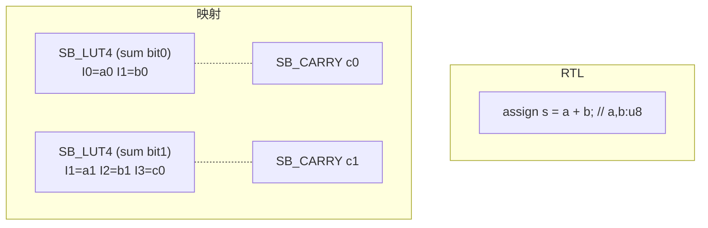

# 4.2 iCE40 映射：`ice40.rs`

> 目標晶片：Lattice iCE40UP5K（iCEBreaker 板）。輸入是
> `netlist::optimize` 產出的通用閘級網路（`$_AND_/$_OR_/$_XOR_/$_MUX_/
> $_DFF_*/$_SDFF_*`），輸出是 nextpnr-ice40 認得的
> `SB_LUT4 / SB_CARRY / SB_DFF* / SB_RAM40_4K`。
> 完整流程見 `fpga/flow.sh`（synthesis → nextpnr → icepack → 位元流驗證）。

本節逐段讀 `veryl-eda/src/ice40.rs`（319 行）。

---

## 4.2.1 SB_LUT4 的 INIT：16-bit 真值表與位元序

`SB_LUT4` 有四個輸入 I0..I3，參數 `LUT_INIT` 是 16 位元的真值表：

$$
\text{INIT}[k] = f\big(i_0, i_1, i_2, i_3\big),\qquad
k = i_0 + 2\,i_1 + 4\,i_2 + 8\,i_3
$$

也就是說 **I0 是最低位元**。這個位元序在程式裡被具象成四個
「單變數遮罩」，`ice40.rs` 開頭的常數：

```rust
/// truth-table patterns of LUT inputs I0..I3
pub(crate) const PAT: [u16; 4] = [0xAAAA, 0xCCCC, 0xF0F0, 0xFF00];
```

驗證一下：`0xAAAA = 10101010...₂`，在位置 $k$（bit index $i_0 + 2i_1 + ...$）
上等於 $i_0$；`0xCCCC` 等於 $i_1$，以此類推。這組遮罩有三個用途：

1. **計算真值表**（`truth`，見 4.2.5）：把 netlist 連成 LUT 的每個葉
   wire 代入對應的 PAT，遞迴求值；
2. **反相器**（4.2.7）：`!PAT[0] = 0x5555` 是「輸出 = ¬I0」；
3. **buffer LUT**（ECP5 也在用）：`PAT[0] = 0xAAAA` 是「輸出 = I0」。

**為什麼這樣設計**：真值表用 `u16` 而不是 bit vector，是因為
整個覆蓋演算法要對成千上萬個節點反覆求值；`u16` 的 AND/OR/XOR
就是一次 CPU 指令，且 4 狀態語意（x）在合成階段已經被 2 狀態化。

寫出的參數格式是二進位字串、**MSB 在前**：

```rust
// ice40.rs:234
params: vec![("LUT_INIT", format!("{:016b}", tt))]
```

注意 `{:#016b}` 與 index 的方向相反：字串第 0 個字元是 INIT bit 15。
這是 yosys JSON 對 bit-vector 參數的慣例（字串左端是高位），
`output.rs` 的 JSON writer 不再轉換，直接寫出。

---

## 4.2.2 cut-based LUT covering：`lut_cover`

映射的核心問題：把一片 `$_AND_/$_OR_/$_XOR_/$_MUX_` 閘海切成
一顆顆 ≤4 輸入的 LUT。形式化：對每個需要計算的節點 $v$ 選一個
cut $(v, L)$——$L$ 是一組 ≤4 個葉節點，使得從 $v$ 往下走到 primary
inputs 必定經過 $L$。每個被用到的 cut 就是一顆 LUT。

```rust
#[derive(Clone)]
pub(crate) struct Cut {
    pub leaves: Vec<u32>, // sorted wire ids
    depth: u32,
    flow: f32,
}
const K: usize = 4;
const CUTS: usize = 16;
```

兩個評分指標：

$$
\text{depth}(v) = 1 + \max_{\ell \in L} \text{depth}(\ell), \qquad
\text{flow}(v) = 1 + \sum_{\ell \in L} \frac{\text{flow}(\ell)}{\text{refs}(\ell)}
$$

`depth` 逼近關鍵路徑長度，`flow` 是面積流（area flow）：除以 `refs`
（fanout）是為了讓「被很多人共用的節點」不要重複計價。

演算法骨架（虛擬碼）：

```text
for pass in 0..2:                       # 第二輪用第一輪的 cover 重新估 refs
    for gate in topological_order:
        sets = [每個 fanin 的候選 cut 葉集合 ∪ {fanin 本身}]
        merged = 所有組合的 leaf 聯集，|leaves| ≤ 4
        去除被支配的 cut（若 leaves 是另一 cut 的超集，永遠不會更好）
        best = depth 最小者（平手比 flow、再比 leaves 數）
        保留至多 16 個：淺的一半 + flow 小的一半
    used, used_carry = cover(roots, best)   # 從 roots 往下標記實際用到的
    用實際 cover 重新估 refs

# area recovery：保持第一階段的深度為 required time，
# 在不超時的前提下改選 flow 最小的 cut
for round in 0..2:
    req[roots] = dmax;  由 cover 反向傳 required time
    for gate in topological_order:
        pick = depth ≤ req 的 cut 中 flow 最小者（沒有就取最淺）
    重新估 refs
```

被支配 cut 的剪除（`ice40.rs:110-114`）是精確的支配關係，不是啟發式：

```rust
cand.sort_by(|a, b| a.leaves.len().cmp(&b.leaves.len()));
let mut kept: Vec<Cut> = vec![];
for c in cand {
    if !kept.iter().any(|k| k.leaves.iter().all(|x| c.leaves.contains(x))) {
        kept.push(c);
    }
}
```

（若 cut A 的葉集合是 cut B 的子集，則 B 覆蓋到的所有下游 A 都能覆蓋，
且 B 的 depth/flow 都不會更差——所以 B 永遠不該被選。）

**為什麼這樣設計**：窮舉所有 cut 是指數級的，`CUTS = 16` 的裁剪讓
每節點成本有界；「先深度、後面積」的兩階段是 cut-based mapping 的
教科書做法（Tony Chan 等人的 cut-based depth mapping + area recovery），
對時鐘頻率敏感的 FPGA 設計是正確的優先序。

### roots 的選擇

不是所有閘都值得變 LUT——roots = 輸出 port + 所有 FF 與 block RAM 的
輸入（`ice40.rs:194-198`）。下游由 `cover()` 從 roots 走回驅動器，
決定 `used` 集合，死邏輯自然不會被映射。

---

## 4.2.3 SB_CARRY：從閘海裡找回加法器

`find_carries` 在通用閘網路裡做**結構辨識**，找的是 yosys 合成後
的標準形狀（`ice40.rs:26-49`）：

```text
co = OR( AND(a, b), AND( xor(a,b), ci ) )
```

匹配條件相當嚴格：

- 外層必須是 `$_OR_`，兩個輸入分別是 `$_AND_`；
- 其中一個 AND 的輸入必須是 `$_XOR_(a, b)` 與某進位 `ci`；
- 另一個 AND 的兩個輸入必須恰為 `a, b`（與 XOR 相同的一對）。

全加器的進位式：

$$
c_{out} = (a \wedge b) \vee ((a \oplus b) \wedge c_{in}) = \mathrm{maj}(a, b, c_{in})
$$

`SB_CARRY` 正是這個 majority 電路：

```rust
// ice40.rs:236-239
for n in &used_carry {
    let (x, y, c) = &carry[n];
    placed.push((pos[n], Cell { typ: "SB_CARRY".into(),
        conns: vec![("I0", *x), ("I1", *y), ("CI", *c), ("CO", Bit::W(*n))],
        params: vec![] }));
}
```

辨識成功的進位輸出會從 LUT 覆蓋的節點集合中**移除**（`node.remove(n)`），
變成 LUT 的「固定葉」（`fixed`），LUT 覆蓋把它當成黑盒輸入：

```rust
// ice40.rs:190-192
let carry: HashMap<u32, (Bit, Bit, Bit)> = find_carries(...)...;
for n in carry.keys() { node.remove(n); }
let fixed: HashMap<u32, Vec<Bit>> = carry.iter()
    .map(|(n, (x, y, c))| (*n, vec![*x, *y, *c])).collect();
```

**為什麼這樣設計**：如果讓 LUT 覆蓋「吞掉」進位邏輯（把 carry 摺進
某顆 LUT），這條 net 就不再是 `SB_CARRY` 的輸出，硬體進位鏈就斷了。
把 carry-out 宣告為 `fixed`，等於告訴覆蓋器：「這裡有個你不能看進去的
原生 cell，它需要 x, y, ci 三個輸入，也請把它們列為 roots。」

---

## 4.2.4 LUT 與 SB_CARRY 的配對：I1/I2 對齊

nextpnr-ice40 在 packing 時可以把一顆 LUT 與一個 SB_CARRY 塞進
同一個 LC，條件是：**LUT 的 I1/I2 = carry 的 I0/I1，且 LUT 的 I3 = CI**。
因為 carry-out 的硬體是從 LC 輸入 I1、I2 直接算的，這個對齊不是風格
偏好，而是硬接線的必要性。`map()` 先建「(a,b) 對 → 進位輸入」的
反查表（`by_ab`，鍵取排序後的 `(min, max)`），再對每顆含進位葉的
LUT 做輸入重排（`ice40.rs:205-225`）：
'pair: for i in 0..K {
    for j in 0..K {
        let (Some(a), Some(b)) = (leaves[i], leaves[j]) else { continue };
        if a >= b { continue; }
        if let Some(ci) = by_ab.get(&(a, b)) {
            if leaves.contains(&Some(*ci)) {
                let rest = ...;           // 剩下的葉
                leaves = vec![rest.first().copied().flatten(),
                              Some(a), Some(b), Some(*ci)];   // I1, I2, I3
                break 'pair;
            }
        }
    }
}
```

找到「(a,b) 是某 carry 的資料輸入、ci 也在這顆 LUT 的葉裡」就重排成
`[其他, a, b, ci]`。注意輸入重排**必須同時重算真值表**——這在 4.2.5
的 `truth` 裡自然解決，因為 memo 是按 wire id 查 PAT 遮罩，順序換了
遮罩就跟著換。

---

## 4.2.5 `truth`：從閘樹求真值表

每顆 LUT 的 INIT 就是其 cut 內所有閘的真值表組合。`truth` 是一個帶
memo 的遞迴求值器，對每個葉 wire 預先注入它的 PAT 遮罩：

```rust
pub(crate) fn truth(w: u32, gates: &[&Cell], node: &HashMap<u32, usize>,
                    memo: &mut HashMap<u32, u16>) -> u16 {
    if let Some(v) = memo.get(&w) { return *v; }
    let c = gates[node[&w]];
    let g = |p: &str, memo: &mut HashMap<u32, u16>| match c.port(p).unwrap() {
        Bit::C0 => 0,
        Bit::C1 => 0xFFFF,
        Bit::W(x) => truth(x, gates, node, memo),
    };
    let v = match c.typ.as_str() {
        "$_NOT_" => !g("A", memo),
        "$_AND_" => g("A", memo) & g("B", memo),
        "$_OR_"  => g("A", memo) | g("B", memo),
        "$_XOR_" => g("A", memo) ^ g("B", memo),
        "$_MUX_" => { let (a, b, s) = (g("A",memo), g("B",memo), g("S",memo));
                      (s & b) | (!s & a) }
        t => panic!("unexpected cell {}", t),
    };
    memo.insert(w, v);
    v
}
```

**為什麼這樣設計**：不求值到常數 folding 那種程度，而是「整顆 LUT 的
語意一次算完」。因為覆蓋把多顆閘摺成一顆 LUT，逐閘的 netlist 表示
已不存在；真值表就是 LUT 的身分證。`memo` 按進入順序注入 PAT 遮罩
（`map()` 中 `memo.insert(*l, PAT[i])`），葉的順序與 LUT 引腳順序
天然一致。

---

## 4.2.6 SB_DFF* 家族：極性編碼在名字裡

yosys 的 FF cell 名字是位置式編碼，例如 `$_DFF_P_`（正緣、無 reset）、
`$_DFF_N_`（負緣）、`$_DFF_PN0_`（負緣 + 非同步 reset to 0）、
`$_SDFF_NP1_`（負緣 + **同步** set to 1）。

`map()` 把這個名字解碼成 iCE40 的變體（`ice40.rs:248-271`）——先剝掉
`$_`、可選的同步 `S` 前綴與 `DFF_`，剩下最多三個字元：時脈極性、
reset 極性、reset 值：

```rust
let t = c.typ.as_str();
let f: Vec<char> = t.trim_start_matches("$_")
    .trim_start_matches('S')            // 同步 S 之後再解
    .trim_start_matches("DFF_").chars().collect();
let neg = if f[0] == 'N' { "N" } else { "" };   // 時脈極性
let Some(r) = c.port("R") else {
    cells.push(Cell { typ: format!("SB_DFF{}", neg),
        conns: vec![("C", ck), ("D", d), ("Q", q)], params: vec![] });
    continue;
};
// iCE40 flip-flops only have active-high reset/set: invert in a LUT
let r = if f[1] == 'N' {
    *inv.entry(r).or_insert_with(|| { /* 插一顆 SB_LUT4 = !r */ })
} else { r };
let sync = if t.starts_with("$_SDFF") { "S" } else { "" };
let (kind, pin) = if f[2] == '1' { ("S", "S") } else { ("R", "R") };
cells.push(Cell { typ: format!("SB_DFF{}{}{}", neg, sync, kind),
    conns: vec![("C", ck), (pin, r), ("D", d), ("Q", q)], params: vec![] });
```

iCE40 的 FF 變體（nextpnr 與 `cells_sim.v` 的模型）：`SB_DFF`/`SB_DFFN`
（無 reset）、`SB_DFFSR/SB_DFFR/SB_DFFS`（非同步 reset/set，一律
**active-high**）、`SB_DFFER/ESS` 等帶 enable 的組合。

關鍵限制（程式註解直接寫出）：**iCE40 的 set/reset 只有 active-high**。
yosys 的 `$_DFF_PN0_`（active-low reset）必須插入一顆反相 LUT：

```rust
*inv.entry(r).or_insert_with(|| {
    let y = Bit::W(next_wire); next_wire += 1;
    cells.push(Cell { typ: "SB_LUT4".into(),
        conns: vec![("I0", r), ("I1", Bit::C0), ("I2", Bit::C0),
                    ("I3", Bit::C0), ("O", y)],
        params: vec![("LUT_INIT", format!("{:016b}", !PAT[0]))] });  // 0x5555
    y
})
```

`inv` 這個 `HashMap<Bit, Bit>` 讓同一個 active-low reset 訊號只花
**一顆**反相器，之後所有 FF 共用（`entry().or_insert_with()` 的效果）。

**為什麼這樣設計**：把「極性轉換」留在映射層而非 elaborator，是因為
ECP5 的 slice 有 LSRMUX 可以免費反相（04.3 節的 `LSRMUX = "INV"`），
同一份 `$_DFF_PN0_` 在兩個後端的最佳處理不同；通用層不該替架構做決定。

---

## 4.2.7 topo 排序：為什麼 cell 順序不能亂

映射後的 `cells` 向量必須保持**拓撲序**（驅動者在使用者之前）。
`map()` 的做法是把新 cell 標上來源閘在原 netlist 的位置，最後排序：

```rust
// the full gate order (incl. carries) keeps the output topologically sorted
let pos: HashMap<u32, usize> = gates.iter().enumerate()
    .filter_map(|(i, c)| if let Bit::W(w) = c.out() { Some((w, i)) } else { None })
    .collect();
...
placed.push((pos[&n], Cell { ... }));
...
placed.sort_by_key(|x| x.0);
```

誰消費這個順序？三個客戶：

1. **`netsim.rs` / `veryl-sim` 的 `gates.rs`**：閘級模擬是單向掃描
   cells 向量，若使用者出現在驅動者之前，會讀到舊值（或 x）；
2. **`pnr/pack.rs`**：carry chain 的組鏈依賴進位輸出→進位輸入的
   資料依賴順序；
3. **`asic/map.rs`**：樹覆蓋 DP 也假設 topo 序。

ECP5 映射因為會新增 buffer LUT 而破壞順序，所以另寫了
`ecp5::topo` 重排（04.3 節）；iCE40 映射只在 FF 前插入 reset 反相器
（FF 是時序邊，不進組合拓撲），所以原有順序倖存——這是兩個檔案
一個重排一個不重排的原因。

---

## 4.2.8 映射結果的收尾：net 清理

最後把「沒有 driver 的 net 名稱」清掉，只留活著的：

```rust
let mut live: std::collections::HashSet<Bit> =
    cells.iter().flat_map(|c| c.conns.iter().filter(|(p, _)| is_out(p))
        .map(|x| x.1)).collect();
for p in &nl.ports { live.extend(p.bits.iter().copied()); }
let nets = nl.nets.iter()
    .filter(|(_, b)| b.iter().all(|x| x.is_const() || live.contains(x)))
    .cloned().collect();
```

RAM 的未使用 RDATA pin 會拿到全新 wire（`next_wire` 計數器），
避免與既有 wire id 撞號——這是所有後端共享的慣例：**新增 wire 一律
從現有最大 id + 1 開始**。

---

## 4.2.9 全流程走一遍：一個 8-bit 加法器會變成什麼



- bit 0 的和 = $a_0 \oplus b_0$，兩輸入 LUT；進位 $c_0 = a_0 \wedge b_0$
  被 `find_carries` 抓走（$c_{in}=0$ 的項已折疊掉）；
- bit 1 的和 LUT 葉含 $a_1, b_1, c_0$，命中 `by_ab` 的重排，
  I1/I2 = carry 資料、I3 = CI → nextpnr 可與 `SB_CARRY` 同 LC 打包；
- `flow.sh` 的下一步：nextpnr-ice40 把 LC 排到 tile 的連續位置
  （硬體要求進位鏈在相鄰 LC 之間直通），icepack 打包成 `.bin`。

---

## 4.2.10 本章重點

- `SB_LUT4` 的 `LUT_INIT` 是 16-bit 真值表，**I0 是 LSB**；
  `PAT = [0xAAAA, 0xCCCC, 0xF0F0, 0xFF00]` 四個單變數遮罩貫穿整個檔案。
- LUT 覆蓋用 cut enumeration：每節點 ≤16 個 cut、精確支配剪除、
  depth 優先 + area recovery（兩輪 required-time 重選）。
- 加法器靠 `find_carries` 的模式匹配找回：`co = (a&b) | ((a^b)&ci)`；
  carry-out 從 LUT 節點集移除、其輸入成為覆蓋 roots，硬體進位鏈才完整。
- LUT 與 `SB_CARRY` 同 LC 打包需要 I1/I2 = carry 資料輸入、I3 = CI；
  `map()` 對含進位葉的 LUT 做輸入重排。
- iCE40 FF 的 set/reset 只有 active-high：`$_DFF_PN0_` 之類要插一顆
  `!PAT[0]` 反相 LUT，並用 `inv` map 共用。
- 映射輸出的 cells 保持拓撲序，閘級模擬與 pack 都依賴它；
  iCE40 映射靠原 netlist 順序倖存，ECP5 映射需要顯式重排。
