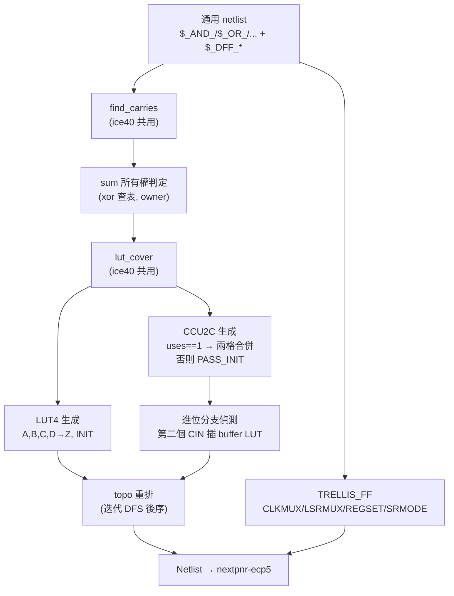

# 4.3 ECP5 映射：`ecp5.rs`

> 目標晶片：Lattice ECP5（LFE5U-85F，nextpnr-ecp5 預設 `--85k
> --package CABGA381`）。輸入與 iCE40 相同：通用閘級網路。
> 輸出是 Project Trellis / yosys 認得的 `LUT4 / CCU2C / TRELLIS_FF`。
> 完整原始碼 `veryl-eda/src/ecp5.rs`（203 行），第一行就說明了共用策略：

```rust
use crate::ice40::{find_carries, lut_cover, truth, PAT};
```

**LUT 覆蓋演算法與 iCE40 完全共用**，ECP5 檔案裡真正的新東西只有三件：
CCU2C 進位鏈的打包、TRELLIS_FF 的字串參數、以及拓撲重排。
本章逐段拆解。

---

## 4.3.1 LUT4：與 iCE40 同一個覆蓋器，不同引腳名

ECP5 的 LUT4 引腳是 `A B C D → Z`（iCE40 是 `I0..I3 → O`），
參數叫 `INIT` 而不是 `LUT_INIT`，位元序同樣是 A = LSB
（`ecp5.rs:64-74`）：

```rust
// ecp5.rs — LUT 生成，覆蓋結果來自 ice40::lut_cover
let mut lut_order: Vec<u32> = used.iter().copied().collect();
lut_order.sort_by_key(|n| pos[n]);          // 閘序，輸出確定性
for n in lut_order {
    let leaves = &best[&n].leaves;
    let mut memo: HashMap<u32, u16> = HashMap::new();
    for (i, l) in leaves.iter().enumerate() { memo.insert(*l, PAT[i]); }
    let tt = truth(n, &gates, &pos, &mut memo);
    for (i, p) in ["A", "B", "C", "D"].iter().enumerate() {
        conns.push((p, leaves.get(i).map(|w| Bit::W(*w)).unwrap_or(Bit::C0)));
    }
    conns.push(("Z", Bit::W(n)));
    cells.push(Cell { typ: "LUT4".into(), conns,
        params: vec![("INIT", format!("{:016b}", tt))] });
}
```

不足四個輸入的 LUT，空腳接 `Bit::C0`（常數 0）——這不是隨便的補位：
真值表是按 (A,B,C,D) 的位元加權算的，腳空著對應 PAT 遮罩為
`...0000`，真值表不受影響，因此**不需要**像某些流程那樣把未用腳
綁到已用腳。

---

## 4.3.2 CCU2C：一格兩位元的進位鏈

ECP5 的進位硬體是 `CCU2C`：一個 slice cell 裡有**兩個半格**
（half 0 與 half 1），每個半格有一個 LUT4 與一個 LUT2，硬體式子
（與 `ccu2c()` 模擬函式一致）：

$$
\text{LUT4} = \text{INIT}[\,A + 2B + 4C + 8D\,],\qquad
\text{LUT2} = \text{INIT}[\,A + 2B\,]
$$

$$
s = \text{LUT4} \oplus c_{in}\text{（INJECT1=NO 時）}, \qquad
c_{out} = (\lnot\text{LUT4} \wedge \text{LUT2}) \vee (\text{LUT4} \wedge c_{in})
$$

yosys 對「加法半格」的標準編程是（`ecp5.rs:14-17` 的註解與常數）：

```rust
/// CCU2C half that adds A + B + CIN (C = 0, D = 1: LUT4 = A ^ B, LUT2 = A)
pub const ADD_INIT: u16 = 0x96AA;
/// CCU2C half that only passes the carry on (LUT4 = 1: COUT = CIN)
pub const PASS_INIT: u16 = 0xFFFF;
```

驗證 `ADD_INIT = 0x96AA = 1001_0110_1010_1010₂`：

- LUT4 在索引 $A + 2B$（$C=0, D=1$）的四個位置
  （2,3,6,7 → bits 2,3,6,7 = 0,1,1,0）……

直接看語意：LUT4 = $A \oplus B$，LUT2 = $A$，代入硬體式：

$$
s = (A \oplus B) \oplus c_{in}, \qquad
c_{out} = \lnot(A \oplus B)\,?\; A : c_{in} = \mathrm{maj}(A, B, c_{in})
$$

正是全加器。

### 為什麼需要 PASS_INIT = 0xFFFF

CCU2C 的半格是「LUT2 + 進位注入」的混合體，硬體強迫每個半格都要
有輸入。當一條進位鏈**無法**兩兩配對（奇數長、或中間某位元的和
不在鏈上），多出來的半格仍要佔著 COUT 的通路，於是把它編程成
恆等函數：

$$
\text{INIT1} = \text{0xFFFF} \Rightarrow \text{LUT4} = 1
\Rightarrow c_{out} = (0 \wedge \text{LUT2}) \vee (1 \wedge c_{in}) = c_{in}
$$

程式裡的分支（`ecp5.rs:96-105`）：

```rust
let init1 = if let Some(j) = j {
    done.insert(j);
    let b1 = &bits[&j];
    conns.extend([("A1", b1.x), ("B1", b1.y), ("C1", Bit::C0),
                  ("D1", Bit::C1), ("COUT", Bit::W(j))]);
    if let Some(s) = b1.sum { conns.push(("S1", Bit::W(s))); }
    ADD_INIT                                     // 真的加第二位元
} else {
    conns.extend([("A1", Bit::C0), ("B1", Bit::C0), ("C1", Bit::C0),
                  ("D1", Bit::C0), ("COUT", Bit::W(i))]);
    PASS_INIT                                    // 只當進位導管
};
```

### 兩格合併的條件：中間進位不得有別人用

一個 CCU2C 的兩半之間，half0 的 COUT 是**內部硬接線**——它不會
出現在網路上。所以 bit $i$ 與 bit $i{+}1$ 能塞進同一格的條件是：
bit $i$ 的 carry-out **只被** bit $i{+}1$ 的 carry-in 使用
（`ecp5.rs:80-92`，`uses` 統計每條 wire 被 LUT 葉、roots 與進位
鏈輸入引用的次數）：

```rust
let j = next_of.get(&Bit::W(i)).copied()
    .filter(|j| !done.contains(j) && uses.get(&Bit::W(i)) == Some(&1));
```

四個條件同時成立才合併：

1. `next_of`：bit $i$ 的 carry-out 恰是 bit $i{+}1$ 的 carry-in（鏈相鄰）；
2. `!done.contains(j)`：bit $i{+}1$ 還沒被別的格子收走；
3. `uses[ci] == 1`：中間進位**唯一**的使用者是下一個進位鏈位元；
4. 隱含條件：連進位來源本身有需要——`need` 集合來自 `used_fixed`，
   亦即 LUT 覆蓋已確認「有人讀這個進位」。

**為什麼這樣設計**：把兩個位元壓進一格省一半的 cell 與繞線資源
（進位在格內是硬接線，不出 fabric）。但如果中間進位還要餵 LUT
（例如比較器把它輸出到旗標），塞進內部線就等於把訊號藏起來了，
所以 `uses == 1` 是硬約束，不是最佳化。

FPGA 的進位鏈是**純鏈**，不能分支：一個 COUT 最多直接餵一個 CIN
（nextpnr-ecp5 會以 "CCU2C unsupported" 拒絕分支鏈）。若網路裡
同一個 carry-out 訊號被兩個下游 CCU2C 當 CIN（例如兩條鏈共用一個
中間進位），第二個讀取者必須走 fabric。程式的處理
（`ecp5.rs:110-127`）：偵測重複的 CIN 來源，插入一顆 buffer LUT
（`INIT = PAT[0]`，即 $Z = A$），讓第二個 CIN 從 LUT 繞線進來：

```rust
// a carry chain does not branch: a COUT feeds at most one CIN directly,
// any other carry-in gets it through the fabric (a buffer LUT; nextpnr
// adds the feed-out / feed-in)
let couts: std::collections::HashSet<Bit> = cells.iter()
    .filter(|c| c.typ == "CCU2C").filter_map(|c| c.port("COUT")).collect();
let mut seen: std::collections::HashSet<Bit> = Default::default();
let mut bufs = vec![];
for c in cells.iter_mut().filter(|c| c.typ == "CCU2C") {
    let Some(k) = c.conns.iter().position(|x| x.0 == "CIN") else { continue };
    let ci = c.conns[k].1;
    if !couts.contains(&ci) || seen.insert(ci) { continue; }  // 首次使用免費
    let y = Bit::W(next_wire); next_wire += 1;
    bufs.push(Cell { typ: "LUT4".into(),
        conns: vec![("A", ci), ("B", Bit::C0), ("C", Bit::C0),
                    ("D", Bit::C0), ("Z", y)],
        params: vec![("INIT", format!("{:016b}", PAT[0]))] });
    c.conns[k].1 = y;
}
cells.extend(bufs);
```

`seen.insert(ci)` 的用法值得注意：`HashSet::insert` 回傳 false 表示
「已經存在」，所以第一個讀取者直接通過，第二個以後才插 buffer。
這裡用 LUT 而不是真 buffer cell（ECP5 沒有 `BUF` 在 nextpnr 的
模型裡）——`Z = A` 的 LUT4 就是 1-bit 的可繞線 repeater，跟 4.2 節
iCE40 反相器用 LUT 是同一個哲學。

### 和（sum）輸出的所有權

兩個 carry 位元可能共用同一個 xor（`x ^ y`）作為和——`elab` 層的
常數折疊有時會讓兩個加法位元看到同一對運算元。程式以 `owner` 表
只讓**第一個**位元輸出和（`sum.filter(|s| owner.get(s) == Some(n))`），
另一個的和由 LUT 覆蓋另外生成。

---

## 4.3.3 TRELLIS_FF：極性是 mux，不是 cell 變體

iCE40 把 FF 極性編在**型號**裡（`SB_DFFN*`，04.2 節）；ECP5 相反：
slice 裡的時脈與 set/reset 到 FF 之間各有一個多工器，配置字串決定
接法。`ecp5.rs:131-146`：

```rust
// flip-flops: $_DFF_P_ / $_DFF_PN0_ / $_SDFF_NP1_ ...
// (clock and reset polarity are muxes in the slice)
for c in nl.cells.iter().filter(|c| c.is_ff()) {
    let t = c.typ.as_str();
    let f: Vec<char> = t.trim_start_matches("$_")
        .trim_start_matches('S').trim_start_matches("DFF_").chars().collect();
    let (q, d, ck) = (c.port("Q").unwrap(), c.port("D").unwrap(),
                      c.port("C").unwrap());
    let mut conns = vec![("CLK", ck), ("DI", d), ("Q", q)];
    let mut params = vec![
        ("GSR", "DISABLED".to_string()),
        ("CEMUX", "1".into()),
        ("CLKMUX", if f[0] == 'N' { "INV" } else { "CLK" }.into())];
    if let Some(r) = c.port("R") {
        conns.push(("LSR", r));
        params.push(("LSRMUX", if f[1] == 'N' { "INV" } else { "LSR" }.into()));
        params.push(("REGSET", if f[2] == '1' { "SET" } else { "RESET" }.into()));
        params.push(("SRMODE", if t.starts_with("$_SDFF") { "LSR_OVER_CE" }
                                         else { "ASYNC" }.into()));
    } else {
        params.push(("REGSET", "RESET".into()));
    }
    cells.push(Cell { typ: "TRELLIS_FF".into(), conns, params });
}
```

四個字串參數的語意：

| 參數 | 值 | 意義 |
|---|---|---|
| `CLKMUX` | `CLK` / `INV` | 時脈直通 / 反相（對應 `$_DFF_N_*`） |
| `CEMUX` | `1` | clock enable 恆為 1（elab 不產生 `$_DFFE_*`） |
| `LSRMUX` | `LSR` / `INV` | set/reset 極性（對應名字第二碼 P/N） |
| `REGSET` | `RESET` / `SET` | LSR 動作時 FF 是清 0 或置 1（第三碼 0/1） |
| `SRMODE` | `ASYNC` / `LSR_OVER_CE` | 非同步（`$_DFF_*`）/ 同步（`$_SDFF_*`） |
| `GSR` | `DISABLED` | 不用晶片級全域 set/reset |

兩個架構事實值得停下來：

- **REGSET 同時是「重置值」與「上電值」**：ECP5 FF 上電時的值由
  REGSET 決定（這與 iCE40「上電恆為 0」不同，第 04.1 節的比較表）。
  這就是 `veryl-eda/test.sh` 做 ECP5 形式等價時要
  `attrmap -remove init` 移除 yosys 的 init 屬性的原因。
- **無 reset 的 FF 也寫 `REGSET=RESET`**：即使 `$_DFF_P_` 沒有 R 腳，
  slice 的 mux 仍需一個確定值；程式選 RESET（LSR 沒接、不會觸發）。

---

## 4.3.4 `is_string_param`：JSON 與 Verilog 寫出器的分歧

ECP5 的參數有兩種型別：真值表（16-bit 位元向量）與 mux 選擇
（字串）。yosys JSON 對兩者的編碼不同——位元向量是 `"016010010..."`，
字串若恰好由 0/1 組成會有歧義，yosys 的慣例是**字串結尾加一個空格**。
`ecp5.rs:156-159`：

```rust
/// parameters that are strings, not bit vectors (yosys JSON marks a string
/// of 0 / 1 with a trailing space)
pub fn is_string_param(cell: &str, k: &str) -> bool {
    matches!(cell, "TRELLIS_FF" | "CCU2C") && !matches!(k, "INIT0" | "INIT1")
}
```

`output.rs` 的 JSON writer 據此決定是否補空格；Verilog writer 則相反，
所有參數都照字面寫。若這個分類出錯：`"INV"` 之類的字串會被當成
位元向量解析失敗，`"10"` 之類的位元向量會被 yosys 當字串。
表格化的分類函式（而非散落在寫出器裡的 if）讓 netsim、
`gatesim.rs`、測試都能引用同一份真相。

---

## 4.3.5 topo：ECP5 為何需要顯式重排

iCE40 映射沿用原 netlist 順序（04.2 節），ECP5 卻必須重排，原因有二：

1. **buffer LUT 是後插入的**，出現在向量尾端，但它的輸入可能驅動
   位於前面的 CCU2C 的 CIN；
2. LUT 與 CCU2C 分兩段生成（先全部 LUT、再全部 CCU2C），CCU2C 的
   資料輸入接的 LUT 一定在前——這半邊沒問題——但 buffer LUT 破壞了
   「兩段各自有序」的性質。

`ecp5::topo` 是迭代式 DFS 後序（`ecp5.rs:179-203`）：

```rust
/// combinational cells in topological order
fn topo(cells: Vec<Cell>) -> Vec<Cell> {
    let mut driver: HashMap<u32, usize> = HashMap::new();
    for (i, c) in cells.iter().enumerate() {
        for (p, b) in &c.conns {
            if let (true, Bit::W(w)) = (is_out(p), b) { driver.insert(*w, i); }
        }
    }
    let mut state = vec![0u8; cells.len()];
    let mut order = vec![];
    for i in 0..cells.len() {
        // iterative depth-first post-order
        let mut stack = vec![(i, false)];
        while let Some((k, done)) = stack.pop() {
            if done { state[k] = 2; order.push(k); continue; }
            if state[k] != 0 { continue; }
            state[k] = 1;
            stack.push((k, true));
            for (p, b) in &cells[k].conns {
                if let (false, Bit::W(w)) = (is_out(p), b) {
                    if let Some(&d) = driver.get(w) {
                        if state[d] == 0 { stack.push((d, false)); }
                    }
                }
            }
        }
    }
    ...
}
```

注意它只對**組合** cell 有效（FF 的 D→Q 是時序邊，呼叫端先過濾）。
迭代而非遞迴，是因為大設計（如 RISC-V SoC 的 8 KB 記憶體周邊）
組合深度可能數千，遞迴有 stack overflow 風險。三態 `state`
（0 未訪、1 在堆疊、2 完成）避免同一節點重複進入後序。

---

## 4.3.6 `ccu2c`：軟體模型 = 硬體模型

`netsim` 與 veryl-sim 的 `gates.rs` 需要 ECP5 cell 的行為模型。
`ecp5::ccu2c` 不另寫模擬邏輯，而是**照 yosys `cells_sim.v` 的模型
原樣實作**（`ecp5.rs:162-176`，`half` 即 4.3.2 開頭的硬體式子，
`get` 以閉包注入、讓同一函式服務 2-state netsim 與 4-state 的
x 傳播）：

```rust
pub fn ccu2c(c: &Cell, get: impl Fn(&str) -> bool) -> (bool, bool, bool) {
    let init = |k: &str| u16::from_str_radix(&p(k), 2).unwrap_or(0);
    let lut = |init: u16, a: bool, b: bool, cc: bool, d: bool|
        (init >> (a as u16 | (b as u16) << 1 | (cc as u16) << 2 | (d as u16) << 3)) & 1 == 1;
    let half = |init: u16, inject: bool, ins: [bool; 4], cin: bool| {
        let l4 = lut(init, ins[0], ins[1], ins[2], ins[3]);
        let l2 = (init >> (ins[0] as u16 | (ins[1] as u16) << 1)) & 1 == 1;
        let s = l4 ^ (!inject && cin);
        let co = (!l4 && !inject && l2) || (l4 && cin);
        (s, co)
    };
    let (s0, c0) = half(init("INIT0"), p("INJECT1_0") != "NO",
                        [get("A0"), get("B0"), get("C0"), get("D0")], get("CIN"));
    let (s1, c1) = half(init("INIT1"), p("INJECT1_1") != "NO",
                        [get("A1"), get("B1"), get("C1"), get("D1")], c0);
    (s0, s1, c1)
}
```

**為什麼這樣設計**：模擬器與硬體的一致性是 gate-level 驗證的全部
價值。把行為模型寫成「讀同一份 cell 參數 → 按廠商模型計算」，
任何參數編碼的錯誤會立刻在模擬中顯現（`test.sh` 的形式等價與
gate-level 共模擬就是這個用意）。`get` 以閉包注入讓同一函式同時
服務 2-state netsim 與 4-state 的 x 傳播。

---

## 4.3.7 流程總覽



與 iCE40 的對照表：

| 主題 | iCE40 | ECP5 |
|---|---|---|
| 進位 cell | 獨立 `SB_CARRY`（majority） | `CCU2C`（兩半格，含 sum 輸出） |
| 進位打包 | LUT + CARRY 同 LC，靠 I1/I2/I3 對齊 | 兩位元同 cell，靠 `uses == 1` |
| 進位分支 | 不允許（鏈必須從 LC0 開始，`pack.rs` 檢查） | 第二個 CIN 插 buffer LUT |
| FF 極性 | 型號編碼（`SB_DFFN*`），active-low 插反相器 | 字串 mux（`CLKMUX = "INV"`），免費 |
| FF 上電 | 恆 0 | `REGSET` 決定 |
| 參數型別 | 全是位元向量 | 混合，`is_string_param` 分類 |
| 拓撲順序 | 原順序倖存 | `ecp5::topo` 顯式重排 |
---

## 4.3.8 本章重點

- ECP5 映射與 iCE40 共用 `lut_cover`/`find_carries`/`truth`；
  新程式碼只處理架構差異——這是「演算法層 vs 架構層」分層的直接示範。
- `CCU2C` 一格兩位元：合併條件是鏈相鄰 + 中間進位 `uses == 1`；
  未配對的半格編程 `INIT1 = 0xFFFF` 純粹當進位導管（$c_{out}=c_{in}$）。
- 進位鏈不可分支：nextpnr-ecp5 會以 "CCU2C unsupported" 拒絕；
  多餘的 CIN 讀取者改走 fabric，由 `INIT = PAT[0]` 的 buffer LUT 提供。
- `ADD_INIT = 0x96AA`：LUT4 = $A \oplus B$、LUT2 = $A$，硬體式
  給出 $s = A\oplus B\oplus c_{in}$、$c_{out} = \mathrm{maj}$。
- `TRELLIS_FF` 的極性是 slice 內 mux：`CLKMUX/LSRMUX/REGSET/SRMODE`
  字串參數；`REGSET` 同時決定重置值與上電值（與 iCE40 的恆 0 不同）。
- `is_string_param` 是 JSON（字串補尾空格）與 Verilog 寫出器的分歧點，
  也是 2-state 模擬器解析參數的依據。
- buffer LUT 的插入打破原 netlist 順序，`ecp5::topo` 用迭代 DFS 後序
  恢復拓撲序，供模擬器與 pack 消費。
