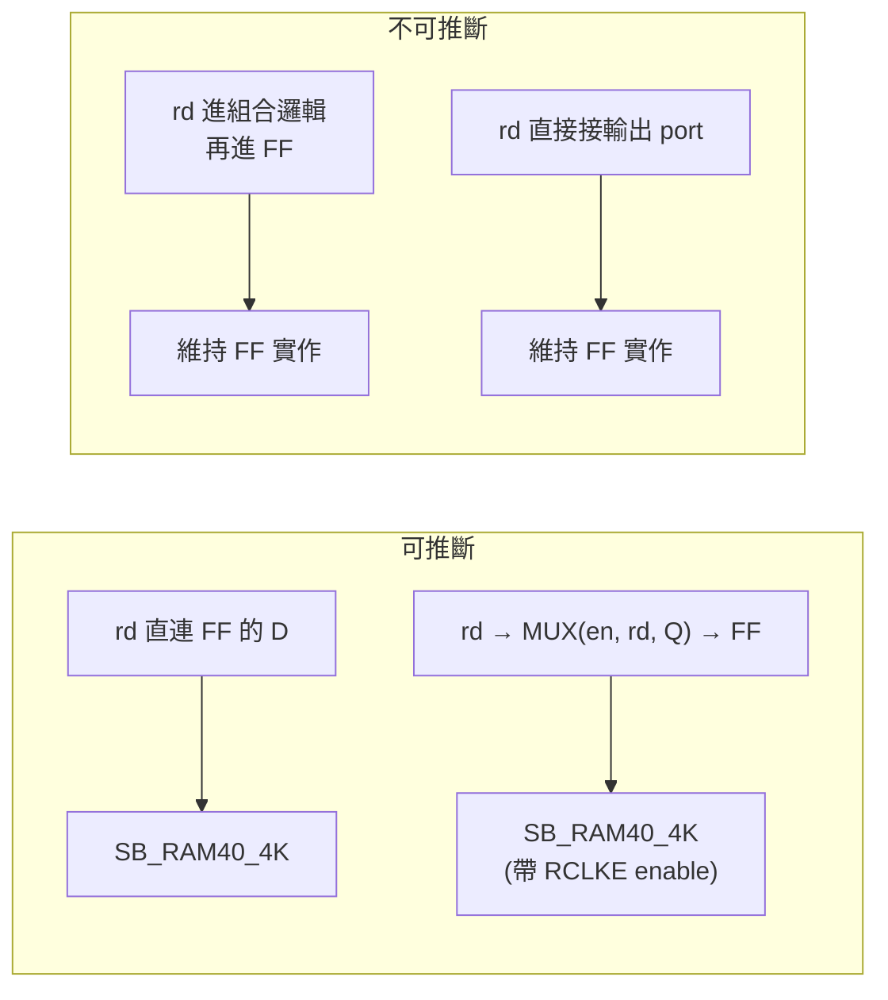

# 4.4 BRAM 映射：`bram.rs`

> 目標：把 elaborator 記錄為「memory」的暫存器陣列（命名 net
> `$mem:NAME:{clk,we,wa,wd,raN,rdN}`，見 `elab::MemInfo`）換成
> iCE40 的 `SB_RAM40_4K` block RAM。成功時，元素 flip-flop、讀暫存器、
> 位址解碼與讀出 mux 全部消失，換成一顆 SRAM 巨集。
> 原始碼 `veryl-eda/src/bram.rs`（246 行）。

模組開頭的註解就是本節大綱：

```rust
//! Block RAM inference for iCE40: an array the elaborator recorded as a
//! memory ... whose read ports are *synchronous* (each read data bit goes
//! straight into a flip-flop on the write clock, optionally with an enable)
//! becomes `SB_RAM40_4K` blocks: the element flip-flops, the read registers
//! and the address decoding / read multiplexers they needed disappear.
//! Asynchronous reads stay logic, because the block RAM only has a registered
//! read port.
```

---

## 4.4.1 為什麼只有同步讀能變 block RAM

FPGA 的 block RAM 是「位址 → SRAM core → **輸出暫存器**」的結構。
讀出的資料一定是**上個時脈週期**位址上的內容：

$$
\text{RDATA}[t] = \text{MEM}\big[\text{RADDR}[t-1]\big]
$$

而 Veryl/HDL 允許組合讀：

$$
\text{data}[t] = \text{MEM}\big[\text{addr}[t]\big]
$$

兩者差一拍。工具無法把組合讀「變成」block RAM（時序會錯），只能：
(a) 用分散式 FF + 讀出 mux 實作（面積爆炸但語意正確），或
(b) 保持 flip-flop 表示。veryl-eda 選 (b)——不做，就留在邏輯裡。



---

## 4.4.2 elaborator 的記憶體表示

`elab.rs` 把「由同一個 `always_ff` 整顆元素寫入、且以整顆元素讀出」
的陣列記成一群命名 net：`$mem:NAME:clk`（寫時脈）、`:we`（寫使能）、
`:wa`（寫位址）、`:wd`（寫資料，width bits）、`:raK`/`:rdK`
（第 K 個讀埠的位址/資料），以及 `NAME` 本身（每個元素的 Q，
depth × width bits）。

`find_mems` 先掃出所有記憶體名稱——把 net 名剝掉 `$mem:` 前綴與
`:clk` 後綴即得。

這個表示法的設計動機：記憶體在 netlist 裡**仍然是 flip-flop**（可被
任何後端當普通邏輯處理），block RAM 推斷是純粹的「事後改寫」，
失敗也無害。

---

## 4.4.3 `find_mems`：推斷條件逐一拆解

`find_mems(nl)` 回傳 `(剝除記憶體邏輯後的 netlist, Vec<Mem>)`。
每個記憶體要通過一連串檢查，任何一項失敗就 `continue 'mem`
（放棄這顆記憶體，它留在 FF 表示）。以下按程式順序列出。

### (1) 形狀合法

深度必須是 2 的冪（`depth != 1 << abits` 放棄）、寫位址寬度必須
恰為 $\log_2 \text{depth}$（block RAM 位址線是硬體）。

### (2) 儲存本體 = 同一時脈的 plain FF

```rust
let plain_ff = |i: usize| nl.cells[i].typ == "$_DFF_P_" && nl.cells[i].port("C") == Some(clk);
...
for (k, b) in store.iter().enumerate() {
    match q_cell.get(b) {
        Some(&i) if plain_ff(i) => elems.push(i),
        Some(_) => continue 'mem,        // 是 FF 但不是這個 clock 的 plain FF
        None => missing[k % width] = true, // 沒有 FF：該資料位元沒人讀，已死
    }
}
```

「缺 FF」被允許（死邏輯掃除已經把沒人讀的資料位元的 FF 拿掉了），
但後面有呼應的檢查：缺的位元**不得**被任何讀埠使用（`bram.rs:113`）：

```rust
if (0..width).any(|j| missing[j] && reads.iter().any(|r| r.data[j].is_some())) { continue; }
```

### (3) 讀埠必須是同步讀

對每個讀埠 `raK/rdK`，每個資料位元只允許兩種形狀：

```rust
// bram.rs:87-107（簡化）
for b in &rd {
    let u = users.get(b)...;                  // 誰在讀這條 rd 線？
    if u.is_empty() { data.push(None); continue; }   // 沒人讀：免暫存器
    if u.len() != 1 { continue 'mem; }               // 超過一個讀者：放棄
    let (ff, e) = if p == "D" && plain_ff(i) {
        (i, Bit::C1)                                  // rd 直接進 FF 的 D
    } else if p == "B" && c.typ == "$_MUX_"
              && !port_bits.contains(&c.out()) {
        // enable: D = en ? rd : Q
        if mux 輸出又被多人讀、或下游 FF 不是 plain_ff { continue 'mem; }
        gone.push(i);                                 // mux 也要一起刪
        (uu[0].0, c.port("S").unwrap())
    } else { continue 'mem };
    if *en.get_or_insert(e) != e { continue 'mem; }   // 同埠所有位元共用 en
    ...
}
```

三個關鍵細節：

1. **enable 的形狀**：`D = MUX(en, rd, Q)`——enable 時保持舊值，
   這正是 block RAM `RCLKE` 的語意。而且 mux 的輸出**不得**是輸出
   port（否則別人還要讀它，刪不得）；
2. **一個讀埠只有一個 enable**：所有位元的 `en` 必須相同
   （`get_or_insert` + 不等則放棄），因為 `RCLKE` 是整個 block 一根腳；
3. **讀資料不得直接接輸出 port**：block RAM 的輸出暫存器之後就是
   繞線，port 需要的是 FF 的 Q。

### (4) 位址不得超出深度

```rust
if ra.iter().skip(abits).any(|b| *b != Bit::C0) { continue 'mem; }
```

位址高位必須常數 0，否則繞回行為（wrap-around）無法用硬體表達。

---

## 4.4.4 `infer`：SB_RAM40_4K 的四種模式

SB_RAM40_4K 是 4096-bit 的方塊，`READ_MODE`/`WRITE_MODE`（各 32-bit
位元向量參數，但只用到低 2 bit）選擇字長：

| READ/WRITE_MODE | 深度 × 寬度 | 每塊資料位元寬 `bw = 16 >> mode` |
|---|---|---|
| 0 | 256 × 16 | 16 |
| 1 | 512 × 8 | 8 |
| 2 | 1024 × 4 | 4 |
| 3 | 2048 × 2 | 2 |

（`bram.rs` 模組註解列的正是這張表。）模式的位址/資料腳映射有個
出人意料的規則——**模式非 0 時資料腳不連續**（yosys `cells_sim.v`）：

```rust
/// RAM data pins used by data bit `d` in a mode (yosys cells_sim.v)
pub fn data_pin(mode: usize, d: usize) -> usize {
    match mode { 0 => d, 1 => 2 * d, 2 => 4 * d + 1, _ => 8 * d + 3 }
}
```

例如 8-bit 模式（mode 1）下資料位元 0 用 `WDATA[0]`，位元 1 用
`WDATA[2]`——硬體把 mask 結構攤在固定的腳位模式上，工具必須照抄。

### 寬字並聯與每讀埠複製

寬於 `bw` 的字用**多顆 block 並聯**（每顆拿字的一部分）：mode 由
深度決定（`match m.depth { 0..=256 => 0, 257..=512 => 1, 513..=1024 => 2, _ => 3 }`），
塊數 `blocks = m.width.div_ceil(bw)`，每塊的寫/讀腳接同一組訊號、
`MASK` 全 0（不做位元遮罩寫入）、未用的 RDATA 腳配新 wire。
注意 `for r in &m.reads { for k in 0..blocks }` 的巢狀順序：**每個
讀埠得到自己的一整份記憶體**。這是雙埠 block RAM 的根本限制：
N 個讀埠 > 2 時只能複製整塊，用同時鐘寫入保持一致
（寫埠只有一個，所以複製份數 = 讀埠數）。

### 參數與 MEM_SLOT

```rust
let mut params: Vec<(&'static str, String)> =
    vec![("READ_MODE", format!("{:032b}", mode)),
         ("WRITE_MODE", format!("{:032b}", mode))];
for name in INIT { params.push((name, "0".repeat(256))); }
params.push((SLOT, format!("{}:{}", m.name, k)));
```

- `READ_MODE/WRITE_MODE` 寫成 **32-bit** 二進位字串（硬體參數寬度）；
- `INIT_0..INIT_F` 先填 256 個 '0'（16 × 256 = 4096 bits），之後由
  `set_mem_init` 回填（4.4.6）；
- `MEM_SLOT = "NAME:BLOCK"` 是 veryl-eda 自訂的**屬性**，不是 iCE40
  參數（模組註解與 `SLOT` 常數說明）：

```rust
/// Which memory a block RAM holds: `NAME:BLOCK` ... kept so a program can
/// be put into the memory after mapping, or into a placed-and-routed
/// bitstream (`pnr::patch_ram`). Not an iCE40 parameter: the yosys JSON
/// writes it as an attribute.
pub const SLOT: &str = "MEM_SLOT";
```

它讓後段流程（`--program prog.bin`、IDE 的 ROM 燒錄、`pnr::patch_ram`
直接改寫 `.asc` 的 `.ram_data`）能夠「認出」哪顆 block RAM 是哪個
記憶體的第幾塊，而**不需要**在 iCE40 的配置格式裡找位置——屬性
隨 yosys JSON 走，.asc 靠 `ram_map()` 對照。

---

## 4.4.5 INIT 位元序：`init_strings` 的三層重排

把「字的陣列」換成 16 條 256-bit 的 `INIT_k` 字串，要穿過**三層**
位址空間重排，`init_strings` 的註解是一行式地圖：

```rust
/// INIT_0..INIT_F (msb first) of block `k` of a memory in `mode`, from
/// its words (word a, data bit d is RAM bit (d << mode) | lane of RAM
/// word a & 0xff, lane = a >> 8)
pub fn init_strings(mode: usize, k: usize, words: &[u64]) -> Vec<String> {
    let bw = 16 >> mode;
    let mut ram = [0u16; 256];
    for (a, w) in words.iter().enumerate().take(256 << mode) {
        let lane = (a >> 8) & ((1 << mode) - 1);
        for d in 0..bw {
            let j = k * bw + d;
            if j < 64 && (w >> j) & 1 == 1 {
                ram[a & 0xff] |= 1 << ((d << mode) | lane);
            }
        }
    }
    (0..16).map(|i| (0..256).map(|p| {
        let bit = 255 - p;
        if (ram[i * 16 + bit / 16] >> (bit % 16)) & 1 == 1 { '1' } else { '0' }
    }).collect()).collect()
}
```

三層重排分別是：

1. **字 → RAM 字**：mode 非 0 時一個 RAM 字（256 之一）其實承載
   多個邏輯字：`RAM word = a & 0xff`，`lane = a >> 8`。mode 2
   （1024×4）下，第 512 個邏輯字是 RAM 字 0 的 lane 2。
2. **資料位元 → RAM 位元位置**：`(d << mode) | lane`——與
   `data_pin` 的非連續腳位規則**同源**（mode 1 下資料位元 d 放在
   bit `2d` 附近），因為 lane 佔用了相鄰位元。
3. **字串方向**：每條 INIT 是 256 個字元、**MSB 在前**（`bit = 255 - p`）；
   一條 `INIT_i` 覆蓋 RAM 位址 $16i \dots 16i+15$ 的字。

$$
\text{INIT}_i[p] \;=\; \text{ram}\big[\,16i + \lfloor (255-p)/16 \rfloor\big]\big[(255-p) \bmod 16\big]
$$

為什麼敢把公式寫得這麼密？因為它是**可測的純函式**：`test.sh` 的
gate-level 共模擬與 `pnr/cosim.py`（icebox_vlog 反解 routed bitstream
再隨機輸入比對）都會踩到 ROM 內容，任何重排錯誤都會讓模擬讀到
錯的資料而當場失敗。

---

## 4.4.6 ROM 與 `patch_ram`：初始化的三個時機

Veryl 沒有 ROM 語法（elaborator 只記「從未寫入的記憶體」，
optimizer 保留它們），初始內容是**映射之後**塞進去的。三個時機、
三個入口：時機 1 是映射後直接改 netlist 參數
（`bram::set_mem_init`，經 `slot_of` 找出 `MEM_SLOT` 符合的
`SB_RAM40_4K`）；時機 2 是 P&R 之後直接改寫 `.asc` 的 `.ram_data`
（`pnr::patch_ram`，靠 `Output::ram_map()` 的
`RamPos { slot, x, y, mode }` 對照 tile 位置）；時機 3 是 CLI
`--program prog.bin`，用 `bram::program_lanes` 拆 byte lanes 後走
時機 1。

```rust
// bram.rs:211-223 — 時機 1：改 netlist 參數（節選）
pub fn set_mem_init(nl: &mut Netlist, name: &str, words: &[u64]) -> usize {
    for c in nl.cells.iter_mut().filter(|c| c.typ == "SB_RAM40_4K") {
        let Some((m, k, mode)) = slot_of(c) else { continue };
        if m != name { continue; }
        let init = init_strings(mode, k, words);
        for (p, v) in c.params.iter_mut() {
            if let Some(i) = INIT.iter().position(|x| x == p) { *v = init[i].clone(); }
        }
        n += 1;
    }
    n
}
```

```rust
// pnr/mod.rs:143-151 — 時機 2：直接改寫 .asc 的 .ram_data（節選）
pub fn patch_ram(asc: &str, map: &[RamPos], name: &str, words: &[u64])
    -> R<(String, usize)>
{
    let mut blocks: HashMap<(i32, i32), Vec<String>> = HashMap::new();
    for r in map {
        let Some((m, k)) = r.slot.rsplit_once(':') else { continue };
        if m != name { continue; }
        blocks.insert((r.x, r.y),
            ram_lines(&crate::bram::init_strings(r.mode, k, words)));
    }
```

`patch_ram` 的價值：**已經 place & route 過的位元流可以只改 RAM 內容
而不用重跑 P&R**——程式（韌體）與電路（硬體）解耦。`.ram_data`
是 16 行 × 64 hex digits（256 bits / 行），`ram_lines` 把每條 INIT
的 '0'/'1' 字串四個一組折成十六進位字元。

### RISC-V SoC 的 byte lanes

`program_lanes` 把一段二進位程式拆進四條 8-bit lane
（RvMem 的 `b0.mem..b3.mem`，位元組 $k$ 進 lane $k$：
`bytes.iter().skip(k).step_by(4)`）。四條 lane = 四顆 block 並聯，
正是 4.4.4 的「寬字並聯」結構反過來用：32-bit 字的位元組 k 恰在
block k。

---

## 4.4.7 netsim 與 hardwired 語意

映射出的 `SB_RAM40_4K` 有兩個消費者：

- `netsim.rs`：照 yosys `cells_sim.v` 模擬（同步讀、寫優先）；
- `pnr/pack.rs` / `pnr/place.rs`：block RAM 佔 `ramb` tile（控制位元在
  其上的 `ramt` tile），`pnr/mod.rs::build` 的 `ram_wire` 先查 `ramb`
  再查上方 tile 找腳位 net。

`pnr/mod.rs` 寫配置時（`RamConfig.PowerUp` 後）依序測 `write_mode & 1`、
`write_mode & 2`、`read_mode & 1`、`read_mode & 2`，非零就打開
對應的 `RamConfig.CBIT_k`（寫在 `y + 1` 的 ramt tile），最後
`ram_data.push(...)` 記下 `.ram_data` 內容。寫模式兩個 bit、讀模式
兩個 bit，順序是硬體配置位的排列，與 bram 的模式編號一致。

---

## 4.4.8 ECP5 的 DP16KD 為什麼還沒做（v2.3 規劃）

`ecp5.rs` 的模組註解直說：

> Memories stay flip-flops for now.

ECP5 的 block RAM 是 `DP16KD`（16 Kbit true dual-port），與
`SB_RAM40_4K` 相比是**另一個量級的複雜度**：

| 面向 | SB_RAM40_4K | DP16KD |
|---|---|---|
| 容量 | 4096 bits | 16384 bits |
| 埠 | 1 寫 + 1 讀 | 2 個全功能埠（各自讀/寫） |
| 字形 | 4 種（256×16 .. 2048×2） | 十數種（含 9-bit byte enable） |
| 讀模式 | 同步，`RCLKE` | 同步/非同步、pipelined AD/REG 暫存器 |
| 初始 | INIT_0..F + `.ram_data` | `INITVAL_00..3F`，**且每行編碼過** |
| 腳位 | 16 條資料腳 | 每埠一整套 `AD/DI/DO/BE/CE/WE/OCE` |

`bram.rs` 現有的推斷條件大多可直接沿用（同步讀、enable 形狀、
位址寬度），要新增的是：

1. **DP16KD 的參數翻譯**：`DATA_WIDTH_A/B`、`REGMODE`、`GSR`、
   `WRITEMODE_A/B` 等**字串參數**（沿 4.3 節 `is_string_param` 的路）；
2. **INITVAL 編碼**：64 條 `INITVAL_00..3F` 每條 320 bits 打包成
   64 個 5-bit 符號的資料行編碼（Project Trellis 的格式），
   `init_strings` 的三層重排要再疊一層；
3. **雙寫埠**：Veryl 若出現兩個寫埠，SB 版直接放棄，DP16KD 卻
   真的能做——推斷器需要放寬「單一寫埠」假設並處理寫衝突語意。

AGENTS.md 將它排在 v2.3，原因就是第 2、3 點：功能正確性（寫衝突）
與格式正確性（INITVAL 編碼）都不是 SB_RAM40_4K 那種一對一換算，
需要新的測試策略（形式等價時 DP16KD 上電值與 init 的互動也要驗證）。

---

## 4.4.9 本章重點

- 推斷的先決條件是**同步讀**：讀資料直連 FF 的 D，或經
  `MUX(en, rd, Q)` 進 FF 的 D（後者 = `RCLKE`）。組合讀、
  讀埠直出 port、多位址高位非零，全部留在 FF 表示。
- 記憶體在 netlist 裡始終是 flip-flop（`$mem:` 命名 net），block RAM
  是事後改寫；推斷失敗無害，超深記憶體靠刪除命名 net 遞迴回退。
- `READ_MODE/WRITE_MODE` 0..3 ↔ 256×16 / 512×8 / 1024×4 / 2048×2；
  非零模式的資料腳不連續（`data_pin`），必須照 yosys 模型。
- 寬字多塊並聯；**每個讀埠整份複製**（block RAM 只有一寫一讀）。
- `MEM_SLOT = NAME:BLOCK` 屬性把初始化的三個時機（映射後 netlist、
  P&R 後 `.asc`、CLI `--program`）串起來；`patch_ram` 改 `.ram_data`
  免重跑 P&R。超過 2048 深度的記憶體靠刪除 `$mem:` 命名 net 遞迴
  回退，留在 FF 表示。
- `init_strings` 穿過三層重排：lane（`a >> 8`）、位元位置
  （`(d << mode) | lane`）、字串 MSB 在前。
- DP16KD（v2.3）的障礙：真雙寫埠的衝突語意 + INITVAL 的行編碼格式，
  不是 SB_RAM40_4K 的一對一換算。
