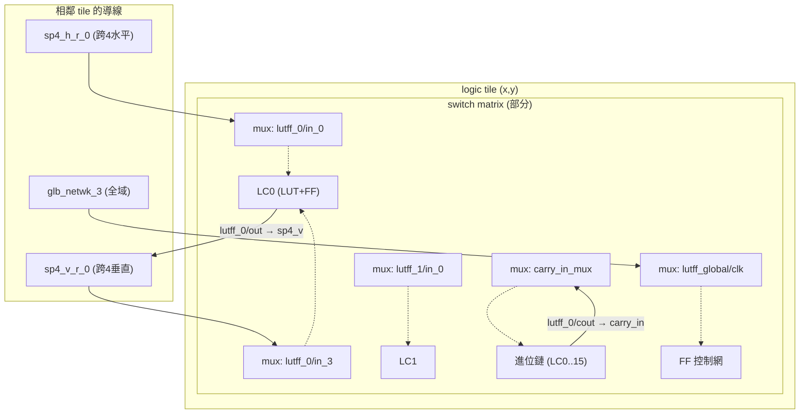
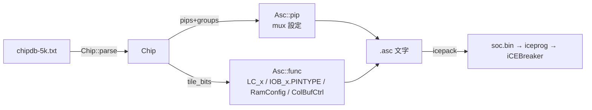

# 4.5 讀懂 chipdb：`pnr/chipdb.rs`

> own P&R（`--pnr veryl`）不做魔法：它需要一張完整的「晶片地圖」——
> 每個 tile 在哪、裡面有哪些導線、哪些 mux 開關（pip）、開關由哪些
> 配置位元控制、封裝腳位怎麼對應 IO。這張地圖就是 IceStorm 的
> `chipdb-5k.txt`。原始碼 `veryl-eda/src/pnr/chipdb.rs`（249 行）。

---

## 4.5.1 chipdb 是什麼：文字版位元流資料庫

IceStorm 計畫反解了 iCE40 的位元流格式，並把「哪個 tile 的哪些位元
控制什麼」公開成文字檔 `chipdb-5k.txt`（UP5K 的資料庫；5k = UP5K/Series
5 的裝置代號）。它其實就是 **icepack 位元流封裝器自己用的內部表**
的文字轉儲。nextpnr-ice40 用的 `.bin` 版本（icebox 資料庫）內容相同，
veryl-eda 選文字版是為了簡單的解析器與可讀性。

檔案結構（節選，真實檔案數十萬行）：

```text
.device 5k 38 38 43326 4417 4608  ...
.pins SG48
  A1  0 12 5 0 0
  ...
.net 17 12 3
  3 12  lutff_0/in_0
  4 12  sp4_h_r_0
  ...
.routing 3 12 4 1 1110 B0[0] B1[4]
.buffer  3 12 7 0 11 B1[3]
.logic_tile_bits 54 18
  LC_0  B0[21] B0[22] B0[23] B0[24] ...
.io_tile_bits 18 18
  IOB_0.PINTYPE_0  B0[2] B0[3] ...
```

規則：以 `.` 開頭的行是**節的開頭**，後續非 `.` 的行屬於該節；
`#` 開頭是註解（並**終止**當前節，見解析器的 `Sec::None` 處理）。

---

## 4.5.2 載入與環境變數

```rust
// chipdb.rs:117-128
pub fn default_path() -> Option<String> {
    if let Ok(p) = std::env::var("VERYL_EDA_CHIPDB") { return Some(p); }
    let home = std::env::var("HOME").unwrap_or_default();
    let cands = [
        "/opt/homebrew/share/icebox/chipdb-5k.txt".to_string(),
        "/usr/local/share/icebox/chipdb-5k.txt".to_string(),
        "/usr/share/icebox/chipdb-5k.txt".to_string(),
        "/Users/Shared/ccc/oss-cad-suite/share/icebox/chipdb-5k.txt".to_string(),
        format!("{}/oss-cad-suite/share/icebox/chipdb-5k.txt", home),
    ];
    cands.into_iter().find(|p| std::path::Path::new(p).exists())
}
```

查找順序：`VERYL_EDA_CHIPDB` 環境變數優先，然後各發行版慣例路徑、
oss-cad-suite（本機安裝）。找不到時 `pnr/mod.rs::place_and_route`
回報：

```rust
.ok_or("IceStorm chipdb-5k.txt not found (set VERYL_EDA_CHIPDB)")?;
```

`Chip::load(path, package)` 一次讀進整個文字檔，`package`（如
`"SG48"`）用來過濾 `.pins` 節——同一檔案含所有封裝的腳位，
不相干的直接丟棄。載入後解析失敗的檢查也寫明原因：

```rust
if c.w == 0 { return Err(...); }                                  // 沒有 .device
if c.pins.is_empty() { return Err(...); }                         // 封裝名錯誤
```

---

## 4.5.3 解析器：單趟狀態機

`parse` 是一個逐行狀態機，狀態就是「現在在哪個節」：

```rust
// chipdb.rs:145
enum Sec {
    None,
    Pins(bool),          // bool = 這是目標封裝的腳位嗎
    Gbufin, Gbufpin, ExtraBits, Ieren, Colbuf,
    Bits(String),        // *_tile_bits 節（tile 型別名）
    Net(u32),            // .net <net-id>
    Mux(u8, u8, u32, u32), // (x, y, dst-net, group-id)
}
```

節的切換（`chipdb.rs:151-192`）：

```rust
if p[0].starts_with('.') {
    sec = Sec::None;
    match p[0] {
        ".device" => {
            c.w = p[2].parse().unwrap_or(0);   // tile 寬
            c.h = p[3].parse().unwrap_or(0);   // tile 高
            let n: usize = p[4].parse().unwrap_or(0);  // net 總數
            // net 相關的平行陣列都按 n 配置
        }
        ".pins" => sec = Sec::Pins(p[1] == package),
        ".net"  => sec = Sec::Net(p[1].parse()?),
        ".buffer" | ".routing" => {
            // p: x y dst pattern bits...
            let bits: Vec<BitPos> = p[4..].iter().map(|b| bitpos(b)).collect()?;
            let n = c.groups.len() as u32;
            let g = *group_ix.entry((x, y, bits.clone())).or_insert(n);
            if g == n { c.groups.push(bits); }
            sec = Sec::Mux(x, y, dst, g);
        }
        t if t.ends_with("_tile_bits") => { /* 記 dims 與新的 tile_bits 表 */ }
        t if t.ends_with("_tile") => { /* 記 tile 位置與型別 */ }
        _ => {}
    }
    continue;
}
```

兩個值得注意的設計：

1. **`group_ix` 的去重**：同一 tile 裡多個 mux 輸入共用同一組配置位元
   （例如 4:1 mux 的兩個 bit 同時選 4 個輸入），`(x, y, bits)` 相同的
   條目共用一個 `group` id。之後 `Asc::pip` 靠它偵測衝突
   （04.1 節末尾的程式碼）。
2. **`.routing` 與 `.buffer` 走同一條路**：兩者都是「dst 由這組位元
   控制」，差別在 `.buffer` 只有一個輸入（pattern 恆 1）。解析器
   不分——都是 pip。

### BitPos 與位元位置語法

```rust
fn bitpos(s: &str) -> R<BitPos> {
    // "B12[34]"
    let s = s.strip_prefix('B').ok_or(...)?;
    let (r, c) = s.split_once('[').ok_or(...)?;
    ...
    Ok((r.parse()?, c.parse()?))
}
```

`B12[34]` = tile 內配置矩陣的 (row 12, column 34)。UP5K 的 logic tile
是 54×18 的位元矩陣（`.logic_tile_bits 54 18`）。

---

## 4.5.4 資料結構：`Chip`

整張地圖的主體（`chipdb.rs:73-107`，節選；每個成員都對應 P&R 的
某個需求，見下方對照表）：

```rust
pub struct Chip {
    pub w: i32, pub h: i32,
    /// tile type ("logic", "io", "ramb", "ramt", "dsp0".., "ipcon") by position
    pub tile_type: HashMap<(i32, i32), String>,
    /// tile type -> (columns, rows)         // 該型別 tile 的位元矩陣尺寸
    pub dims: HashMap<String, (usize, usize)>,
    /// tile type -> function name -> bits   // "logic"/"LC_3" -> 20 個 BitPos
    pub tile_bits: HashMap<String, HashMap<String, Vec<BitPos>>>,
    /// (x, y, name) -> net                  // 導線名 -> 全域 net id
    pub by_name: HashMap<(i32, i32, String), u32>,
    /// per net: bounding box of the tiles it appears in
    pub net_box: Vec<(i16, i16, i16, i16)>,
    pub kind: Vec<Kind>,
    pub pips: Vec<Pip>,
    pub groups: Vec<Vec<BitPos>>,
    /// net -> pips leaving it               // 繞線搜尋的鄰接表
    pub fanout: Vec<Vec<u32>>,
    /// package pin -> (x, y, pio)
    pub pins: HashMap<String, (i32, i32, u8)>,
    pub gbufin: Vec<(i32, i32, u8)>,         // fabout -> glb_netwk_N 入口
    pub ieren: HashMap<(i32, i32, u8), (i32, i32, u8)>,
    pub colbuf_src: Vec<(i32, i32)>,
    pub extra_bits: HashMap<String, (usize, usize, usize)>,
}

pub struct Pip {
    pub x: u8, pub y: u8,
    pub src: u32, pub dst: u32,     // 驅動 net 與被驅動 net
    pub group: u32,                 // 這個 mux 輸入的配置位元組
    pub pat: u32,                   // 該組位元的值（bit i = group[i]）
}
```

每個成員都對應 P&R 的某個需求：

| 成員 | 用途 | 消費者 |
|---|---|---|
| `tile_type` / `dims` | 擺置合法位置、`.asc` 骨架 | `place.rs`, `Asc::new` |
| `tile_bits` | tile function → 配置位元 | `Asc::func` |
| `by_name` | netlist 訊號 → 晶片導線 | `pnr/mod.rs::build`、`pack` |
| `net_box` | 擺置成本（net 跨距） | `place.rs` 的 bounding box 估計 |
| `pips` / `fanout` / `groups` | 繞線圖 + 寫配置 | `route.rs`, `Asc::pip` |
| `pins` / `ieren` | pcf 腳位、IO 使能 | `place.rs`（固定 IO）、`Asc` 的 IoCtrl |
| `gbufin` / `colbuf_src` | 全域時脈 / 欄緩衝 | `pnr/mod.rs` 的 globals 與 colbuf 迴圈 |

`fanout` 是**反向索引**：繞線搜尋從驅動 net 走出去，需要的不是
「誰指向我」而是「我能去哪」，`fanout[src] = [pip 索引]` 讓
`route.rs` 的 A* 每步 O(度數)；`pnr/mod.rs::find_pip`（進位鏈接線
時查「某 dst 可由某 src 驅動的 pip」）也靠它——在
`chip.fanout[s]` 裡找 `dst` 與座標都吻合的第一條 pip。

---

## 4.5.5 導線分類：`Kind` 與 `wanted`

### net id 的壓縮表示

chipdb 給每個導線一個全檔唯一的整數 id（`.net <id>` 節）。但一條
「導線」出現在多個 tile（`.net` 節的每一行是 `(x, y, name)`）。
解析器把同一 net id 的所有出現位置折進 `net_box`（bounding box），
並**只保留有查詢價值的 (x, y, name)**：

```rust
// chipdb.rs:57-60
/// names the place and route looks up (`Chip::net`); other aliases are not kept
fn wanted(name: &str) -> bool {
    name.starts_with("lutff_") || name.starts_with("io_")
        || name.starts_with("glb_netwk_") || name == "fabout"
        || name.starts_with("carry_in") || name.starts_with("ram/")
}

// Sec::Net 的處理（chipdb.rs:215-222）
let b = &mut c.net_box[n];
*b = (b.0.min(x as i16), b.1.min(y as i16), b.2.max(x as i16), b.3.max(y as i16));
if c.net_label[n].2.is_empty() {
    c.net_label[n] = (x, y, p[2].to_string()); c.kind[n] = Kind::of(p[2]);
}
if wanted(p[2]) { c.by_name.insert((x, y, p[2].to_string()), n as u32); }
```

span 導線（`sp4_h` 等）只留 bounding box 與 kind，不進 `by_name`——
繞線**經過**它們用的是 pip 的 net id，不需要按名字查。

### Kind：名稱 → 角色

```rust
pub enum Kind {
    Other, Local, LutIn, LutOut, Ctrl,
    Glb, Glb2Local, Sp4H, Sp4V, Sp12H, Sp12V,
    Io, Carry, Fabout,
}
```

分類規則（`Kind::of`）直接反映 iCE40 的命名慣例：

| 名稱形態 | Kind | 意義 |
|---|---|---|
| `local_g` | Local | LAB 內局部導線 |
| `lutff_N/in_K` | LutIn | LC 輸入腳 |
| `lutff_N/out`、`neigh_op_*` | LutOut | LC 輸出 / 鄰居饋送 |
| `lutff_global/*` | Ctrl | 時脈 / set-reset / enable 的全域控制 |
| `glb_netwk_N` | Glb | 8 條全域網路 |
| `glb2local_*` | Glb2Local | 全域 → 局部入口 |
| `sp4_*` / `sp12_*` | Sp4H/V, Sp12H/V | 跨 4 / 12 tile 的 span 導線 |
| `io_N/*` | Io | IO block 腳 |
| `carry_in` | Carry | 進位鏈專線 |
| `fabout` | Fabout | 全域網路的饋入線 |
| `ram/RDATA*` 等 | LutOut/LutIn/Ctrl | block RAM 腳（資料輸出像 LC 輸出） |

`kind` 的兩個消費者：`pnr/sta.rs` 依導線種類估延遲（span 比 local
慢、Glb 最慢），`pnr/route.rs` 依種類給基本成本——繞線器偏好
「先 span 後遠程」自然的長度排序。

---

## 4.5.6 tile 內的 pip 圖

UP5K 38×38 tile 陣列中，一個 logic tile 的繞線資源示意：



每個 `mux` 對應 chipdb 裡一群 `.routing` 行——**同一個 dst、不同
src、共用同一組配置位元**。一個 4:1 mux 的四行：

```text
.routing 3 12 4 1 00 B0[3] B1[7]
.routing 3 12 4 5 10 B0[3] B1[7]
.routing 3 12 4 9 01 B0[3] B1[7]
.routing 3 12 4 13 11 B0[3] B1[7]
```

（dst net 4，四位元 pattern 與 B0[3]/B1[7] 兩個位元位置——示意值。）
解析後成為四個 `Pip { src: 1/5/9/13, dst: 4, group: g, pat: 0..3 }`。
寫 `.asc` 時 `Asc::pip` 按 (group, pat) 設位元；兩個 pip 若對同一
group 要求不同 pat，就是硬體矛盾，`Asc::pip` 會報錯
（04.1 節的「conflicting settings」）。

一個 tile 的 pip 數量級：

```text
UP5K: 38×38 tiles ≈ 1444；logic/io tiles 各數百條 pip
整顆晶片 pips 總數約 30 萬級 —— Chip::parse 一次 parse 約百毫秒級
```

（準確數字隨 chipdb 版本而異，此處只給量級感。）

---

## 4.5.7 查詢 API 與 ieren / colbuf 等雜項

`Chip` 對外的查詢面刻意很小：

```rust
pub fn net(&self, x: i32, y: i32, name: &str) -> Option<u32>;   // by_name 查表
pub fn label(&self, n: u32) -> String;                          // 錯誤訊息用
pub fn bits(&self, ttype: &str, func: &str) -> R<&Vec<BitPos>>; // tile function bits
```

三個「奇怪但必要」的表：

- **`ieren`**：`(x, y, pio) → (x, y, ie/ren 編號)`。IO 的輸入使能
  （IE）與 pull-up（REN）配置位元**不在 IO 自己的 tile**，而在
  某個集中管理的 tile，映射由這張表給出（`pnr/mod.rs` 的
  `IoCtrl.IE_*` / `IoCtrl.REN_*`）。
- **`colbuf_src`**：欄緩衝（column buffer）把全域網路縱向饋送到
  各處，需要為**每個全域**打開相關 tile 的 `ColBufCtrl.glb_netwk_N`；
  這些 tile 的清單就是 `colbuf_src`（`pnr/mod.rs` 對每個 g 迴圈開
  8 組位元，與 nextpnr 行為一致，含 UP5K tile (25,14) 的例外）。
- **`gbufin` / `gbufpin`**：全域網路的入口——`gbufin` 是 fabout
  （fabric 來源），`gbufpin` 是特定 IO pad 直連。`pnr/mod.rs` 把
  reset 限定偶數網路、時脈用其餘，就是遍歷 `gbufin` 分配的。

`extra_bits` 存 tile 之外的配置（如 `padin_glb_netwk.3`——特定 pad
直連全域網路的位元），平時用不到，但位元流要完整就必須可達。

---

## 4.5.8 從 chipdb 到 .asc：資料的單向流

整個 own P&R 對 chipdb 的依賴是**單向**的：解析一次，之後只讀。
寫配置只透過兩個管道（04.1 節）：



**為什麼這樣設計**：veryl-eda 的 own P&R 選擇**複用 IceStorm 的
資料庫而不是自己反解位元流格式**，本質是把「格式正確性」外包給
被幾百人驗證過的 chipdb；自己的程式碼只負責搜尋（place/route）與
選擇（哪些 pip、哪些 tile function）。資料庫換版本（或換裝置
chipdb-1k/8k）時，解析器不變——只要檔案還是這個格式。這與
04.3 節「複用 yosys 的 cell 模型」是同一個工程哲學：**行為與格式
跟權威來源對齊，自己的程式碼只寫演算法。**

---

## 4.5.9 本章重點

- `chipdb-5k.txt` 是 IceStorm 對 iCE40 位元流資料庫的文字轉儲：
  tiles（型別/位置）、tile_bits（function → 配置位元）、nets（導線
  與 bounding box）、pips（mux 輸入 + 配置位元 pattern）、pins、
  全域網路入口與雜項控制位元。
- 解析器是單趟狀態機：`.` 行開節、`#` 行終止節；`.routing`/`.buffer`
  統一處理為 pip，同一組配置位元去重成 `group`。
- 查詢面極小：`net()`（名字 → net id）、`bits()`（tile function 位元）、
  `fanout`（pip 反向索引）；span 導線不進 `by_name`，只留
  bounding box 與 `Kind` 分類（估延遲/成本用）。
- `Pip { src, dst, group, pat }` 是繞線圖的邊也是配置位的寫入指令；
  同 group 衝突在 `Asc::pip` 被偵測為硬體矛盾。
- `VERYL_EDA_CHIPDB` 覆寫路徑；預設依序找 homebrew、usr、
  oss-cad-suite。
- 設計哲學：格式正確性外包給 IceStorm 的資料庫，own P&R 只寫
  搜尋演算法與配置選擇；解析一次、單向只讀。
