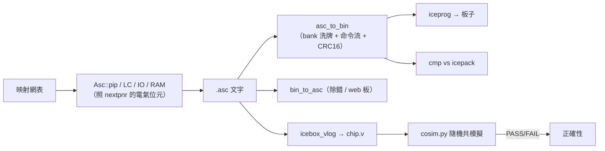

# 4.9 位元流生成與正確性對照：.asc → .bin → 回到 Verilog

> 對照原始碼：`veryl-eda/src/pnr/mod.rs`（`Asc` 寫出）、`pnr/bitstream.rs`
> （`.asc` ⇄ `.bin`）、`fpga/cosim.py`（oracle）、`fpga/pnr_test.sh`。
> 繞線與時序都過了，最後一里路是把組態**寫成晶片真的會吃的位元**。
> 這一里路最容易出「安靜的錯」：一個 bit 寫錯位置，晶片不會報錯，
> 只是不工作。所以本章一半講怎麼寫，一半講怎麼**獨立驗證**。

## 4.9.1 .asc：以 tile 為單位的組態文字檔

iCE40 的組態記憶體（CRAM）邏輯上是一張 25×32 的 tile 網格，每個 tile
有 $16 \times W$ 個 bit（$W$ 隨 tile 型別不同：logic 54、io 18、
ramb/ramt 42）。`.asc` 就是這張圖的逐 tile 文字化：

```text
.comment from veryl-eda
.device 5k
.logic_tile 12 7
000000000000000000000000000000000000000000000000000000000000
...（16 行 × 54 字元）
.io_tile 0 4
...
.ram_data 6 7
<hex 行…>
```

本工具的寫出端（`mod.rs:105-116`）非常直白：`Asc` 結構持有
`bits: HashMap<(x,y), Vec<Vec<u8>>>`（每 tile 的 '0'/'1' 矩陣），
最後 `text()` 逐 tile 印出。**難的不是印，而是知道哪個 bit 在哪**。

## 4.9.2 每種東西的 bit 怎麼來

所有位置知識都來自 `chipdb-5k.txt` 的 `.logic_tile_bits` 等區段——
功能名 → `BitPos`（tile 內的列、欄）清單。四類寫入：

### (1) LC 組態（`mod.rs:344-358`）

```rust
let mut v = [false; 20];
for k in 0..16 { v[LUT_PERM[k]] = (lc.init >> k) & 1 == 1; }
v[8] = lc.carry;
if let Some(f) = &lc.ff { v[9] = true; v[18] = f.set; v[19] = f.asynch && f.sr.is_some(); }
let bits = chip.bits("logic", &format!("LC_{}", z))?;
for (k, b) in bits.into_iter().enumerate() { if v[k] { a.set(x, y, b, true); } }
```

`LUT_PERM` 是**邏輯位 → 實體位**的排列（`mod.rs:54`）：

```rust
const LUT_PERM: [usize; 16] = [4, 14, 15, 5, 6, 16, 17, 7, 3, 13, 12, 2, 1, 11, 10, 0];
```

16-bit 真值表在矽上**不是線性排列**的——bit 0 在位置 4、bit 1 在位置
14……這張表是 IceStorm 逆向出來的。另外三個非 LUT 位：8 = 進位使能、
9 = FF 使能、18 = set/reset 值、19 = 同步/非同步。負緣時鐘是 tile 級
的（8 個 LC 共用），所以另用 `negclk` 表收集、以 tile 功能 `NegClk`
統一寫入（`mod.rs:359`）。

### (2) PIP（`mod.rs:93-104`，4.6.5 已引）

每個 pip 的 `group`/`pat` 對應 mux 的幾個 bit；同 group 只寫一次。

### (3) BRAM（`mod.rs:361-368`）

```rust
a.func(x, y, "RamConfig.PowerUp")?;
for (k, on) in [ram.write_mode & 1, ram.write_mode & 2, ram.read_mode & 1, ram.read_mode & 2]... {
    if *on != 0 { a.func(x, y + 1, &format!("RamConfig.CBIT_{}", k))?; }
}
a.ram_data.push(((x, y), ram_lines(&ram.init)));
```

模式位在 **ramt**（上方）tile、內容走 `.ram_data`（16 行 hex）。

### (4) IO（`mod.rs:384-395`）

```rust
let types: &[usize] = if io.dir == Dir::In { &[0] } else { &[0, 3, 4] };
for t in types { a.func(*x, *y, &format!("IOB_{}.PINTYPE_{}", z, t))?; }
let &(ix, iy, iz) = chip.ieren.get(&(*x, *y, *z)).ok_or("no IE/REN for pin")?;
if io.dir == Dir::In { a.func(ix, iy, &format!("IoCtrl.IE_{}", iz))?; }
a.func(ix, iy, &format!("IoCtrl.REN_{}", iz))?;
```

IO 的電氣組態分散在**三個地方**：PIO tile 的 `PINTYPE_*`（方向/驅動）、
另一個 tile 的 `IoCtrl.IE_*`（輸入使能）與 `IoCtrl.REN_*`（pull-up），
對應關係由 chipdb 的 `.ieren` 表查得。輸出要 `PINTYPE_0/3/4` 三組、
輸入只要 0——這些是照 nextpnr 寫的：**不做實驗猜，抄對的答案**。

## 4.9.3 兩個「照 nextpnr 寫」的細節

`mod.rs:396-405` 有段註解直接點名：

```rust
// column buffers on for every global, and the default cascade bits of the
// DSP / IP-connect tiles (as nextpnr writes them; UP5K tile 25,14 excepted)
for &(x, y) in &chip.colbuf_src {
    for g in 0..8 { a.func(x, y, &format!("ColBufCtrl.glb_netwk_{}", g))?; }
}
for (xy, t) in &chip.tiles {
    if !(t.starts_with("dsp") || t == "ipcon") || *xy == (25, 14) { continue; }
    let fs: Vec<String> = chip.tile_bits[t].keys().filter(|f| f.starts_with("Cascade.") && f.ends_with("_inmux02_5")).cloned().collect();
    for f in fs { a.func(xy.0, xy.1, &f)?; }
}
```

* **Column buffers**：每個 global 的行緩衝全部打開。這是**電氣**位元，
  不影響邏輯功能——但 `icebox_vlog` 忽略它們，若漏寫，模擬仍然 PASS、
  真板子卻可能不動。照抄 nextpnr 的做法（全開）是已知安全解。
* **DSP/IPCON 的 Cascade 預設位元**：UP5K 有 DSP 與 IP-connect tile，
  它們的 `Cascade.*_inmux02_5` 位元有 tile 特定的預設值；nextpnr
  對**除了 tile (25,14) 以外**的所有 dsp/ipcon tile 寫上這些位元，
  (25,14) 是例外（那顆的矽版本預設相反）。這種「一顆 tile 的例外」
  正是逆向資料庫的日常——沒有理由，只有對照。

為什麼要抄 nextpnr 而不是自己推導？因為這些位元的**驗證回路**很長：
模擬器看不到、板子要拿 LED 一顆顆試。以「與 nextpnr 位元級相同」為
不變量，等於把 IceStorm 生态多年的除錯成果免費繼承過來——
`pnr_test.sh:45-47` 的 `cmp` 就是把這個不變量機器化：

```bash
# our .bin (own icepack port) must equal icepack's
icepack $B/$m.asc $B/$m.icepack.bin
cmp -s $B/$m.bin $B/$m.icepack.bin || { echo "$m: .bin differs from icepack"; fail=1; }
```

## 4.9.4 .asc → .bin：IceStorm icepack 寫路徑的移植

`bitstream.rs` 的 `asc_to_bin()`（`bitstream.rs:79-196`）把文字組態
封裝成 iCE40 的 SPI 位元流。三個層次：

### (1) 座標洗牌：CRAM bank

實體 CRAM 是 4 個 bank 的位面（`bitstream.rs:31-58` 的 `cram_index`）。
tile 的邏輯 bit `B{row}[{col}]` 要換算成 `(bank, x, y)`：

```rust
fn cram_index(tx: i32, ty: i32, bx: usize, by: usize) -> (usize, usize, usize) {
    const PERMX: [usize; 18] = [23, 25, 26, 27, 16, ...];   // IO tile 的欄洗牌
    const PERMY: [usize; 16] = [0, 1, 3, 2, 4, 5, 7, 6, ...]; // IO tile 的列洗牌
    let right = tx > CHIP_W / 2;
    let top = ty > CHIP_H * 2 / 3;
    let bank = (top as usize) | ((right as usize) << 1);
    let btx = (if right { CHIP_W + 1 - tx } else { tx }) as usize;
    ...
}
```

晶片右半/上半的 tile 座標要**鏡射**進對應 bank；IO tile 另有一套
PERMX/PERMY 洗牌。這張表無理可講——它就是矽的接線。

### (2) 命令流

位元流是一串 nibble 命令（`bitstream.rs:148-194`）：

| 命令 | 作用 | 本實作 |
|---|---|---|
| `0x7E AA 99 7E` | 前導 | 固定 |
| `0x92 20/00` | warmboot 開關 | `.warmboot` |
| `0x62/0x82` | 設寬/高 | CRAM 691、BRAM 分段 |
| `0x11 bank` | 選 bank | 4 個 bank |
| `0x72 h ...` | 寫 $h$ 行 CRAM | 每行 8 bit 一 byte、行間兩個 0x00 |
| `0x22` | CRC 觸發 | CRC16 覆蓋 **0x22 這個 byte 本身** |

CRC16 是 CCITT 多項式（`crc16`，`bitstream.rs:72-77`），初值 0xFFFF、
在 CRC 命令**之後**歸零再算——順序錯了晶片直接拒載。

### (3) 讀回：bin_to_asc

`bin_to_asc()`（`bitstream.rs:202-289`）是反向：解析命令流填回
CRAM/BRAM 位面，再逐 tile 印出、把**不在任何 tile 範圍內**的 set bit
列成 `.extra_bit`。它就是自製 iceunpack，兩個用途：除錯（看自己寫的
bit 落在哪）與 web 環境的 `board_load_bin`（M13 的虛擬板直接吃 .bin，
先解碼成組態再建模擬模型——用的就是同一套 `cram_index` 反變換）。



## 4.9.5 正確性的 oracle：cosim.py

寫 bit 的每一層都可能有錯，而且**模擬器看不見大多數的錯**。
`fpga/cosim.py` 是最終 oracle，原理一句話：

> 把 routed `.asc` 用 IceStorm 的 `icebox_vlog` **還原成 Verilog**，
> 與 veryl-eda 的映射網表**並聯**，隨機輸入共模擬，每個時鐘緣前
> 逐位比較所有輸出。

```python
raw = subprocess.run(["icebox_vlog", "-d", "sg48", "-p", pcf, "-n", "chip", asc], ...).stdout
# icebox_vlog re-declares output ports as regs; make that legal for iverilog
...（perl/regex 修正 port reg 宣告）
tb.append("chip c(%s);" % ", ".join(conn_c))     # 從位元流還原的晶片
tb.append("%s g(%s);" % (esc(top), ", ".join(conn_g)))  # 原始映射網表
```

testbench 的骨架（`cosim.py:70-88`）：

```python
tb.append("  repeat (%d) begin" % cycles)
tb.append("    #10;")
tb.append(cmp)                                   # 比較所有輸出
if clock: tb.append("    %s_c = 1; #10; %s_c = 0;" % (clock, clock))
if reset: tb.append("    if (cyc == 2) %s_c = !%s;" % (reset, ractive))
tb.append(rnd)                                   # 新的隨機輸入
```

為什麼這個 oracle 夠強？

1. **icebox_vlog 是獨立實作**：它由 `.asc` 的 tile bits 推出連接與 LUT
   表，與本工具共用**零行程式碼**——本工具寫錯 bit、icebox_vlog 就會
   讀出不同的電路，輸出分歧立刻現形。
2. **比較的對象是映射網表**（不是 RTL）：隔絕了綜合層的正確性問題
   （那是 `test.sh` 的形式等價檢查的事），cosim 只驗 P&R。
3. **隨機輸入 + 1000 週期**（`pnr_test.sh:50` 的 `--cycles 1000`）：
   組合邏輯的錯幾乎必現；時序錯（FF 打錯 tile、時脈極性錯）在幾十
   週期內也會造成分歧。
4. **逐位比較、時鐘緣前取樣**：不給雙方「事後解釋」的空間。

`pnr_test.sh` 對每個範例設計跑這一整套（加法器到 RISC-V SoC、VGA），
再加上 icetime 的獨立 $F_{max}$ 與 icepack 的位元級 `cmp`——
三個獨立檢查，各抓不同層的錯。

## 4.9.6 為什麼這樣設計？

* **只移植 UP5K 一顆裝置**：`asc_to_bin` 開頭就拒絕其他裝置
  （`bitstream.rs:103-105`：`only the 5k device is supported`）。
  bank 幾何、tile 寬度全是裝置常數——多一顆裝置就多一份逆向表，
  而本工具的目標（教學 + web 板）只需要 iCEBreaker 上的那顆。
* **.asc 是「可讀的中間格式」**：真正的交付物是 .bin，但保留 .asc
  讓人能用眼睛/icebox 檢查，也讓 `patch_ram`（`mod.rs:143-176`）能
  在不重跑 P&R 的情況下改寫 BRAM 內容（換程式不必重繞線——
  SoC 載入新程式就是靠它）。
* **oracle 選擇的哲學**：驗證工具的正確工具，必須與被驗證者**無共享
  假設**。cosim 的兩端（icebox_vlog 與 yosys cells_sim.v 的網表模型）
  各自獨立於 veryl-eda，任何一層的位元錯誤都無法在兩邊同時、同樣地錯。

## 本章重點

1. `.asc` = 逐 tile 的 CRAM 位元 + `.ram_data` + `.extra_bit`；
   位置知識全部來自 chipdb 的 tile_bits 表，本工具不寫死幾何
   （除 UP5K 裝置常數）。
2. LC 的 16-bit 真值表經 `LUT_PERM` 洗成實體位置；FF/進位各一位元；
   負緣時鐘是 tile 級 `NegClk`。
3. IO 電氣位元（PINTYPE、IE/REN，跨 tile 由 `.ieren` 查）、column
   buffers 全開、DSP/IPCON 的 `Cascade.*_inmux02_5` 預設位元——
   全部照 nextpnr 寫，UP5K tile (25,14) 是唯一例外。
4. `asc_to_bin` 做 bank 鏡射/IO 洗牌、命令流與 CRC16（CRC 覆蓋 0x22
   本身）；`bin_to_asc` 反向，供除錯與 web 虛擬板。
5. 最終正確性由 `cosim.py` 保證：`icebox_vlog` 把 routed .asc 還原成
   Verilog，與映射網表並聯吃相同隨機輸入、逐位比較 1000 週期；
   另有 icetime 獨立 $F_{max}$ 與與 icepack 的位元級 `cmp`。
