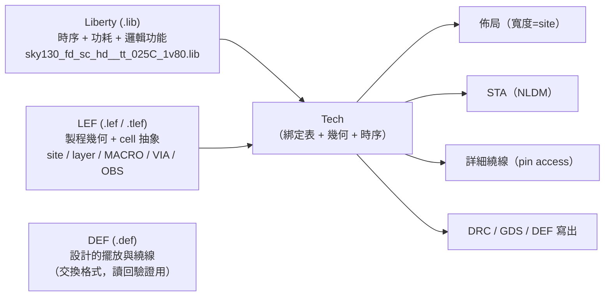

# 5.11 PDK 整合：Liberty、LEF、DEF

> 原始碼：`veryl-eda/src/pdk/`（`liberty.rs` 423 行、`lef.rs` 254 行、
> `def.rs` 190 行、`mod.rs` 487 行）。
>
> 流程的其餘部分（映射、佈局、繞線、STA、DRC、GDS）都對「抽象的 cell 與
> 層」工作；PDK 模組是唯一知道「AOI21 其實叫
> `sky130_fd_sc_hd__a21oi_1`、寬 5 個 site、pin 在 li1 上」的地方。
> 本章講三種檔案格式怎麼被解析、`Tech` 怎麼把它們縫在一起。

## 5.11.1 三種格式、三種角色



| 格式 | 內容 | 在流程中的角色 |
|---|---|---|
| **Liberty** | 時間（ns）、電容（pF）單位；每 cell 的面積、pin 方向/電容/函式、ff 群組、timing arcs 與 NLDM 表 | STA 的延遲與 constraint、綁定驗證的邏輯函式、Verilog 行為模型 |
| **LEF** | 資料庫單位、SITE（row 的磚塊尺寸）、LAYER（方向/pitch/width/spacing/RC）、VIA 定義、MACRO（cell 尺寸、pin 形狀、OBS） | 佈局網格、繞線規則、`layout::build` 的 via 形狀、DRC 的 cell 幾何 |
| **DEF** | DIEAREA、ROW、COMPONENTS（擺放）、PINS、NETS（含 ROUTED/VIA）| 「設計結果」的交換格式；`def::check_placement` 拿它對 LEF 驗證 |

一個比喻：Liberty 說 cell **多快**、LEF 說 cell **多大且佔哪些格子**、
DEF 說**這顆晶片把它們放在哪**。

## 5.11.2 Liberty：群組語法與解析

Liberty 是巢狀群組：`cell (name) { pin (A) { timing () { ... } } }`。
`liberty.rs` 的 `Group` 是通用容器：

```rust
// veryl-eda/src/pdk/liberty.rs
#[derive(Debug, Default, Clone)]
pub struct Group {
    pub kind: String,
    pub args: Vec<String>,
    /// simple (`name : value ;`) and complex (`name (v, ...) ;`) attributes, in order
    pub attrs: Vec<(String, Vec<String>)>,
    pub groups: Vec<Group>,
}
```

解析器 `parse(src) -> Group` 是一個簡單的棧機：遇到 `word {` 壓棧、
遇到 `}` 彈棧掛到父群組、`word : value ;` 與 `word (args);` 存成屬性。
值得注意的工程細節：

- **字串內的換行接續**：Liberty 的長數值表常寫成
  `"1, 2, \<newline> 3"`，lexer 在讀字串時把 `\\\n` 刪掉：

```rust
// veryl-eda/src/pdk/liberty.rs（節錄）
let s = String::from_utf8_lossy(&self.b[st..j.min(self.b.len())]).replace("\\\n", "").replace("\\\r\n", "");
```

- **屬性順序保留**（`attrs: Vec` 而非 map）： Liberty 沒有嚴格的
  「屬性唯一」保證，保留順序讓 `values` 表與其 index 一起出來。

### NLDM 表與雙線性內插

```rust
// veryl-eda/src/pdk/liberty.rs（節錄）
impl Table {
    /// bilinear interpolation (extrapolating linearly past the ends)
    pub fn at(&self, x: f64, y: f64) -> f64 {
        let (x, y) = if self.transposed { (y, x) } else { (x, y) };
        let seg = |ix: &[f64], v: f64| -> (usize, f64) {
            if ix.len() < 2 { return (0, 0.0); }
            let mut k = 0;
            while k + 2 < ix.len() && v > ix[k + 1] { k += 1; }
            (k, (v - ix[k]) / (ix[k + 1] - ix[k]))
        };
        ...
        let r0 = g(i, j) + (g(i, j1) - g(i, j)) * fj;
        let r1 = g(i1, j) + (g(i1, j1) - g(i1, j)) * fj;
        r0 + (r1 - r0) * fi
    }
}
```

`transposed` 處理一個真實世界的陷阱：Liberty 模板可以宣告
`variable_1 : total_output_net_capacitance`（SKY130 的部分模板就是這樣），
此時表的兩軸與慣例相反。`library()` 在讀 `lu_table_template` 時記下：

```rust
// veryl-eda/src/pdk/liberty.rs（節錄）
templates.insert(t.name().to_string(), (
    t.attr_list("index_1").map(...).unwrap_or_default(),
    t.attr_list("index_2").map(...).unwrap_or_default(),
    v1.contains("capacitance"),      // transposed
));
```

### 邏輯函式與真值表

cell 的 `function` 屬性（如 `!((A1&A2)|B1)`）與 ff 群組的
`clocked_on / next_state / clear` 是字串運算式。`liberty.rs` 自帶一個
小運算式語言（`Expr` + `function()` 遞迴下降解析器，支援 `!` `'` `&` `*`
`+` `|` `^` 與**並置**——`A B` 與 `A(B)` 都是 AND），以及

```rust
// veryl-eda/src/pdk/liberty.rs
/// truth table of `e` over `vars` (bit k of the index = vars[k])
pub fn truth(e: &Expr, vars: &[String]) -> u64 {
    let mut t = 0u64;
    for m in 0..(1u64 << vars.len()) {
        if e.eval(&|v: &str| vars.iter().position(|x| x == v).map(|k| m >> k & 1 == 1).unwrap_or(false)) { t |= 1 << m; }
    }
    t
}
```

這是 5.11.6 綁定驗證的基石：兩個函式等價 ⇔ 真值表相等。

## 5.11.3 LEF：製程幾何與 cell 抽象

`lef.rs` 的資料模型：

```rust
// veryl-eda/src/pdk/lef.rs
pub struct Layer {
    pub name: String,
    pub kind: String,          // ROUTING, CUT, MASTERSLICE, ...
    pub horizontal: bool,
    pub pitch: (f64, f64),     // 繞線軌道間距
    pub offset: (f64, f64),    // 軌道 0 的位置 → Tech::track_x0/y0
    pub width: f64,
    pub spacing: f64,
    pub rpersq: f64,           // Ω/□ → STA 的線電阻
    pub cpersq: f64,           // pF/µm²
    pub edgecap: f64,          // pF/µm（邊緣）
}
pub struct Macro {
    pub name: String, pub class: String,
    pub w: f64, pub h: f64, pub site: String,
    pub pins: Vec<MacroPin>,   // 名稱/方向/USE/形狀矩形
    pub obs: Vec<Rect>,        // 障礙物
}
```

解析器是 token 流 + 「跳到 END」的省略策略（不需要的區塊如
VIARULE、NONDEFAULTRULE 直接 `skip_block`）。SKY130 的幾個關鍵事實
（`mod.rs` 的測試鎖定）：row 高 = site 高 = **2.72 µm**、site 寬
**0.46 µm**、每列 **8 條繞線軌道**（`row_h / met1 pitch(0.34 µm)`）；
`M1M2_PR` via 的定義包含 cut（via）+ 下 pad（met1）+ 上 pad（met2）
三組矩形——這正是 `layout::put_via` 需要的（5.9 節）。

**TLEF 與 cell LEF 的合併**：製程檔（`.tlef`）定義 SITE/LAYER/VIA，
cell 檔定義 MACRO；`Lef::merge` 只是簡單拼接（兩者內容不重疊）。

## 5.11.4 DEF：設計結果的交換格式

`def.rs` 讀的區塊：

```rust
// veryl-eda/src/pdk/def.rs
pub struct Def {
    pub design: String,
    pub dbu: i64,
    pub die: (i64, i64, i64, i64),     // DIEAREA
    pub rows: Vec<Row>,                // ROW name site x y orient DO n BY 1 STEP sx sy
    pub comps: Vec<Component>,         // - name cell + PLACED ( x y ) orient
    pub pins: Vec<Pin>,
    pub nets: Vec<Net>,                // connections + ROUTED/VIA 記錄
    pub special: Vec<Net>,             // SPECIALNETS（電源）
}
```

它存在的原因是**自我檢查**：`check_placement(d, lef)` 把 DEF 對 LEF 驗證——
cell 是否在 LEF 裡、是否踩在 site 網格上、是否在 die 內、是否有重疊、
row 是否被 filler 覆滿：

```rust
// veryl-eda/src/pdk/def.rs（節錄）
if (c.x - r0.x) % sw != 0 || (c.y - r0.y) % sh != 0 { bad.push(format!("{} off the site grid ...")); }
...
let empty: usize = occ.iter().map(|r| r.iter().filter(|o| **o == 0).count()).sum();
if empty > 0 { bad.push(format!("{} sites without a cell or filler", empty)); }
```

**為什麼寫 DEF 又自己讀回來**：DEF 是業界交換格式（OpenROAD、Innovus
都認得）。把它當作**輸出的快照 + 輸入的回歸測試**：只要 `check_placement`
通過，產出的擺放就滿足標準工具會檢查的所有結構性約束。

## 5.11.5 Tech：thread-local 的當前製程

`mod.rs` 的 `Tech` 是所有 PDK 資訊的合體：

```rust
// veryl-eda/src/pdk/mod.rs（節錄）
pub struct Tech {
    pub name: String,
    pub row_h: f64, pub site_w: f64, pub site: String,
    pub track_x0: f64, pub track_y0: f64,   // 繞線節點 (0,0) 的物理位置
    pub tracks: u32,
    pub layers: [String; 4], pub vias: [String; 3],   // 繞線層由下到上 + 層間 via
    pub pin_layer: String, pub pin_via: String,        // cell pin 層與它到 layers[0] 的 via
    pub sram: bool,                          // 記憶體是 SRAM 巨集（vlib）還是 flip-flop（SKY130）
    pub cells: HashMap<String, Binding>,
    pub fillers: Vec<(u32, String)>,
    pub tap: Option<(String, u32, f64)>,     // tap cell、寬、最大間距
    pub liberty: Option<liberty::Library>,
    pub lef: Option<lef::Lef>,
}
```

存取採 thread-local 模式：

```rust
// veryl-eda/src/pdk/mod.rs
thread_local! {
    static CUR: RefCell<Option<Rc<Tech>>> = const { RefCell::new(None) };
    static VLIB: Rc<Tech> = Rc::new(vlib());
}
pub fn tech() -> Rc<Tech> { CUR.with(|c| c.borrow().clone()).unwrap_or_else(|| VLIB.with(|v| v.clone())) }
pub fn set_tech(t: Option<Rc<Tech>>) { CUR.with(|c| *c.borrow_mut() = t); }
pub fn with_tech<R>(t: Rc<Tech>, f: impl FnOnce() -> R) -> R {
    let old = CUR.with(|c| c.replace(Some(t)));
    struct Restore(Option<Rc<Tech>>);
    impl Drop for Restore { fn drop(&mut self) { let o = self.0.take(); CUR.with(|c| *c.borrow_mut() = o); } }
    let _r = Restore(old);
    f()
}
```

**為什麼 thread-local 而不是參數傳遞**：ASIC 流程的十幾個模組
（`map`、`place`、`route`、`sta`、`pdn`、`layout`、`drc`、`gds`）都隨時
要查製程。把 `Tech` 當參數穿過所有函式簽名，會讓每個函式多一個參數、
每個呼叫點多一個傳參，且中期加入新模組時要改一串簽名。thread-local
讓「目前用哪個製程」成為隱式環境，`with_tech` 的 RAII `Restore` 保證
即使 `f` panic 也會還原——這正是平行測試（`cargo test` 同時跑 vlib 與
SKY130 的情境）所需的隔離：每條執行緒有自己的 `CUR`。

## 5.11.6 綁定表 SKY130_HD：邏輯名 → PDK cell

流程內部只講 vlib 的語言（`INV`、`AOI21`、`DFFR`…）。綁定表把每個
邏輯 cell 指到 SKY130 的具體 cell，**並附上邏輯函式供驗證**：

```rust
// veryl-eda/src/pdk/mod.rs（節錄）
/// logical cell -> (library cell, (logical pin, library pin), function over the logical pins)
pub const SKY130_HD: &[(&str, &str, &[(&str, &str)], Kind)] = &[
    ("INV", "inv_1", &[("A", "A"), ("Y", "Y")], Kind::Comb("!A")),
    ("AOI21", "a21oi_1", &[("A", "A1"), ("B", "A2"), ("C", "B1"), ("Y", "Y")], Kind::Comb("!((A&B)|C)")),
    ("MUX2", "mux2_1", &[("A", "A0"), ("B", "A1"), ("S", "S"), ("Y", "X")], Kind::Comb("(S&B)|(!S&A)")),
    ("DFFR", "dfrtp_1", &[("CK", "CLK"), ("D", "D"), ("RN", "RESET_B"), ("Q", "Q")],
        Kind::Ff { clk: "CK", clear: Some("!RN"), preset: None }),
    ...
];
pub const SKY130_PREFIX: &str = "sky130_fd_sc_hd__";
```

`sky130()`（建構 `Tech`）對**每個 entry** 執行三步驗證：

```rust
// veryl-eda/src/pdk/mod.rs（節錄）
for (logical, name, pins, kind) in SKY130_HD {
    let full = format!("{}{}", SKY130_PREFIX, name);
    let lc = lib.cell(&full).ok_or_else(|| format!("{} is not in the Liberty file", full))?;
    check_binding(lc, pins, kind)?;                      // 1. 邏輯函式等價
    let m = lef.macro_(&full).ok_or_else(...)?;          // 2. LEF 裡有這顆
    let access = access_points(m, &pins, "li1", ...)?;   // 3. pin 存取點找得到
    cells.insert(logical.to_string(), Binding { cell: full.clone(), pins, width: (m.w / site.w).round() as u32, access, area: lc.area });
}
```

`check_binding` 是精髓：把 entry 裡的**邏輯函式**（用我們自己的變數名
寫）經 pin 改名換成庫的 pin 名後，與 Liberty 裡該 pin 的 `function` 屬性
**比真值表**：

```rust
// veryl-eda/src/pdk/mod.rs（節錄）
let same = |a: &liberty::Expr, b: &liberty::Expr| {
    let mut vars = vec![];
    a.vars(&mut vars);
    b.vars(&mut vars);
    liberty::truth(a, &vars) == liberty::truth(b, &vars)
};
```

組合 cell 比較輸出 pin 的 function；flip-flop 比較 ff 群組的
`clocked_on`（含正/負緣）、`next_state`、`clear`/`preset`，以及
「Q 的 function 必須等於狀態變數」：

```rust
// veryl-eda/src/pdk/mod.rs（節錄）
chk("clocked_on", &ff.clocked_on, clk)?;
chk("next_state", &ff.next_state, "D")?;
match (clear, &ff.clear) { (Some(w), Some(h)) => chk("clear", h, w)?, (None, None) => {}, _ => return Err(format!("{}: clear differs", lc.name)) }
```

**為什麼每個 entry 都驗**：綁定表是手寫的，`a21oi_1` 的 pin 叫 `A1/A2/B1`
而邏輯 cell 叫 `A/B/C`——搞反 A1 與 B1 對 AOI21 恰好不變（對稱），但對
`a21o_1`（`(A&B)|C`，非對稱）就是功能錯誤，而且會一路錯到 GDS。在
`sky130()` 建構時用 Liberty 的 function 屬性當**地面真值**擋下，錯誤在
啟動時就死掉，而不是在晶片上。`Binding` 還攜帶物理資訊：

```rust
// veryl-eda/src/pdk/mod.rs（節錄）
pub struct Binding {
    pub cell: String,                          // 庫名
    pub pins: Vec<(&'static str, String)>,     // (邏輯 pin, 庫 pin)
    pub width: u32,                            // 佔幾個 site
    pub access: Vec<(&'static str, u32, u32, f64)>,  // pin 存取點
    pub area: f64,
}
```

`access`（由 `access_points()` 從 LEF pin 形狀推導，是 `mod.rs` 最精密的
函式）告訴詳細繞線：這個 pin 的 via 應該打在哪一欄哪一軌、需要多長的
li1 stub（`f64` 偏移；`NaN` 表示 pin 自帶 met1、不需要 pin via）。

## 5.11.7 to_library 與 verilog_models：把綁定翻回業界語言

```rust
// veryl-eda/src/pdk/mod.rs（節錄）
pub fn to_library(nl: &crate::netlist::Netlist) -> crate::netlist::Netlist {
    let t = tech();
    let mut out = nl.clone();
    if t.is_vlib() { return out; }
    for c in out.cells.iter_mut() {
        let Some(b) = t.binding(&c.typ) else { continue };
        for (p, _) in c.conns.iter_mut() { *p = static_pin(b.lib_pin(p)); }
        c.typ = b.cell.clone();
    }
    out
}
```

它把 cell 名與 pin 名換成庫命名（Verilog / DEF 輸出用）；
`verilog_models()` 更進一步：**從 Liberty 的 function 屬性合成 Verilog
行為模型**，讓 iverilog 能模擬導出的網路表，而不需要 PDK 的 Verilog 單元庫：

```rust
// veryl-eda/src/pdk/mod.rs（節錄）
// 組合 cell：
for o in c.outputs() {
    if let Some(f) = o.function.as_deref().and_then(|f| liberty::function(f).ok()) {
        s += &format!("  assign {} = {};\n", o.name, f.verilog());
    }
}
// flip-flop：clocked_on 的運算式決定 posedge/negedge、clear/preset 決定 always 的條件鏈
s += &format!("  initial {} = 1'b0;\n  always @({}) {}{} <= {};\n", q, sens.join(" or "), body, q, d);
```

測試鎖定的輸出範例：

```verilog
module sky130_fd_sc_hd__dfrtp_1 (input CLK, input D, input RESET_B, output reg Q);
  initial Q = 1'b0;
  always @(posedge CLK or negedge RESET_B) if (!RESET_B) Q <= 1'b0; else Q <= D;
endmodule
```

**為什麼從 Liberty 合成而不是抄 Verilog 庫**：綁定驗證已經證明
Liberty function 與我們的邏輯 cell 等價（5.11.6），因此由它合成的模型
自動與流程內部語意一致；而且 Liberty 是我們本來就要解析的檔案，
不必多下載/多解析一份 Verilog。

## 5.11.8 Tech 的查詢 API

STA（5.7 節）只透過四個 `Tech` 方法接觸 PDK：`arc`（NLDM 延遲與 slew）、
`constraint`（setup/hold 表）、`pin_cap`（pin 電容，net 負載）、
`wire_rc`（LEF 四層平均的 Ω/µm 與 pF/µm，Elmore 項用）。每個 API 都先過
`binding()`——**綁定表是唯一的翻譯層**，流程模組永遠講邏輯名，翻譯
錯誤在 `sky130()` 建構時就已經全部排除。

## 5.11.9 為什麼這樣設計

- **Liberty/LEF/DEF 各管一個軸**（時間/幾何/設計），三個解析器都刻意
  小（400/250/190 行）：只讀流程需要的部分，不需要的區塊跳到 END。
- **`Tech` 是值物件 + `Rc`**：clone 便宜、thread-local 存 `Rc<Tech>`，
  建構一次反覆使用；`sky130_builtin()` 甚至用 thread-local 快取避免
  重複解析內建子集。
- **綁定表帶函式**：把「映射正確性」從「相信寫表的人」變成「每次啟動
  對 Liberty 驗證」。這是整個 PDK 模組最重要的設計決策。
- **`is_vlib()` 守門**：教學庫與真實製程的行為分歧（strap 封鎖範圍、
  tap 有無、SRAM 巨集有無）全部顯式分流。

## 5.11.10 本章重點

- Liberty = 時間軸：單位換算（`time_ns`/`cap_pf`）、NLDM 表（雙線性內插 +
  transposed 模板）、ff 群組、function 屬性（自製運算式語言 + `truth()`）。
- LEF = 幾何軸：SITE（2.72 µm × 0.46 µm）、LAYER（pitch/offset/width/
  spacing/RC）、VIA 定義（多層矩形組）、MACRO（尺寸/pin 形狀/OBS）。
- DEF = 設計軸：DIEAREA/ROW/COMPONENTS/NETS；`check_placement` 對 LEF
  驗證 site 網格、重疊、覆蓋。
- `Tech` 用 thread-local + `Rc` + RAII 的 `with_tech`，把製程變成隱式環境，
  平行測試天然隔離。
- `SKY130_HD` 綁定表：每個 entry 以 Liberty function 的真值表驗證
  （`check_binding`），並預先推導 pin 存取點（`access_points`）。
- `to_library` / `verilog_models` 把綁定翻成庫命名網路與可模擬的
  Verilog 行為模型——後者由已驗證的 Liberty function 合成。
