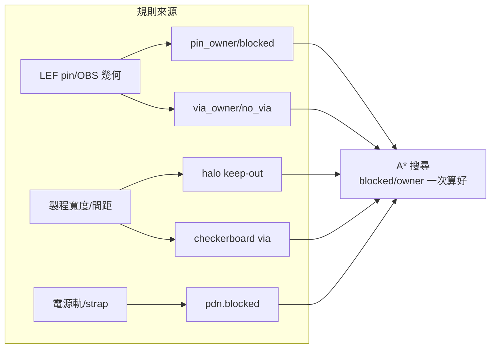

# 5.5 詳細繞線與設計規則

> 原始碼：`veryl-eda/src/asic/detail.rs`（473 行）。輸入：網路 + 佈局 +
> 全域繞線 `Routing` + PDN；輸出：`Detail`（軌道級線段、via、conflicts/opens）。

## 5.5.1 軌道網格：把「不短路」變成建構性質

全域繞線（5.4）回答「走哪些 gcell」；詳細繞線回答「走哪條軌道、哪裡打
via」。本專案在每個 gcell 裡建立軌道網格：

```rust
// veryl-eda/src/asic/detail.rs
pub const LAYERS: usize = 4;      // M2(橫) M3(縱) M4(橫) M5(縱)
pub const TRACKS: u32 = 8;        // 每列高 8 條軌道（0.5 µm 一條）
const VIA_COST: f32 = 4.0;        // 打一顆 via ≈ 走 4 格
let nx = pl.sites + 1;
let ny = pl.rows * TRACKS + 1;
let id = |l: usize, x: u32, y: u32| (l * plane) as u32 + y * nx + x;
```

關鍵不變式：**每個網格節點至多屬於一條 net**。只要搜尋過程遵守它，
結果就**結構性地不會短路**——這是網格繞線相對幾何布爾運算（真實工具的
GDS 檢查）最大的工程簡化。`occ` 陣列記每節點被幾條 path 使用：
`occ[n] > 1` 即 conflict。

## 5.5.2 pin 存取點 `detail::pin_point`

繞線的起點是「cell 的 pin 在哪一格」。標準 cell 的內部已有自己的 met1
走線（cell 內部電源、閘極連線），外部訊號必須從**固定的存取點**接入。
vlib 的近似：pin 沿 cell 寬度均分、交替高低（錯開讓相鄰 pin 不同軌）：

```rust
// veryl-eda/src/asic/detail.rs（節錄）
pub fn pin_point(nl: &Netlist, pl: &RowPlacement, i: usize, k: usize) -> (u32, u32) {
    let c = &nl.cells[i];
    let (w, h) = dims(c);
    let (r, s) = pl.pos[i];
    // library cells: their pin access points (rows alternate N / FS, so odd rows are mirrored)
    if let Some(&(_, dx, ty, _)) = crate::pdk::tech().binding(&c.typ)
            .and_then(|b| b.access.iter().find(|a| a.0 == c.conns[k].0)) {
        return (s + dx, r * TRACKS + if r % 2 == 1 { TRACKS - 1 - ty } else { ty });
    }
    ...
    // standard cell: pins left to right, at alternating heights
    let x = s + ((k as u32) * w) / n as u32;
    let y = r * TRACKS + 2 + (k as u32 % 2) * 3;
    (x.min(s + w - 1), y)
}
```

兩個細節：

1. **PDK 路徑**：SKY130 的存取點 `(dx, ty)` 來自綁定表（LEF pin 的實際
   幾何），奇數列因上下翻轉（FS orientation）要鏡射 `TRACKS-1-ty`。
2. **巨集**（`h > 1`，如 SRAM）：pin 沿頂邊展開
   `x = s + ((k*2+1)*w)/(n*2)`，行 `y = (r+h)*TRACKS - 1`。

存取點在 vlib 中的第二個用途是**全域繞線的巨集端點**（route.rs 5.4.3 用它
取巨集所在 gcell），所以它是全域/詳細兩段的共同錨點。

## 5.5.3 走廊：把 A* 關進局部

每條 net 的搜尋空間 = 全域繞線選的 gcell 集 + 端點所在 gcell + **各擴一圈**：

```rust
let mut add = |x: i64, y: i64| {
    for dx in -1..=1 { for dy in -1..=1 { ... gc.insert(...); } }
};
if let Some(segs) = corridor_of.get(&p.bit) {
    for s in segs.iter() { add(s.0 as i64, s.1 as i64); add(s.2 as i64, s.3 as i64); }
}
for q in &t { add((q.1 / TRACKS) as i64, (q.2 / TRACKS) as i64); }
```

搜尋時用 stamp 檢查：

```rust
if gc_mark[((vy / TRACKS) * gx + vx / TRACKS) as usize] != cmark { continue; }
```

這是全域→詳細的**銜接契約**：全域繞線已保證擁塞在容量內，詳細繞線不該
私自越界搶別人的地盤（否則全域階段的協商全部作廢）。走不通的 net 得到
**加寬**：`widen()` 再擴一圈；到最後幾輪（hard phase）甚至放開整個 die
（`gc_mark` 全部蓋章）做嚴格 rip-up-reroute。

## 5.5.4 `lib_rules`：SKY130 的設計規則進到搜尋裡

vlib 的網格乾淨：所有節點可用、via 隨處可打。SKY130 不行——金屬最小
寬度/間距、via pad 尺寸、電源軌佔位都是真規則。它們以**預先標記**的方式
進入搜尋（不是事後檢查），分五類：

### (1) 軌道密度與邊界

```rust
if lib_rules {
    for y in 0..ny { for x in 0..nx {
        if y % 2 == 1 { blocked[id(2, x, y) as usize] = true; }   // met3 隔軌
        if x % 2 == 1 { blocked[id(3, x, y) as usize] = true; }   // met4 隔軌
        if matches!(y % TRACKS, 0 | 7) { blocked[id(0, x, y) as usize] = true; }  // 電源軌下無 met1
        if x == nx - 1 || y == ny - 1 { for l in 0..LAYERS { blocked[...] = true; } }
    } }
}
```

SKY130 的 met3/met4 最低寬度是軌距兩倍 → **每隔一條軌可用**；met1 的
第 0/7 軌被電源軌（row rail）壓住；die 邊界最後一行/列禁走。

### (2) `pin_owner` / `blocked`：cell 內 met1 的歸屬

cell 內部 met1（LEF 的 `OBS` 與 pin shapes）不能讓別的 net 走。程式把
每個矩形加上 **keep-out**（半線寬 0.07 + 間距 0.14）展開成節點，標記為
`blocked`（無主）或該 pin 所屬 net 的 `pin_owner`：

```rust
let keep = 0.07 + 0.14 - 1e-6;   // wire half-width + met1 spacing
for (q, owner) in rects {
    let (ax0, ax1) = (s as f64 * sw + q.x0 - keep, s as f64 * sw + q.x1 + keep);
    ...
    match owner {
        Some(o) if pin_owner[n] == u32::MAX || pin_owner[n] == o => pin_owner[n] = o,
        _ => if pin_owner[n] == u32::MAX || owner.is_some() { blocked[n] = true; },
    }
```

### (3) `via_owner` / `no_via`：via pad 的鄰居規則

met1–met2 via 的 pad（0.16 × 0.13 µm）比線寬大，會侵占左右節點。所以
每個 pin 矩形周圍再擴 `keep_vx/keep_vy`，標成 `no_via`（這裡不能打 via，
但線仍可過）；pin 自己的 net 可以把 via pad「貼上」自己的 met1
（`gap <= 0` 才算合法接觸，隔一點點反而會留**notch**——DRC 最愛抓的形狀）：

```rust
let gap = ((sx0 - px).max(px - sx1) - 0.16).max((sy0 - py).max(py - sy1) - 0.13);
match owner {
    Some(o) if gap <= 0.0 && (via_owner[k] == u32::MAX || via_owner[k] == o) => via_owner[k] = o,
    _ => no_via[k] = true,
}
```

pin 存取點的正上/下方（`dx == 0`）一律 `no_via`，斜鄰居限同一 net——
兩顆相鄰 via 的 pad 會互相侵入。

### (4) checkerboard via 位置

met1→met2 的 via 只允許在 `(x+y)` 為偶數的節點（pad 不會撞隔壁 via）：

```rust
if lib_rules && vl != l && vl.min(l) == 0 {
    if (vx + vy) % 2 == 1 && pin_owner[id(0, vx, vy) as usize] != ni as u32 { continue; }
    let o = via_owner[(vy * nx + vx) as usize];
    if o != u32::MAX && o != ni as u32 && ... { continue; }
    if no_via[(vy * nx + vx) as usize] { continue; }
}
```

### (5) `halo` / `pad_halo`：沿軌 keep-out

met2/met3/met4 的線端與 via pad 會沿**軌道方向**多佔一格（end-of-line
rule）。節點被佔用時，其沿軌鄰居記入 `near` 計數；搜尋成本把它算進
「這格其實沒空」的懲罰，最後 even `near>0 且 occ>0` 也累 history：

```rust
let halo = |n: u32| -> [u32; 2] {
    let (l, x, y) = decode(n);
    if !lib_rules || l <= 1 { return [u32::MAX; 2]; }     // 只有 met3/met4
    if horizontal(l) { [id(l, x-1, y), id(l, x+1, y)] } else { [id(l, x, y-1), id(l, x, y+1)] }
};
// via 落到 met2：其 pad 上下鄰格（met2 豎軌）也算
let pad_halo = |v: u32| -> [u32; 2] { ... [id(1, x, y-1), id(1, x, y+1)] ... };
```

這些規則全部包在 `let lib_rules = !tech.is_vlib();` 之後——**vlib 一條都
不啟用**（5.1.3 的 guard 哲學：演算法通用、製程規則集中）。



## 5.5.5 搜尋與談判：與全域繞線同構

詳細繞線的引擎與 5.4 同構：Prim 順序 + A* + PathFinder，但 (a) 四層，
(b) 節點可跨層（via 成本 `VIA_COST = 4.0`），(c) 走廊限制，(d) 規則節點
排除：

```rust
let c = step * (1.0 + hist[v as usize]) * (1.0 + pres * (occ[v as usize] + nv) as f32);
if hard && (occ[v as usize] > 0 || nv > 0) { continue; }   // hard 輪：完全不准共擠
```

疊代結構（`NEGOTIATE = 60` 輪談判 + 3 輪硬性）：

- 衝突 net 才重繞（`conflicted`/`clash` 判準含 halo 衝突）；
- 每 4 輪（16 輪後每 2 輪）加寬走廊一次；
- `hard` 輪直接禁止任何共用節點，且**繞不成的 net 保留舊路徑**
  （`if hard && opens[ni] > 0 { ... old }`）——寧可報告 open 也不拆掉
  其他 net 的合法路徑；
- history 依「該節點的 halo 有別人」加 0.1、依共擠加 0.4，`pres ×1.7`
  上限 1000（f32 精度保護）。

衝突計數也把 halo 算進去：

```rust
for (ni, (p, pv)) in paths.iter().zip(&pvias).enumerate() {
    let other = |h: u32| ... owner[h] != ni ...;
    for &n in p { for h in halo(n) { if other(h) { k += 1; } } }
    for &v in pv { for h in pad_halo(v) { if other(h) { k += 1; } } }
    if k > 0 { clash[ni] = true; conflicts += k; }
}
```

## 5.5.6 收尾：節點集 → 線段與 via

輸出要把網格節點還原成幾何：沿軌連續節點合併成一段
（`segs.push((l, x, y, ex, ey))`）、via 記錄在下層節點、pin via 特殊標記
`layer 255`（DEF 寫出時再加短 stub，見 `mod.rs::def`）：

```rust
for &n in &paths[ni] {
    let (l, x, y) = decode(n);
    let (px, py) = if horizontal(l) { (x.wrapping_sub(1), y) } else { (x, y.wrapping_sub(1)) };
    if !set.contains(&id(l, px, py)) { ...往前延伸成一段... }
}
let mut pv = pvias[ni].clone(); pv.sort(); pv.dedup();
for q in t { if q.0 == 0 { vias.push((255, q.1, q.2)); } }   // pin via
```

`Detail.conflicts` / `opens` 是 `flow_with` 外層重試（`util × 0.85`，見
5.1.2）的判準：**詳細繞線說不乾淨，就換更大的 die 從佈局重來**——
局部規則的失敗由全域資源重新分配來解。

## 5.5.7 為什麼規則要在搜尋「之前」標好

另一種做法是「先繞、後 DRC、抓到再修」。本專案反其道：所有 keep-out 在
搜尋前一次展開成節點標記。理由：

- **成本前置但確定**：展開是 $O(\text{cell 矩形數})$，每個 A* 節點只做
  一次查表；
- **不變式單純**：搜尋從不改變 blocked 集合，conflict 只可能來自 occ，
  容易推理；
- **可測**：`drc::check`（5.9）對 GDS 形狀做獨立檢查，兩套實作互相對照——
  `tools/gds_check.py` 用 KLayout 找的 notches 正是 `no_via` 邏輯想避免的。

## 5.5.8 一個 notche 案例：為什麼「貼上」與「隔開」差一條 DRC 規則

考慮 pin 的 met1 矩形 $P$ 與一個 via pad $V$（0.16 × 0.13）在它右側：

```text
      ┌────────P────────┐
      │   pin met1      │   gap = 距離
      └─────────────────┘
                    ┌V┐
                    └─┘
```

- $gap = 0$（pad 與矩形**相切**）：兩個金屬形狀連成一片，屬同一 net
  即合法——`detail.rs` 的 `gap <= 0.0` 分支允許該 net 佔用此 via 位置；
- $0 < gap < 0.14$（最小間距之內）：形狀**不連通**卻靠太近——DRC 的
  spacing 違規；若勉強連通（用一小條搭接），則在 pin 邊上形成一個
  內凹角（**notch**），KLayout 的 notching 檢查會抓到（`tools/gds_check.py`
  就是這個 oracle）。

所以同一個幾何情境按 net 歸屬分裂成兩種處置：自己的 net 可以「貼」，
別人的 net 必須「退到 0.14 之外」（`keep_vx = 0.16 + 0.14`）。這正是
`detail.rs:195-210` 那段 `no_via` 展開在做的事，也是 5.9 DRC 能夠通過的
第一道防線：**規則不靠事後檢查，靠搜尋空間裡根本不存在非法選項。**

## 5.5.9 與 `drc`/`layout` 的分工

| 層次 | 檢查者 | 檢查什麼 |
|---|---|---|
| 節點級（搜尋中） | `detail::route` 的 blocked/owner/no_via | 任何路徑不存在已知的非法幾何 |
| 形狀級（流程後） | `asic::drc::check` | 版圖形狀間的寬度/間距/包圍（5.9） |
| 獨立 oracle | `tools/gds_check.py`（KLayout） | 同上，含單一 net 內部的 notches |

三層檢查的粒度遞增、速度遞減：節點級在每個 A* 步 $O(1)$，形狀級對
全版圖跑一次，KLayout 是外部工具（`GDS_PY` 環境變數指定）。`drc::check`
的實作刻意與 `detail` 的規則**分開寫**，讓兩套邏輯可以互相抓錯——
如果 `detail` 的 keep-out 算少了，`drc` 會報違規；算多了，繞線
conflicts 會變多、利用率重試會變頻繁。

## 本章重點

- 軌道網格 + 「一節點一 net」不變式，讓不短路成為搜尋的建構性質。
- `pin_point` 是全域與詳細繞線的共同錨點；PDK 由綁定表供給存取點並處理
  FS 列鏡射。
- SKY130 規則以預標記進入搜尋：隔軌層（met3/met4）、電源軌 keep-out、
  `pin_owner`/`via_owner`/`no_via`、checkerboard via、`halo`/`pad_halo`
  沿軌 keep-out；全部在 `lib_rules = !tech.is_vlib()` 之內。
- 引擎與全域同構（Prim + A* + PathFinder）但多層、走廊受限；60 輪談判
  + 3 輪 hard（禁止共擠、失敗保舊路、走廊全開）。
- conflicts/opens 回饋給 `flow_with` 降 utilization 重來；`drc::check` 與
  KLayout 是兩個獨立的正確性 oracle。
