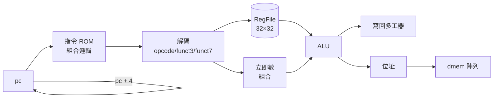
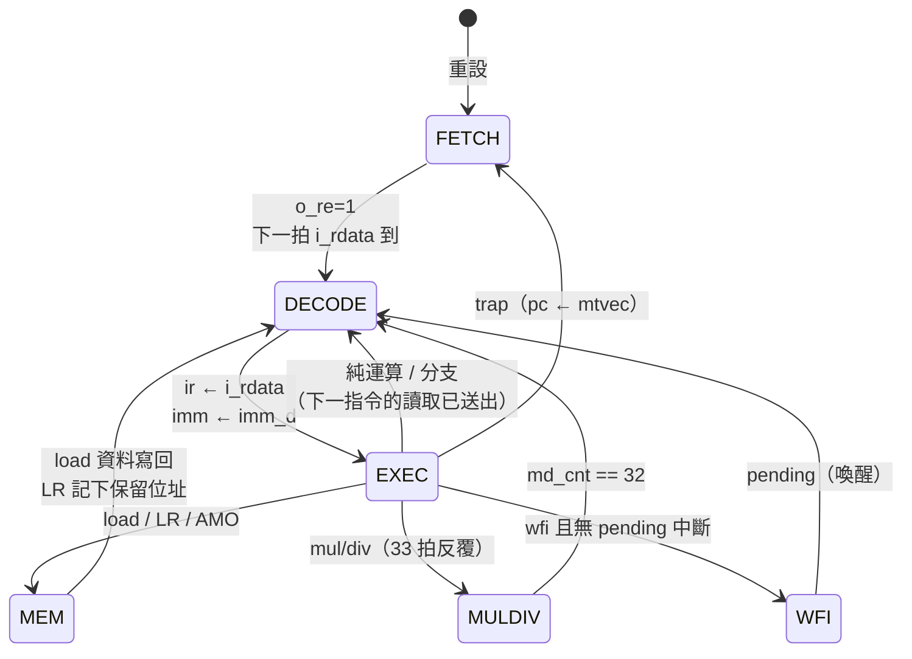
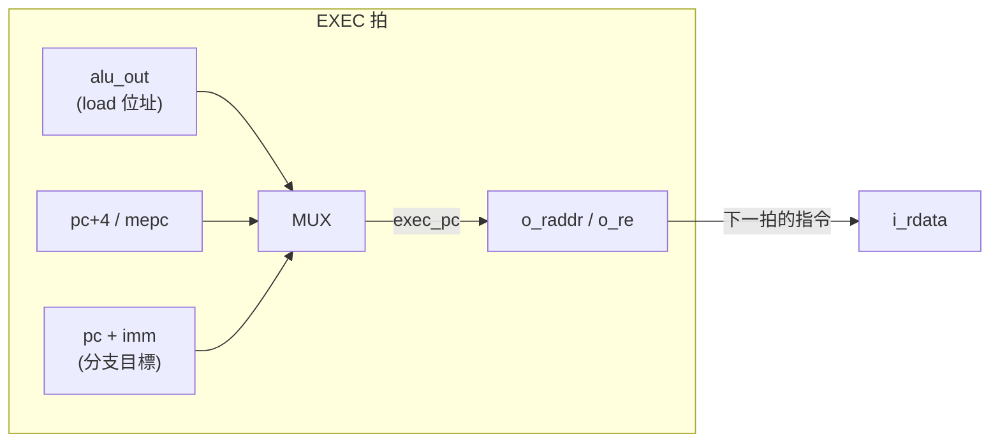

# 6.1 RISC-V 綜合實例：單週期與多週期核心

> 本章講解專案裡兩顆真的會上 FPGA 的 RISC-V 核心：
> 單週期的 `RiscvCore`（`examples/src/rv32i.veryl`）與多週期的
> `RvCore`（`examples/src/rvsoc.veryl`，RV32IMA + Zicsr）。
> 這裡看的是**微架構與原理**；怎麼用 `v2c` 編譯 C、怎麼在 IDE 操作，
> 請參考 manual 的 10-riscv-c.md。

## 6.1.1 為什麼要有兩顆核心

同一個指令集可以有非常不同的硬體實作，這兩顆核心正好構成一個教學光譜的兩端：

| | `RiscvCore`（rv32i.veryl） | `RvCore`（rvsoc.veryl） |
|---|---|---|
| 微架構 | 單週期（一拍一指令） | 多週期狀態機 |
| 指令集 | RV32I（無 fence/ecall/ebreak/CSR） | RV32IMA + Zicsr |
| 記憶體 | 組合邏輯 ROM + 外部 dmem | 同步 RAM（4 位元組通道） |
| 週期數 | 每指令 1 | 2 起步（load 3、mul/div 35、trap 3） |
| 用途 | 教學、綜合下限測試 | 真正跑 C 程式的 SoC |

單週期核心的意義不是「快」，而是**每拍都完成一個指令**——它把
取指、解碼、ALU、記憶體全部塞進一個組合路徑，Fmax 自然很低，
但它是理解資料路徑最乾淨的教材。多週期核心則把這條長路徑切開，
換取時脈頻率，代價是每個指令要 2 拍以上。

## 6.1.2 單週期核心：一拍到底的資料路徑

`rv32i.veryl` 只有 416 行，三個模組：`Alu`、`RegFile`、`RiscvCore`。
暫存器檔是真正的觸發器陣列：

```veryl
module RegFile #(
    ...
) (
    i_clk : input  clock   ,
    i_we  : input  logic   ,
    i_waddr: input  logic<5>,
    i_wdata: input  logic<32>,
    i_raddr1: input logic<5>,
    o_rdata1: output logic<32>,
    ...
) {
    var rf: logic<32>[32];

    always_ff (i_clk, i_rst) {
        if_reset {
            rf = '{default: 0};
        } else if i_we && i_waddr != 0 {
            rf[i_waddr] = i_wdata;   // x0 永遠是 0：寫入直接被擋掉
        }
    }
    assign o_rdata1 = rf[i_raddr1];  // 組合讀取：同一拍讀、同一拍寫可見
    ...
}
```

單週期核心的關鍵在於：**寫回與讀取在同一拍**。`rf` 是觸發器，
組合讀取讀到的是「上一拍寫入後」的值，所以資料冒險（data hazard）
天然不存在——這就是單週期微架構最大的教學價值。



## 6.1.3 多週期核心：FETCH / DECODE / EXEC / MEM / MULDIV / WFI

`rvsoc.veryl` 的 `RvCore` 是本專案真正跑 C 程式的 CPU。它的狀態機
定義在模組最上方（`rvsoc.veryl:46-51`）：

```veryl
const FETCH : logic<3> = 3'd0;
const DECODE: logic<3> = 3'd1;
const EXEC  : logic<3> = 3'd2;
const MEM   : logic<3> = 3'd3;
const MULDIV: logic<3> = 3'd4;
const WFI   : logic<3> = 3'd5;

var state : logic<3>;
var pc    : logic<32>;
var ir    : logic<32>; // 執行中的指令
var lsaddr: logic<32>; // load / AMO 的位址（Mem 用）
```

週期數（與 ISS 完全一致，見 6.4 節）：

| 狀態路徑 | 週期數 | 例子 |
|---|---|---|
| FETCH→DECODE→EXEC→(回到 DECODE) | 2 | add, lui, beq |
| …→MEM→DECODE | 3 | lw, sw, lr.w, amoadd |
| …→MULDIV(32 拍循環)→DECODE | 35 | mul, div |
| …→WFI→(喚醒)→DECODE | 直到中斷 | wfi |
| …→FETCH（跳 mtvec） | 3 | 任何 trap |

為什麼最少是 2 拍而不是 1？因為記憶體是**同步讀取**（`SyncRam`）：
FETCH 拍送出 `o_raddr = pc`，`i_rdata` 要到**下一拍**才有資料，
所以 DECODE 拍讀的是 `i_rdata`：

```veryl
// Decode 那一拍指令還在 i_rdata 上，之後在 ir
let cur: logic<32> = if state == DECODE ? i_rdata : ir;
```

暫存器檔也用同一招——兩份相同的同步讀取 RAM 當兩個讀取埠：

```veryl
inst u_rf1: SyncRam #(ADDR_W: 5, DATA_W: 32) (
    i_we   : rf_we    ,
    i_waddr: rd_idx   ,
    i_wdata: rf_wd    ,
    i_re   : 1'b1     ,
    i_raddr: cur[19:15],
    o_rdata: rs1_raw  ,
);
```

`x0` 不能依賴 RAM 的內容（模擬時初值是 `x`），所以在 DECODE 拍
另外記下「讀的是不是 x0」：

```veryl
var rs1_zero: logic;
let rs1_data: logic<32> = if rs1_zero ? 32'd0 : rs1_raw;
```

### 狀態轉移



注意 EXEC → DECODE（而不是 FETCH）這條邊：**EXEC 拍已經把下一個
指令的讀取送出去了**（`o_raddr = exec_rd`，見 `rvsoc.veryl:466`），
所以從 EXEC 回到 DECODE 直接讀到新指令。這是「每指令 2 拍」的關鍵。

### MULDIV：一個 33 位元加減法器跑 33 拍

乘除法不使用組合乘法器（那會毀掉 Fmax），而是反覆式：

- 乘法：{部分積, 乘數} 64 位元，每拍條件加 `md_b` 再右移；
- 除法：{餘數, 商}，每拍左移後試減。

```veryl
let md_sh  : logic<64> = {md_p[62:0], 1'b0};
let md_div : logic     = md_f3[2];
let md_x   : logic<33> = {1'b0, if md_div ? md_sh[63:32] : md_p[63:32]};
let md_y   : logic<33> = if md_div ? ~{1'b0, md_b} : if md_p[0] ? {1'b0, md_b} : 33'd0;
let md_sum : logic<33> = md_x + md_y + {32'd0, md_div}; // 減法 = 加反相再加一
```

除以 0 不觸發例外（RV 規格：商 = −1、餘數 = 被除數），
由 `md_bz && md_f3[2:1] == 2'b10` 直接選 `0xffff_ffff`。

## 6.1.4 Speculative fetch 與 trap gating

`RvCore` 最巧妙（也最容易出錯）的地方：**EXEC 拍就送出下一個
讀取位址，即使這個指令可能陷入例外**。註解（`rvsoc.veryl:438-440`）
說得很直白：

> Exec 送出的下一個讀取位址：不等陷阱（陷入時改走 Fetch，從 mtvec
> 重新取指令）；分支條件 take 只進最後一個多工器。

也就是說：



- **投機取指（speculative fetch）**：陷入例外的指令也照樣送出
  讀取（除了 load——周邊的讀取有副作用，陷入的 load 不能讀，
  所以 `o_re = !trap_fast`，見 `rvsoc.veryl:468`）。例外發生時
  pc 直接改成 `mtvec`，那筆投機讀回的資料被丟棄，
  重新從 handler 取指。省下的邏輯是「先判陷阱再送位址」
  的額外一拍或串聯閘。

- **`trap_fast` 與 `trap` 的分層**：並非所有陷阱都能在 EXEC 拍
  立刻判定。分支目標沒對齊要等比較器 `take` 的結果，
  所以把它從 `trap_fast` 拆出來：

```veryl
// trap_fast：不用等分支比較器的陷阱（決定暫存器、記憶體、CSR 寫不寫）；
// trap = 再加上分支目標沒對齊（只決定下一個 pc）
var trap_fast : logic;
var trap_cause: logic<5>; // {interrupt, code}
let trap: logic = trap_fast || bad_branch;
```

   `trap_fast` 閘住所有**有狀態效果**的動作（寫暫存器、寫記憶體、
   寫 CSR、寫 minstret），`bad_branch` 只影響下一個 pc。
   這讓關鍵路徑上不需要等 32 位元分支比較——比較 `imm[1]`
   和 `take` 就夠了（`bad_branch`，`rvsoc.veryl:194`）。

- **位址對齊檢查只用 2 位元**：`addr_lo = rs1_data[1:0] + imm[1:0]`
  是一個 2 位元加法器，和 32 位元 ALU 平行運算：

```veryl
let addr_lo   : logic<2> = rs1_data[1:0] + imm[1:0];
let bad_jal   : logic = (opcode == Opcode::Jal && imm[1]) || (opcode == Opcode::Jalr && addr_lo[1]);
let bad_branch: logic = opcode == Opcode::Branch && imm[1] && take;
```

## 6.1.5 A 擴充在 store 致能路徑上的位置

LR/SC 的地址比較**刻意不用 ALU**。AMO 的位址就是 `rs1`
（沒有偏移量），所以：

```veryl
let sc_ok: logic = resv_v && resv_a == rs1_data; // A 擴充的位址就是 rs1（不經過 ALU，路徑短）
```

`sc_ok` 在 EXEC 拍直接決定 `o_wstrb`（store 致能）：

```veryl
o_wstrb = if op_store || (is_sc && sc_ok) ? store_strb : 4'd0;
```

這條比較在 `o_wstrb` 的路徑上，而 `o_wstrb` 又驅動整個 SoC 的
RAM 寫入——它是**全設計最長的組合路徑之一**。這也是為什麼
整個 SoC（含 8 KB RAM、UART、VGA）剛好能跑 12 MHz：
把比較挪到 ALU 輸出之後就會跌破 12 MHz（見 6.3 節）。

## 6.1.6 綜合規模

用 `cargo test board_speed`（`veryl-eda/src/tests.rs:699`）可以在
自己機器上量到真實數字。典型的相對量級（以 LUT 數為標尺）：

| 設計 | 大約 iCE40 資源 | 意義 |
|---|---|---|
| Blinky | 幾十個 LUT | 下限 |
| RiscvSoc（單週期 + ROM） | 數百 LUT | 教學用下限 |
| RvBoard（多週期 RV32IMA，RAM 在 block RAM） | 約千餘 LUT + 8 個 block RAM | 真正可用 |

單週期核心的邏輯深（ROM 組合讀 + 解碼 + ALU + dmem 寫），
但每指令 1 拍；多週期核心每指令 ≥ 2 拍，Fmax 卻能站上 12 MHz
而單週期不行。這正是「以拍數換頻率」最直觀的例子。

## 6.1.7 為什麼這樣設計

1. **同步 RAM 而非組合讀**：iCE40 的 block RAM 只有同步讀；
   想上 FPGA 就必須接受「位址進去、資料下一拍出來」。
   多週期狀態機是順應硬體，不是為了賣弄。
2. **立即數在 DECODE 拍解好存進 `imm`**：EXEC 拍就不用重複
   移位拼接邏輯（`imm_d` 的組合樹只在 DECODE 用）。
3. **CSR 位址先轉 4 位元編號再選值**：12 位元比較器 → 4 位元
   多工器，比直接 12 位元多工器小很多（`rvsoc.veryl:209-233`）。
4. **mtval 唯讀 0**：規格允許（mtval 是 optional），省下保存
   出錯位址的觸發器。
5. **mcycle / time 都讀 SoC 的 mtime**：一個計時器，兩個名字，
   且 `mcycle` 的時間基準和中斷（mtimecmp）天然一致。

## 6.1.8 本章重點

- 單週期 `RiscvCore` 把整條路徑塞進一拍，資料冒險天然不存在，
  是理解資料路徑的教材。
- 多週期 `RvCore` 六狀態：FETCH / DECODE / EXEC / MEM / MULDIV / WFI；
  每指令 2 拍起，load/AMO 3 拍，乘除 35 拍，trap 3 拍。
- 同步 RAM 意味著「取指要一拍」，所以最少 2 拍；
  EXEC → DECODE 的邊（下一指令讀取已送出）是 2 拍的關鍵。
- speculative fetch + `trap_fast`/`trap` 分層：投機讀取換簡單控制，
  有副作用的動作全部被 `trap_fast` 閘住。
- `sc_ok` 的位址比較在 store 致能路徑上，是 12 MHz 的關鍵瓶頸。
