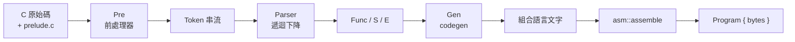

# 6.2 C 子集編譯器（`rv/cc.rs`）

> 原始碼：`veryl-eda/src/rv/cc.rs`（1718 行）、`veryl-eda/src/rv/asm.rs`（547 行）、
> `veryl-eda/src/rv/prelude.c`（372 行）。
> 操作面（`v2c cc`、IDE 的 C 程式群組）見 manual/10-riscv-c.md。

## 6.2.1 為什麼自己寫一個 C 編譯器

RvSoc 只有 8 KB RAM、單核、無浮點。用 GCC/LLVM 當然可以，
但那要帶一整條 binutils 工具鏈。專案的選擇是寫一個
**小到能在瀏覽器 wasm 裡跑、又能誠實編譯真程式**的 C 子集編譯器：

- 純 Rust、零依賴（`rv/cc.rs` 只用 `std`），wasm 加幾十 KB；
- 產生的是**組合語言文字**，再交給自己的組譯器 `rv/asm.rs`
  組成機器碼——中間輸出可讀（每條語句前有 C 原始行註解）；
- 編譯錯誤帶 `file/line/msg`，IDE 能直接在編輯器上畫底線
  （wasm `cc` 回 `errors: [{file, line, msg}]`）。

## 6.2.2 子集範圍

模組開頭註解就是規格（`cc.rs:1-17`）：

| 支援 | 不支援 |
|---|---|
| `char`（無號，RISC-V ABI）、`signed char`、`short`、`int`、`long`（= int）及 unsigned 形式 | struct / union / enum / typedef |
| `void`、指標、任意維度陣列 | 浮點數 |
| `const / volatile / static / extern`（接受並忽略差異） | 函式指標 |
| 區塊、`if`、`while`、`do`、`for`、`switch`、`break`、`continue`、`return`、任意位置宣告 | 遞迴超深（棧會爆，但語法上可） |
| 全部 C 運算子（含 `?:`、`,`、複合指定） | 位域 |
| 函式至多 8 參數、`...` 可變參數 | |
| 前處理器：`#define`（含參數）、`#undef`、`#ifdef/#ifndef/#if/#else/#endif` | `#include` 被忽略（runtime 永遠在） |

`long = int` 是刻意簡化：RV32 本來就只有 32 位元 ABI，
`long` 在 RV32GCC 也是 32 位元。

## 6.2.3 三段式管線



`compile()`（`cc.rs:1600`）把它們串起來：

```rust
let files = vec!["<runtime>".to_string(), name.to_string()];
let mut pre = Pre { macros: HashMap::new(), errs: vec![], files: &files };
pre.macros.insert("__VERYL2CHIP__".into(), ...);
pre.macros.insert("RAM_SIZE".into(), ...);
let mut toks = vec![];
pre.run(0, PRELUDE, &mut toks);   // runtime 先進 token 串流
pre.run(1, src, &mut toks);
```

注意：**runtime 和使用者程式是一起前處理、一起解析的單一翻譯單元**。
這讓 `prelude.c` 的 `va_start`、`memcpy` 等可以像內建一樣使用，
也讓後面的死碼移除（6.2.6）能用同一個 refs 圖。

## 6.2.4 前處理器與詞法

`Pre::run` 逐行工作：去註解（`strip_comments` 保留換行）、
接續行（`\` 結尾）、`#if` 條件堆疊（`(本分支取不取, 曾有分支取過)`），
然後 `lex_line` 切 token。巨集展開 `expand` 遞迴、
用 `hide` 堆疊防止自我參照：

```rust
None => {
    hide.push(name.clone());
    let e = self.expand(at(&m.body), hide);
    hide.pop();
    out.extend(e);
    i += 1;
}
```

字串相鄰合併（`"a" "b"` → `"ab"`）在 token 層就做掉，
跨行也一樣。

## 6.2.5 暫存器配置策略：a0 一票到底

`Gen` 的策略寫在模組註解裡（`cc.rs:14-17`）：

> 每個運算式結果都進 a0，中間值推上棧，區域變數住在
> frame（s0 = frame pointer）。

實際暫存器角色：

| 暫存器 | 用途 |
|---|---|
| `a0` | 運算式的「累加器」：`expr()` 的回傳值都落在這 |
| `t0`、`t1` | 二元運算的兩個運算元（`t0 op t1 → a0`） |
| `t2` | 指標乘法尺度等臨時 |
| `s0` | frame pointer；區域變數在 `s0 - off` |
| `sp` | 棧頂（`_start` 設成 RAM 頂） |
| `a0..a7` | 函式參數（RISC-V ABI） |

二元運算的生成模式：

```rust
EK::Bin(op, a, b) => {
    let ta = self.expr(a);          // a0 = a
    if let Some((k, tk)) = Self::constant(b) { if let Some(t) = self.binop_imm(op, &ta, k, &tk) { return t; } }
    // t0 = a, t1 = b
    let tb = if self.is_simple(b) { self.emit("mv t0, a0"); self.load_simple(b, "t1") } else {
        self.push();                // addi sp, sp, -4; sw a0, 0(sp)
        let tb = self.expr(b);
        self.emit("mv t1, a0");
        self.pop("t0");             // lw t0, 0(sp); addi sp, sp, 4
        tb
    };
    self.binop(e, op, &ta, &tb)
}
```

「簡單」的定義在 `is_simple`：常數、字串、可 12 位元定址的
區域/全域純量、陣列名（decay 成位址）。只有簡單的東西才
直接 `load_simple` 進暫存器，其餘推棧。

$$\text{深度} = 1 + \#\{\text{需要推棧的子運算式}\}$$

這當然不是最佳化編譯器——巢狀算術每層兩次 store/load——
但它**正確、可預測、生成碼與 C 原始行並列可讀**（`note_line`
在每條語句前塞 `# 行號: 原始碼`）。

### 參數傳遞

參數走 ABI：`a0..a7`，最多 8 個。產生碼的順序很講究
（`call`，`cc.rs:1288-1293`）：

```rust
// arguments that need code first (on the stack), then the simple ones straight into a0..a7
let simple: Vec<bool> = args.iter().map(|a| self.is_simple(a)).collect();
for (i, a) in args.iter().enumerate() { if !simple[i] { tys[i] = Some(self.expr(a)); self.push(); } }
for i in (0..args.len().min(8)).rev() { if !simple[i] { self.pop(&format!("a{}", i)); } }
for (i, a) in args.iter().enumerate().take(8) { if simple[i] { tys[i] = Some(self.load_simple(a, &format!("a{}", i))); } }
```

先算**不簡單**的參數推棧，再從後往前彈進 `a_i`——
這樣簡單參數的生成碼不會蓋掉棧上的中間值。
可變參數的祕訣：前 8 個指定詞的 frame 槽 `s0-40 .. s0-12`
（`const ARGS: i32 = 40`）**依序存放**，第 9 個之後緊跟其後，
`va_start` 只要讀 `s0-40+8*n` 就能走完整個列表。

## 6.2.6 runtime `prelude.c` 與函式級死碼移除

`prelude.c`（372 行）提供 I/O 與字串/記憶體函式：
`putchar/getchar/printf`（子集）、`puts/strlen/strcpy/memcpy/...`、
`va_*` 巨集，以及 MMIO 的包裝（LED、按鈕、UART、mtime）。
它以 `include_str!` 編進二進位：

```rust
pub const PRELUDE: &str = include_str!("prelude.c");
```

問題：runtime 裡大多數函式在使用者程式中根本沒用到
（沒用 printf 的程式不該帶 printf）。解法是
**函式級（與全域級）的 reachable-set 標記**（`cc.rs:1662-1682`）：

```rust
// reachability
let mut keep: Vec<String> = vec![];
let mut todo = vec!["main".to_string()];
// what top-level assembly refers to
for a in &asms { for n in asm_names(a) { if code.contains_key(&n) || data.contains_key(&n) { todo.push(n); } } }
while let Some(n) = todo.pop() {
    if !seen.insert(n.clone()) { continue; }
    keep.push(n.clone());
    let refs = code.get(&n).map(|c| &c.1).or_else(|| data.get(&n).map(|d| &d.1));
    ...
}
```

每個函式在 codegen 時就蒐集自己的 `refs: HashSet<String>`
（它 `call` 過誰、`la` 過哪些全域/字串標籤）。
從 `main`（加上 top-level `asm("...")` 引用的名字）做 DFS，
只有 reachable 的函式和全域才被印進組合語言。
字串池也照樣過濾（`keep.contains(".LS{i}")`）。

為什麼不做函式內的死碼消除？因為它是在
**組合語言層之後**由組譯器和硬體吃掉：
不可達基本塊的代價只有幾個位元組，
而函式級移除已經省掉幾 KB 的 runtime。
這是「最小工程量拿最大收益」的取捨。

## 6.2.7 `asm("")` 與 naked function

兩種行內組語：

1. **敘述級**：`asm("csrw mtvec, ...")`——文字直接插入輸出，
   其中出現的識別字若對應函式/全域，記入 `refs`
   （不然死碼移除會把被引用的函式刪掉）：

```rust
if name == "asm" || name == "__asm__" {
    match args { [E { k: EK::Str(text), .. }] => {
        for n in asm_names(&text) { if self.funcs.contains_key(&n) || self.globals.contains_key(&n) { self.refs.insert(n); } }
        for l in text.lines() { if !l.trim().is_empty() { self.emit(l.trim()); } }
    } _ => self.error(e, "asm takes one string of assembly".into()) }
    return Ty::Void;
}
```

2. **Top-level**：`asm("my_data: .byte 1,2,3")`——標籤定義
   算作定義（`asm_labels`），死碼移除不會把只在組語裡
   引用的符號當成未定義。

**Naked function**：函式體全部是 `asm` 敘述（或空）時，
不加 prologue/epilogue——組語自己負責返回：

```rust
// a body of asm statements only: naked (no prologue / epilogue: the assembly returns itself)
if !v.is_empty() && v.iter().all(|s| is_asm(s) || matches!(s, S::Empty)) {
    self.scopes = vec![HashMap::new()];
    for s in v { self.stmt(s); }
    let mut out = vec![format!("{}:", f.name)];
    out.extend(std::mem::take(&mut self.out));
    return (out, std::mem::take(&mut self.refs));
}
```

典型用法：中斷處理常式必須手工保存/恢復暫存器，
prologue 反而會踩壞框架。

## 6.2.8 Epilogue 不讀 sp 以下：中斷框架

正常函式的收尾（`cc.rs:1516-1520`）：

```rust
// never read below sp: an interrupt pushes its frame there
v.push("    addi sp, s0, -8".into());
v.push("    lw ra, 4(sp)".into());
v.push("    lw s0, 0(sp)".into());
v.push("    addi sp, sp, 8".into());
v.push("    ret".into());
```

明明 `ra`、`s0` 存在 frame 頂（prologue 是 `sw ra, frame-4(sp)`、
`sw s0, frame-8(sp)`），epilogue 卻**從 s0 重新定位**、
而且只碰 `sp` 以上 8 個位元組。為什麼？

因為 RISC-V 的**中斷是非同步的**：中斷可能在函式執行到
任何一點時打進來。本專案的慣例（runtime 的中斷處理常式）是
把中斷框架**推在當前 `sp` 之下**——也就是說，棧指標下方
的記憶體隨時可能被硬體打斷時新推的框架覆蓋。
如果 epilogue 用 `lw ra, frame-4(sp)`（讀 sp 以下），
而中斷恰好在 prologue 之後、epilogue 之前打進來，
handler 的推疊就會蓋掉 `ra`/`s0` 的保存槽——返回時跳到
垃圾位址。

用 `s0` 定位就不一樣了：`s0` 是呼叫者進來時的 `sp`，
**被保存槽永遠在 s0−8 .. s0−1**，且這段記憶體：
1. 是本函式自己 frame 的一部分；
2. 位於本函式進入時的 sp 之上——handler 的框架
   只會推在**更深**（更小的位址）處。

$$\text{安全條件：} \forall \text{讀取位址 } a: \; a \ge \text{進函式時的 } sp = s0$$

epilogue 的 `addi sp, s0, -8` 把棧頂一次拉回保存槽下方
（等價於撤銷整個 frame），再從 `s0-8`、`s0-4` 讀回，
最後 `addi sp, sp, 8` 完全還原。整個 epilogue
**沒有任何一次讀取低於 s0−8**。

```mermaid
flowchart TB
    subgraph 呼叫者 frame
    X["呼叫者的資料"]
    end
    subgraph 本函式 frame
    S0B["s0-8: s0 保存"] --> RAB["s0-4: ra 保存"] --> LOC["區域變數<br/>（s0-12 以下）"]
    end
    subgraph 中斷時
    SP["sp（可停在本函式任意點）"] --> IH["中斷框架<br/>（handler 推）<br/>全部 < sp"]
    end
    IH -.覆蓋.-> LOC
    IH -x->|"epilogue 只讀 ≥ s0-8"| S0B
```

同樣的理由解釋了為什麼 `push()` 的中間值推疊也安全：
推疊時 `sp` 一路下移，但**讀回**（`pop`）發生在推疊完成後
立刻、在子運算式遞迴的同一個敘述內，中斷若插入，
handler 也只用 `sp` 以下的空間，不會碰 `sp..sp+4`。

## 6.2.9 組譯器與程式收尾

`compile()` 最後印出啟動碼並組譯：

```
_start:
    li sp, {mem_size}
    la t0, __bss_start
    la t1, __bss_end
.Lbss:
    bgeu t0, t1, .Lmain
    sw zero, 0(t0)
    addi t0, t0, 4
    j .Lbss
.Lmain:
    call main
_halt:
    j _halt
```

BSS 清零、跳 main、死迴圈收尾（RvBoard 上 LED 停在最後狀態）。
組譯失敗或 `program.end + 256 > mem_size`（棧要留 256 位元組）
都回編譯錯誤。

## 6.2.10 為什麼這樣設計

1. **a0 累加器式 codegen**：中間狀態只有一個暫存器與一個棧，
   正確性容易驗證；生成碼稍大，但 8 KB RAM 的程式本來就小。
2. **runtime 編進同一翻譯單元**：免連結器、免標頭檔搜尋路徑，
   死碼移除還能用同一個 refs 圖。
3. **組語是中間表示**：`v2c cc -S` 可以直接給人看；
   組譯器獨立，`asm("")` 天然共享同一組偽指令。
4. **錯誤一次全回**：`Vec<Diag>` 按行排序去重（`cc.rs:1683`），
   IDE 能一次顯示所有問題。

## 6.2.11 本章重點

- C 子集：無 struct/浮點/函式指標；前處理器內建；`#include` 忽略。
- 管線：Pre → 遞迴下降 Parser → Gen（a0 累加器 + 推棧）→
  組語文字 → `asm::assemble`。
- 參數先算不簡單者推棧、再彈進 `a0..a7`；可變參數靠
  frame 槽連續存放。
- `prelude.c` 以 `include_str!` 進 binary，reachable-set
  從 `main` 做死碼移除（函式級 + 全域級 + 字串）。
- `asm("")`（敘述/頂層）與 naked function 支援手寫中斷處理。
- Epilogue 絕不讀 `sp` 以下：中斷框架推在 sp 下方，
  保存槽必須只用 `s0` 定位。
