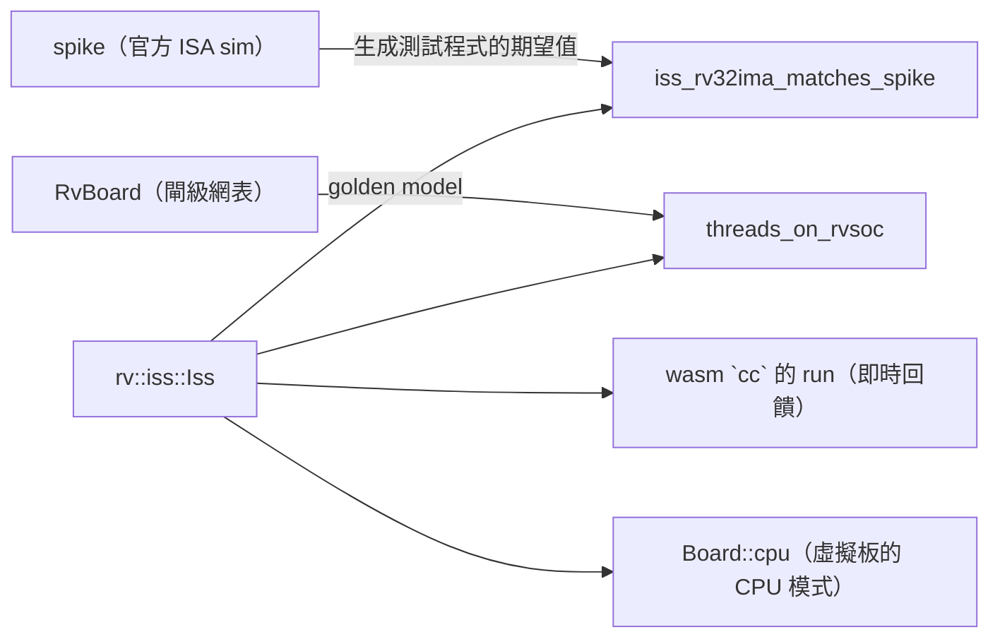
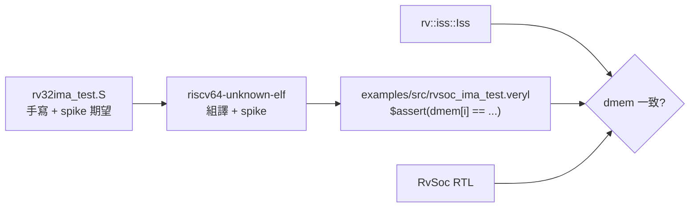

# 6.4 指令集模擬器 ISS（`rv/iss.rs`）

> 原始碼：`veryl-eda/src/rv/iss.rs`（364 行）。
> 一個 RV32IMA + Zicsr 的**指令集模擬器**，記憶體映射與 RvSoc
> 完全相同，連週期數都和 RTL 一致。

## 6.4.1 ISS 的角色：golden model

驗證一個 CPU 需要一個「對的答案」。專案裡 ISS 扮演三個角色：



1. **與 spike 對照**（`tests.rs::iss_rv32ima_matches_spike`）：
   `examples/sw/build.sh` 把 `rv32ima_test.S` 組譯成 binary，
   同時用 spike 跑出每個 `$assert(dmem[i] == ...)` 的期望值，
   寫進 `examples/src/rvsoc_ima_test.veryl`。
   ISS 在同一程式上跑，dmem 內容必須完全一致。
2. **與閘級 RTL 對照**（`tests.rs::threads_on_rvsoc`）：
   RvBoard 綜合 → own P&R → 閘級網表，跑多執行緒測試程式；
   ISS 用同樣的程式、同樣的中斷時序跑，比較輸出。
3. **互動/教學**：wasm 的 `cc` 指令可以 `run` 幾百萬條指令
   即時回報輸出；虛擬開發板的 CPU 模式（6.5 節）
   用 ISS 而不是閘級模擬，才能即時。

ISS 為什麼 cycle-exact？因為角色 2 需要它：如果 ISS 的
計時器（mtime）與 RTL 的 mtime 不同步，
timer 中斷的到達時間就不一樣，多執行緒程式的排程會分叉，
比較就失去意義。

## 6.4.2 狀態與記憶體映射

```rust
pub struct Iss {
    pub pc: u32,
    pub x: [u32; 32],
    pub mem: Vec<u8>,
    pub led: u32,
    pub btn: u32,
    pub tx: Vec<u8>,
    pub rx: VecDeque<u8>,
    pub cycles: u64,
    pub instret: u64,
    pub tx_cycles: u64,
    tx_busy_until: u64,
    pub vram: Vec<u8>,
    pub font: Vec<u8>,
    pub colors: u32,
    // ---- machine mode ----
    pub mie_bit: bool,
    pub mpie: bool,
    pub mie: u32,
    pub mtvec: u32,
    pub mscratch: u32,
    pub mepc: u32,
    pub mcause: u32,
    pub minstret: u32,
    resv: Option<u32>,
    mtime_off: u32,
    pub mtimecmp: u32,
    pub msip: bool,
    pub wfi: bool,
}
```

記憶體映射與 `rvsoc.veryl` 的註解逐條對應（`iss.rs:10-21`）：

| 位址 | 裝置 |
|---|---|
| 0x0000_0000 | RAM（`mem`，大小由呼叫者給，預設 8 KB） |
| 0x1000_0000 | LED |
| 0x1000_0004 | BTN（bit 2..0 = BTN3..1，bit 15..8 = 開關） |
| 0x1000_0008 / 0x0C | UART 資料 / 狀態 |
| 0x1000_0010 / 0x18 / 0x20 | MTIME / MTIMECMP / MSIP |
| 0x1000_2000+ | VgaText：vram / font / colors |

`mtime = cycles + mtime_off`——寫 MTIME 時把偏移反算進去
（`store` 的 `4 => self.mtime_off = v.wrapping_sub((t + 1) as u32)`），
而不是真的存一個 mtime 觸發器。這樣 `mtime_at(t)` 是純函數，
`wfi` 的睡眠跳躍（6.4.5）才能「直接跳到下一次中斷」。

## 6.4.3 週期計數：與 RTL 逐拍對照

`step_until` 是核心（`iss.rs:203`）。每個指令的 Exec cycle
是 `e = self.cycles + 1`，之後：

| 事件 | 加的週期 | RTL 對應 |
|---|---|---|
| 一般指令 | 2 | EXEC→DECODE |
| load / LR / AMO | 3 | +MEM |
| mul / div | 35 | MULDIV 33 拍 |
| trap | 3 | EXEC→FETCH（mtvec） |
| wfi | 睡到中斷 | WFI 狀態 |
| 重設後 | cycles = 1 | pc = 0 |

中斷取樣**和 RTL 同一拍**：

```rust
// ---- traps, in RvCore's priority ----
let pending = self.mip_at(e) & self.mie;
if self.mie_bit && pending != 0 {
    let code = if pending & 0x800 != 0 { 11 } else if pending & 8 != 0 { 3 } else { 7 };
    self.trap(16 | code);
    return Ok(());
}
```

`mip_at(e)`：

```rust
fn mip_at(&self, t: u64) -> u32 {
    ((!self.rx.is_empty() as u32) << 11) | ((self.mtime_at(t) >= self.mtimecmp) as u32) << 7 | (self.msip as u32) << 3
}
```

外部中斷 = 「接收緩衝非空」（與 SoC 的 `rx_full` 一致）、
計時器 = `mtime >= mtimecmp`、軟體 = msip。
優先權 `MEIP > MSIP > MTIP` 與 RTL 的 if-else 鏈相同。

`trap()`：

```rust
fn trap(&mut self, cause: u32) {
    self.mepc = self.pc;
    self.mcause = cause;
    self.mpie = self.mie_bit;
    self.mie_bit = false;
    self.resv = None;
    self.pc = self.mtvec & !3;
    self.cycles += 3; // Decode, Exec, Fetch of the handler
}
```

與 RTL 的 EXEC 拍 trap 分支逐行對應（mepc/mcause/MPIE/MIE/
清保留/跳 mtvec），連「陷入的指令不產生效果」
（在取指令之前就 return）都一樣。

## 6.4.4 MMIO 與 A 擴充

load/store 走 `load_word` / `store`，先判 IO 區再落記憶體：

```rust
fn load_word(&mut self, a: u32, t: u64) -> u32 {
    if a & IO_BASE != 0 {
        return match (a >> 2) & 15 {
            0 => self.led & 0xff,
            1 => self.btn & 0xff07,
            2 => self.rx.pop_front().map(|b| b as u32).unwrap_or(0),
            3 => (!self.rx.is_empty() as u32) << 1 | (t < self.tx_busy_until) as u32,
            4 => self.mtime_at(t),
            ...
        };
    }
    ...
}
```

UART 狀態暫存器的 `tx_busy` 依賴時間 `t`——寫 TX 時記下
`tx_busy_until = t + tx_cycles`，狀態讀取時比較。
這讓「printf 連發」的程式在 ISS 上也會被 UART 速度
節流（CPU 板模式需要）。

LR/SC：

```rust
2 => { wb = Some(self.load_word(addr, e)); self.resv = Some(addr); cyc = 3; }
3 => {
    let ok = self.resv == Some(addr);
    if ok { self.store(addr, rs2, 15, e); }
    self.resv = None;
    wb = Some(!ok as u32);
}
```

與 RTL 的 `resv_v/resv_a` 一一對應；trap 清 `resv = None`
（RTL：`resv_v = 0`）。

## 6.4.5 wfi：跳躍式睡眠

`step_until(limit)` 的 wfi 分支不逐拍數——它**直接算出**
下一個可能喚醒的週期：

```rust
if self.wfi {
    let mut t = self.cycles;
    loop {
        if self.mip_at(t) & self.mie != 0 { self.wfi = false; self.cycles = t + 1; return Ok(()); }
        // only the timer changes by itself: jump to it (bounded by the caller's limit)
        let to_cmp = self.mtimecmp.wrapping_sub(self.mtime_at(t)) as u64;
        let next = if self.mie & 0x80 != 0 && to_cmp > 0 { t + to_cmp } else { u64::MAX };
        if next >= limit { ... }
        t = next;
    }
}
```

唯一會自己變化的 pending 是計時器（mtime 往前走），
所以睡眠可以解析跳躍：`t + (mtimecmp - mtime)`。
外部與軟體中斷由呼叫者推入（`Iss::rx`、`msip`），
`limit` 讓「睡到這個視窗結束」成為可能
（虛擬板每個 run 視窗都會推新字元進 rx）。
沒有任何能喚醒它的中斷且無 limit 時，回錯
`"wfi with no interrupt that can wake it"`——
這正是死迴圈偵測。

## 6.4.6 run：halt 偵測

```rust
pub fn run(&mut self, max: u64) -> Result<bool, String> {
    for _ in 0..max {
        let pc = self.pc;
        self.step()?;
        if self.pc == pc && !self.wfi && (!self.mie_bit || self.mie == 0) { return Ok(true); }
    }
    Ok(false)
}
```

「pc 不動 + 沒在睡 + 沒有中斷會叫醒」= 程式halt
（編譯器收尾的 `j _halt` 就是 `j .` 自跳）。

## 6.4.7 threads_on_rvsoc：閘級對照

`tests.rs::threads_on_rvsoc` 的流程：

1. `RvBoard` 綜合 → own P&R → 閘級網表（`gatesim` / `netsim`）；
2. 程式由 `program_lanes` 塞進 block RAM；
3. 閘級模擬執行多執行緒測試（含中斷驅動的排程）；
4. ISS 用同一 binary、同樣的輸入時序執行；
5. 比較輸出（LED、UART tx）。

這個測試一次驗證了：整數管線、A 擴充（執行緒用
LR/SC 做鎖）、CSR（mtime/mtimecmp）、中斷（timer tick）、
以及**整條綜合→P&R→位元流→閘級模擬**的鏈路。
ISS 的 cycle-exactness 是這一切成立的前提：
它讓「兩邊都在同一個 mtime 值收到同一個中斷」。

## 6.4.8 與 spike 的驗證流程



`$assert` 的格式被三個消費者共用（AGENTS 的規定）：
veryl-sim 的 RTL 測試台、veryl-eda 的 rv32i_core 綜合測試、
以及 ISS 對照。測試覆蓋 M（乘除、除零、溢位）、
A（LR/SC 復原）、Zicsr 與各種 trap。

## 6.4.9 為什麼這樣設計

1. **364 行的完整 ISA 模型**：不實作系統呼叫、不模擬快取，
   只到 RTL 有的程度。多出 RTL 的部分才是 bug 溫床。
2. **mtime 用偏移而非計數器**：讓睡眠跳躍成為 O(1)，
   wfi 千萬拍不花千萬次迭代。
3. **`legal(inst)` 白名單**：與 RTL 的 `legal_d` 一張表，
   凡 RTL 不支援的（fence 的變體、CSR 保留區）ISS 也拒絕——
   測試程式踩到不支援指令時兩邊一起 trap，而不是
   一邊跑一邊 trap。
4. **TX 有節流**：`tx_busy_until` 讓 UART 速度進入
   模型，CPU 板模式才能看到真實的「打字速度」。

## 6.4.10 本章重點

- ISS 是 golden model：對上 spike（ISA 語義）、
  對上閘級 RTL（threads_on_rvsoc）、餵給 wasm 與虛擬板。
- cycle-exact：2/3/35/3/wfi 的週期數與 RTL 一致，
  中斷取樣在同一拍（Exec cycle）。
- mtime = cycles + offset：睡眠可解析跳躍。
- halt = pc 自跳 + 無喚醒源。
- `legal()` 白名單與 RTL 對齊，不支援的指令兩邊都 trap。
