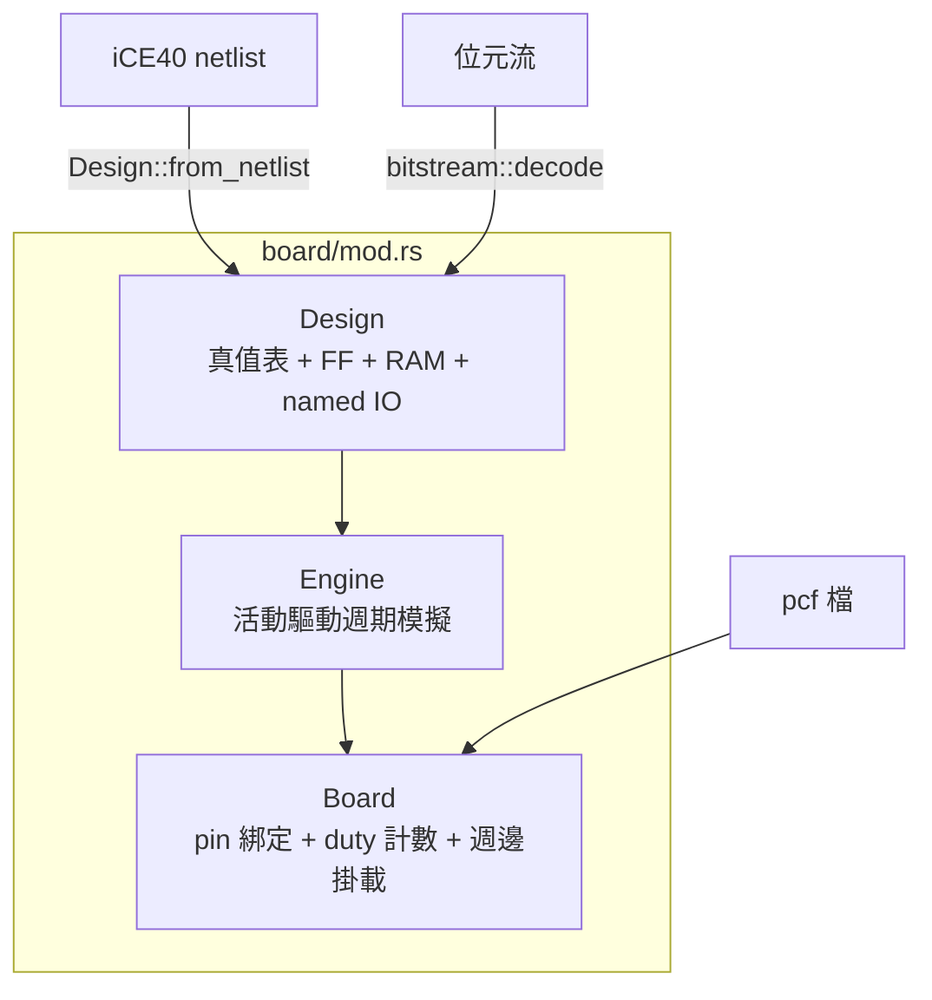

# 6.5 虛擬開發板引擎（`board/mod.rs`）

> 原始碼：`veryl-eda/src/board/mod.rs`（695 行）、`board/icebreaker.rs`。
> 這是網頁虛擬 iCEBreaker 的心臟：一個比逐閘模擬快兩個數量級的
> 週期模擬器，只模擬 iCE40 對映後的電路。

## 6.5.1 三層結構



- **`Design`**：電路的**靜態結構**。組合邏輯一律是 4 輸入
  真值表（`Comb`），時序是 `Ff`（含 set/reset `Ctl`），
  記憶體是 `Ram`（SB_RAM40_4K，256×16，四種模式），
  IO 是 `(名稱, net 編號)`。
- **`Engine`**：在 `Design` 上跑週期模擬。
- **`Board`**：把 engine 的 net 綁到板子的腳位（pcf）、
  免費供應 12 MHz 時脈、統計每個輸出腳的 duty（高電位比例）、
  掛載週邊（UART / 七段 / VGA，見 6.7 節）。

## 6.5.2 Design：真值表統一一切組合邏輯

iCE40 對映後只剩四種 cell（`Design::from_netlist`）：

```rust
"SB_LUT4" => {
    let init = c.params.iter().find(|x| x.0 == "LUT_INIT")...;
    let table = u16::from_str_radix(init, 2)...;
    d.comb.push(Comb { ins, table, out });
}
// carry out = majority(I0, I1, CI)
"SB_CARRY" => {
    let ins = [net(p("I0"), ...), net(p("I1"), ...), net(p("CI"), ...), C0];
    d.comb.push(Comb { ins, table: 0b1110_1000, out });
}
```

SB_CARRY 也被塞進真值表框架：majority(I0, I1, CI) 的 3 輸入
真值表 `0b1110_1000`。這個「萬物皆 4-LUT」的決定讓引擎的
求值迴圈只有一種形狀：

```rust
let idx = self.v[g.ins[0] as usize] as u16 | (self.v[g.ins[1] as usize] as u16) << 1
    | (self.v[g.ins[2] as usize] as u16) << 2 | (self.v[g.ins[3] as usize] as u16) << 3;
let y = (g.table >> idx) & 1 == 1;
```

一次位移、一次比較——沒有 switch、沒有多型。
RAM 的行為照抄 yosys `cells_sim.v`（`ram_edge`：
時脈上升沿先註冊讀舊內容、再寫入）。

## 6.5.3 Engine：活動驅動（activity-driven）

### 為什麼比每個 cycle 全模擬快

天真的週期模擬器每拍把**所有** LUT 重算一遍：

$$
T_{\text{naive}} = N \cdot C \quad (N \text{ 拍} \times C \text{ 個 cell})
$$

但每拍實際改變的訊號是少數：Blinky 只有計數器的進位鏈 +
幾個輸出。活動驅動的原則是**只跑變化訊號的下游**：

$$
T_{\text{activity}} \approx N \cdot \bar{c} \quad (\bar{c} = \text{每拍平均變化 cell 數})
$$

實作三件套（`Engine::new`）：

1. **level（拓撲層數）**：Kahn 演算法算每個 cell 的深度，
   順帶偵測組合迴路：

```rust
let mut level = vec![0u32; d.comb.len()];
let mut ready: Vec<u32> = (0..d.comb.len() as u32).filter(|i| indeg[*i as usize] == 0).collect();
while let Some(c) = ready.pop() {
    for &u in &users[c as usize] {
        level[u as usize] = level[u as usize].max(level[c as usize] + 1);
        indeg[u as usize] -= 1;
        if indeg[u as usize] == 0 { ready.push(u); }
    }
}
if done != d.comb.len() { return Err("combinational loop in the design".into()); }
```

2. **fanout（CSR，壓縮列儲存）**：`fan_start/fan` 記每個 net
   餵了哪些 cell，`set()` 時 O(下游數) 地把它們排進佇列：

```rust
pub fn set(&mut self, n: u32, val: bool) {
    let val = val as u8;
    if self.v[n as usize] == val { return; }   // 沒變：什麼都不做
    ...
    let (a, b) = (self.fan_start[n as usize] as usize, self.fan_start[n as usize + 1] as usize);
    for k in a..b { let c = self.fan[k]; self.enqueue(c); }
}
```

3. **按層求值**：`propagate()` 從 level 0 到最深逐層
   pop 佇列——**每個 cell 在一次 settle 中最多求值一次**，
   這同時消除了毛波（glitch）：中間值不會被算兩次。

```rust
pub fn propagate(&mut self) {
    for _round in 0..64 {
        if self.pending > 0 {
            for l in 0..self.queue.len() {
                while let Some(c) = self.queue[l].pop() {
                    ...
                    self.set(out, y);   // 又觸發下一層
                }
            }
        }
        if self.changed.is_empty() { return; }
        // 時脈邊緣 + 非同步 set/reset：先收集再一起套用（NBA 語義）
        for &(n, val) in &next { self.set(n, val); }
    }
}
```

### 時脈邊緣是「被看到」的

`watch` 標記時脈 net 與非同步 set/reset net。時脈（含
設計內部分頻出來的時脈！）變化時，引擎查
`clock_of[net]` 找到該時脈上的 FF（依上升/下降分成兩桶），
**先收集所有新值再一起寫入**（`next`）——
避免「同一個邊緣上，先寫的 FF 影響後讀的 FF」的錯序。
多時脈設計（分頻時脈、負緣 FF）自然被支援。

RAM 同理掛在時脈上（`clocks[k][2]`），上升沿才動。

## 6.5.4 Board：腳位、duty 與 12 MHz

`Board::new` 用 pcf（`set_io name pin`）把 IO net 綁到腳號，
`clk` 記錄時脈腳的 net。`run(n)` 是一拍的完整定義：

```rust
pub fn run(&mut self, n: u64) {
    for i in 0..n {
        // UART RX 腳的位準（週邊在打）
        if let Some(u) = self.uart.as_mut() { ... self.eng.set(rx, l); self.eng.propagate(); }
        if let Some(c) = self.clk { self.eng.set(c, true); self.eng.propagate(); }
        // 每個輸出腳：duty 與 edge 統計
        for (k, p) in self.pin_out.iter_mut().enumerate() {
            let v = self.eng.v[p.1 as usize];
            p.2 += v as u64;
            self.edges[k] += (v != self.prev[k]) as u64;
            self.prev[k] = v;
        }
        // 週邊取樣（UART TX、七段、VGA）
        ...
        if let Some(c) = self.clk { self.eng.set(c, false); self.eng.propagate(); }
    }
}
```

duty 的語義：**高電位時間比例**（$\text{duty} = \frac{\#\{cycles\ high\}}{\#\{cycles\}}$）。
LED 亮度、蜂鳴器頻率（edges/秒）這些慢速物理量
不需要逐拍回報 UI，只要窗口結束時 `take_duty()`
一次取走。

### CPU 模式：`Board::cpu`

閘級跑 RISC-V 太慢，所以板子有第二種模式：CPU 是 ISS
（6.4 節），板子其餘（腳位、duty、週邊）照常：

```rust
pub struct Cpu {
    pub iss: crate::rv::iss::Iss,
    led: Vec<(usize, u32)>,     // (pin_out 索引, LED 暫存器位元)
    ins: Vec<(u32, u32)>,       // (輸入 net, 按鍵暫存器位元)
    rst: Option<u32>,
    next_rx: u64,
    acct: u64,                  // 已入帳的 CPU 週期
    next_frame: u64,
    pub error: Option<String>,
}
```

`run_cpu` 逐條指令執行、把指令佔用的週期**入帳**到
輸出腳的 duty：`account(..., d)` 把 LED 暫存器的值
乘上 d 拍累加。VGA 畫面每 800×525 拍從
`text_frame()` 產生一次（6.7 節）——**週期語義仍在**，
只是求值單位從閘變成指令。

## 6.5.5 與 netsim 的比較與速度

兩個模擬器的差別：

| | netsim（`netlist` 層） | board Engine |
|---|---|---|
| 單位 | 2 態位元、任意 cell | 位元組陣列、4-LUT 統一 |
| 目標 | 正確性（測試 oracle） | 速度（網頁即時） |
| 時脈 | 由測試台顯式驅動 | 任何 net 上的邊緣 |
| cell 集 | iCE40/vlib/generic | iCE40 四種 |

`cargo test board` 的 `board_engine_matches_netsim`
（`tests.rs:606`）把同一設計分別在兩個引擎上跑，
輸出必須一致；`board_speed`（`tests.rs:701`）印出速度：

```rust
println!("board speed: {} ({} LUTs): {:.2} M cycles/s = {:.1}% of 12 MHz, {:.1} evals/cycle",
    top, luts, n as f64 / s / 1e6, n as f64 / s / 12e6 * 100.0, b.eng.evals as f64 / n as f64);
```

量測的量級（機器而異，release 編譯）：

- Blinky（幾十 LUT）：**超過 12 MHz 的即時速度**
  （每拍平均求值次數低，活動驅動的收益在此最大）；
- RiscvSoc / RvBoard（千餘 LUT + 8 KB block RAM）：
  每秒百萬到數百萬拍、每拍平均 evals 通常遠小於 LUT 總數；
- CPU 模式（ISS）：數千萬指令/秒，真正的即時。

`evals/cycle` 就是活動驅動收益的直接度量：
設計有 L 個 LUT，每拍平均只評估 $\bar{c} \ll L$ 個。

## 6.5.6 為什麼這樣設計

1. **真值表統一**：一種 cell、一個求值迴圈；
   新的 iCE40 cell 只要能化成 4-LUT 就免改引擎。
2. **位元組陣列存 net 值**：`Vec<u8>` 比位元向量好寫好除錯；
   記憶體開銷（每 net 1 byte）在千 LUT 規模完全無感。
3. **NBA 語義**：邊緣觸發的新值收集後一起套用，
   和 RTL 模擬器的 non-blocking assignment 一致，
   兩個引擎的結果才能對上。
4. **duty 而非波形**：UI 需要「LED 亮不亮、多亮」，
   不需要波形；duty + edges 剛好是亮度和頻率。
5. **設計與腳位分離**：同一個 Design 可以接 tutorial 的
   pcf、自己寫的 pcf、或位元流反解出來的 pin 名
   （6.6 節）。

## 6.5.7 本章重點

- `Design` = 4-LUT 真值表 + FF（含 set/reset）+ RAM + named IO；
  SB_CARRY 也是真值表（majority）。
- `Engine` 活動驅動：變化 net → fanout(CSR) → 按 level 求值，
  每拍平均只評估變化下游；組合迴路在 level 計算即報錯。
- 時脈邊緣被「看到」（任何 net），多時脈/負緣自然支援；
  邊緣新值收集後一次套用（NBA）。
- `Board`：pcf 綁腳、12 MHz 自由時脈、duty/edges 統計、
  週邊掛載；CPU 模式用 ISS，指令週期入帳到 duty。
- 與 netsim 的結果一致性有測試背書；`board_speed` 印出
  M cycles/s、佔 12 MHz 的百分比與 evals/cycle。
