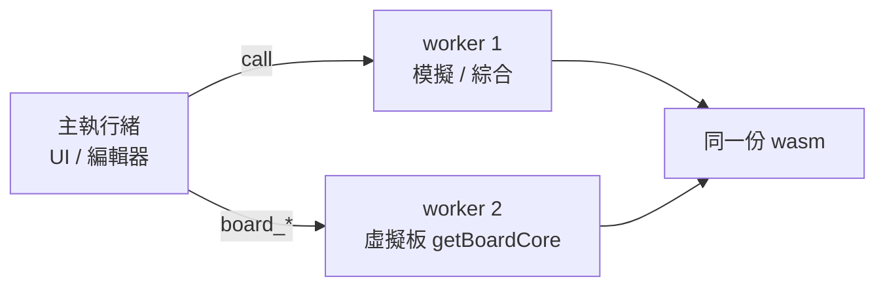

# 6.8 WASM 與瀏覽器 IDE

> 原始碼：`veryl-wasm/src/lib.rs`（75 行）、`veryl-wasm/src/api.rs`（777 行）、
> `web/src/`。原理與架構在此；IDE 的日常操作見 manual/11-ide.md，
> 虛擬板操作見 manual/12-board.md。

## 6.8.1 目標：`file://` 上就能用

web/dist 是**提交進 git、雙擊 index.html 就能用**的靜態頁：

- 沒有伺服器、沒有 fetch——wasm 以 base64 內嵌在
  `dist/wasm.js`，範例程式內嵌在 `dist/examples.js`；
- `file://` 下 fetch 會被瀏覽器擋（CORS null origin），
  所以「零 fetch」不是偏好而是必要。

代價與收益：

| | 收益 | 代價 |
|---|---|---|
| base64 內嵌 | file:// 可用、無部署 | 二進位大 33%、改碼要重打包 |
| 零 imports 的 C ABI | 任何環境可載入（含 Node 測試） | 手工記憶體協定 |

## 6.8.2 C ABI：alloc / call / result_len / dealloc

`lib.rs` 全部匯出只有五個函數：

```
ptr = alloc(n); 寫入請求 JSON 位元組;
out = call(ptr, n);           // 回傳結果緩衝指標
讀 result_len() 個位元組（JSON）;
dealloc(ptr, n);
```

```rust
#[no_mangle]
pub extern "C" fn alloc(n: usize) -> *mut u8 {
    let mut v = Vec::<u8>::with_capacity(n.max(1));
    let p = v.as_mut_ptr();
    std::mem::forget(v);
    p
}

#[no_mangle]
pub unsafe extern "C" fn call(p: *const u8, n: usize) -> *const u8 {
    std::panic::set_hook(Box::new(|info| { ... PANIC.with(|p| *p.borrow_mut() = format!("internal error: {}{}", msg, loc)); }));
    let req = std::slice::from_raw_parts(p, n);
    let out: Value = match serde_json::from_slice::<Value>(req) {
        Ok(v) => match api::dispatch(&v) { Ok(r) => r, Err(e) => json!({ "ok": false, "error": e }) },
        Err(e) => json!({ "ok": false, "error": format!("bad request: {}", e) }),
    };
    let bytes = serde_json::to_vec(&out).unwrap_or_default();
    RESULT.with(|r| { *r.borrow_mut() = bytes; r.borrow().as_ptr() })
}
```

設計決策：

1. **JSON in / JSON out**：一個 `cmd` 欄位分派
   （`dispatch`，`api.rs:710`），新增功能 = 新增一個
   match 臂。沒有一堆 `#[wasm_bindgen]` 函數的
   JS glue 維護成本。
2. **錯誤也是 JSON**：`{ "ok": false, "error": ... }`；
   編譯錯誤甚至是 `{ "ok": true, "compiled": false, "errors": [...] }`
   ——「編譯失敗」是正常答案不是異常。
3. **panic 變成訊息**：`set_hook` 把 panic 訊息存進
   `PANIC`，`panic_message()` 讓呼叫者在 instance
   trap 後仍能讀到原因（wasm trap 會丟掉暫存器）。
4. **零 imports**：不 import 任何 JS 函數——
   沒有 malloc 的環境依賴（`alloc` 就是 `Vec::with_capacity` +
   forget），wasm 檔案可以放進任何 sandbox。

### 記憶體安全注意

`call` 回傳的指標指向 `RESULT`（thread-local），
**下一次 call 會使其失效**——TS 端每次 call 後立即
複製 `result_len()` 位元組。`alloc`/`dealloc` 用
`Vec::from_raw_parts` 的往返保持同一個分配器。
`load_chipdb` 是第五個函數：把 chipdb-5k.txt 文字餵進
`api::set_chip`，thread-local 存起來供所有 P&R 命令用。

## 6.8.3 thread-local 狀態

瀏覽器的 wasm 每個 worker 一個 instance，thread-local
就是天然的會話狀態：

```rust
thread_local! {
    /// the virtual iCEBreaker: the loaded design (kept for power cycles), its pin file and the running board
    static BOARD: RefCell<Option<(Design, Option<String>, Board, Value)>> = ...;
    static LOADED: RefCell<Option<Loaded>> = ...;
    static CHIP: RefCell<Option<Chip>> = ...;
    static LAST_GDS: RefCell<Option<(String, Vec<u8>)>> = ...;
}
```

`Loaded` 列舉記住「板子是從什麼載入的」：

```rust
enum Loaded {
    Netlist(Netlist),
    Bitstream { asc: String, map: Vec<pnr::RamPos> },
    Cpu(Vec<u8>, usize),
}
```

`board_program`（換程式不重跑 P&R）就靠它：netlist 模式
改 `set_mem_init`、bitstream 模式 `patch_ram`、CPU 模式
重建 Iss——三種「記憶體裡換程式」的路徑各自不同。

## 6.8.4 api.ts：無 DOM 的前端核心

`web/src/api.ts`（100 行）的刻意約束：**不得 import DOM**。
它打包兩份：

- `dist/api.cjs`：CommonJS，給 Node 的 `npm test` 用——
  測試在 Node 裡載 wasm、呼叫與瀏覽器完全相同的 API；
- bundle 進頁面：瀏覽器同樣呼叫它。

```ts
// 概念形狀（簡化）
export function call(cmd: string, args: object): object {
    const req = JSON.stringify({ cmd, ...args });
    // alloc → 寫入 → call → 讀 result_len → dealloc → JSON.parse
}
```

好處是**測試等於使用**：`npm test` 把每個範例跑過
`synth` / `pnr` / `board_*`，跟瀏覽器裡跑的是同一份
wasm、同一份 TS 呼叫碼。AGENTS 說的「same wasm +
TS API as the page」就是這個意思。

## 6.8.5 打包：base64 內嵌

`npm run build`（build.mjs）的流程：

1. `cargo build --target wasm32-unknown-unknown --release`
   編出 `veryl-wasm.wasm`；
2. wasm 以 base64 寫進 `dist/wasm.js`（一個巨大的字串
   常數 + 解碼器）；
3. chipdb 經 `web/test/chipdb.mjs` 變成 `dist/chipdb.js`；
4. 範例（含 tutorial、lab、C 範例的預設設定）寫進
   `dist/examples.js`。

瀏覽器載入頁面時，`base64 → Uint8Array → WebAssembly.instantiate`
全是同步本地操作。CI 的 Pages 部署只是把 `web/dist`
推上去。

## 6.8.6 IDE 的編輯器：textarea 疊 highlighted pre

`src/ide/editor.ts`（183 行）的結構：

```mermaid
flowchart TB
    subgraph .editor
    PRE["<pre> 語法上色<br/>highlight.ts 的 Veryl tokenizer"] 
    TA["<textarea> 透明文字<br/>完全疊在 pre 上"]
    end
    TA -->|"input 事件"| PRE
```



- `highlight.ts`（133 行）：Veryl 的 tokenizer——關鍵字、
  字串、數字、註解、屬性 `#[...]`——產生帶 span 的 HTML；
- textarea 的字色設成 `transparent`、caret 與選取保留；
- 兩者的字體、行高、padding 必須逐 px 一致
  （`CodeEditor.lineHeight` 讀 computed style）；
- 手機版用 `--edfs` / `--edlh` 變數（16px / 22px）。

為什麼不用現成的編輯器（Monaco 等）？這個專案的
wasm 總大小與載入速度是教學場景的核心指標；
一個 133 行的 tokenizer 換掉幾 MB 的相依，
而且是 file:// 上唯一零依賴的選擇。

## 6.8.7 i18n：tr() 與 hans()

`src/i18n.ts`（64 行）：

```ts
export function tr('繁體', 'English'): string   // 依目前語言回傳
```

- 繁中/英文成對寫死在呼叫點（`tr('繁體', 'English')`），
  不需要 key 檔案、不會有 key 拼錯；
- **簡體由 `hans()` 從繁體自動轉**：`src/i18n_hans.ts`
  （141 行）先做詞彙替換（大陸術語：檔案→文件、
  模擬→仿真、繞線→布线、列→行……），再做字元轉換；
- 靜態 HTML 用 `data-en` / `data-en-title` / `data-en-ph` /
  `data-en-html` 屬性；
- `npm test` 檢查每個 `tr()` 對——避免繁中字元
  沒進 hans 表（轉換後出現簡表缺字）。

術語表（A.1 節）就是這兩份表的子集延伸。

## 6.8.8 兩頁共用 SynthOverlay

兩個頁面共享同一個核心：

- `demo.html`：原示範頁（繁中），`src/main.ts`；
- `index.html`：IDE（M11+），`src/ide/main.ts`；
  舊的 `ide.html` 是保留 hash 的重定向。

共用的元件 `src/synth/overlay.ts`（1027 行）：
綜合/佈局繞線/時序的視覺化覆蓋層。IDE 把它嵌進
編輯器分頁（`embedded` 模式）：標題列的
`flowTarget` / `flowStage` / `synthTop` 選單驅動它，
IDE 自己的 `#synBar` / `#synInfo` / `#synMsg` 接住
覆蓋層的進度與錯誤——**元素 id 相同、DOM 位置不同**。
demo 頁則用覆蓋層自己的完整對話框。

IDE 另有獨立於覆蓋層的即時反饋：`list` 指令（僅解析）
做打字時的語法檢查，elaboration 錯誤要 `simulate` 才報
——解析和展開的成本差一個數量級。

## 6.8.9 worker 分工：編輯不卡模擬

瀏覽器端的執行模型（`web/src/client.ts`、`ide/board.ts`）：



每個 worker 一個 wasm instance、一組 thread-local
會話狀態（6.8.3）。板子在自己 worker 連續跑
`board_run`（每秒幾百萬拍），主執行緒只收 duty/edges/
RLE 幀——打字、編輯、語法檢查（`list`）完全不卡。
兩個 worker 的會話互不相通是**特性**：模擬會話的
elaborate 結果不會被板子的電源重開弄髒。

## 6.8.10 為什麼這樣設計

1. **一個 JSON 分派口**：命令集會長（現在已有 20 個），
   但 ABI 永遠五個函數；wasm 端加功能不用動 JS glue。
2. **狀態在 thread-local**：每個 worker 一個獨立會話
   （編輯器 worker 與板子 worker 互不干擾——
   `getBoardCore` 讓板子在自己的 worker 跑，
   編輯時模擬不卡 UI）。
3. **api.cjs = 瀏覽器 = Node**：同一份呼叫碼三處使用，
   回歸測試直接抓 CLI 與頁面的分歧
   （npm test 甚至比對 CLI 的 GDS 位元組）。
4. **textarea 疊 pre**：零依賴、行為原生（IME、選取、
   撤銷都是瀏覽器的），只犧牲多行選取的視覺效果。
5. **繁中為源、簡中為導出**：維護一份語言的事實來源，
   另一份用程式生成，`npm test` 把關。

## 6.8.10 本章重點

- C ABI 五函數：alloc/call(JSON)/result_len/dealloc/
  load_chipdb；零 imports、panic 訊息可撈回。
- 一個 JSON `cmd` 分派口 + thread-local 會話狀態
  （CHIP / BOARD / LOADED / LAST_GDS）。
- `board_flash` 的完整鏈（synth → own P&R → bin → decode）
  全部在瀏覽器內跑，chipdb 也是內嵌資料。
- api.ts 無 DOM → api.cjs → Node 測試與頁面同碼；
  dist 的 base64 內嵌讓 file:// 可用。
- IDE：textarea 疊 highlighted pre；i18n 是
  `tr(繁, 英)` + `hans()` 導出簡中；兩頁共用
  SynthOverlay（IDE 用 embedded 模式）。
- worker 分工：板子在獨立 worker 連續跑，
  主執行緒只收統計與幀。
