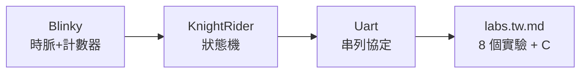
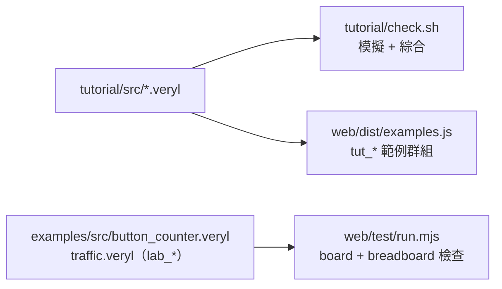

# 6.9 教學課程設計（`tutorial/`）

> 原始碼：`tutorial/`（Veryl 專案：`src/blinky.veryl`、`knight.veryl`、
> `uart.veryl`、`README.tw.md`、`labs.tw.md`）與 web 的
> `src/ide/bbmodel.ts`。課程怎麼用見 README.tw.md；
> 這裡談**課程為什麼長這樣**。

## 6.9.1 課程結構



三個正式課程 + 一本實驗手冊，全部是**可以上真板子的設計**：

| 課程 | 檔案 | 新概念 |
|---|---|---|
| 第 1 課 Blinky | `src/blinky.veryl`（58 行） | 時脈、`always_ff`、計數器高位元 |
| 第 2 課 KnightRider | `src/knight.veryl`（107 行） | 狀態機、位移方向 |
| 第 3 課 Uart | `src/uart.veryl`（201 行） | 串列協定、取樣、多模組實例 |
| 實驗手冊 | `labs.tw.md` | 8 個實驗（按鍵防彈、交通燈…）+ C 實驗 |

## 6.9.2 漸進設計原則：每課恰好一個新概念

### Blinky：把「時間」變成「位元」

```veryl
module Blinky #(
    param WIDTH: u32 = 24, // 2^24 / 12 MHz ≈ 1.4 秒一輪
) (
    i_clk : input  clock   ,
    i_rst : input  reset   ,
    o_ledr: output logic   ,
    o_ledg: output logic   ,
    o_led : output logic<5>,
) {
    var cnt: logic<WIDTH>;
    always_ff {
        if_reset { cnt = 0; } else { cnt = cnt + 1; }
    }
    assign o_ledr = !cnt[WIDTH - 1];
    assign o_ledg = cnt[WIDTH - 1];
    assign o_led  = cnt[WIDTH - 1:WIDTH - 5];
}
```

教了三件事但只有一個「啊哈」：**時脈頻率與人眼速度的
鴻溝用計數器跨越**——$2^{24}/12\,\text{MHz} \approx 1.4\,\text{s}$。
同時偷偷教了二進位（`o_led` 是計數器的 5 個高位元，
板上 LED 以二進位往上數）。測試台把 WIDTH 縮成 6：

```veryl
#[test(test_blinky)]
module TestBlinky {
    inst clk: $tb::clock_gen;
    inst rst: $tb::reset_gen(clk);
    ...
    initial {
        rst.assert();
        $assert(led == 5'd0 && ledr == 1'b1 && ledg == 1'b0, "after reset: count 0, green on");
        clk.next(37); // cnt = 37 = 6'b100101
        $assert(led == 5'b10010, "the top 5 bits of 37");
```

**參數化讓模擬與硬體共用同一份程式碼**：模擬幾十拍，
真板子照樣 24 位元。這個技巧在整個專案反覆出現。

### KnightRider：狀態機、除頻與同步器

第二課的開頭註解自己宣佈了新觀念清單：

```veryl
// 第 2 課：跑馬燈（Knight Rider）
// 一顆亮點在 5 顆 LED 間來回跑；按住 BTN1 暫停。
// 新觀念：除頻產生 tick、按鈕同步器、多個 always_ff、if 巢狀判斷。
module KnightRider #(
    param TICK : u32 = 1_500_000, // 12 MHz / 1.5M = 每秒 8 步
    param DIV_W: u32 = 21       , // 除頻計數器的寬度（要能放下 TICK - 1）
) (...)
```

三個 `always_ff` 各司其職，刻意不併成一個大區塊：

```veryl
// 除頻：每 TICK 個時脈送出一拍 tick
always_ff { ... else if div == TICK - 1 { div = 0; tick = 1; } ... }

// 按鈕經過兩個正反器再使用，避免亞穩態
always_ff { ... btn_s = {btn_s[0], i_btn}; }

// 每個 tick 移動一格，碰到兩端就回頭；按住按鈕時不動
always_ff { ... } else if tick && !btn_s[1] { if left { ... pos = pos << 1; } ... }
```

教學上這是三個躍升：

1. **除頻（tick）**：從 Blinky 的「看高位元」升級為
   「每 $T$ 拍產生一拍事件」——$\text{tick 頻率} = \frac{12\,\text{MHz}}{TICK}$；
2. **兩級同步器**：按鈕與時脈不同步，第一級 FF 可能進亞穩態
   （metastability），第二級讓它有整整一拍恢復。
   這是硬體工程最經典的一課，放在第二課是刻意的——
   越早見過越好，而跑馬燈恰好只需要它的最簡形式；
3. **one-hot 狀態與方向位元**：`pos` 是 one-hot 編碼、
   `left` 是方向——學生第一次「設計」狀態編碼。

### Uart：協定與層次

201 行，三個模組（傳送、接收、echo top）。首次出現：
跨模組實例化、位元計時（`CLKS_PER_BIT = 104`）、
啟始/停止位元、**中點取樣**：

```veryl
// 起始位元：線路從 1 變 0，等半個位元時間到它的中間
...
// 停止位元的中間：必須是 1，這個字元才算數
```

課程註解還點出環境背景：「iCEBreaker 的 USB 晶片
同時是一個序列埠（FPGA 的 TX = 腳 9、RX = 腳 6）」——
學生學的不只是協定，還有**這塊板子上它長在哪裡**。

第三課的測試台是全課程最精采的一段：
**testbench 自己當電腦**——解碼 `o_tx`、從 `i_rx`
送字元（每位元 8 個時脈，縮短模擬時間）。學生在
這裡第一次看到「測試台也是硬體設計」：它有同步器、
有位元計數器，與被測物對稱。而虛擬板的 UART 週邊
（6.7 節）就是同一個「電腦端」的模型——課程用真 UART，
模擬器用模型，兩邊能對上。

## 6.9.3 實驗的漸進設計（labs.tw.md）

八個實驗的概念曲線（AGENTS 的總結）：

$$
\text{時脈} \to \text{計數器} \to \text{狀態機} \to \text{按鍵防彈} \to \text{交通燈}
$$

每個實驗只引入一個新概念，且**前一個實驗的產物
是下一個的原料**：

1. 按鍵點 LED（IO 方向、pcf）
2. 計數器亮度（呼吸 LED）
3. KnightRider 複習
4. 按鍵防彈（同步器 + 計數消抖——第一次遇見
   「真實世界訊號很髒」）
5. 按鍵計數器（`button_counter.veryl`，lab 範例之一）
6. 交通燈（`traffic.veryl`：狀態機 + 計時器 + 按鍵全用上）
7. UART / 蜂鳴器
8. 自由創作

`button_counter.veryl` 與 `traffic.veryl` 不只出現在
文件裡——它們是 `examples/` 的正式設計（`lab_*` 群組），
`web/test/run.mjs` 會在虛擬板上跑它們的 board/breadboard
檢查。**文件與程式碼共用同一份真相**：教程文字裡的
程式碼必須與 `src/` 一致（AGENTS 明文規定）。

## 6.9.4 lab 範例與 web 整合

`labs.tw.md` 的每課連結形如
`index.html#ex=<id>&board=1`——點開就是 IDE 載入該範例、
虛擬板模式開啟。分享另有一條路：

> labs are shared as `index.html#lab=<gzip+base64url JSON>`
> or `.lab.json`.

學生交作業（程式 + 接線 + 週邊設定）壓成一個 URL
或一個檔案，老師點開即重現。整條鏈不需要伺服器。

## 6.9.5 麵包板模式：bbmodel.ts 的弱/強 net

實驗後段的「接真電路」在虛擬板上用麵包板模式實現
（`web/src/ide/bbmodel.ts`，104 行，無 DOM、Node 可測）。

### 模型

```mermaid
flowchart TB
    subgraph 強連接（union-find 合併成 net）
    STRIP["麵包板條<br/>（h:col:row → s:col:top/bot）"]
    RAIL["電源軌 rail:vcc/gnd"]
    WIRE["跳線 wire"]
    BTN["閉合的按鈕/開關"]
    end
    STRIP --> NET[net]
    RAIL --> NET
    WIRE --> NET
    BTN --> NET
    NET --> LVL["位準：3V3=1 / GND=0 / FPGA 腳=duty"]
    RES["電阻 = 弱傳遞"] -.->|"net 無強驅動時"| LVL
```

節點就是電氣點：麵包板的孔按**條**合併
（`node()`：a-e 列 → `s:col:top`、f-j → `s:col:bot`）、
電源軌按整條合併。強連接（條、軌、跳線、閉合的
按鈕/開關）用 union-find 合併：

```ts
const closed = p.kind === 'wire' || (p.kind === 'sw' && p.on) || (p.kind === 'btn' && pressed.has(p.id));
if (closed) uf.union(node(p.a), node(p.b));
```

### 強驅動、弱傳遞

每個 net 的位準來自**強驅動者**：3V3（1）、GND（0）、
或 FPGA 輸出腳（其 duty）。兩個強驅動相撞 = 短路警告
（除非值相同）。電阻是**弱**傳遞：net 沒有強驅動時，
經由電阻從有電位的鄰居借位準（固定點迭代，最多 50 輪）：

```ts
for (const p of parts.filter(q => q.kind === 'res')) {
    const [x, y] = [uf.find(node(p.a)), uf.find(node(p.b))];
    for (const [from, to] of [[x, y], [y, x]]) {
        if (!strong.has(to) && level.get(to) == null && level.get(from) != null) { level.set(to, level.get(from)!); changed = true; }
    }
}
```

這正是 pull-up / pull-down 的語義：按鈕斷開時
輸入腳經上拉電阻讀 1，閉合時被強驅動的 GND 蓋掉。

### LED 與浮接

```ts
led.set(p.id, a === null || c === null ? 0 : Math.max(0, a * (1 - c)));
```

亮度 = $\text{level}(a) \times (1 - \text{level}(b))$。
兩個警告是教學重點：**LED 沒串限流電阻**（會燒真硬體）、
**FPGA 輸入腳浮接**（加上下拉電阻）——這是麵包板
課程最常見的兩個錯誤，模擬器主動教會學生避開。

## 6.9.7 check.sh：課程自身的品質門

`tutorial/check.sh` 是獨立 Veryl 專案的整條流程檢查：
每個課程範例要過模擬（`#[test]` 測試台）、
綜合（veryl-eda 對 iCE40）、以及（有工具鏈時）佈局繞線。
教材在這個專案裡不是「文件」，是**受測試的構件**——
與 `labs.tw.md` 連結的 `lab_*` 範例同理，
`web/test/run.mjs` 會在虛擬板上跑它們。



「Keep the code shown in the tutorial text identical to
`src/`」這條規則靠的就是這條管線：教程文字貼的
程式碼與 `src/` 是同一份，任何一邊改了、
另一邊不同步，測試會指出來。

## 6.9.8 為什麼這樣設計

1. **參數化共享程式碼**：模擬的 WIDTH=6 與硬體的 24
   是同一份 Veryl——學生學會「測試台縮小參數」的通用技巧。
2. **每課一個概念**：認知負荷固定；實驗的階梯
   （時脈→計數器→狀態機→防彈→交通燈）讓每步的
   增量都小於「一次講不完」。
3. **文件即程式碼**：`check.sh` 跑整條流程、
   `web/test/run.mjs` 檢查 lab 範例——教程爛掉會被 CI 抓到。
4. **bbmodel 無 DOM**：104 行的純模型可被 Node 測試，
   麵包板的接線錯誤（短路、浮接、無限流電阻）
   有單元測試覆蓋。
5. **錯誤變成教學**：模擬器的警告文案直接解釋
   真實世界的後果（「真實電路中會燒掉 LED 或 FPGA 腳位」）。

## 6.9.7 本章重點

- 課程 = 3 個正式課（Blinky/KnightRider/Uart）+ 8 個實驗 + C，
  每課恰好一個新概念，前一課產出是下一課原料。
- Blinky 用參數化讓模擬（WIDTH=6）與硬體（24）共用程式碼。
- lab_* 範例在 `examples/` 且被 `web/test/run.mjs` 檢查；
  分享用 `#lab=`（gzip+base64url）或 `.lab.json`。
- bbmodel：條/軌/跳線/閉合按鈕 = 強（union-find 成 net），
  電阻 = 弱（固定點迭代）；強驅動衝突 = 短路警告；
  LED 亮度 = level(a)×(1−level(b))；浮接腳主動警告。
