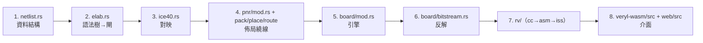

# 附錄 A.2 原始碼檔案索引

每一列：路徑、行數（`wc -l` 的實際值）、一句話職責。
依 crate 分組。核心模組（本書 6.x 章深談的）標 ★。

## veryl-sim/src（模擬器）

| 檔案 | 行數 | 職責 |
|---|---:|---|
| `main.rs` | 4 | bin：交給 cli |
| `cli.rs` | 52 | 命令列參數與入口 |
| `lib.rs` | 117 | 對外 API（parse/list/run） |
| `elab.rs` | 1172 | 語法樹 → 模擬 IR（階層、inst、modport） |
| `expr.rs` | 331 | 運算式 Pratt 解析器（token 之上） |
| `sim.rs` | 835 | 求值、delta 週期、NBA 排程、時脈、VCD |
| `value.rs` | 218 | 4 態位元向量（0/1/x）與 Bits |
| `gates.rs` | 273 | 從閘級網表建模組（`run_gates`） |
| `iface.rs` | 109 | interface / modport 的共用解析 |
| `gen.rs` | 24 | generate-for 的迴圈變數（const param） |

## veryl-eda/src（綜合核心）

| 檔案 | 行數 | 職責 |
|---|---:|---|
| `main.rs` | 3 | bin：交給 cli |
| `cli.rs` | 373 | 命令列（synth/fpga/asic/gatesim/cc/pdk） |
| `lib.rs` | 25 | crate 入口 |
| `elab.rs` ★ | 1742 | 符號執行式綜合：語法樹 → 閘（if/case→mux、FF） |
| `expr.rs` | 278 | 運算式求值（常數折疊用） |
| `netlist.rs` ★ | 666 | 網表資料結構與 `optimize`（折疊/去死碼/組合迴路） |
| `ice40.rs` ★ | 319 | iCE40 對映（SB_LUT4/SB_CARRY/SB_DFF*） |
| `ecp5.rs` | 203 | ECP5 對映（LUT4/CCU2C/TRELLIS_FF） |
| `bram.rs` ★ | 246 | 記憶體識別、SB_RAM40_4K、程式載入（byte lanes） |
| `output.rs` | 147 | yosys JSON 與結構化 Verilog 輸出 |
| `netsim.rs` | 256 | 2 態閘級模擬器（測試 oracle） |
| `gatesim.rs` | 66 | 閘級測試台的 provider（opt/ice40/asic/vlib） |
| `power.rs` | 69 | 功耗估計（FPGA） |
| `tests.rs` | 1251 | 整合測試（board、bitstream、rv、等價情境） |
| `value.rs` | 5 | 常數（重用 veryl-sim 的 Bits） |

## veryl-eda/src/asic（標準單元後端）

| 檔案 | 行數 | 職責 |
|---|---:|---|
| `mod.rs` | 280 | 流程編排（map→place→cts→route→sta） |
| `lib.rs` | 135 | vlib 標準單元定義 |
| `map.rs` | 298 | 樹覆蓋 DP 對映 + 高扇出 BUF 樹 |
| `place.rs` | 342 | 列退火佈局 |
| `cts.rs` | 143 | 時鐘樹合成 |
| `route.rs` | 212 | 全域繞線（Prim 順序 + A* + PathFinder） |
| `detail.rs` | 473 | 細部繞線（含 PDK 規則：禁區、via 所屬） |
| `sta.rs` | 266 | 靜態時序分析 |
| `pdn.rs` | 191 | 電源網（電軌、條帶、tap） |
| `power.rs` | 157 | 功耗估計（ASIC） |
| `layout.rs` | 188 | 版圖形狀建構 |
| `drc.rs` | 185 | 設計規則檢查 |
| `gds.rs` | 158 | GDSII 寫出 |

## veryl-eda/src/pnr（自家 iCE40 佈局繞線）

| 檔案 | 行數 | 職責 |
|---|---:|---|
| `mod.rs` | 409 | 流程入口（place_and_route_on、pcf、ram_map） |
| `chipdb.rs` ★ | 249 | IceStorm chipdb-5k.txt 的解析 |
| `pack.rs` | 339 | LUT/FF/carry/RAM 打包成 LC |
| `place.rs` | 313 | 模擬退火佈局 |
| `route.rs` | 174 | PathFinder 式繞線 |
| `sta.rs` | 375 | 時序分析與 icetime 對照 |
| `bitstream.rs` | 289 | .asc ↔ .bin（icepack 格式）、patch_ram |
| `power.rs` | 44 | 功耗估計（FPGA） |

## veryl-eda/src/pdk（製程技術檔）

| 檔案 | 行數 | 職責 |
|---|---:|---|
| `mod.rs` ★ | 487 | Tech 介面（行/站/軌、寬度、SKY130_HD 綁定表） |
| `liberty.rs` | 423 | Liberty (.lib) 解析（NLDM、約束、電容） |
| `lef.rs` | 254 | LEF 解析（單元寬度、pin/obstruction） |
| `def.rs` | 190 | DEF 寫出 |

## veryl-eda/src/board（虛擬開發板）★

| 檔案 | 行數 | 職責 |
|---|---:|---|
| `mod.rs` | 695 | Design（真值表+FF+RAM）/Engine（活動驅動）/Board（腳位+duty） |
| `bitstream.rs` | 271 | 位元流反解：parse_bin/parse_asc + decode(chip, cfg) |
| `periph.rs` | 170 | Uart / Seg / Vga / rle / text_frame |
| `icebreaker.rs` | 86 | iCEBreaker 腳位表、DEFAULT_PCF、board() |

## veryl-eda/src/rv（RISC-V 工具鏈）★

| 檔案 | 行數 | 職責 |
|---|---:|---|
| `mod.rs` | 8 | 模組宣告 |
| `cc.rs` | 1718 | C 子集編譯器（Pre→Parser→Gen） |
| `asm.rs` | 547 | RV32 組譯器與列表 |
| `iss.rs` | 364 | RV32IMA+Zicsr 指令集模擬器（cycle-exact） |
| `prelude.c` | 372 | C runtime（I/O、字串、va_*、MMIO） |
| `tests/*.c, .out` | — | 編譯器測試（期望值取自 gcc） |

## veryl-wasm/src（瀏覽器介面）

| 檔案 | 行數 | 職責 |
|---|---:|---|
| `lib.rs` | 75 | C ABI：alloc/call/result_len/dealloc/load_chipdb/panic_message |
| `api.rs` | 777 | JSON 指令分派（synth/pnr/asic/board_*/cc） |

## web/src（前端 TypeScript）

| 檔案 | 行數 | 職責 |
|---|---:|---|
| `api.ts` | 100 | 無 DOM 的呼叫層（也打包成 api.cjs 給 Node） |
| `client.ts` | 69 | wasm 載入與 worker 協調 |
| `main.ts` | 338 | demo.html 的主流程 |
| `examples.ts` | 33 | 範例清單與預設 |
| `templates.ts` | 61 | 新檔案範本 |
| `i18n.ts` | 64 | tr(繁, 英) 與語言切換 |
| `i18n_hans.ts` | 141 | 簡體轉換表（詞彙 + 字元） |
| `wave.ts` | 185 | VCD 波形渲染 |
| `worker.ts` | 24 | 模擬 worker |
| `zip.ts` | 66 | 專案下載/匯入（zip） |
| `ide/main.ts` | 1230 | IDE 主程式（專案/測試/流程/手機佈局） |
| `ide/editor.ts` | 183 | textarea 疊 highlighted pre |
| `ide/highlight.ts` | 133 | Veryl tokenizer 上色 |
| `ide/board.ts` | 644 | 虛擬板畫面與 worker（getBoardCore） |
| `ide/bbmodel.ts` | 104 | 麵包板電氣模型（強/弱 net，無 DOM） |
| `ide/breadboard.ts` | 234 | 麵包板 SVG 編輯器 |
| `synth/overlay.ts` | 1027 | 綜合/佈局/時序視覺化（兩頁共用） |
| `synth/model.ts` | 118 | 綜合結果的頁面資料模型 |
| `synth/asic.ts` | 186 | ASIC 版圖/繞線的呈現 |
| `synth/device.ts` | 112 | FPGA 裝置圖（tile/LC） |
| `synth/layouts.ts` | 160 | 覆蓋層版面 |
| `synth/compare.ts` | 75 | 模擬 vs 閘級比對的顯示 |
| `view/canvas.ts` | — | 畫布基礎（縮放/拖曳） |

## 腳本與其他（非 .rs/.ts）

| 路徑 | 職責 |
|---|---|
| `build.sh` | 全案建置：veryl-sim、veryl-eda、web/dist（wasm+TS） |
| `test.sh` | 整合測試（--full 加 yosys 形式驗證） |
| `publish.sh` | crates.io 發佈（dry-run / --yes） |
| `examples/sw/build.sh` | RISC-V 程式：gcc + spike 期望 → ROM veryl |
| `examples/` | 獨立 Veryl 專案（rv32i、rvsoc、soc、features…） |
| `tutorial/` | 課程專案（Blinky、KnightRider、Uart、labs） |
| `web/test/run.mjs` | Node 端 npm test（每個範例走 dist/ 的 wasm） |
| `tools/` | sky130_subset.py、gds_check.py、font5x7.py、tocn.py |
| `fpga/flow.sh`、`fpga/pnr_test.sh`、`fpga/cosim.py` | FPGA 流程、own P&R 檢查、路由正確性 oracle |

| 總計 | | |

總計約 25,000 行（Rust + TS），其中 6.x 章深談的
模組（elab/netlist/ice40/bram/board/rv/pnr/chipdb/lib.rs+api.rs）
約佔一半。

## 閱讀路徑（依本書章節）

想按圖索驥讀原始碼，建議順序：



- 先讀 `netlist.rs` 的型別（`Cell`/`Port`/`Bit`）——
  幾乎所有模組都以它為共同語言；
- `elab.rs` 很長，從 `synthesize_stages` 進去，
  只追一個小例子（例如 blinky 的計數器）；
- `board/mod.rs` 的 `Engine::propagate` 是活動驅動的
  全部祕密（一個函數）；
- `rv/cc.rs` 從 `compile()` 讀起（1600 行附近），
  它是最上層的編排。

## 依賴方向（模組間）

```
rv/iss ←─ board/mod.rs（Cpu）      rv/cc ─→ rv/asm
board/mod.rs ─→ board/{bitstream, periph, icebreaker}
board/bitstream.rs ─→ pnr/chipdb.rs、pnr/bitstream.rs（bin_to_asc）
veryl-wasm/api.rs ─→ { netlist, pnr::chipdb, board, bram, rv, pdk }
web/src/api.ts ─→（wasm）veryl-wasm/src/lib.rs
```

規則（AGENTS 明文）：核心演算法不反向依賴介面層——
`board/` 不知道 wasm 的存在，`wasm/api.rs` 只做
JSON 進出與 thread-local 會話。

## 測試入口（從檔案出發）

| 想驗證 | 跑什麼 | 主要消費的檔案 |
|---|---|---|
| 模擬器 | `cd veryl-sim && ./test.sh` | sim.rs、elab.rs |
| 綜合 + 情境 | `cd veryl-eda && cargo test --release` | elab、netlist、netsim |
| 虛擬板 | `cargo test board -- --nocapture`（看速度） | board/* |
| 位元流 | `cargo test bitstream`（需 chipdb） | board/bitstream、pnr/bitstream |
| C 編譯器 | `cargo test cc` | rv/cc、rv/asm |
| ISS 對 spike | `cargo test iss_rv32ima` | rv/iss（需 examples/sw 的 ROM） |
| 閘級 RTL 對 ISS | `cargo test threads_on_rvsoc` | rv/iss + 全條綜合鏈 |
| yosys 等價 | `./test.sh --full` | ice40、ecp5、output |
| own P&R 正確性 | `./fpga/pnr_test.sh` | pnr/*、fpga/cosim.py |
| DRC/GDS | `GDS_PY=… ./test.sh` | asic/{layout,drc,gds}、tools/gds_check.py |
| 前端 | `cd web && npm test` | dist/ 的 wasm + api.cjs |

## 行數的意義

幾個刻意的不對稱：

- `elab.rs`（1742）與 `cc.rs`（1718）是兩個最大的檔案——
  它們都是「把一種語言變成另一種語言」的翻譯器，
  邏輯密度高、難以再拆（拆了反而要在檔案間跳）；
- `netlist.rs`（666）是全案被依賴最多的模組——
  型別設計穩定，上面的演算法層才能各自演化；
- `pnr/`（合計 ~2,200）比 `asic/`（~2,800）小，因為
  iCE40 的架構由 chipdb 描述（資料驅動），
  vlib/SKY130 的規則則要寫成程式；
- `board/`（1,222）用 695 行的 `mod.rs` 餵活了整個
  網頁虛擬實驗室——單一抽象（Design）的複利。

## 各模組的入口函數（從哪個函數讀起）

| 檔案 | 入口 | 說明 |
|---|---|---|
| `veryl-sim/src/lib.rs` | `list` / `run_gates` | 頁面的 `list`/`simulate` 也走這裡 |
| `veryl-eda/src/elab.rs` | `synthesize_stages` | 綜合的總入口（回 Stages） |
| `veryl-eda/src/netlist.rs` | `optimize` | 折疊、別名解析、死碼、迴路偵測 |
| `veryl-eda/src/ice40.rs` | `map` | RTL 網表 → iCE40 cells |
| `veryl-eda/src/ecp5.rs` | `map` | 同上（LUT4/CCU2C/TRELLIS_FF） |
| `veryl-eda/src/pnr/mod.rs` | `place_and_route_on` | pack→place→route→sta→asc |
| `veryl-eda/src/pnr/bitstream.rs` | `asc_to_bin` / `bin_to_asc` | 位元流編解碼 |
| `veryl-eda/src/asic/mod.rs` | `flow` | 標準單元整條後端 |
| `veryl-eda/src/pdk/mod.rs` | `tech()` / `with_tech` | thread-local 技術檔 |
| `veryl-eda/src/board/mod.rs` | `Design::from_netlist`、`Engine::new`、`Board::new` | 引擎三段式入口 |
| `veryl-eda/src/board/bitstream.rs` | `Config::parse_bin`、`decode` | 反解兩段式 |
| `veryl-eda/src/rv/cc.rs` | `compile` | C → 機器碼 |
| `veryl-eda/src/rv/iss.rs` | `Iss::step_until` | 逐指令（含 wfi 休眠） |
| `veryl-wasm/src/lib.rs` | `call` | 唯一的請求入口 |
| `veryl-wasm/src/api.rs` | `dispatch` | JSON 指令分派 |
| `web/src/api.ts` | `call`（同名概念） | 瀏覽器/Node 的呼叫層 |
| `web/src/ide/main.ts` | 模組載入即掛事件 | IDE 不用類別，直接初始化 |
| `web/src/synth/overlay.ts` | 建構子 + `run` | demo 與 IDE 共用的覆蓋層 |

## 修改時的常見連動

改一個模組時要跟著動的測試與構件（AGENTS 規則的索引）：

| 改了 | 連動 |
|---|---|
| `ice40.rs` 的 cell 語義 | `board/mod.rs`（`Design::from_netlist`）、`netsim.rs`、`veryl-sim/src/gates.rs` 三處要同步 |
| `pnr/bitstream.rs` 的位元排列 | `board/bitstream.rs` 的 `LUT_PERM` 對稱；`cargo test bitstream` |
| `rv/cc.rs` 的 epilogue/prologue | `rv/tests/*.out` 的期望輸出、`iss.rs` 的行為不變性 |
| `rvsoc.veryl` 的週期數 | `rv/iss.rs` 的 `cyc` 常數（2/3/35/3） |
| `examples/sw` 的組譯 | `examples/src/*_rom.veryl` 重新生成；`$assert` 格式不許變 |
| `web/src` 的 TS | `npm run build` 重建 dist；`npm test` |
| 任何 Rust | `./build.sh`（含 dist 的 wasm）後才提交 |

最後提醒：**只有 `_doc/book/` 下的檔案是本書的**；
本索引的行數會隨程式演進漂移，重新發佈前用
`wc -l` 重取一次即可（表上的數字取於本書撰寫時）。
