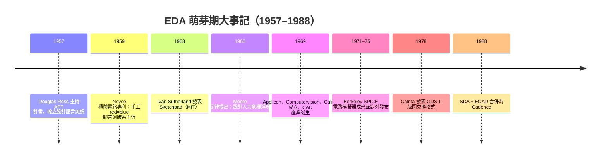

# 1.1 從畫圖紙到畫電路：自動化的萌芽

1962 年冬天，麻薩諸塞州劍橋的 MIT Lincoln Laboratory 裡，一位年輕的博士生正對著一台價值數十萬美元的 TX-0 電腦發呆。他的名字是 Ivan Sutherland。當時積體電路剛被發明三年多，整個半導體產業的版圖設計工作，仍然由一群拿著紅藍膠帶與手術刀的繪圖員在巨大的聚酯薄膜圖紙（Mylar）上完成：紅色膠帶代表金屬層，藍色代表擴散層，黑色代表接觸孔。一顆只有幾千個電晶體的晶片，版圖可能鋪滿一整面牆，任何一條膠帶貼歪一公釐，幾個月的辛苦就付諸流水。Sutherland 不會想到，他在 1963 年做出的 Sketchpad——那個用光筆在螢幕上畫圖、可以「抓住」線段讓它自動對齊的系統——會成為此後六十年電子設計自動化（EDA）的精神原型：把人的意圖交給機器去執行與檢查。

## 手工時代的物理極限

要理解 EDA 為何出現，必須先理解手工設計為何崩潰。1958 年德州儀器的 Jack Kilby 與 1959 年快捷半導體（Fairchild）的 Robert Noyce 各自示範了積體電路，但直到 1960 年代中期，IC 的生產瓶頸並不在製造，而在設計。一個邏輯工程師想清楚電路行為之後，得把每顆電晶體的幾何形狀畫在圖紙上，放大數百倍交給繪圖員製作刻版紅膜（rubylith），再用攝影縮小製成光罩。這條流程的人力成本與晶片複雜度成正比，而 Gordon Moore 在 1965 年寫下那篇著名的短文，預測「單晶片元件數每年翻倍」——後來修訂為每兩年翻倍。換句話說，設計人力需求也應以同樣的指數速度增長，這在任何經濟體系裡都不可持續。

數學家會說這是「複雜度的除法不成立」：元件數 $N$ 翻倍，手工工時也翻倍，但公司不會雇兩倍的繪圖員。業界於是只能做兩件事：把設計單元標準化（例如 TI 的 Stanley Mazor 與 Robert Boyce 等人推廣的標準電路單元概念，以及後來 Mead–Conway 在 1980 年代標準化的可延伸設計規則），或者讓電腦接手。歷史選了第二條路，而讓這條路走得通的，是美國政府。

## 國家的手：國防、太空與早期計算機繪圖

1960 年代的電子設計自動化幾乎沒有商業市場——民間公司買不起百萬美元級的圖形電腦。真正付錢的是美國國防部與 NASA。阿波羅登月計畫需要的導航電腦、義勇兵飛彈的積體電路訂單，讓 IC 在 1960 年代初期幾乎全部銷往軍工體系；這些計畫同時催生了大量自動化需求：電路模擬、邏輯驗證、測試圖形產生。Bell Labs 的 L-系列語言（1960 年代中期的 L4、L6）讓工程師用文字描述邏輯電路再由程式編譯成文件與測試資料；IBM 內部發展出一整套 IPL（Intermediate Programming Language，1950 年代末期由 Joan Lukens 等人主導）與其後的 Logic Automation 體系，處理從邏輯圖到模板打孔（automated tapeout 之前身）的流程。這些都是純文字驅動、無圖形介面的系統，卻已經確立了 EDA 最重要的思想：**設計是一種可以被編譯的語言**。

同一時期，MIT 的另一條線索同樣關鍵。Douglas Ross 在 1950 年代末主持 APT（Automatically Programmed Tool）計畫，為數值控制工具機設計出人類史上第一批「設計語言→幾何動作」的編譯器。APT 的哲學——工程師描述「要什麼」，編譯器算出「怎麼做」——直接影響了後來硬體描述語言的設計思路。Ross 後來在 MIT 參與 CAD 計畫，並在 1960 年代提出「結構化的設計描述」思想，成為此後所有設計資料庫的理論基礎。

## Sketchpad：互動式設計的誕生

1963 年，Sutherland 在 Claude Shannon 與 Marvin Minsky 等人的指導下完成博士論文《Sketchpad: A Man-Machine Graphical Communication System》。跑在 TX-2 電腦上的 Sketchpad 提供了幾個直到今天仍是 CAD 核心的概念：約束條件（constraint）讓幾何元素自動滿足設計規則；主圖與實例（master/instance）實現了層次化設計；圖形資料第一次成為電腦裡一等公民的資料結構。Sutherland 因這項工作獲得 1988 年圖靈獎。

Sketchpad 本身並非 EDA 工具，但它是「電腦輔助設計」一詞第一次有了具體的血肉。此後十年，圖形化版圖編輯成為各家公司競逐的方向：Applicon（1969 年由 Schlumberger 支持成立，取材自 MIT CAD 計畫）、Computervision（1969 年成立）、Calma（1969 年成立，其 Graphic Data System 在 1970 年代成為 IC 版圖繪製的事實標準）。這三家波士頓與矽谷的小公司，構成了日後所謂「CAD 產業」的第一代。

## GDS-II：版圖有了通用格式

有了圖形編輯器，還需要交換格式。1978 年，Calma 發表 GDS-II（Graphic Data System II），一種以階層式 cell、圖層、多邊形描述晶片幾何的二進位格式。它原本只是 Calma 自家系統的資料檔，卻因為各家光罩製造商與設計公司都用 Calma 機器而意外成為業界標準。此後近四十年，直到 2010 年代 OASIS 逐漸取代，GDS-II 一直是晶片交給晶圓廠的最終語言。一段有趣的歷史是：1990 年代 Calma 被 General Electric 賣給 VLSI Technology，GDS-II 格式隨之進入公有領域（Cadence 曾短暫主張其著作權並在 2003 年開放），但它的資料模型——階層、圖層、多邊形——至今未變。可以說，今天每一顆晶片的「最後一哩」，仍然用 1978 年的思想在表達。

## 邏輯層的自動化：從 Simulation 到 Placement

版圖繪製只是「畫圖」的自動化，真正的演算法革命發生在看不到的地方。1960 年代後期，IBM 的 Kirkpatrick 與 Clark 等人開始研究把邏輯單元自動排到晶片上的 placement 問題；Bell Labs 發展了針對自家產品的版圖系統。1975 年，IBM 的 Larry Nagel 發表了 SPICE 的前身與同期論文，而 SPICE 本身由 Donald Pederson 主持的 UC Berkeley 電子研究實驗室在 1971–1973 年間成形（Ronald Rohrer 的 CANCER 為其直系祖先），於 1975 年對外發布。SPICE 象徵一件大事：政府資助的大學（透過 DARPA 與 NSF）開始生產業界通用的 EDA 工具，這條「Berkeley 模式」日後將複製到 PLA 最小化、佈局佈線與 FPGA 領域。

商業 EDA 公司也在 1970 年代末登場：1982 年成立的 Daisy、Mentor（1981 年成立）、Valid，加上從 Calma、Applicon 轉型而來的勢力，以及 1988 年由 SDA Systems 與 ECAD 合併而成的 Cadence、1991 年從之而來的 Synopsys 前身（1986 年成立的 Optimal Solutions，Aart de Geus 主導的邏輯合成技術）。但這些公司制度層面的故事，要等到工具背後的演算法問題被「定性」之後才真正展開——工程師必須先知道：這些問題到底是簡單的工程，還是本質上無法完美解開的數學難題？

## 小結

1950 至 1980 年代的三十年裡，晶片設計從牆上的紅藍膠帶，變成了電腦裡的幾何資料結構；推動這場轉變的不是單一發明，而是三股力量的交會：Moore 定律造成的設計人力危機、美國國防與太空計畫提供的資金與需求、以及 MIT 與 Berkeley 等校園孕育的互動圖形與模擬技術。Sketchpad 給了這個產業互動設計的範式，APT 給了它「設計即編譯」的哲學，GDS-II 給了它通用的交換格式。

然而工具有了，一個更深的問題才剛浮上水面：當工程師要求電腦「自動排好這一萬個電路單元、自動繞通這兩萬條線」時，電腦面對的其實是一類計算上極度困難的問題。1971 年，一位多倫多來的年輕學者在 ACM SIGACT 座談會上宣讀的論文，將永遠改變 EDA 演算法工程師看待自己工作的方式。下一節，我們就來談 NP-Completeness，以及它為什麼讓晶片問題「永遠解不完」。
