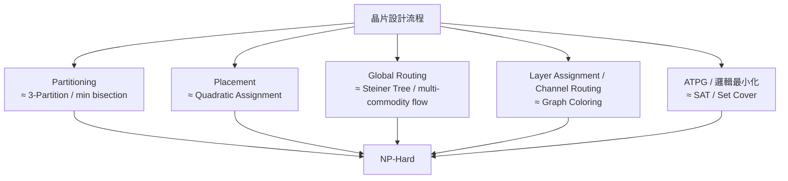

# 1.2 NP-Hard 無所不在：為什麼晶片問題永遠解不完

1971 年 5 月 4 日，俄亥俄州哥倫布市，第三屆 ACM Symposium on Theory of Computing 的會場上，一位來自多倫多大學、個性內斂的年輕助理教授 Stephen Cook 宣讀了一篇題為《The Complexity of Theorem-Proving Procedures》的論文。這篇只有五頁的短文做了一件驚人的事：它證明「布爾可滿足性問題（SAT）」具有一種奇特的性質——任何可以在多項式時間內被驗證的問題，都可以轉化成 SAT。換句話說，如果你能有效率地解 SAT，你就能有效率地解成千上萬種看似無關的難題。次年，Cook 在伯克利指導的博士生 Richard Karp 在同一個會議上發表《Reducibility Among Combinatorial Problems》，一口氣列出 21 個可以從 SAT（或彼此）多項式歸約的組合問題。這 21 個問題裡，有一大半——分割（partition）、圖著色（graph coloring）、集合覆蓋（set cover）、旅行商問題——正是晶片設計每天要面對的核心難題。EDA 演算法的整個歷史，從此籠罩在這兩篇論文的陰影與啟示之下。

## Cook–Levin 定理說了什麼

Cook 的論文（通常稱 Cook–Levin 定理，因為蘇聯的 Leonid Levin 在 1970 年前後獨立得到了等價結果，但受鐵幕隔絕直到 1973 年才發表）的核心概念是「多項式時間歸約」：若問題 A 可以在多項式時間內轉化為問題 B，則 B 的有效演算法立即給出 A 的有效演算法。Cook 證明 SAT 對這個歸約是「完備」的： $`P \subseteq NP`$ 中的每一個問題都能歸約到 SAT。而 $`NP`$ 中最難的問題構成 $`NP`$ -Complete；任何一個 NP 問題若被證明「不比 SAT 容易」，就是 $`NP`$ -Hard。

Karp 的 21 問題將這個抽象框架變成了工程師的工具箱。他把 Satifiability、0-1 Integer Programming、Clique、Set Packing、Vertex Cover、Set Covering、Feedback Arc Set、Hamiltonian Circuit、3-Partition、Chromatic Number（圖著色）、Clique Cover、Exact Cover、Steiner Tree、三維匹配等問題排成一張歸約圖，一個接一個證明它們同屬 NP-Complete。這張表的深遠意義在於：它展示了一個問題族群——而這個族群的成員幾乎涵蓋所有實際工程中的組合優化。

## 晶片設計的每一站都是 Karp 名單上的問題

讓我們逐站檢視晶片實體設計流程，幾乎每一步都撞上 NP-Hard 牆。

第一站是分割（partitioning）。把一百萬個電路單元分到兩個晶片區塊，要求跨區連線最少、兩區面積平衡。這本質上是帶平衡約束的圖分割，等價於 Karp 名單上的 minimum bisection / 3-Partition 問題。最經典的啟發式——Kernighan–Lin 演算法（1970）與 Fiduccia–Mattheyses 演算法（1982）——之存在，正是因為這個問題精確解需要指數時間。

第二站是布線（routing）。在通道中為數萬條線網找互不相交、長度最短的路徑，等價於 Steiner Tree 與多重商品流（multi-commodity flow）的組合——前者在 Karp 的 21 問題名單上（Karp 證明 Steiner Tree 是 NP-Complete 是透過 Exact Cover 歸約），後者則是另一個著名的 NP-Hard 問題。單一條線網的最短路徑可以用 Dijkstra 1959 年的演算法在多項式時間解決，但當數萬條線網彼此爭奪通道資源時，問題就墜入 NP-Hard 深淵。這正是EDA 一個微妙之處：問題的「單體版本」常是簡單的，但「多體競爭版本」立刻變成難題。

第三站是測試（test generation）。判斷一個電路是否存在能偵測某故障的測試輸入，本質上是 SAT 問題（可用 SAT solver 解），因此是 NP-Complete。連最小化 PLA、最小化邏輯函數中的項數，也等價於 Set Cover。

## 精確解為何不可行：指數爆炸遇上 Moore 定律

NP-Complete 的正式定義並不排除存在超線性但仍可解的演算法；真正的問題是指數成長。考慮一個平凡解法： $`n`$ 個電路單元的二分割共有 $`2^n`$ 種，n = 40 時已達萬億量級；n = 100 時遠超宇宙原子總數。換個角度，如果演算法是 $`O(2^{n/10})`$ ，把 n 從 100 提升到 200，只需多花 1024 倍計算時間——看似可克服。但 Cook–Karp 歸約保證的壞消息是：除非 P = NP（這是千禧年七百萬美元獎金問題，且學界幾乎一致認為答案是「不等」），否則不存在多項式時間的精確演算法。

更殘酷的是 Moore 定律與硬體成長之間的賽跑。1971 年 Intel 4004 有 2,300 個電晶體，1993 年 Pentium 有 310 萬個，2020 年代先進晶片突破數百億。指數成長的問題規模，吃掉了硬體指數成長帶來的所有紅利。這正是 EDA 產業與其他軟體產業最大的不同：一般軟體工程師遇到規模成長可以「升級機器」，EDA 工程師的問題規模成長得比機器快，因此必須「換演算法」——或者更誠實地說，必須「放棄完美」。

## 從絕望到務實：複雜度理論如何重塑 EDA

有趣的是，NP-Completeness 的發現並沒有讓 EDA 停擺，反而促成了一種新的工程文化。1970 年代以前，學術界習慣追求「最佳演算法」；Cook 與 Karp 之後，研究者開始心安理得地問：「我的啟發式在最壞情況下表現如何？平均情況下呢？」EDA 文獻從此充滿了「近似比」與「經驗結果」兩種並存的評價標準。

幾個具體的里程碑值得記住：1983 年 Kirkpatrick、Gelatt 與 Vecchi 發表模擬退火（simulated annealing），靈感來自統計物理，證明隨機化可以系統性地逃離局部最佳；1980 年代 Routing 領域從 Lee 演算法（1961，BFS 為基礎）演進到 A* 搜尋與 Hightower line-search（1976）、Soukup 演算法，全是「在精確與速度之間取捨」的產物。而 Bell Labs 的 Frank Rubin 與其他研究者開始系統性討論「channel routing 的 density 下界」，把近似解的品質用數學下界來評估——這種「知道自己離最佳多遠」的意識，正是複雜度理論送給 EDA 的禮物。

還有一條常被忽略的線索：1970 年代末，Lagrangian relaxation 從運籌學界（Held 與 Karp 本人在 1970 年將其應用於 TSP 下界）流入 VLSI 領域，1990 年代被 Cheng、Cong 等人大量用於 timing-driven placement。這條線索把「精確但慢」的數學規劃技術，改造成「近似但快」的工程工具，成為 EDA 演算法史的一個重要篇章。

## 為什麼「永遠解不完」反而是好消息

如果晶片問題可以在多項式時間精確解開，那麼 EDA 就不會是一個有六十年生命的產業：所有工具都會被寫成一次性的腳本，然後商品化、免費化。正因為每個核心問題都是 NP-Hard，正因為每十奈米新製程都讓約束條件改變一次，正因為每個新世代的晶片都比上一世代大百倍，「找更好的啟發式」就永遠有價值。NP-Completeness 是 EDA 產業的存在理由。

但要談啟發式，必須先回答一個更基本的問題：工程師如何在數學上「知道」自己放棄了多少？下一節我們正式定義啟發式與近似演算法，看看貪婪、局部搜尋、分支定界與拉格朗日鬆弛這些思想，如何在完美與可行之間搭建橋樑。
