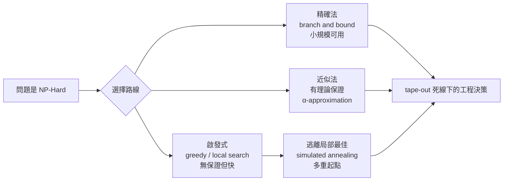

# 1.3 啟發式與近似演算法：在完美與可行之間妥協

1983 年 5 月，IBM Thomas J. Watson 研究中心的 Scott Kirkpatrick、C. Daniel Gelatt 與 Mario Vecchi 在《Science》上發表了一篇不尋常的論文：作者群裡沒有一位純粹的計算理論學家，論文引用的是統計物理而非計算複雜度。文章標題是《Optimization by Simulated Annealing》。這篇論文背後的故事，道盡了 EDA 演算法哲學的根本轉向：既然 Cook 與 Karp 已證明我們的問題本質上解不完，那就換一種問法——不再問「最佳解是什麼」，而問「夠好的解，多快能拿到」。這個思想轉變，配合 IBM、Bell Labs 當年面臨的 tape-out 死線，孕育出 EDA 產業獨特的「夠好就好」文化。

## 何謂啟發式：一個必須被精確定義的日常詞

在 EDA 語境裡，啟發式（heuristic）演算法指「不保證找到最佳解、也不保證多項式時間內找到可行解，但在實務上通常表現良好」的方法。它與「近似演算法」（approximation algorithm）有微妙但重要的區別：近似演算法有數學證明，保證解的品質不會比最佳解差某個倍數（例如 $\alpha$-approximation，解值至多為最佳值的 $\alpha$ 倍）；啟發式沒有這種保證，只有經驗證據。工程師必須清楚這條界線，因為它決定了演算法何時會失效。

理解啟發式最好的方式是三個具體例子。第一個是貪婪法（greedy）：每一步都做當下看起來最好的選擇。Kruskal 最小生成樹就是貪婪法，而且恰好是精確的；但把貪婪法用在 partitioning 上——每次把與已選區塊連線最多的單元抓過去——通常會落入糟糕的局部陷阱。貪婪法的價值在於速度（$O(n \log n)$ 量級），以及在作為更複雜演算法的「初始解產生器」時的表現。

第二個是局部搜尋（local search）：從一個可行解出發，反覆在「鄰域」中找更好的解，直到無法再改進。數學上，若解空間為 $S$，鄰域函數為 $N: S \to 2^S$，局部搜尋迭代 $x_{k+1} = \operatorname{argmin}_{y \in N(x_k)} f(y)$，直到 $f(x_{k+1}) \ge f(x_k)$。Kernighan–Lin 演算法（1970）是 EDA 局部搜尋的經典：從隨機二分割開始，反覆交換一對節點使 cut size 下降；Fiduccia–Mattheyses（1982）將其改為單節點移動、用 bucket list 達到每次 pass 線性時間。局部搜尋的致命傷是「局部最佳解」：在解空間裡，到處都是比周圍好但離全域最佳很遠的坑。

第三個是逃離局部最佳的三板斧：隨機擾動、接受變壞的移動、多重起點。模擬退火屬於第二類——用溫度 $T$ 控制接受變壞移動的機率 $e^{-\Delta f / T}$，隨迭代降溫，理論上在無限緩慢冷卻下收斂到全域最佳（Geman 與 Geman 1984 年的證明）。Kirkpatrick 等人論文裡的實驗對象之一正是 VLSI 佈局，他們把晶片佈局類比為原子冷卻結晶，這個物理隱喻在 1980 年代的 EDA 界激起了長達十年的應用熱潮。

## 分支定界與拉格朗日鬆弛：精確方法的務實化身

啟發式不是唯一的妥協路線。分支定界（branch and bound）在 1960 年代由 Land 與 Doig（1960）以及 Little 等人（1963，TSP 應用）系統化：用上下界把搜尋樹剪枝，理論上可精確解，實務上靠好的界來控制規模。EDA 裡的典型應用是工程變更順序與小規模 exact placement（例如單列 channel 的最佳化）。它的教訓是：精確演算法在問題規模小的時候完全可行，工程的藝術在於「切分問題，讓精確法只處理夠小的子問題」。

Lagrangian relaxation 走的是另一條路：把約束透過乘子放進目標函數。原問題 $\min f(x)$ subject to $g_i(x) \le 0$ 變成拉格朗日對偶

$$L(\lambda) = \min_x \left[ f(x) + \sum_i \lambda_i g_i(x) \right]$$

鬆弛後的問題通常容易得多，而 $L(\lambda)$ 給出原問題的下界。Held 與 Karp 在 1970 年用它為 TSP 建立了下界，證明「精確數學」與「務實工程」可以相容。1990 年代，這個技術被大量引進 timing-driven 與 power-driven placement：把 timing 約束鬆弛成目標函數的一部分，用次梯度法更新乘子，在數十次迭代內得到品質可接受的解。它與純啟發式的本質區別在於：拉格朗日法同時給出解與「這個解有多好」的證據（對偶間隙）。

## 為什麼 EDA 產業接受「夠好就好」

這個文化不是天生，而是被經濟與制度逼出來的。晶片設計有 tape-out 死線：晶圓廠的 shuttle（MPW）批次固定日期發車，錯過一班就是數月延遲與數百萬美元損失。在死線壓力下，再完美的演算法若跑三天還沒收斂，就是無用。同時，半導體公司的良率經濟學決定了設計品質的邊際效用：佈線長度再縮短 2%，可能對良率與功耗的影響微乎其微，但對 tape-out 時間的影響巨大。理性選擇是「80% 品質、20% 時間」。

另一個常被忽略的因素是良率的統計本質：晶片最終良率受製程變異主導，設計工具之間的 1% 差異往往淹沒在 die-to-die 變異之中。因此 EDA 演算法的品質評估，從來不是純粹的數學問題，而是與良率模型、生產排程、設計人力成本交織的商業問題。這也是為什麼 EDA 演算法文獻裡， benchmark（如 ISPD、ICCAD 競賽的測試集）與「與前人方法的相對比較」文化特別發達——在缺乏理論保證的世界裡，社群只能靠大量實驗建立信任。

## 從「解不好」到「問題都寫不對」

在結束本節之前，必須指出一個更深刻的轉向。1980 年代以前，EDA 演算法研究者的苦惱是「解不好」；1990 年代之後，一個新的認識逐漸形成：很多時候問題的難，不是因為解法笨，而是因為我們把問題「建模」得太粗糙——把電路想成簡單的圖，把線網想成兩點連線，忽略了超圖的結構、忽略了電氣特性、忽略了時序。演算法的進步，有一半來自建模的進步。

這個轉向把我們帶到本節的最後一個主題，也是整個 EDA 演算法史的數學基石：圖（graph）與超圖（hypergraph）。把幾百萬個電晶體變成頂點、把幾十萬條線網變成邊——這個看似顯然的動作，其實充滿了選擇與陷阱。下一節，我們就來仔細看這個「數學化」的過程。
