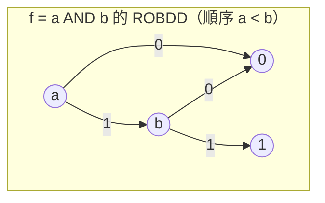
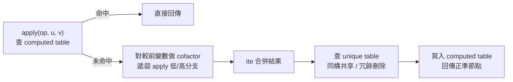

# 2.2 BDD 的革命：Bryant 1986 與 ROBDD 正準形式的運算

1986 年，IBM 的 Randell（Randy）Bryant 在 IEEE Transactions on Computers 上發表了《Graph-Based Algorithms for Boolean Function Manipulation》。這篇論文本身並沒有發明 BDD——二元決策圖的雏形早在 1959 年就出現在 C. Y. Lee 的貝爾實驗室報告裡，1978 年 Akers 也獨立提出過類似結構——但 Bryant 做的是把散落各處的觀念組合成一個自洽、高效、有複雜度保證的資料結構與演算法套件，並且證明了它的一個關鍵性質：正準性（canonicity）。這個性質讓「兩個布林函數是否等價」這個在真值表表示下是指數級的問題，變成兩張圖的指標比對。這一步，徹底改變了形式驗證的命運。

## 從決策樹到約化有序決策圖

BDD 的基本想法是：一個布林函數可以用一張二分決策圖表示。給定變數順序 $x_1 < x_2 < \dots < x_n$，圖中每個內部節點標記某個變數 $x_i$，有兩條出邊分別對應 $x_i = 0$（low/else）與 $x_i = 1$（high/then）；葉節點只有兩個，分別代表常數 0 與 1。求值時從根節點出發，沿著當前變數的值走邊，最後落在的葉子就是函數值。這就是決策樹，但它有 $2^n - 1$ 個節點，毫無實用價值。

Bryant 的貢獻在於兩條「約化」規則。第一條是合併同構子圖（isomorphic nodes are shared）：如果兩個節點的變數與兩條出邊都相同，它們就是同一個節點，只保留一份。第二條是刪除冗餘測試（redundant tests are eliminated）：若某節點的兩條出邊指向同一個節點，這個測試毫無意義，刪掉它、讓上游直接跳過。一張同時滿足「變數沿所有路徑按給定順序出現」與「兩條約化規則」的圖，就稱為約化有序二元決策圖（ROBDD）。Bryant 證明了核心定理：**在給定變數順序下，每個布林函數的 ROBDD 是唯一的**。這就是正準性。它的直接推論是：函數 $f$ 與 $g$ 等價 $\iff$ 它們的 ROBDD 完全相同（節點級別的指標相等）。等價性檢查從指數問題降為常數時間的指標比較——前提是你已經建出了這兩張圖。

ROBDD 的簡潔性也常常令人吃驚。對稱函數（如 $n$ 位多數函數）、加法器的某些部分，其 ROBDD 只有線性大小，遠小於 $2^n$ 的真值表。當然，壞消息同樣存在：乘法器（integer multiplier）的中間位輸出函數，其 BDD 在任何變數順序下都是指數級的——這是 Bryant 論文裡就給出的否定結果，也註定了 BDD 在算術電路驗證上的侷限。

## Bryant 的演算法框架：Shannon 展開與 ite

BDD 不只是一個表示，Bryant 論文的另一半是「在這個表示上高效計算」的演算法。一切操作的基礎是 Shannon 展開：

$$f = \bar{x} \cdot f|_{x=0} + x \cdot f|_{x=1}$$

也就是說，任何函數都可以由它對某個變數的兩個餘因子（cofactor）組合回來。Bryant 把這個組合抽象成一個三元運算元 if-then-else：

$$ite(f, g, h) = (f \wedge g) \vee (\bar{f} \wedge h)$$

妙處在於所有常見的布林運算都是 ite 的特例：$\text{AND}(f,g) = ite(f, g, 0)$，$\text{OR}(f,g) = ite(f, 1, g)$，$\text{XOR}$、$\text{NOT}$ 皆然。於是整個運算系統只需要一個演算法：`apply(op, B_1, B_2)`。

apply 的做法是典型的動態規劃。對兩個節點 $(u, v)$，比較它們的變數順序，對順序靠前者做 cofactor 遞迴；用一個雜湊表記錄已經算過的節點對，避免重複遞迴（memoization）；用另一個雜湊表（unique table）保證新建的節點符合約化規則、自動共享。Bryant 證明了複雜度：**$O(|B_1| \cdot |B_2|)$**，其中 $|B|$ 是圖的節點數。這是該表示下的最優界——運算成本正比於輸入圖大小的乘積，而不是函數真值表大小的乘積。這個多項式封閉性正是 BDD 與其他表示（如不等長的 DNF/CNF）的本質區別：布林運算不會讓表示失控，只有函數本身的結構才會。

## 變數順序：一個 NP-Hard 的靈魂問題

正準性是「給定順序」下的正準性，而順序本身的選擇影響巨大。同一個函數，好的順序下幾十個節點，壞的順序下上百萬個節點，是 EDA 實務中每天都在發生的事。經典例子：函數 $f = x_1 y_1 + x_2 y_2 + \dots + x_n y_n$，交錯順序 $x_1 < y_1 < x_2 < y_2 < \dots$ 下是線性大小，分組順序 $x_1 < x_2 < \dots < x_n < y_1 < \dots < y_n$ 下是指數大小。

Bryant 論文之後不久，人們很快發現這不是工程細節而是計算複雜性問題：1993 年，Bollig 與 Wegener 證明了「判斷一個函數是否存在節點數小於等於 $k$ 的某順序 BDD」是 NP-Complete 的（Bryant 1986 的論文其實已指出最優順序問題是 NP-hard）。因此實務上只能靠啟發式：一是依電路結構（如 DFS 順序）得到初始順序，二是動態重排。最重要的動態方法是 1993 年 Rudell 提出的 sifting：把每個變數在順序中上下滑動到所有可能位置，記錄使圖最小的位置，放回，反覆掃描所有變數直到不再改善。sifting 的成本可控（每次滑動的總成本與相鄰交換次數成正比），效果顯著，至今仍是幾乎所有 BDD 套件（CUDD、BuDDy 等）的標配。

此外還有一族放棄嚴格順序的變體：自由 BDD（free BDD，沿路徑上變數不重複但不要求全域順序）與它的工業化身——後者其實正是下一節的主角 AIG 所繼承的精神血脈。

## 與符號模型檢查的相遇：SMV 與 McMillan

BDD 從演算法論文變成學術運動的轉捩點，是它與模型檢查（model checking）的結合。模型檢查是 1981 年前後由 Clarke、Emerson 及 Quielle、Sifakis 各自提出的驗證方法：把系統建模成有限狀態機，把待驗性質寫成 temporal logic 公式，然後窮舉所有可達狀態檢查性質是否成立。理論優美，但 1980 年代的實作全都卡在狀態爆炸——狀態數是暫存器數的指數，窮舉幾十個位元就到極限。

1990 年前後，Kenneth McMillan 在 Carnegie Mellon 的博士論文（指導教授 Edmund Clarke）提出 symbolic model checking：不用一個狀態一個狀態地列舉，而是用 BDD 把「狀態集合」表示成一個布林函數——集合就是特徵函數，特徵函數就是 BDD。於是「可達狀態集」的計算變成 BDD 的不動點迭代：$\mu Z. (I \vee \text{Post}(Z))$，每一次迭代就是有限次的布林的組合（映像計算 image computation，本質上是量詞消去 $\exists x. T(x,y) \wedge Z(x)$，用 Bryant 的 apply 配合量化操作完成）。卡內基的 SMV 工具因此能夠驗證 $10^{20}$ 個狀態以上的系統——不是靠算得快，而是靠 BDD 把巨大集合壓縮成小圖。Clarke、Emerson 與 Sifakis 後來獲得 2007 年圖靈獎，symbolic model checking 是獲獎理由中被點名的關鍵技術之一。

這場結合的社會學意義值得記一筆：它證明了「表示法創新」可以直接改寫一個領域的天花板。BDD 讓形式驗證從「玩具」變成「可以跑在真實晶片設計上的工具」，而驗證需求（微處理器時代安全攸關的錯誤成本急升）又反過來為 BDD 研究提供了十年不停的經費與問題來源。

## 進入產業：等價性檢查與 1990 年代的工具生態

商業 EDA 工具在 1990 年代中期大量採用 BDD。最典型的應用是組合等價性檢查（combinational equivalence checking, CEC）：合成、最佳化或工程變更（ECO）之後，需要證明修改前後的兩個網表在功能上等價。Bryant 的正準性使這件事異常自然——把兩個電路分別建 BDD，逐一比較輸出節點。Synopsys 的 Formality、Cadence 的等效檢查工具、Mentor 的 FormalPro，其組合等價核心在 1990 年代到 2000 年代初都以 BDD 為主要引擎（後來才逐步與 SAT 技術合流，詳見本章 2.4）。IBM 內部也在測試與驗證流程中大量使用 BDD——Bryant 本人正是在 IBM 的工程環境裡意識到這個問題的重要性。

同時期學術界圍繞 BDD 的延伸同樣活躍：Brace、Rudell、Bryant 在 1990 年 DAC 發表的 CUDD 前身工作確立了「加權長度、unique table、computed table」的實作正典；Burch、Clarke、Long、McMillan 與 Dill 將 BDD 推進到時序等價與序列電路驗證；Bryant 本人在 1991 年進入 Carnegie Mellon，把這條線繼續推向後來的質量函數與 Symbolic Trajectory Evaluation。BDD 的影響甚至溢出 EDA：排程問題、密碼分析、機率系統分析（PRISM 工具）都借用過它的表示。

但 BDD 的黃金年代在 2000 年前後開始讓位。原因有三：其一，某些常見電路（乘法器、除法器、寬位算術）的 BDD 本質上是指數的，sifting 也救不了；其二，symbolic model checking 的映像計算在深狀態空間上遭遇「中間 BDD 爆炸」，團隊需要不斷手工調整順序；其三，此時 SAT 求解器正以前所未有的速度成熟（見 2.4），它沒有正準性，但沒有表示法爆炸的問題。工業界的等價性檢查逐步轉向 SAT 為主、BDD 為輔的混合引擎。

不過 BDD 的遺產並沒有消失，而是被繼承和改寫。1990 年代末 Berkeley 的一個觀察是：與其追求正準的圖表示，不如保留圖結構但放棄順序限制，然後用雜湊把結構等價的節點合併——這個「用雜湊取代正準性」的哲學，正是 AIG 與 strashing 的出發點。下一節，我們就跟著 Alan Mishchenko 與 Berkeley 的 ABC 框架，看這條「非正準但極其高效」的路線如何成為今日邏輯最佳化的骨幹。

## 延伸閱讀

- R. E. Bryant, "Graph-Based Algorithms for Boolean Function Manipulation," IEEE Trans. Computers, 1986。
- K. L. McMillan, "Symbolic Model Checking: An Approach to the State Explosion Problem," CMU PhD thesis, 1992。
- R. Rudell, "Dynamic Variable Ordering for Ordered Binary Decision Diagrams," ICCAD, 1993。
- B. Bollig, I. Wegener, "Improving the Variable Ordering of OBDDs Is NP-Complete," IEEE Trans. Computers, 1996。
