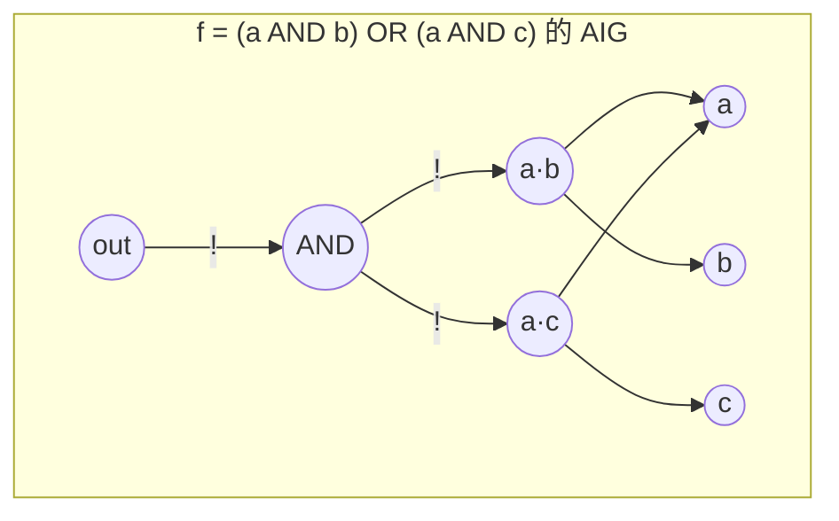
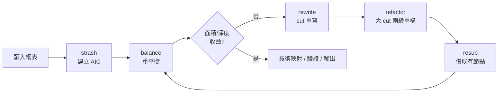

# 2.3 AIG 與 ABC：Berkeley 的開源邏輯最佳化帝國

如果說 BDD 是「正準表示」路線的頂點，那麼 And-Inverter Graph（AIG）就是「非正準但可高效操作」路線的頂點。AIG 本身簡單到近乎寒酸：整個電路只用一種節點——二輸入 AND 閘——加上一種邊屬性（反相器，以邊上的補位標記表示）。沒有 OR、沒有 XOR、沒有多輸入閘，所有的布林運算都被約化成 AND 與 NOT。聽起來這樣的表示法應該又大又難處理，但 2000 年代中期以後，它反而成為學術界與工業界邏輯合成與驗證工具的事實基礎。這個逆轉的核心人物，是 Berkeley 的 Alan Mishchenko，以及他一手建立、至今仍在持續開發的開源框架 ABC。

## 從 MIS 到 SIS 到 ABC：一條四十年的 Berkeley 血脈

要理解 AIG 的成功，必須先理解它背後的學術傳統。1980 年代，Berkeley 的 Robert Brayton 與 Alberto Sangiovanni-Vincentelli 建立了邏輯合成研究的重鎮，產出了一脈相承的三代開源工具。第一代 MIS（1980 年代初）奠定了「多級邏輯最佳化」的基本流程：把兩級表示分解成多級網路，再反覆做分解、代數因式分解、節點消去。第二代 SIS（1990 年前後，Berkeley 釋出）把這些技術整理成完整的合成系統，內含兩級化簡器 espresso、時序最佳化、技術映射（technology mapping）等模組，是整整一代研究生的實驗平台，也直接哺育了商業合成工具的許多核心演算法（例如手術式重寫結構與 delay/area 權衡的框架）。

第三代就是 ABC（2005 年前後由 Mishchenko 主導釋出，繼承了 Berkerley 的 PLA/邏輯合成工具鏈與他先前在 Portland State 的 DSAT 系列）。ABC 與前兩代最大的不同在於內部表示：SIS 用的是網路節點上掛布林的因式表示，操作複雜、易碎；ABC 全面改用 AIG 作為中間表示，並以 strashing（structural hashing）作為所有操作的底層。這個改變看似只是實作細節，實際上是路線的徹底更替：從「維護一個越改越亂的表示」變成「維護一個不變式極簡、可隨時重複最佳化的表示」。

## AIG 與 strashing：用雜湊換取秩序

一個 AIG 是一個 DAG：輸入是 PI（primary input）節點，內部節點是二輸入 AND，常數節點只有 0；每條邊可以帶補位（complemented edge），表示「訊號經過反相器」。OR、XOR、MUX 全部用這個基本積木拼出來，例如 $a \vee b = \overline{\bar{a} \wedge \bar{b}}$，$a \oplus b$ 用四個 AND 加反相即可。這種極簡化讓所有演算法只需處理一種節點，cache 行為也極好，圖的每一個節點可以壓縮成一個 32 位元的「lit」（變數編號加補位），記憶體密度高得驚人。

strashing（structural hashing）是 AIG 世界的心跳。規則很簡單：每當要建立一個 AND 節點 $(a, b)$ 時，先用一個雜湊表查 $(a, b)$ 是否已經存在；存在就直接重用已有的 lit，不存在才建立新節點。配合 AIG 的基本代數不變式（$a \wedge a = a$、$a \wedge \bar{a} = 0$、$a \wedge 0 = 0$、交換律的正規化等），strashing 會自動完成大量的局部合併。它不像 BDD 那樣提供全域的正準性，但它提供了一種「結構去重」：兩個邏輯上相同的小子電路，只要以相同順序進入雜湊表，就會被自動識別為同一個 AIG 子圖。ABC 的每一個建構與重寫操作都經過 strashing，因此整個網路始終保持沒有重複子圖的狀態，這也是 AIG 能夠作為驗證引擎的基礎——結構相同的兩個 AIG 一定等價，等價性檢查只需要處理「結構不同但功能相同」的部分。

## 演算法三部曲：rewrite、refactor、resub

有了 AIG 表示之後，邏輯最佳化就變成「對圖做局部手術」的問題。ABC 的核心是三個互相補充的演算法，它們都遵循同一個架構：對每個節點，計算其局部環境，枚舉若干替換方案，用 strashing 與功能檢查驗證，然後擇優替換。

第一個是 rewriting（2004 年前後，Mishchenko 與 Brayton 在 DAC 發表的 cut-based rewriting）。對每個節點計算一組 cuts（割集）：一個 cut 是一組「蓋住該節點下方所有路徑」的節點集合，cut 內的節點相當於這個局部子電路的輸入。對每個 cut，把 $k$ 輸入的局部函數枚舉其所有可能的 NPN 等價類（NPN class：在輸入置換、輸入取補、輸出取補下等價的函數類，4 輸入時只有 222 個），對每個 NPN 類挑一個面積最小的預先計算好的子圖實作，換掉原來的局部結構。rewriting 的效果類似「局部最佳化地重畫每一小塊電路」，成本低、速度快，通常能穩定減少 10% 到 20% 的 AIG 節點數。

第二個是 refactoring（2005 年，同樣是 cut-based）。它對每個節點取一個較大的 cut，把該子電路的功能提取成真值表，用兩級化簡器（本質上是 2.1 節所講的質蘊含項與覆蓋思想的現代化身）重新綜合出一個新的、可能更小的結構。refactoring 的視野比 rewriting 大，能捕捉跨越多個節點的重複計算，代價是真值表與化簡的成本隨 cut 大小指數成長，所以只能對小 cut 使用，作為 rewriting 收斂後的第二段打磨。

第三個是 resubstitution（resubstitution，2006 年前後由 Mishchenko 與其合作者系統化，思想可追溯到 1980 年代的 Muroga 與後續工作）。它不重畫子電路，而是尋找「已有節點的組合能否表達這個節點的功能」：對節點 $n$，在它的邏輯鄰域裡找一組「除數」節點 $d_1, \dots, d_k$，判斷 $n$ 是否可以寫成 $d_i$ 們的小函數（例如 $n = (d_1 \wedge d_2) \vee (\bar{d_3} \wedge n_{\text{old}})$ 這種形式）。如果可以，$n$ 的部分邏輯就被免費地「借」自現有節點，刪掉它自己的支撐邏輯即可。resub 是三者中唯一「只減不增」的操作，在面積已經很小的電路上仍能繼續壓縮，也是現代商業合成工具中 Resub 類技術的直接來源。

三個演算法反覆交替執行（ABC 的典型腳本是 `rewrite; refactor; resub; rewrite -z;` 迴圈若干輪，中間穿插 balance 重平衡樹深），直到面積與深度不再改善。值得注意的是，這個流程的每一個元件——真值表、覆蓋、局部重寫——都能追溯到更早的理論，但把它們組合進 AIG+strashing 的框架裡，產生了數量級的工程加速。

## 開源的力量：ABC 如何改變了學界與產業

ABC 以開源（後來以 BSD 類授權釋出）的形式發布，這在商業 EDA 工具動輒數十萬美元授權費的背景下產生了結構性的影響。對學術界而言，ABC 提供了一個免費、可靠、性能接近商業工具的基準平台：研究生不必先花兩年寫基礎設施，可以直接在 ABC 上加自己的演算法，與別人的工作公平比較。近年許多重要的學術成果——SAT-based 技術映射、精確 synthesis 方法、exact synthesis（例如 2015 年前後 Haaswijk、Soeken 等人在 ETH 發展的工作）——都以 ABC 或其衍生品為基礎。FPGA 學界尤其受益：iCE40 開源工具鏈的映射與合成、VTR/VPR 流程中的 LUT 映射模組，都直接或間接使用 ABC 的 AIG 引擎。

對產業而言，影響更為深遠且往往未被公開承認。AIG 作為中間表示已被多家商業合成與形式驗證工具採用（無論是直接引入 ABC 程式碼，還是重新實作同樣的演算法）；邏輯等價性檢查、SAT-based 驗證、techmap 驗證、retiming 後的等價證明，這些流程的引擎核心與 ABC 中的演算法高度同源。Yosys——開源硬體合成的另一個里程碑——也把 ABC 作為其邏輯最佳化後端，開源 FPGA 與 ASIC 社群因此幾乎都經過 ABC 的手。Mishchenko 本人的職業軌跡也反映了這個生態：他先在 Intel 與 Portland State 工作，2000 年代中進入 Berkeley 與 Brayton、Sangiovanni-Vincentelli 合作，把 ABC 建成 Berkeley 合成研究的公共基礎，至今仍持續維護與擴充。

從更長的歷史尺度看，ABC 代表了一個轉折：EDA 的創新不再只發生在公司的閉門實驗室，而是由一個開源核心承載，學術界在它之上做研究，產業界從它身上吸取演算法，兩者形成正向迴圈。這與 2.1 節講的 Shannon 之後「表示法進入教育與產業」的制度化過程遙相呼應——只不過這一次，載體是一個 git repo 而不是教科書。

AIG 故事裡還有一塊拼圖沒有展開：ABC 內部用什麼引擎來完成那些「功能級」的判斷？rewriting 需要驗證替換前後函數相同，等價性檢查需要證明兩個 AIG 等價，model checking 需要探索狀態空間——這些問題的最終仲裁者，是布林可滿足性（SAT）求解器。2000 年前後 SAT 求解器效能的十級跳，是讓 AIG 路線真正騰飛的關鍵外部條件。下一節，我們就來回顧這段從 Davis-Putnam 到 CDCL 的二十年躍進。

## 延伸閱讀

- A. Mishchenko, R. Brayton, "Simplification of Non-deterministic Multi-valued Networks," ICCAD, 2002；及其 cut-based rewriting 系列論文（DAC 2004, ICCAD 2005）。
- A. Mishchenko, S. Chatterjee, R. Brayton, "DAG-aware AIG rewriting: a fresh look at combinational logic synthesis," DAC, 2006。
- E. M. Sentovich et al., "SIS: A System for Sequential Circuit Synthesis," Berkeley, 1992。
- Berkeley ABC 官方網站與原始碼倉庫（people.eecs.berkeley.edu/~alanmi/abc/）。
