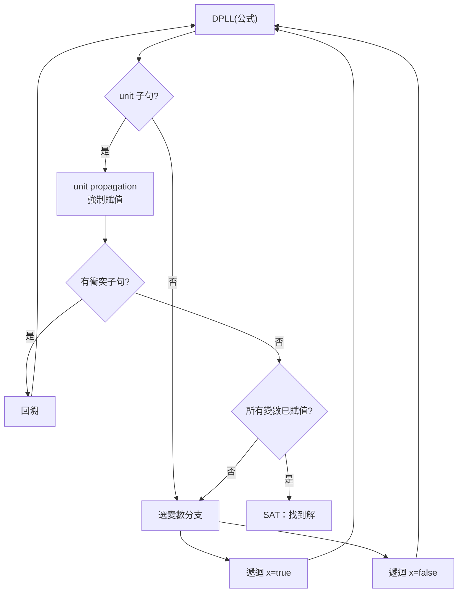

# 2.4 SAT 求解器二十年的躍進：從 Davis-Putnam 到 CDCL

前兩節的兩條路線有一個共同的天花板：BDD 有表示法爆炸，AIG 只有結構去重而無功能推理。能把「這兩個電路等不等價」「這個性質在 k 步之內會不會被違反」這類問題徹底打穿的，是布林可滿足性（SAT）求解器。SAT 是歷史上第一個被證明 NP-Complete 的問題（Cook, 1971；獨立的 Levin, 1971），理論上沒人相信有多項式演算法，但實務上，從 1996 年到 2005 年的十年間，SAT 求解器的實際效能提升了三到四個數量級，把一個「理論上不可解」的問題變成了 EDA 流程裡隨手可用的子程序。這一段躍進的歷史，是演算法工程戰勝理論悲觀論最經典的案例。

## Davis-Putnam 與 DPLL：回溯的雛形

故事始於 1960 年，Martin Davis 與 Hilary Putnam 發表了《A Computing Procedure for Quantification Theory》。他們的演算法（後稱 DP）建立在兩個推理規則上：unit propagation（若一個子句只剩一個未賦值文字，該文字必須為真）與純文字消除（pure literal elimination），再加上核心的一步——**消去變數**：對變數 $x$，把所有含 $x$ 的子句兩兩做解析（resolution，即從 $(A \vee x)$ 與 $(B \vee \bar{x})$ 導出 $(A \vee B)$），然後刪掉所有含 $x$ 的子句。DP 的問題是解析會產生子句爆炸，記憶體很快吃光。

1962 年，Davis、Logemann 與 Loveland 在《A Machine Program for Theorem-Proving》中做了一個至關重要的工程修改：把「消去變數」換成「分支變數」——不展開解析，而是嘗試把 $x$ 賦成真，遞迴求解；失敗則回溯嘗試 $x$ 為假。這個演算法就是 DPLL。它犧牲了一些推理能力，換回了記憶體可控，並且確立了此後六十年所有高效 SAT 求解器的骨架：**搜尋 + 傳播 + 回溯**。在整個 1970 到 1980 年代，DPLL 一直是定理證明與組合問題求解的基礎，但它那個時代的實作仍然相當原始——沒有學習、沒有智能分支，面對工業規模的實例幾乎無能為力。

## 相變：為什麼理論悲觀、實務樂觀

理解 SAT 為何「可解」，必須提到 1990 年代初的一個統計物理現象。對隨機 3-SAT——每個子句隨機選三個變數——當子句數與變數數的比值 $r = m/n$ 從小到大掃描時，存在一個尖銳的臨界值 $r_c \approx 4.26$：$r$ 小於 $r_c$ 時公式幾乎必然可滿足，大於 $r_c$ 時幾乎必然不可滿足，而在 $r_c$ 附近，DPLL 型演算法的搜尋樹大小呈現冪律甚至指數峰值。這個 phase transition 現象（Cheeseman、Kanefsky 與 Taylor 在 1991 年 IJCAI 的論文首次系統指出，隨後由 Selman、Levesque、Mitchell 等人深入）一方面解釋了為什麼「最難的實例集中在相變附近」，另一方面也帶來了重要的樂觀訊息：遠離相變的實例——也就是工業上真實出現的大多數結構化問題——其實非常好解。SAT 求解器的勝利，本質上是「讓工業實例遠離最壞情況」的勝利，而這要靠演算法主動學習問題的結構。

## GRASP 1996：衝突驅動學習的誕生

真正的轉捩點是 1996 年 João Marques-Silva 與 Karem Sakallah 在葡萄牙與 Michigan 完成的 GRASP（Generalized Search Algorithm for Satisfiability），發表於 ICCAD 與 IEEE Trans. on Computers。GRASP 把 DPLL 從「盲目搜尋」升級為「衝突驅動搜尋」（conflict-driven search），核心新增了三件事。

第一是 implication graph（蘊含圖）：在搜尋過程中，把每一次 unit propagation 的因果鏈記錄成有向圖，每個賦值是一個節點，每條邊對應「因為某個子句的另一個文字已為假，這個文字被迫為真」。當出現衝突（某子句全部文字為假）時，可以在圖上追溯這次衝突的完整成因。第二是 conflict analysis（衝突分析）：沿著蘊含圖往回走，找出「導致這次衝突的最少分支決策集合」，把它們組合成一個新的子句——例如 $\neg d_1 \vee \neg d_2 \vee l$，意思是「別再做這個分支組合了，除非額外假設 $l$」。這個新子句被加入公式，成為 learning。這是本質性的變化：DPLL 失敗後只知道「這條路不通」，必須重新走一遍；CDCL 失敗後把「不通」的原因固化成約束，同一個錯誤永遠不會再犯。第三是 non-chronological backtracking（非時序回溯）：既然衝突的根因是分支決策 $d_1, d_2$，那就直接跳回 $d_2$ 那一層，跳過中間那些與衝突無關的分支，一次省掉大量搜尋。

這三件事合起來，就是今天所謂的 CDCL（Conflict-Driven Clause Learning）。學習到的子句是「從公理可推導的引理」，它們讓求解器在面對具有大量重複子結構的問題——恰恰是 EDA 中電路展開、性質展開所產生的公式——時展現出驚人的效率。

## Chaff 2001：VSIDS 與 watched literals 把效能推過臨界點

GRASP 證明了概念，但真正把 CDCL 推向工業可用的是 2001 年 Princeton 的 Matthew Moskewicz 等人發表的 Chaff（"Engineering an Efficient SAT Solver", DAC 2001）。Chaff 的貢獻主要是兩個工程層面的創新，但它們帶來的加速是數量級的。

第一個是 VSIDS（Variable State Independent Decaying Sum）分支啟發式。GRASP 時代的分支策略偏向「挑當下影響最大的變數」，計算昂貴且效果一般。VSIDS 改用一個極簡的計數器：每個變數一個分數，每當它出現在新學習的子句中，分數加一；分數隨時間指數衰減；每次分支就挑分數最高的未賦值變數。這個策略直接回應了 CDCL 的精神——學到的子句蘊含了「哪些變數正在製造麻煩」，就優先處理它們。實作上，Chaff 的 VSIDS 幾乎零開銷，卻能讓求解器自動聚焦在問題的「衝突核心」。

第二個是 watched literals（雙監看文字）。unit propagation 是 DPLL/CDCL 中最耗時的部分：樸素做法是在每次賦值後掃描所有子句，檢查是否有變成 unit 或空的。Chaff 的做法是每個子句只「監看」兩個文字，只有當某個被監看的文字被賦為假時，才需要處理這個子句（換一個監看對象，或偵測到 unit/衝突）；而且回溯時完全不用動監看狀態。這把 propagation 的成本從「全子句掃描」降到「只碰受影響的子句」，在大型公式上節省一到兩個數量級。

Chaff 在當時的 EDA 基準（包括 CMU 的 BMC 實例與 ISA 測試）上比 GRASP 快一到兩個數量級，這個跳躍直接讓 SAT 從「研究演示」變成「可嵌入商業工具的引擎」。隨後的十年是 CDCL 的精緻化時期：MiniSat（2003，Eén 與 Sörensson）以簡潔的實作確立了「clause database + VSIDS + watched literals + restart + clause deletion」的現代求解器標準範式，成為此後幾乎所有求解器的程式碼祖先；Glucose（2009 前後，Audemard 與 Simon）引入 LBD（learning 后的子句「扣結度」）評分，改進了學習子句的保留策略；CaDiCaL 與 Kissat（Biere 及其合作者，2019 至 2020 年代）繼續在資料結構、restart 策略、inprocessing（定期做 subsumption、變數消除等化簡）上精進，連年拿下 SAT Competition 冠軍。這條演算法主線延續至今，社群也以年度 SAT Competition 與 yearly evaluation 持續驅動實作水準。

## SAT 進入 EDA：BMC、ATPG 與等價性檢查

CDCL 的成熟，對 EDA 而言不是「多了一個演算法」，而是打開了一整片應用版圖。最重要的是 bounded model checking（BMC）：1999 年 Armin Biere、Clarke 及其合作者在 Trento 的論文提出，把「在 $k$ 個週期內性質會不會被違反」直接轉成一個 SAT 實例——把狀態機的轉移關係沿時間軸複製 $k$ 份（unrolling），加上初始狀態約束與性質的反面，交給 SAT 求解器。若 SAT，求解器給出的賦值就是一個反例（counterexample），可以直接畫成波形；若 UNSAT，就證明了 $k$ 步之內安全。BMC 的意義在於它把模型檢查從 BDD 的「窮舉全部可達狀態」改變為「沿時間軸局部展開」，避開了 BDD 的中間爆炸；雖然它單獨無法證明「永遠安全」，但與 k-induction、interpolation（McMillan, 2003）等完備化技術結合後成為當今工業 model checking 的主力。Biere 後來也成為 PicoSAT、CaDiCaL、Kissat 的作者，BMC 的發明人與當代求解器的作者身兼兩職，是這條歷史線上最直接的人事連結。

SAT 在 EDA 的其他應用同樣廣泛。ATPG（automatic test pattern generation）自 1980 年代起就用 DPLL 式搜尋做故障激發與傳播（SCOAP、D-algorithm、FAN 等傳統技術本質上都是帶啟發式的回溯搜尋），CDCL 出現後被大幅取代與強化。組合等價性檢查（見 2.2 節）在 2000 年代逐步轉向 SAT 為核心的 miter 比對：把兩個電路的對應輸出 XOR 起來，用 SAT 證明這個 miter 恆為 0；商業工具（包括用 BDD 起家的 Formality 等同類產品）普遍轉為 SAT 與 BDD 混合引擎。技術映射的正確性驗證、retiming 之後的時序等價、FPGA 的 LUT 網路等價確認、routing 的形式檢查，都是 SAT 的日常任務。可以說，今日任何一個嚴肅的數位設計流程裡，SAT 求解器都是被呼叫最頻繁的演算法核心之一。

## 二十年躍進的意義

回顧從 1960 到 2005 的這段歷史，可以看到一個反覆出現的模式：理論上 NP-Complete 的問題，靠著「正確的表示法 + 聰明的學習 + 極致的工程」可以在工業規模上變得實用。DP→DPLL 確立了搜尋骨架；GRASP 讓失敗變成知識；Chaff 讓知識的累積與使用變得廉價；MiniSat 之後的系譜則把這些技術打磨成穩定的工程產品。這個模式與 BDD（表示法的正準性）與 AIG（結構雜湊）的歷史相互輝映，也共同解釋了為什麼現代 EDA 的形式驗證與邏輯最佳化流程，正是這三者的合體：AIG 提供緊湊的中間表示，strashing 做結構去重，BDD 處理小而需要正準性的子問題，SAT 承擔所有需要「證明」的重量級判斷。

本書接下來的章節將離開演算法史的抽象層次，回到 veryl2chip 這個具體的工具：它如何把 Veryl 原始碼經過解析、命名解析與 elaborate 之後，交給內建的模擬器與合成後端，最終產出從 FPGA bitstream 到 SKY130 GDS 的完整晶片。理解了本章的這些演算法傳統，你將能看清 v2c 每一步輸出背後所站立的肩膀。

## 延伸閱讀

- M. Davis, H. Putnam, "A Computing Procedure for Quantification Theory," JACM, 1960。
- M. Davis, G. Logemann, D. Loveland, "A Machine Program for Theorem-Proving," CACM, 1962。
- J. P. Marques-Silva, K. A. Sakallah, "GRASP: A Search Algorithm for Propositional Satisfiability," IEEE Trans. Computers, 1999（ICCAD 1996）。
- M. W. Moskewicz et al., "Chaff: Engineering an Efficient SAT Solver," DAC, 2001。
- A. Biere et al., "Bounded Model Checking," CAV, 1999。
- SAT Competition 官方網站與歷屆結果（satcompetition.github.io）。
