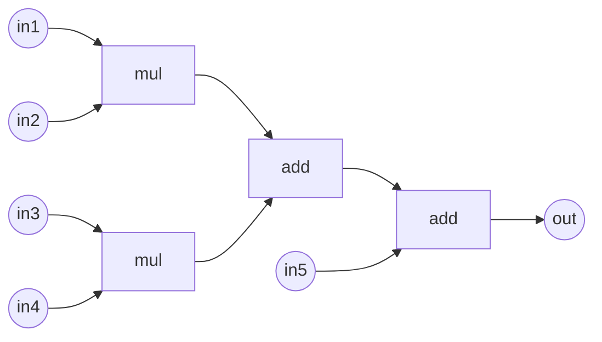

# 3.2 排程演算法：ASAP/ALAP、List Scheduling 與力導向排程

## 從演算法到時脈週期

上一節我們看到，1980 年代 HLS 的理論骨架由 Gajski 的 System Architect's Workbench 等系統確立：排程、資源分配、綁定三部曲。本節聚焦排程（scheduling）——給定一個資料流圖，決定每個運算在第幾個時脈週期執行。排程之所以是 HLS 的第一個核心問題，是因為它直接決定了電路的延遲（總週期數）與吞吐率，也決定了後續分配與綁定的難度。

## CDFG 與 DFG：排程的輸入模型

排程問題的輸入通常建模為控制資料流圖（CDFG, Control and Data Flow Graph）。CDFG 的節點是運算（加法、乘法、比較、載入等），有向邊表示資料相依；控制流（if、while）則以條件節點或子圖結構表達。為了聚焦核心演算法，教科書與本節通常先討論最純粹的子集：資料流圖（DFG），即不含控制分支、單一基本區塊的圖。

形式化地，DFG 是有向非循環圖 $`G = (V, E)`$ ，每個節點 $`v_i \in V`$ 是一個運算，帶有類型 $`type(v_i)`$ （例如 add 或 mul）與延遲（通常假設單週期或已知延遲）。邊 $`(v_i, v_j)`$ 表示 $`v_j`$ 必須在 $`v_i`$ 完成後才能開始。兩個節點如果操作同一個變數，可以插入虛節點（dummy node）或直接以邊相連。



這個五運算的小例子（兩個乘法、兩個加法鏈）貫穿本節。

## 問題的兩種形式：資源約束與時間約束

排程問題有兩種鏡像形式。資源約束排程（Resource-Constrained Scheduling, RCS）給定每種資源的上限（例如：最多 1 個乘法器、1 個加法器），求最短總週期數。時間約束排程（Time-Constrained Scheduling, TCS）給定總週期數上限（例如：必須在 4 個週期完成），求最少資源。兩者都是 NP-hard 的（RCS 包含.job-shop 排程為特例），因此實務上全部依賴啟發式——而啟發式的品質，取決於它對「某運算還有多少自由度」的估計有多準確。這正是 ASAP/ALAP 登場的原因。

## ASAP 與 ALAP：自由的上下界

As-Soon-As-Possible（ASAP）排程是最自然的演算法：依拓撲序掃描 DFG，每個節點的開始時間等於所有前驅完成時間的最大值。

```
ASAP(G):
  for v in 拓撲序(G):
      s(v) = max{s(u) + d(u) for u ∈ pred(v)}, 若無前驅則 s(v) = 0
```

對上例（假設單週期延遲）：m1、m2 在週期 0；a1 在週期 1；a2 在週期 2。總長度 3。ASAP 給出的是每個運算「最早」可能開始的時間，它只受資料相依與資源上限中資源為無限時的約束。

ALAP（As-Late-As-Possible）是鏡像：從輸出往回掃描逆拓撲序，每個節點「最晚」可開始的時間。若給定時間約束 $`T`$ ，ALAP 以 $`T`$ 為死線往回推；若不給 $`T`$ ，則以 ASAP 的總長度為 $`T`$ 。

```
ALAP(G, T):
  for v in 逆拓撲序(G):
      l(v) = min{l(u) - d(v) for u ∈ succ(v)}, 若無後繼則 l(v) = T - d(v)
```

有了 ASAP 時間 $`s(v)`$ 與 ALAP 時間 $`l(v)`$ ，我們得到排程理論中最重要的量：mobile（也稱 slack，鬆弛度）

$$
mob(v) = l(v) - s(v)
$$

上例中若 $`T = 3`$ ，所有節點 mobility 均為 0——這是關鍵路徑，完全被資料相依鎖死。但若把圖改複雜一點：兩個獨立的乘法 m3、m4 也餵給後續運算，它們的 $`s`$ 可能是 0 而 $`l`$ 是 2，mobility 為 2。mobility 為 0 的運算構成關鍵路徑；mobility 大的運算可以自由後移，用來填補資源衝突。

ASAP/ALAP 本身是 $`O(|V|+|E|)`$ 的動態規劃，快到可以反覆呼叫。它們不只是演算法，更是所有後續啟發式的「量尺」。

## List Scheduling：以 mobility 為優先權的貪婪法

資源約束排程最經典的啟發式是 list scheduling，其思想源自作業系統的優先權排程，1970 年代已被用於微碼排程，1980 年代被移植到 HLS（代表性論文包括 Davidson 等人的微碼排程工作與 Gajski 團隊的系統化）。

List scheduling 逐週期推進。在每個週期，收集所有「前驅已完成」的待排節點（ready list），依優先權排序，按資源上限依序放入本週期，放不下的留到下一週期。關鍵在優先權函數——最常用的是 mobility 的倒數：

$$
priority(v) = -mob(v) \quad \text{（mobility 小者先排）}
$$

直覺很清楚：mobility 為 0 的節點再不排就拖累關鍵路徑，先排它們；mobility 大的節點有的是時間，晚一點無妨。也有以到輸出的最長路徑長度（depth to sink）作為優先權的變體，本質相同。

```
LIST_SCHED(G, resource_limits):
  t = 0
  while 有未排節點:
      ready = {v : 所有前驅已排且完成時間 ≤ t}
      將 ready 依 priority 由小到大排序
      對每種資源 r，從 ready 中取出至多 limit(r) 個該類節點，排入週期 t
      t = t + 1
```

List scheduling 的性質是「快而不一定好」： $`O(|V| \log |V|)`$ 等級的複雜度，但貪婪決策可能造成後悔——某個週期排入一個 mobility 不為零的節點，佔掉了資源，導致後面連鎖延遲。它沒有回溯。要做得更好，必須讓演算法「感知全局」，這就是力導向排程的目標。

## 力導向排程：Paulin 與 Knight 的物理類比

1986 年，IMEC 的 Pierre Paulin 與加拿大 Carleton 大學的 John Knight 發表了 Force-Directed Scheduling（完整期刊版於 1989 年刊登於 IEEE Transactions on CAD），這是 TCS（時間約束）問題上影響最深遠的啟發式。

FDS 的核心是一個物理類比。給定時間約束 $`T`$ ，先算出每個節點的 ASAP/ALAP 區間。定義機率分佈：假設節點 $`v`$ 在其可行區間 $`[s(v), l(v)]`$ 內均勻隨機選擇開始時間，則

$$
p(v, t) = \frac{1}{mob(v) + 1} \quad \text{若 } s(v) \le t \le l(v), \text{否則 } 0
$$

對每個時間步 $`t`$ 與每種資源類型 $`r`$ ，累加所有在 $`t`$ 期「可能」使用 $`r`$ 的節點機率：

$$
D(r, t) = \sum_{v:\, type(v)=r} p(v, t)
$$

$`D(r, t)`$ 稱為分佈圖（distribution graph），它是在資源尚未決定時，對「每個週期平均需要幾個 $`r`$ 型單元」的期望值。 $`D(r,t)`$ 的最大值決定了 $`r`$ 型資源數量的下界 $`\lceil \max_t D(r,t) \rceil`$ ，而資源總成本近似為 $`\sum_t \lceil D(r,t) \rceil`$ ——所以目標變成把分佈圖「壓平」。

壓平的手段是「力」。若把節點 $`v`$ 確定排到時間 $`t`$ （即從其機率分佈中拿走其他時間的機率、全部集中到 $`t`$ ），造成的分佈圖變化定義為力：

$$
Force(v, t) = \underbrace{p(v,t)\cdot\big(D(type(v),t) - \overline{D}(type(v))\big)}_{\text{self force}} + \sum_{u \in pred(v) \cup succ(v)} \underbrace{p(u,t')\cdot(\cdots)}_{\text{successor/predecessor forces}}
$$

其中 $`\overline{D}`$ 是該類資源分佈的平均值。self force 衡量把 $`v`$ 放進一個已經很擠的時段所增加的峰值貢獻；successor/predecessor force 考慮固定 $`v`$ 之後，其鄰居的可行區間被壓縮、機率重新分佈帶來的連鎖效應。這是 FDS 優於單純 list scheduling 的關鍵：它看得見決策的間接後果。

演算法迭代進行：

```
FDS(G, T):
  計算 s(v), l(v) 與初始機率分佈 p(v,t), 分佈圖 D(r,t)
  while 存在機率分佈不為 0/1 的節點:
      對每個候選 (v, t):  計算 Force(v, t)
      選出 |Force| 最小（或最負）者，固定 v 於 t，更新 p 與 D
  輸出確定排程
```

每次迭代固定一個節點， $`O(|V|^2 \cdot T)`$ 等級的總複雜度，對當年（與今天）的區塊規模都完全可行。FDS 原生解 TCS（固定 $`T`$ 最小化資源）；對 RCS 則可用二分搜尋 $`T`$ 反覆呼叫。Paulin 與 Knight 並在同一框架下處理了暫存器的分配（透過生命週期分析），使其成為 IMEC Cathedral 系列中 Cathedral-II 的排程引擎之一，也深刻影響了 Synopsys Behavioral Compiler 的內部演算法。

## 一張甘特圖看懂排程結果

以本節的例子做時間約束 $`T=3`$ 的 FDS：因為所有節點 mobility 為 0，排程唯一：

```
週期 0: | m1 | m2 |
週期 1: | a1 |
週期 2: | a2 |
```

需要 2 個乘法器、1 個加法器。若放寬到 $`T=4`$ （假設圖更複雜、部分節點有 mobility），FDS 會把高 mobility 的乘法錯開，可能只需 1 個乘法器：

```
週期 0: | m1 | m3 |
週期 1: | m2 | m4 |
週期 2: | a1 | a3 |
週期 3: | a2 | a4 |
```

這就是排程的經濟學：面積（資源數）與延遲（週期數）之間的取捨曲線，而演算法的任務是在曲線上給出接近 Pareto 前沿的點。

## 排程之後：誰用哪個加法器？

排程回答了「何時」，但沒回答「用哪個」。上面第二張甘特圖裡，m1 與 m2 共用同一個實體乘法器——這個決定（綁定）會影響需要多少多工器（mux）、多少暫存器，進而影響實際的面積與時脈。排程把 DFG 中相同類型的節點分成了時間上不相衝突的等價類，綁定問題正是在此基礎上做圖論優化：相容圖（compatibility graph）的 clique partitioning、以及把 mux 成本化為加權二分匹配的 Hungarian 演算法。

下一節 3.3，我們就走進這個綁定的世界：圖著色、最大加權二分匹配，以及為什麼這兩個 NP-hard 與多項式的問題，共同決定了資料路徑最終的長相。
