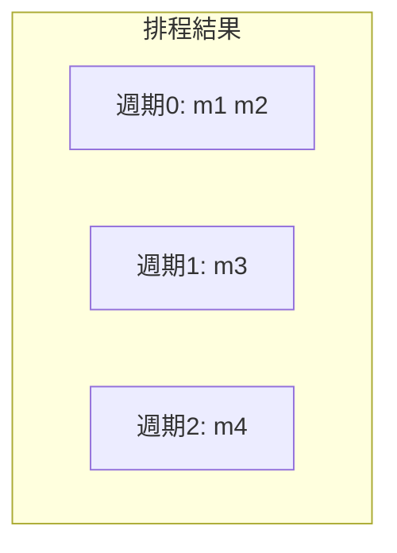
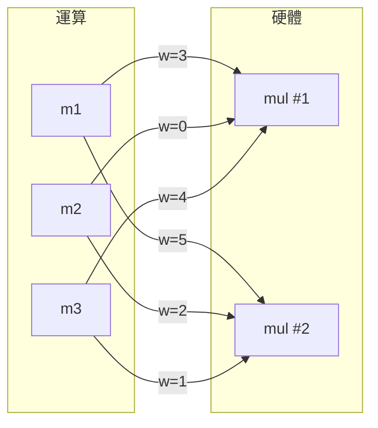

# 3.3 資源分配與綁定：圖著色與最大加權二分匹配

## 從「何時」到「用哪個」

3.2 節的排程演算法決定了每個運算落在哪個時脈週期。但一張排程甘特圖還不是電路：週期 0 的 m1 與週期 1 的 m2 都要「某個」乘法器來執行——它們可以共用一個實體乘法器（在輸入端加多工器，分時復用），也可以各自擁有一個。這個決定就是綁定（binding）或稱分配（allocation）的最後一環，由 Daniel Gajski 在 CMU 的 System Architect's Workbench 中確立為 HLS 三部曲的第三步。綁定決定了多工器數量與大小、暫存器數量、以及資料路徑中連線的拓撲——這些往往比運算本身更耗面積。本節講述綁定的兩大數學支柱：圖著色（clique partitioning）與最大加權二分匹配。

## Operator Sharing 的邏輯

綁定的基本前提是 operator sharing：兩個同型運算只要「不會在同一個週期執行」，就可以共用同一個硬體單元。經過 3.2 的排程，這個相容性判斷變得簡單：節點 $u$、$v$ 相容（compatible）若且維若 $type(u) = type(v)$ 且它們的執行區間不重疊。

若 m1、m2 在週期 0 同時執行（相衝突，incompatible），m3 在週期 1、m4 在週期 2，則 {m1, m3}、{m1, m4}、{m2, m3}、{m2, m4} 相容，{m1, m2} 不相容。最少需要 2 個乘法器（週期 0 兩個並行），m3、m4 可在其中任意分配。

把所有運算作為節點、相容關係作為邊，就得到相容圖（compatibility graph）。綁定的第一種數學形式化於焉浮現：

> 相容圖的 clique partitioning 問題：把節點劃分成最少個兩兩相連的子集（clique），每個 clique 對應一個實體硬體單元。

Clique partitioning 是 NP-hard 的（它是圖著色的補圖形式：把相容圖取補得到衝突圖 conflict graph，最小 clique 劃分等價於最小著色）。1980 年代 HLS 研究者（如 Tseng 與 Siewiorek 在 CMU 的 Synthesis 系統工作，1986 年前後）建立了這個形式化，並給出兩種實用解法：直接的啟發式 clique 劃分（貪婪選最大 clique，或 left-edge 演算法的變體——left-edge 原是 1970 年代/channel routing 中對區間圖做最佳著色的 $O(n \log n)$ 演算法，對區間圖結構的綁定問題是精確的），以及圖著色啟發式（如 Brelaz 的 DSATUR, 1979）。

## 圖著色視角：衝突圖與 DSATUR

許多實作偏好衝突圖著色的敘事：節點 = 運算，邊 = 「同週期執行」（不可共用）。著色數 = 需要的硬體單元數，同色節點共用一個單元。對一般圖，最小著色是 NP-hard，貪婪法依「飽和度」（鄰居已用色數）降序逐點上色即可得到不錯的結果。對由排程區間導出的區間圖（interval graph），left-edge 演算法給出精確最小著色——這解釋了為何排程越「區間化」（生命週期乾淨、不交疊），綁定結果越接近最佳。

## 加權二分匹配：最小化多工器的洞見

Clique partitioning（或著色）最小化的是「單元個數」，但它有個盲點：兩個綁定方案可以有相同數量的乘法器，mux 成本卻天差地遠。1980 年代末至 1990 年代初的研究（代表性作者包括 C.-T. Hwang、Y.-C. Hsu 與 J.-Y. Jang 等在台灣與美國的團隊，以及 Miodrag Potkonjak 與 Jan Rabaey 在 Berkeley 的 FORCE/CUPID 系列工作）把這個成本問題精確化：如果資源個數已由排程與資源約束決定為 $k$ 個，那麼綁定問題變成「把 $n$ 個運算分給 $k$ 個單元，最小化多工器總成本」——這是一個加權二分匹配（weighted bipartite matching）問題。

形式化：二分圖左邊是 $n$ 個運算，右邊是 $k$ 個硬體單元，邊 $(v_i, u_j)$ 的權重 $w_{ij}$ 定義為把 $v_i$ 綁到 $u_j$ 所「新增」的多工器成本。實務上常以兩個運算所需輸入的公共變數來估計：若 $v_i$ 與 $v_{i'}$（同前一個單元的既存運算）有相同來源運算，則它們可共享輸入連線、mux 輸入可合併。求最小權重完美匹配，即整體 mux 成本最小的綁定。當 $n = k$ 時是標準的指派問題（assignment problem），Kuhn 於 1955 年提出的匈牙利演算法（Hungarian algorithm，源自 Kosko、Munkres 的整理）以 $O(n^3)$ 求解；當 $n > k$，可補虛擬節點轉為方陣。這是綁定文獻中罕見的多項式精確可解子問題，因此被廣泛實作——包括今日開源 HLS 工具（如 Bambu）與商業工具的資源綁定階段。

最小化總權重：本例最佳為 m1→M1、m2→M2、m3→M2，總成本 5。

## ILP 觀點與整體最佳化

1990 年代，研究者開始把排程與綁定合起來寫成整數線性規劃（ILP）：變數 $x_{v,t} \in \{0,1\}$ 表示節點 $v$ 是否排入週期 $t$，$b_{v,u} \in \{0,1\}$ 表示 $v$ 綁到單元 $u$；目標函數同時計入資源成本與 mux 成本；資料相依、資源上限、綁定與排程的一致性都是線性約束。Gebotys、Niemann（與 Marwedel，1990 年代中期）等人建立了系統化的 ILP 形式化，可以求出小規模問題的全域最佳解，並作為啟發式品質的 benchmark。ILP 在實務上規模受限，但其價值在於證明了：排程與綁定耦合優化比分開做有 5%–20% 的品質空間——這促使 FDS 之後的工具在排程階段就預估 mux 成本（例如 Potkonjak 與 Rabaey 的 FORCE，1992，用「力」的框架在排程時即考慮綁定影響）。

## 一個完整的小例子

把 3.2 的排程結果（$T=4$，1 個乘法器方案）延伸：假設 m1（週期 0）、m2（週期 1）、m3（週期 2）皆用乘法器，且 m1 的輸入是 in1、in2；m2 的輸入是 in1、in3；m3 的輸入是 in2、in4。若 m1、m2 共用乘法器，in1 與 in3 需要 2 輸入 mux；若 m1、m3 共用，in2 需要 2 輸入 mux、in1/in4 亦然。用共享來源計分：m1-m2 共享 in1（省 1 個 mux 輸入）、m1-m3 共享 in2（省 1 個）、m2-m3 無共享（省 0）。二分匹配自然會選 m1-m2 或 m1-m3 之一共組，取決於全局權重——這正是 weighting 精確化的價值：直覺估不出來的差異，$O(n^3)$ 的演算法算得出來。

最後，綁定還要處理暫存器：變數的生命週期（從產生到最後一次被讀取）形成區間，暫存器分配同樣是區間圖著色問題（left-edge 又一次登場），並再與 mux 成本耦合。完整 HLS 前端的資料路徑於焉成形：一張由資源單元、多工器、暫存器組成的 RTL 網表。

## 從行為到邏輯：下一座橋

到此為止，HLS 三部曲（排程、分配、綁定）把 C 演算法變成了一張 RTL 網表。但網表裡的「一個 16 位元加法器」究竟是幾個閘？怎樣的布林結構面積最小、速度最快？這就離開行為層，進入邏輯綜合的疆域。邏輯優化的歷史比我 HLS 更悠久，而且分成涇渭分明的兩個時代：兩級邏輯（two-level logic）與多級邏輯（multi-level logic）。

下一節 3.4，我們回到 1950 年代——Quine 與 McCluskey 的真值表最小化——然後一路走到 1980 年代 Berkeley 的 Espresso，看看在 PLA 主導的年代，兩級邏輯如何成為 EDA 的第一個成功商業演算法。
