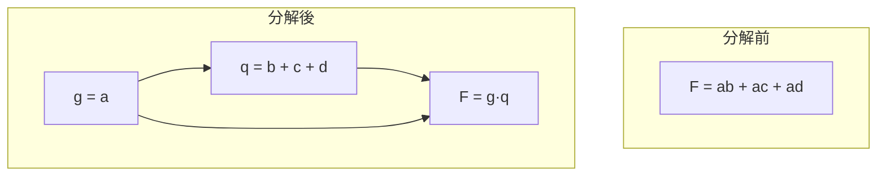

# 3.5 多級邏輯優化：MIS/SIS 的分解、抽取與代入

## 兩級之後：深度的自由

3.4 節的 Espresso 把兩級邏輯（SOP）優化推到了實用極限，但兩級表示有先天的結論：SOP 項數對某些函數是指數級的（XOR 鏈、加法器進位鏈、譯碼器）。多級邏輯——允許任意深度的閘網路、允許中間變量與共享子表達式——才是真實矽的形狀。標準元件庫（standard cell）在 1980 年代中期成熟，提供了 AND/OR/NAND/MUX/OAI 等多樣化細胞，加上互連延遲的重要性日增，業界與學界的注意力全面轉向多級優化。這場轉型的理論與工程中心，仍然是 Berkeley。

## MIS：1987 年的奠基之作

1987 年，Robert Brayton、Richard Rudell、Alberto Sangiovanni-Vincentelli 與 Aziz Khatri 等人發表了 MIS（Multi-level Implementation System），首度把多級優化整合成完整系統。1990 年前後，在 UC Berkeley 的 July 1990 起，MIS 演化為 SIS（Sequential Interactive Synthesis / Sequential circuit Synthesis System），由 Ellen Sentovich、Hamid Savoj、Kurt Keutzer、Rajeev Ranjan 等人持續發展，加入了時序電路支援（狀態最小化、狀態分配、retiming——後者見 3.8 節）與 BDD 引擎。SIS 以組合語言般的互動式 script（`source script.rugged` 等經典腳本）操作，是 1990 年代所有邏輯綜合研究的標準平台，也是 Synopsys Design Compiler 與日後 ABC 的直接思想祖先。

## 兩種除法：代數式 vs 布林式

多級優化的數學核心是「除法」（division）：給定兩個布林表示式 $`f`$ 與 $`g`$ ，求 $`q`$ （商）與 $`r`$ （餘）使 $`f = g \cdot q + r`$ 。依據對 $`g \cdot q + r`$ 中重疊項的處理方式，分成兩個世界。

代數式除法（algebraic division）把布林運算當作多項式運算：乘積中不允許立方體之間相交（即 $`g`$ 與 $`q`$ 相乘時不產生共識項的抵消），因此 $`f = gq + r`$ 在 cube 層面是精確的集合運算。代數除法快速（多項式時間）、可預測，代價是錯過一些布林化簡的機會。MIS/SIS 的主力操作都建立在代數除法上——弱除法（weak division）：對 $`g`$ 中每個 cube，從 $`f`$ 的各 cube 中逐項扣除。

布林式除法（Boolean division）則允許真正的布林恆等式： $`f = gq + r`$ 只需在函數意義上相等， $`gq`$ 與 $`r`$ 可以在 don't care 空間中互相掩護，得到比代數除法更小的電路。代價是計算複雜度（需要對 cofactor 做布林運算）。1990 年代以前布林除法不實用，BDD（Bryant, 1986）與 SAT 的成熟才使其可行——SIS 的內建版本仍以代數為主、布林為輔。

## 三大操作：decompose、extract、resubstitute

SIS 的 script 優化是四類局部操作的迴圈，每類都以上述除法為引擎。

Decompose（分解）：把一個大節點 $`F`$ 拆成若干新節點。以 algebraic factor 為代表：遞迴尋找最大公因子，把 $`F = gf + h`$ 重寫成 $`F = g \cdot q + h`$ ， $`g`$ 、 $`q`$ 、 $`h`$ 各成節點。這降低單節點複雜度，利於後續技術映射。

Extract（抽取）：這是多級優化的靈魂——發現多個節點之間共享的子表達式，把它抽出成為新節點，供多處引用。代數意義上的最佳化版本是 kernel extraction：對表示式的所有 cube 兩兩做 cofactor，枚舉 kernel（不可再除的商）與 co-kernel，統計每個 kernel cube 出現次數，貪婪地選出「出現次數 × 大小」最大的子式抽取。Rudell 在 MIS 中發展了高效的 kernel 交織（kernel intersection）枚舉演算法。Extract 直接對應人類工程師手寫 RTL 的「中間變數共享」直覺，是面積縮減的最大來源。

Resubstitute（再代入，resubstitution）：利用既有節點重寫目標節點。給定節點 $`F`$ 與候選「幫手」節點 $`g`$ ，計算 $`F`$ 在 $`g`$ 的 cofactor 下的函數：若 $`F`$ 可以寫成 $`\bar{g} \cdot f_0 + g \cdot f_1`$ 且 $`f_0`$ 、 $`f_1`$ 比 $`F`$ 簡單，就新增邊 $`g \to F`$ 並縮小 $`F`$ 。這操作不改變電路的邏輯功能（在 don't care 框架下甚至可以改變局部函數），卻能削減節點複雜度；在 2000 年代的 ABC 中，resubstitution 進化為以 SAT 為引擎的強力工具（cut-based resub），至今仍是 FPGA 面積優化的主力之一。

SIS 的經典 script 把這些操作與兩級優化交替：`eliminate`（把小節點摺回）→ `resub` → `fx`（extraction）→ `resub` → `simplify` → `full_simplify`，反覆多輪。其中 `full_simplify` 就是布林層級的兩級式化簡——使用了每個節點在整個網路中的 don't care（外部 DC、可滿足性 DC、 Observability DC），這是 Espresso don't care 框架的多級延伸。

## BDD：布林引擎的支柱

SIS 的 Boolean 化簡與後期的等價檢查，依賴 1986 年 Randy Bryant（CMU）提出的約化有序二叉決策圖（ROBDD）。BDD 給布林函數一個規範形（canonical form），使等價判斷變成指標比較，使 cofactor、AND/OR 以圖合併（ite 演算法）多項式完成（對合適的變數序）。BDD 讓「布林除法」「全局 don't care 計算」「序電路驗證」從理論變成幾行程式。它同時催生了 1990 年代的符號模型檢查（symbolic model checking, McMillan 的 SMV, 1992），把驗證與綜合的理論基礎打通。BDD 的變數序敏感性（變數順序錯了指數爆炸）催生了 sifting 等動態重排演算法——這些都是 1990 年代 EDA 研究的熱點。

## 為什麼多級在 Standard Cell 世代成為主流

制度與經濟的驅動力與技術同樣清晰。第一，standard cell 庫的商業模式（代工廠提供 PDK 與 cell library，見 3.6 節）使得「任意深度的閘網路 + 技術映射」取代了「PLA 面積模型」，優化目標從項數變成 mapped area 與 delay。第二，晶片規模（1980 年代末跨過 10 萬閘）使得手工設計不敷使用，自動化多級綜合成為必須。第三，MIS/SIS 以免費授權的形式擴散，培養了整整一代研究者與工程師，Synopsys 於 1986 年創立（Aart de Geus 等，源自 GE 的技術），以 timing-driven 綜合商業化成功後，其內部演算法與 SIS 的操作集高度同源。

多級優化的最終產物是一張與工藝無關的布林網路。要真正下線，還得把它映射到具體的 cell library 或 FPGA LUT——這就是技術映射（technology mapping）的任務，也是邏輯綜合鏈上最後、也最商業化的一環。下一節 3.6，我們看 ASIC 的路：Dagon 的 tree covering、cut-based mapping，與 Synopsys Design Compiler 的崛起。
