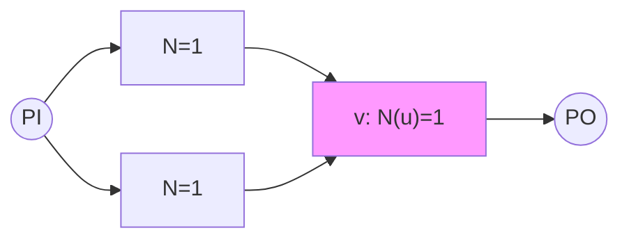
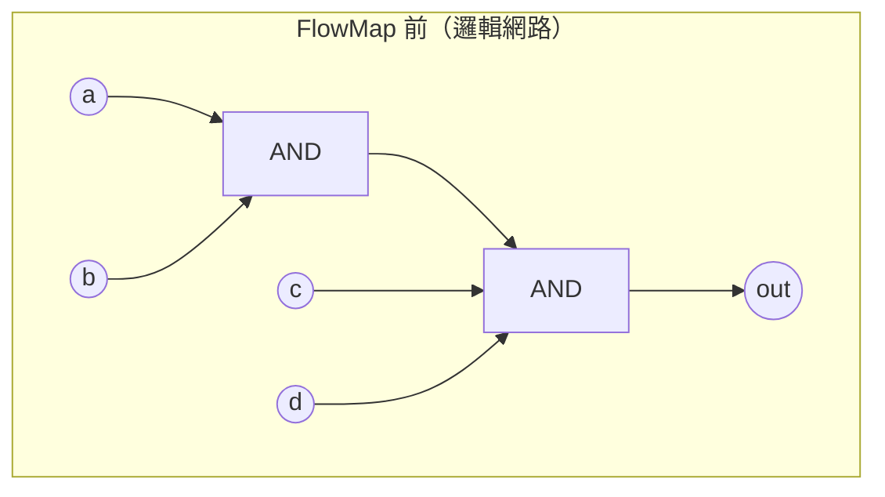

# 3.7 技術映射的 FPGA 之路：K-LUT 與 FlowMap 演算法

## 為什麼 FPGA 是另一個世界

3.6 節的 ASIC 映射面對的是一個「軟」的目標：standard cell 庫有幾百種 cell，映射結果的形狀幾乎自由。FPGA 則完全相反：晶片是一個高度規律的二維陣列，每個可程式邏輯單元（logic element）的結構是固定的——以 Xilinx 早期與 Altera（今 Intel）的典型架構為例，一個 LE 包含一個 K 輸入查找表（K-LUT， $`K`$ 通常為 4 或 6）加上一、兩個可程式觸發器（flip-flop），週邊是佈線資源與 I/O。K-LUT 能實現任意 $`K`$ 輸入布林函數——這是 lookup table 的本質： $`2^K`$ 位元的真值表。

這種離散、規律的資源結構使映射問題被徹底淨化：目標不再是「選哪個 cell」，而是「把布林網路切成盡量少（面積目標）或盡量淺（延遲目標）的 K-input 錐（cone）」。切割的好壞直接決定 LUT 數量與關鍵路徑上的 LUT 級數——後者因為 FPGA 佈線延遲大（可程式 switch 的電容遠高於 ASIC 互連），往往在總延遲中佔比過半，於是「最小化 LUT 級數」在 FPGA 映射中的地位比 ASIC 中重要得多。這個純化也孕育了 EDA 演算法史上少見的理論瑰寶：FlowMap。

## Cut Enumeration：Cong 的基本功

一切從 cut 說起。對網路中節點 $`v`$ ，一個 cut $`(V_c, C)`$ 把以 $`v`$ 為根的子網路分成包含 $`v`$ 的「上部」與 cut 節點集 $`C`$ ；若 $`|C| \le K`$ ， $`v`$ 連同其上部邏輯可以打包進一個 LUT，cut 節點就是該 LUT 的輸入。枚舉所有 $`K`$ -feasible cuts 是面積與延遲映射的共同基礎，Jason Cong（UCLA，VLSI 架構與綜合領域的旗幟性人物）團隊在 1990 年代末至 2000 年代初（Cong 與 Hromkovic 等人的 cut 枚舉論文，以及 Lingamneni、Pan 等合作）系統化了高效枚舉：對每個節點合併其子節點的 cuts（ $`c_1 \vee c_2`$ 的單調組合），過濾掉大小超過 $`K`$ 與被支配（dominated，某 cut 是另一 cut 的子集）者，配合上限 $`B`$ （每節點最多保留 $`B`$ 個 cut，實務 8–16 個）使總複雜度線性可控。2000 年代 Mishchenko 與 Cong 合作的論文把這套方法整理成今日 ABC 中 `if` 命令的引擎，成為開源與工業界共用的標準件。

## FlowMap：深度最佳的映射

1994 年，UCLA 的 Jason Cong 與 Yuzheng Ding 發表 FlowMap（IEEE Transactions on CAD, 1994；初版於 DAC/ICCAD 1992–94 期間），解決了如下問題：給定 DAG 形式的布林網路與參數 $`K`$ ，求一個 K-feasible 覆蓋，使從 PI 到 PO 的最大 LUT 級數（depth）最小。此前的方法（包括樹映射的延遲變體與各種啟發式）都沒有深度保證；FlowMap 是第一個（迄今仍是唯一一個廣為引用的）多項式時間、且證明達到理論下界的映射演算法。

FlowMap 的天才之處是一個轉換：把「最小化 LUT 級數」的組合優化問題，轉成網路流問題。分兩階段。

第一階段，depth computation：自 PI 向 PO 計算每個節點的標籤 $`N(v)`$ = 以 $`v`$ 為根、深度不超過各值的 K-feasible 錐的最小級數。 $`N(v) = \max_{u \in fanin(v)} N(u)`$ 或 $`+1`$ ，取決於能否把 $`v`$ 連同 fanin 打包進同一級的 K-feasible 錐。

第二階段，即核心：對每個節點 $`v`$ 判斷「是否存在一個 K-feasible 的錐，使其中所有節點的 $`N`$ 標籤都不超過 $`N(v) - 1`$ 」——若存在， $`v`$ 可以吸收進上一級， $`N(v)`$ 不加一。FlowMap 把這個判定轉成 min-cut：構造輔助網路，對每個 fanin 節點 $`u`$ 依其 $`N(u)`$ 分層，把 $`N(u) \ge N(v)`$ 的節點視為「必須切斷」的層，求 PI 到 $`v`$ 的最小割；若最小割容量 $`\le K`$ ，則該割就是一組 $`\le K`$ 個輸入的 cut，使錐內所有節點標籤 $`\le N(v)-1`$ ，故 $`N(v) = \max N(u)`$ （不 +1）；否則 $`N(v) = \max N(u) + 1`$ 。

用 min-cut 檢查 $`v`$ 是否可吸收：輔助網路中以 $`N`$ 標籤分層、容量 1 的邊，若最小割 $`\le K`$ 則 $`v`$ 不增加深度。求出所有 $`N(v)`$ 後，最後一遍貪婪回溯（每個 PO 沿標籤收集 cut）即得映射結果。總複雜度約 $`O(|E| \cdot |V| \log |V|)`$ （每次 min-cut 用簡單的 max-flow 增廣即可，因為割容量只需與 $`K`$ 比較）。理論上，FlowMap 的結果深度等於「K-feasible 映射的深度下界」（由原始 DAG 的層級結構決定），即 depth-optimal。

以 $`K=2`$ （僅為示例）映射後，每個 LUT 吸收兩個輸入的錐，FlowMap 保證關鍵路徑的 LUT 級數達到最小——這在 FPGA 上意味著直接省下一到數級佈線延遲。

## Cut Ranking 與面積導向：FlowMap 之後

FlowMap 只管深度，不管面積——它產生的 LUT 數可能比啟發式多。1990 年代後半，Cong 與 Pan、Hwang 等人的 cutMap、以及 Sham 與 Wilton 等工作引入 cut ranking：對每個節點的多個 feasible cuts，用啟發式分數排序（例如：cut 的 fanout 覆蓋能力、與其他節點 cut 的重疊度、深度與面積的加權），在保證深度接近 FlowMap 的同時大幅縮減 LUT 數。2000 年代，Pan 與 Lin 的 DP 上下文、以及 Berkeley 的 ABC（Alan Mishchenko）把 cut enumeration + 動態規劃 + (depth, area) Pareto 保留做成標準框架（`if`/`if -a` 等），面積導向映射在 FPGA 上同樣成熟。實務流程則是：映射前做 resub/refactor 等多級優化（3.5 節的遺產）減少節點數，映射後做 pack（把 LUT 與 FF 打包進 LE）、placcement、routing——這條鏈與本書後續章節的 FPGA 後端（如 veryl2chip 的 `--pnr veryl` 流程）直接銜接。

## 與 ASIC 映射的對照

把 3.6 與 3.7 併排看，差異一目了然。ASIC 映射是「異質資源上的 covering」：cell 種類多、成本函數複雜，理論上難以保證最佳，商業價值來自 timing-driven 的工程整合。FPGA 映射是「同質資源上的切割」：目標單純（K-feasible cut），反而誕生了 depth-optimal 的精確理論（FlowMap）與高度標準化的開源實作（ABC）。諷刺的是，兩者在 2000 年代於 AIG + cut-based framework 中合流：同一套 cut enumeration，換個成本函數，既能映射到 standard cell（經 boolean matching），也能映射到 LUT。這是 EDA 演算法史上「殊途同歸」的漂亮案例。

## 時序的最後一塊拼圖

映射之後，電路的時序還有一種純粹的優化餘地：不改變任何邏輯功能，只把暫存器在組合邏輯之間搬移，就能平衡各級延遲、縮短時脈週期。這就是 retiming——由 MIT 的 Charles Leiserson 與 James Saxe 在 1980 年代構想、1991 年以完整理論發表的演算法。它也是 Synopsys Design Compiler 與 Xilinx Vivado 中實實在在的選項。下一節 3.8，我們走進這個把「時鐘週期」變成線性規劃的優雅理論。
