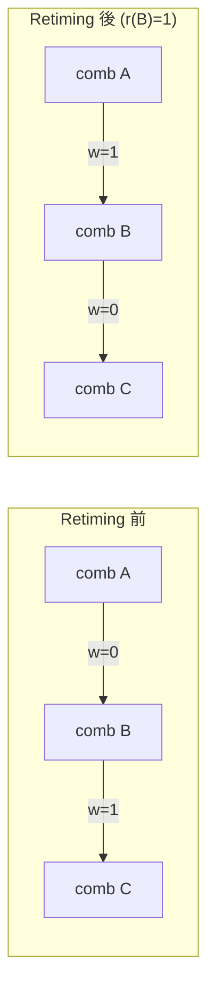

# 3.8 Retiming：Leiserson–Saxe 演算法與跨暫存器搬移的等價性

## 一個只用「搬」就能加速的問題

考慮一個同步電路：組合邏輯之間插著暫存器（正反器）。直覺告訴我們，時脈週期由「相鄰兩個暫存器之間最長的組合路徑延遲」決定。那麼問題來了：如果不改變電路的輸入輸出功能，只把暫存器沿著路徑前後搬移——有些往輸入方向搬、有些往輸出方向搬——能不能讓最長段變短？

答案是可以，而且理論非常優雅。這就是 retiming（重時序）：1981 年 Charles Leiserson（MIT，時為 CMU 博士生，後為 MIT 教授，亦是演算法聖經 CLRS《Introduction to Algorithms》的第二作者）與 James Saxe（Dartmouth）在 CMU 的會議論文中首次提出（"Optimizing Synchronous Systems"，1981 年 CMU Conference on VLSI；期刊版 1983 年 JACM "Retiming Synchronous Circuitry" 的前身），並於 1991 年在 Journal of the ACM 發表完整理論（Leiserson 與 James B. Saxe, "Retiming Synchronous Circuitry", Algorithmica 1991 亦有並列版本；一般引用以 1991 年 JACM/Algorithmica 的完整版為準）。在接下來的敘述中，我們以 1991 年完整版為準。

## 模型：圖上的延遲與週期

同步電路建模為有向圖 $G = (V, E)$：節點 $v$ 是計算元素（組合邏輯或暫存器），帶延遲 $d(v)$（組合邏輯的傳播延遲；暫存器的 $d=0$）；邊 $(u,v)$ 帶權 $w(u,v)$ = 該連線上暫存器的個數。

Retiming 是一個整數標號 $r: V \to \mathbb{Z}$，把每條邊的暫存器數改為

$$w_r(u, v) = w(u, v) + r(v) - r(u)$$

要求所有 $w_r \ge 0$（不能有負延遲邊）。這個公式就是全部魔法：把 $r$ 想成「時間的偏移」，$r(v)$ 大的節點相當於晚一拍執行，其輸入端自然需要多一個暫存器緩衝、輸出端則可以少一個。Leiserson 與 Saxe 證明了核心的等價性定理：若原電路功能正確且初值給定恰當，則 retiming 後的電路與原電路功能等價（對任意輸入序列，輸出序列在有限延遲意義下相同）。等價性的直覺在於：retiming 只改變「資料在哪一拍被取樣」，不改變計算的資料流拓撲。



上例中把一個暫存器從 B 與 C 之間搬到 A 與 B 之間，A 的延遲變成獨立一段，關鍵路徑由 $d(A)+d(B)$ 變為 $\max(d(A), d(B), d(C))$。

## 時脈週期的線性規劃

retiming 的兩大目標：min-period（最小化時脈週期）與 min-area（在週期約束下最小化暫存器總數，即 $\sum_{(u,v) \in E} w_r(u,v) \cdot cost$，通常 $cost$ 為位元寬度）。

Min-period 的關鍵觀察：給定候選週期 $c$，retiming 約束可以寫成一組不等式。對每條組合路徑 $u \rightsquigarrow v$（沿途無暫存器），retiming 後的組合延遲必須滿足

$$d(u) + \sum_{e \in path} \big(\text{無中間暫存器的延遲}\big) + d(v) \le c$$

亦即對每條邊 $(u,v)$（在壓縮圖中，一條邊代表一段無暫存器的組合路徑）：

$$r(u) - r(v) \le w(u,v) - \frac{c - (\text{該段組合延遲})}{1} \quad \text{（差分約束形式）}$$

更精確地，定義 $c(u,v) = d(u) + d(v)$ 為經過邊 $(u,v)$ 兩端點的組合延遲貢獻；Leiserson–Saxe 的標準形式化是把候選週期 $c$ 代入，構造約束圖（constraint graph）：節點同原圖，邊權為 $w(u,v)$（若 $d(u)+d(v) \le c$）或 $w(u,v) - 1$（若 $d(u)+d(v) > c$，此時要求該邊必須至少有一個暫存器以切割組合路徑，即 $w_r(u,v) \ge 1$，等價於 $r(u) - r(v) \ge 1 - w(u,v)$）。加上 $w_r \ge 0$ 的基本約束後，這是一組形如 $r(v) - r(u) \ge a(u,v)$ 的差分約束系統（system of difference constraints）——正是最短路徑問題的對偶形式。

## Floyd–Warshall 與 Bellman–Ford：可行性與求解

差分約束系統可行的充要條件是其對應的約束圖沒有負權環（negative cycle）。這給出 min-period retiming 的演算法骨架：

1. 對候選週期 $c$（從所有可能取值中做參數搜尋），構造約束圖。
2. 用 Floyd–Warshall（$O(|V|^3)$）或 Bellman–Ford（$O(|V| \cdot |E|)$）檢查有無負環；無負環則可行，且各節點的最短距離直接給出一組合法的 $r$。
3. 對 $c$ 做二分或從離散候選值集合中搜尋（候選值只可能是各節點延遲的組合和），得到最小可行週期。

```
RETIMING_MIN_PERIOD(G):
  candidates = {d(u) + d(v) : (u,v) ∈ E} 等離散值
  對 candidates 由小到大：
      建約束圖 G_c
      if Floyd–Warshall(G_c) 無負環:
          return c 與由最短距離導出的 r
```

Min-area retiming 則把 $c$ 固定為目標週期，以 $\sum w_r$ 為目標函數——這是一個線性規劃（且約束矩陣是網路矩陣，對偶為最短路徑/最小成本流結構），Leiserson 與 Saxe 給出了基於最短路徑的專門演算法。1991 年的論文還處理了更細的議題：初值（initial state）的設置以保證上電後功能等價（需要在搬移過的暫存器上設定正確的初始值，或在邊界插入額外邏輯）、fanout 與 I/O 約束（輸入輸出端的暫存器位置往往不能動）。

## 從理論到工具：Design Compiler 與 Vivado

Retiming 的工業落地花了將近二十年。1990 年代的 Synopsys 將 retiming 整合進 Design Compiler（相關技術部分來自 Synopsys 收購的 Viewlogic/Synopsys 內部研發與學界授權，具體版本自 1990 年代末的 `retime` 選項開始可用），在 standard cell 流程中與 resynthesis 結合：先 retiming 找出關鍵段，再對關鍵段做局部邏輯優化，反覆迭代。實務上工業 retiming 必須處理理論假設之外的現實：非理想時脈（skew）、測試性（scan chain 中暫存器順序不能亂動）、初值與形式驗證（retiming 後的電路必須通過 combinational/sequential equivalence checking，2000 年代初 Synopsys 的 Formality 等工具開始明確支援 retimed 電路的驗證）。

FPGA 側，retiming 的價值尤其大：FPGA 的邏輯延遲相對均勻（LUT + routing），但 routing 延遲變異大，且 LUT + FF 的結構使「搬 FF」有時能同時改善 timing 與 pack 效率。Xilinx 的 Vivado（2010 年代，繼承 ISE 的寄存器複製/搬移能力）在 placement 與 synthesis 階段都提供 retiming 選項（`retiming`、`register replication` 等 directive），其實作與物理綜合（physical synthesis）緊耦合——即在知道佈線延遲之後再決定搬移方向，這已超出 1991 年純組合延遲模型的範圍，是該理論在實務上的延伸。

## 與 Pipelining 的關係

最後釐清 retiming 與 pipelining（管線化）的關係。Pipelining 在組合路徑中「插入」新的暫存器，把延遲（latency，輸出到輸出的拍數）換取吞吐率（每拍一個結果）；retiming 則不增加總暫存器數（在閉合迴路中保持 loop 的暫存器數不變，這對遞迴電路是本質約束），只是重新分配位置。兩者的關係是：對前饋（無迴路）電路，retiming 可以實現相當於 pipelining 的效果（把既有暫存器推到關鍵路徑上）；對含迴路的遞迴電路（如 IIR 濾波器），retiming 的極限由迴路中暫存器數與迴路延遲決定（iteration bound，此概念由 Kung、Parhi 等人在 DSP 文獻中系統化，與 retiming 理論互補），此時需要 look-ahead transformation 等 HLS 技術才能再突破——這正是 3.2 節排程理論與本節 retiming 理論在 DSP 綜合中的交會點。在 HLS 流程中（3.1–3.3 節），排程決定了暫存器的初始位置，綁定決定了資料路徑，而 retiming 常被作為最後一道時序保險：讓演算法在暫存器位置上再自由一次，換取時脈的最後幾個百分點。

至此，我們完成了從 C 語言到時脈最終確定的整條邏輯綜合之旅：排程（3.2）→ 綁定（3.3）→ 兩級優化（3.4）→ 多級優化（3.5）→ ASIC 映射（3.6）→ FPGA 映射（3.7）→ retiming（本節）。這八十年間的每一個演算法，都還活在你今天使用的工具裡——從 Vitis HLS 的排程引擎，到 ABC 的 cut enumeration，到 Design Compiler 的 retiming 選項。演算法史的魅力正在於此：好的想法不會死去，只會換一身衣裳回來。
