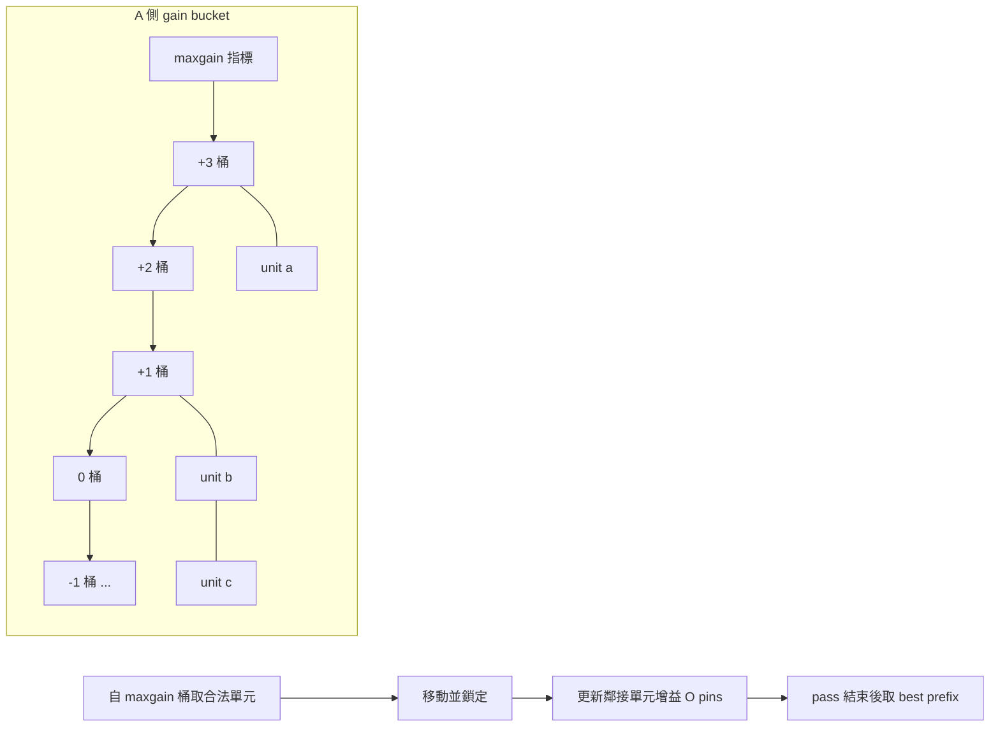

# 4.2 FM 演算法：gain bucket 資料結構與 O(n) 單次掃描

## 從圖到超圖，從成對到單點

KL 演算法（見 4.1）有兩個與電路現實脫節之處：電路 netlist 是超圖（一條 net 可以連接任意多個單元），KL 的圖模型只能把多元 net 拆成團或星狀，引入失真；此外每次交換兩個頂點、嚴格等分，成本又是 $`O(n^2 \log n)`$ 。1982 年，伊利諾大學香檳分校的 Charles Fiduccia 與 Roberto Mattheyses 在第 19 屆 Design Automation Conference（DAC 1982）發表〈A Linear-Time Heuristic for Improving Network Partitions〉，一舉同時解決這三個問題。這篇論文提出的 FM 演算法，至今仍是每一個商業與學術分區工具的核心引擎。

FM 的關鍵決策有三。第一，直接在超圖上定義增益：移動一個單元 $`v`$ 從 $`A`$ 到 $`B`$ ，其增益定義為

$$
g(v) = \sum_{e \ni v} \big( \text{FS}(e) - \text{TE}(e) \big),
$$

其中對每條含 $`v`$ 的 net $`e`$ ， $`\text{FS}(e)`$ （from-side）是 $`e`$ 在 $`A`$ 側的端點數減一， $`\text{TE}(e)`$ （to-side）是 $`e`$ 在 $`B`$ 側的端點數。直觀地說：若移動 $`v`$ 能讓某條 net 完全脫離切割面（該 net 在 $`A`$ 側只剩 $`v`$ ），該 net 的切成本就省下來；若移動 $`v`$ 反而把原本不在切割面上的 net 拉進切割面，成本就增加。這個定義與 net 的權重直接相乘，完全不需要把超圖退化成圖。

第二，每次只移動一個單元（single-cell move），而非 KL 的成對交換。這使演算法能在兩側面積不等的約束下自由移動：只要移動後 $`B`$ 側面積不超過上限 $`s \cdot W`$ （ $`W`$ 為總面積， $`s`$ 為平衡參數，例如 0.5 就接近等分），該移動就是合法的。平衡約束不再是「每次操作後等分」，而是「任何時刻都不越界」，這讓 FM 天然支援實際電路中大小懸殊的單元（一個 RAM macro 抵得上上千個 gate）。

第三，也是 FM 在計算史上最有名的貢獻：用桶狀結構把「找最大增益的合法單元」從線性掃描變成常數時間。

## Gain Bucket：O(1) 取最大值

增益值有上下界：一個單元的增益不可能超過它所接 net 的權重總和，更緊繃地，不可能超過最大 net 權 $`W_{\max}`$ 乘以 pin 數上限。因此在任何時刻，所有未鎖定單元的增益都落在 $`[-W_{\max} p_{\max},\ +W_{\max} p_{\max}]`$ 的整數範圍內。FM 為每一側開一個桶陣列 `bucket[maxgain + 1]`，第 $`i`$ 格是一個雙向鏈結串列，串著所有增益為 $`i`$ 的未鎖定單元，另維護一個指標 `maxgain` 指向當前非空的最大增益桶。

選擇移動對象時，從 `bucket[maxgain]` 的串列頭取第一個合法（滿足平衡）的單元即可， $`O(1)`$ ；找不到合法的就沿桶往下降，總成本攤提後仍是常數。單元移動後增益改變 $`\Delta g`$ ，只需將它從第 $`i`$ 桶摘下、插入第 $`i+\Delta g`$ 桶，並視情況更新 `maxgain`——雙向鏈結串列保證摘除也是 $`O(1)`$ 。

真正精妙之處在於增益更新的攤提分析。當單元 $`v`$ 移動時，只有與 $`v`$ 相鄰的 net 上的單元增益會變；令 $`P`$ 為所有 net 的 pin 總數（netlist 的「大小」度量），則一個 pass 中所有增益更新的總成本為 $`O(P)`$ ，桶操作本身也全部 $`O(P)`$ 。於是 FM 的單一 pass——包含初始化、 $`n`$ 次移動、與 KL 同款的 best-prefix 截斷——總時間是 $`O(P)`$ ，即輸入大小的線性時間。這正是論文標題「A Linear-Time Heuristic」的含義。



## Pass 的完整結構與與 KL 的對照

一個 FM pass 的骨架如下：

```
FM-pass(netlist, A, B, balance s):
  compute FS/TE for all cells; build gain buckets
  best = cut(); k = 0
  while exists unlocked legal cell:
    v = pick max-gain legal cell from buckets
    move v to the other side ; lock v
    for each net e incident to v:
      update FS/TE ; update gains of free cells on e (bucket move)
    k++
    record (gain_k, cut_k)
    if cut_k < best: best = cut_k ; bestk = k
  if bestk > 0: undo moves after bestk ; return improved
  else: return no improvement
```

與 KL 並列來看，FM 保留了「鎖定已移動單元、記錄增益序列、取 best prefix、多個 pass 直到無改善」的整個 KL 範式，但把操作單位從「交換一對」換成「移動一個」、把圖換成超圖、把最大增益搜尋從 $`O(n)`$ 掃描換成 $`O(1)`$ 桶取樣。效果是戲劇性的：FM 在相同的品質水準下比 KL 快一至兩個數量級，且一次 pass 內可做多於 $`n/2`$ 次的有效移動，對平衡約束的表達也更自然。

FM 的深遠影響延伸到整個實體設計領域。它確立的「gain bucket + critical net 增量更新」成為放置（placement）中迭代精修的標準技術；Krishnamurthy 在 1984 年提出多級 bucket（將 gain 拆成按 net 大小分層的多維鍵）以打破同增益單元之間的隨機平手；Dutt 與 Theny 及後續工作則改良了 FS/TE 增益對大型 net 的低估問題。而在分區問題本身，FM 將在 1990 年代與另一個思想——多層級（multilevel）——結合，產生能在百萬節點規模上工作的 hMetis。那將是下一節的主題。
