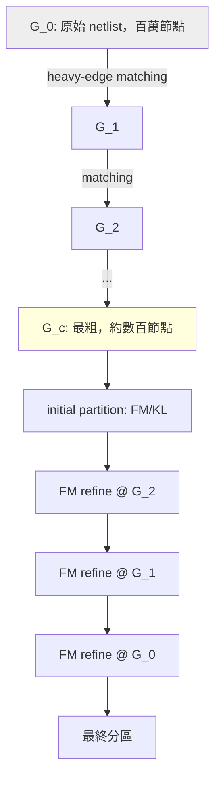

# 4.3 多層級切割：hMetis 的 coarsening–unrefinement 框架

## 單層 FM 的天花板

FM 演算法（4.2）把單次 pass 做到線性時間，但千禧年之前的電路已經有數十萬到百萬個單元，FM 的天生意限開始浮現：它是純局部移動，在巨大的 netlist 上，隨機初始解的局部極小數量以指數成長，FM 收斂到的解品質隨規模上升而惡化；每個 pass 雖然快，但需要越多 pass、品質卻越差。理論與工業界都需要一個「能看見全域結構」的方法，但全域方法（如譜方法、網路流）在當時又無法擴展。1990 年代中期，明尼蘇達大學的 George Karypis 與 Vipin Kumar 給出了答案：多層級（multilevel）框架。他們的圖分區工具 METIS（Karypis 與 Kumar，1995 年起的系列論文，SUPERTECH 技術報告與 1998 年 SIAM 版本）與超圖分區工具 hMetis（Karypis、Aggarwal、Kumar 與 Shekhar，1997 年 DAC 論文〈Multilevel hypergraph partitioning: applications in VLSI domain〉，及 1999 年 IEEE TCAD 期刊版）徹底改寫了這個領域的遊戲規則。

多層級框架由三個階段構成，形成一個 V 字形的工作流程：

1. Coarsening（粗化）：反覆將頂點合併成超節點，把 $n$ 個節點的超圖縮成數百節點的小超圖。合併時偏好沿「重邊」配對——兩節點間連接的 net 權重越大，越該被合併，因為重邊代表強耦合，合併它們最不會破壞未來切分時的自由度。常用策略是 heavy-edge matching（重邊匹配）：貪婪地依邊權由大到小配對頂點，或 randomized heavy-edge matching 增加多樣性。
2. Initial partition（初始分區）：在最粗、最小的超圖上跑 FM 或 KL。此時問題只有幾百個節點，FM 的全域視野相對充分，能在毫秒內找到高品質解。
3. Uncoarsening / refinement（展開與精修）：沿粗化的反方向逐層展開超節點，每展開一層就在當前層的解上跑一輪（限制式版本 的）FM 精修。越往下層節點越多、解的細節越豐富，FM 只需修正局部瑕疵。

## 為什麼多層級有效

直觀的解釋是尺度分離。真實電路的功能結構是層次化的：寄存器、模組、子系統層層嵌套，連接密度在模組內遠高於模組間。coarsening 的重邊匹配恰好是在「自動發現」這個層次結構——同一邏輯群組的單元被黏成超節點，跨群組的稀疏連接留待上層處理。於是初始分區看到的是電路的骨架而非毛細血管，FM 在骨架上不會迷失於局部極小；而下層的 FM 只在已經接近正確的大框架內做微調，每次精修的搜尋空間極小。換句話說，多層級框架讓一個本質上局部的演算法（FM）獲得了近似全域的視野，代價只是多跑幾次線性時間的精修。

理論上可以從兩個角度理解其品質優勢。其一是解空間樣本化：不同的 matching 隨機性讓同一 netlist 產生許多不同的粗化序列，各自收斂到不同局部極小，取最佳者即可，這等於廉價地實現了多起點搜尋。其二是逐層問題縮減：在第 $k$ 層上 FM 的有效問題規模是 $n/2^k$ 量級，整體總工作量是幾何級數，$\sum_k O(P/2^k) = O(P)$——多層級框架保持 FM 的線性時間，同時大幅提升品質。hMetis 的實驗顯示，在 ISPD98 benchmark（IBM 提供的 21 萬節點電路套件，1998 年）上，多層級方法切邊比單層 FM 少 5% 到 50%，且在百萬節點級 netlist 上分鐘內完成。這個量級的改善直接轉換為晶片面積與線長的節省，工業界幾乎立即採用：Cadence 在 1990 年代末與 Karypis 合作將多層級技術引入其分區引擎，開源版 METIS/hMetis 則成為學術界與其他行業（網頁圖分區、平行計算負載平衡、社區偵測）的實際標準——一個由兩位平行計算背景的研究者寫出的 VLSI 工具，最終成為橫跨多學科的基礎設施，這在 EDA 學術工具史上是少數的例子。

Karypis 與 Kumar 之後把多層級思想推廣到多目標與多約束版本（hMetis-R/-K，multi-constraint partitioning，1999），使分區能同時平衡面積、記憶體、通訊等多個維度——這對 multi-FPGA 系統至關重要，因為每顆 FPGA 的 LUT 與 I/O 資源各有上限。而多層級框架的影響遠不止分區：後來的全域放置（如 MLPart、多層級 quadrisection）皆直接承襲此框架。

coarsening 的實作細節值得一提。每輪 matching 選定配對後，被合併的超節點權重為成員權重之和，兩者間的 net 權重則累加到「內部」；net 大於某閾值（hyperedge size limit，預設約 100）時通常不再參與配對，避免一條巨 net 把半個電路黏成一團。層數由最小允許的超節點數決定，hMetis 通常把百萬節點的 netlist 縮到數百節點、歷經二十至三十層。uncoarsening 端則有一個重要細節：展開一層時，超節點的成員在上一層被視為不可分割的整體，這意味著下層的 FM 精修只有在「超節點邊界」附近才自由——搜尋範圍逐層放大，品質與成本都可控。

V-cyclic 的加強版本也值得記錄：hMetis 提供 -c 選項做多次 V 型往復（coarsen 到中間層再重來），以及將 FM 精修的目標從單純切邊改為切邊與通訊量的加權組合（K-way 版本的 hMetis-K）。這些工程選項在 1999 年 TCAD 論文中系統性地做過消融實驗，成為後續所有多層級工具的方法學範本。

## 戰場

分區演算法成熟之後，真正的戰場在應用端。哪裡最需要它？1980 到 1990 年代的硬體模擬（emulation）產業，與 ASIC 的階層式設計流程，是兩個把分區推向數百萬美元商業價值的戰場——QuickTurn、Zycad、IKOS 這些公司如何在 pin limitation 的物理限制下，用分區演算法把整個晶片塞進數十顆 FPGA。這是下一節的故事。
