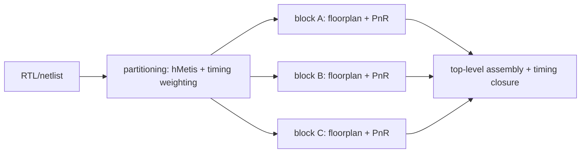

# 4.4 切割的戰場：Multi-FPGA 模擬與 ASIC 模組化設計

## Emulation：把整個晶片塞進一櫃 FPGA

1980 年代後期，ASIC 設計變得龐大到軟體模擬器跑不動的地步：一顆數十萬閘的晶片，在當時的工作站上模擬一秒的實際運作可能要數小時到數天，而驗證恰恰需要跑完整的韌體與應用程式。產業的回應是硬體模擬器（emulator）——用大量可重組態邏輯（最初是 custom chips，很快轉為 FPGA）直接實作被驗證的設計，以接近或超過百萬倍的速度換取「全速、真實環境」的驗證。Zycad 於 1980 年代中期率先以 XP 系列客製化處理器切入加速/模擬市場；QuickTurn 由 L. Curtis Widdoes 等人於 1988 年在加州創立（Widdoes 是 S-1 超級電腦與 Valid 模擬器時代的工程老將），其 Reality Engine/Systems Realizer 用數十到數百顆 Xilinx FPGA 互連；IKOS 則於 1989 年在 Milpitas 成立，以 compiler-driven 的多晶片模組（後來也轉用 FPGA）為特色。1990 年代這三家與 Mentor（後來併購 QuickTurn 未成、另發展 Celaro）、日本 Nianta 等形成激烈的模擬器市場，QuickTurn 與 IKOS 最終在 2000 年代初皆併入 Cadence 與 Mentor，血統延續至今日 Palladium（Cadence）與 Veloce（Siemens EDA）產品線。

模擬器架構的核心物理限制只有一個：FPGA 的 I/O pin 數遠少於其內部邏輯容量。一顆當年的 FPGA 約有數萬個 LUT 與數百個 pin，比例上「裝得下卻連不出」。設計一旦被切成 $`k`$ 份跨 $`k`$ 顆 FPGA，每條跨晶片 net 都要消耗兩端各一個 pin；若 netlist 未經良好分區，跨晶片 net 數輕易超過 pin 預算，模擬器就裝不下這個設計——無論 FPGA 多便宜。更糟的是，跨晶片 net 無法直接連線（pin 不夠），模擬器必須用 time-multiplexed 虛擬互連（以多個時槽共用一組實體線），每條虛擬線都吃掉全域時脈預算，直接降低模擬速度。因此 multi-FPGA 分區是一個雙目標問題：最小化跨晶片 net 數（pin 滿足度），同時最小化 time-multiplexing 的槽數（速度）。學術界發展出 min-cut 反覆修正、以 net-cut 數為主要目標的 multi-way partitioning（hMetis 的 multi-constraint 模式即是回應此需求：同時平衡每顆 FPGA 的 LUT 用量與 pin 用量）。 QuickTurn 與 IKOS 的工具鏈中，分區品質直接決定了「哪些客戶設計可被模擬」與「模擬跑多快」，這使得 partitioning 從學術問題變成產品的核心競爭力——一個演算法工程師對 net-cut 的 10% 改善，能讓一片賣數百萬美元的模擬器支援更大的設計。

## ASIC 階層式設計與 timing-driven partitioning

戰場的另一側在 ASIC 內部。1990 年代的 ASIC 設計流程是標準的 top-down hierarchical flow：先做 block-level floorplan 與 partition，把數百萬閘切成可獨立佈局佈線的模組，每個模組由不同設計師或不同 EDA 工具 run 完成。切割的目標不再是單純的 net-cut 最小化，而是三個目標的折衷：(1) 模組間介面 pin 數（決定頂層走線通道與 block 邊界延遲）；(2) 切割後各模組面積利用率（floorplan 的可行性）；(3) 時序關鍵路徑不被切斷，或切在可承受的邊界上。第三項催生了 timing-driven partitioning：以靜態時序分析估計每條 path 的 slack，把 slack 緊的 path 端點「黏」在一起（在 FM 增益中加分或直接做 net weighting），使分區不在時序上開洞。Alpert 與 Liu 等人 1990 年代的 net weighting、clustering-based timing-driven 方法即是此思路的代表。

經濟上，這是「分工」的邏輯：切割讓大型設計可被並行開發、可被多個 tool run 各自最佳化、可讓 macro 與 std-cell 各安其位。分區品質每差 10%，block 邊界的走線與 buffer 就多一圈，timing closure 就多幾週工程師時間——以 1990 年代一顆 ASIC 數百萬美元的 NRE 來說，partitioning 是投資報酬率極高的演算法戰場。

## 延續到 chiplet 時代

進入 2020 年代，同一個問題以更巨大的經濟規模回歸。Chiplet 與 2.5D/3D 封裝（UCIe 互連、CoWoS、EMIB）把「跨邊界成本」從一根走線變成一顆 die-to-die 介面：功率、延遲、測試、良率、異質製程成本全部押在「把系統切成哪幾塊」的決策上。與 1990 年代 ASIC partitioning 相比，變數更多（不同 die 可用不同製程節點、HBM 頻寬與 SerDes 位置成為新的 pin 資源、熱與供電成為硬約束），但數學核心未變：以成本模型驅動的平衡多路分區，FM/hMetis 血統的啟發式仍是主力，只是 cost function 換成了跨 die 頻寬、功耗與封裝成本。分區演算法的戰場每十年換一次武器，戰術核心卻三十年如一日。

而當我們把尺度從「系統切成模組」縮小到「die 內部的宏觀佈局」——哪些 block 放在哪裡、形狀如何切——問題就從 partitioning 滑向 floorplanning。那是另一個組合最佳化的經典戰場：slicing tree 與模擬退火的故事，下一節登場。
