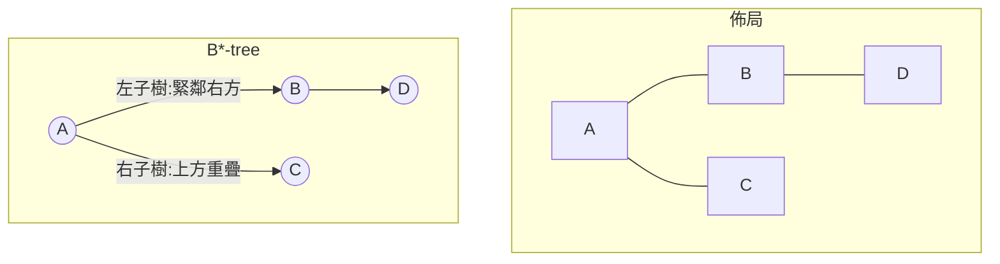

# 4.6 B*-tree 與非切片結構：Wong–Liu 框架的演進

## 非切片編碼的競逐年代

1990 年代後半，floorplanning 研究社群展開了一場「編碼競賽」：誰能找到一種資料結構，既能表達所有非切片佈局、又小而快、又支援高效率的鄰域 move。競賽的起跑線是 Murata、Fujiyoshi、Nakatake 與 Kajitani（東京工業大學）的 sequence pair：1995 年在 ISPD/ICCAD 發表、1996 年擴充為 IEEE TCAD 期刊論文〈VLSI module placement based on rectangle-packing by the sequence-pair〉。sequence pair 用兩個模組名稱的排列 $`(S_+, S_-)`$ 編碼任意不重疊佈局：模組 $`a`$ 在 $`b`$ 左邊若且唯若 $`a`$ 在兩個序列中都排在 $`b`$ 之前（ $`a \to b`$ 同時出現於 $`S_+`$ 與 $`S_-`$ ）； $`a`$ 在 $`b`$ 上方若且唯若順序在兩序列中相反。由這對排列可以唯一重建所有模組的相對位置，重建時間 $`O(n \log n)`$ 或更快。任何佈局都有對應的 sequence pair，任何 sequence pair 都對應合法佈局——這種雙射性使它成為退火搜尋的完美載體，Wong–Liu 框架的三種 move（交換、旋轉、平移）直接平移過來。緊接著，Guo、Cheng 與 Chou 於 1999 年 ICCAD 提出 O-tree（帶序樹，以左邊界 contour 重建位置），空間更小；Hong、Xu、Wu 等人於 2000 年提出 corner block list。每一種都宣稱更快的重建或更緊的搜尋空間，學術會議上這是五、六年間最熱鬧的戰場。

## B*-tree：contour 的有序樹

競賽中影響最深遠的方案來自 Yao-Wen Chang、Yung-Ching Chang 與 Guang-Ming Wu（台大團隊，指導教授為 Martin D. F. Wong 的學生輩合作網絡）於 2000 年 ASP-DAC 發表、2000 年 IEEE TCAD 期刊擴充的〈B*-trees: a new representation for non-slicing floorplans〉。B*-tree 是模組「左下輪廓」的有序二元樹編碼：給定佈局，把每個模組視為一個節點；節點 $`u`$ 的左子樹根是緊貼在 $`u`$ 正右方的第一個模組（ $`x_u + w_u = x_v`$ ），右子樹根是 $`u`$ 上方第一個水平重疊的模組（ $`y_v \ge y_u`$ 且 $`x`$ 區間重疊）。樹的先序遍歷即解碼順序：逐一把模組放到「不與已放置模組重疊的最左下位置」，位置由 contour（輪廓鏈結串列）決定，整個重建在 $`O(n)`$ 時間完成。

B*-tree 的妙處在於它不只編碼拓撲，還隱含了 packing（壓實）動作：任何 B*-tree 解碼出來的佈局自動是 compacted（每個模組都被推到左下極限）。這消除了 sequence pair 的一個缺陷——sequence pair 的解碼可能產生未壓實的佈局，退火必須在成本函數中另加壓實項或在每次評估前壓實。packed B*-tree（Chang 與其學生後續於 2004 年 TCAD 提出的 fast B*-tree 變體）進一步把左傾/下傾的 packing 語義加入樹的建構，使單次解碼即得最緊佈局。move set 也極其自然：旋轉模組、刪除再插入節點（換位置）、交換兩節點——每次 move 後 $`O(n)`$ 重解碼、 $`O(n)`$ 評估成本，與退火的一步開銷嚴絲合縫。

## Wong–Liu 框架的延續與現代迴響

關鍵的歷史連續性在於：B*-tree 論文並沒有發明新的搜尋引擎。它沿用的正是 Wong–Liu（4.5）確立的「編碼空間 + move set + 模擬退火 + 溫度排程」整套框架，只是把 slicing tree 的 normalized Polish expression 換成了非切片的 B*-tree。Wong 本身就是 1986 年那篇論文的作者——十五年後他與學生張耀文用自己的框架吃下了自己當年定義的 slicing 世界，這在 EDA 學術史上是一則完整的傳承故事。2000 年代初的 benchmark（MCNC、GSRC）上，B*-tree 系演算法（如 MB*-tree 處理軟模組與固定邊框、PKU 系列處理預放置約束）相繼成為最優解紀錄保持者，B*-tree 也被整合入商業工具的 floorplan 引擎。

各編碼之間的取捨可以用一張表收攏：sequence pair 空間為 $`O((n!)^2)`$ 個合法編碼、解碼 $`O(n \log n)`$ ，表達力最完整；O-tree 只編碼 packing 後的拓撲、空間 $`O(n!)`$ 量級、解碼 $`O(n)`$ ，但無法表達「刻意留白」的佈局；corner block list 沿四角遞迴刪除、支援 $`O(n)`$ 解碼與較緊的鄰域；B*-tree 則以 contour 解碼與天然的 compacted 語義取勝。實務比較的結論大致是：在小到中規模（ $`n \le 200`$ ）且要求壓實佈局時，B*-tree 的 move 效率最高；sequence pair 因雙射性與理論完整性仍在軟模組與預放置約束變體中佔一席之地。編碼競賽到 2005 年前後塵埃落定，勝利者不是任何單一結構，而是「tree/list 編碼 + contour 解碼 + 退火」這個模式本身。

值得誠實記上一筆的是退火時代的落幕方式。2000 年代中期，analytical placement（力導向、非線性最佳化）在大規模標準單元放置上全面勝出，退火只在模組數數十到數百的 floorplanning 級距維持優勢。而 2021 年，Google 的 Mirhoseini 等人在《Nature》發表 RL for chip placement，宣稱強化學習在 macro placement 上超越人類與學術方法，引發 EDA 界關於評測公平性、訓練成本與可重現性的著名論戰（CAD contest 與 2022–2023 年的後續論文對其做了嚴格檢驗）——本書將在 9.3 節完整剖析這場論戰。但無論搜尋引擎換成退火、力導向還是 RL，問題的本體從未改變：模組矩形不重疊、面積線長折衷、pin 對齊與熱約束。從 Ohtsuki 的 slicing 到 B*-tree 的 contour，四十年間變的是編碼與搜尋，不變的是「把矩形排好」這個古老而常新的組合問題。至此，本書完成了分區與樓板規劃這條主線；接下來的章節將轉向佈局之後的工序——佈線與時序。
