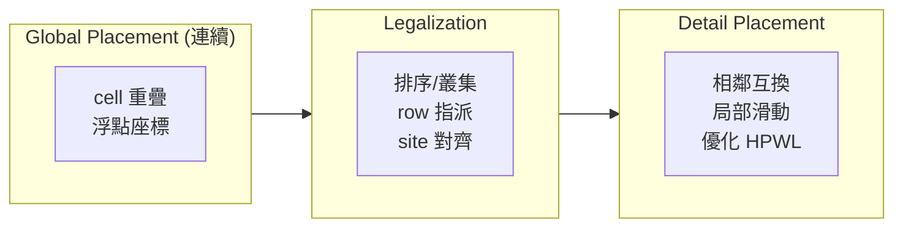

# 5.5 Legalization：從連續座標到站位與晶格的對齊

分析式擺放與模擬退火都屬於「全域擺放」（global placement）：它們在連續座標空間中追求線長與密度的平衡，但產出的 cell 座標既可能互相重疊，也不落在製造所需的離散格點上。把這個連續解變成「每個 cell 佔據一個合法站位（site）、互不重疊、且盡量不破壞線長」的合法布局，是擺放流程的最後一哩——legalization（合法化）。這一步看似工程雜務，實則有自己豐富的演算法史，而且它的品質直接決定前面所有數學努力的成敗：一次糟糕的合法化可以把優美的全域解的線長拉長數十個百分點。

## 問題的形式化與難度

標準 cell 流程中，晶片被劃分為等高的 row，每個 row 是一維的 site 序列（寬度通常為 M2 金屬層 pitch 的整數倍）。Legalization 要把每個 cell 指派到某個 row 的某個 site 區間，滿足：(1) 同一 row 內 cell 不重疊；(2) cell 位置盡量接近其全域座標；(3) 總線長增加最小。這本質上是一個帶容量限制的一維／二維指派問題。它仍然是 NP-hard（即使只考慮一個 row 的線性排列，最優指派也非平凡），因此所有實用方法都是啟發式——但它們的啟發式設計有其數學品味。

## Tetris：2002 年的簡單與有效

最著名也最長壽的合法化演算法是 Patrick Hassett 與 Mehmet Can Yildiz 等人在 2002 年提出的 Tetris（Hill, "Global and Detailed Placement" 一系工作中廣為流傳的實作；該演算法以俄羅斯方塊為名，因為它像堆疊方塊一樣把 cell 逐個安放）。其流程：

```text
將所有 cell 依 x 座標排序
for cell c in 排序後的序列:
    在 c 的目標 x 附近, 找出最能容納 c 的 row 與空位
    (候選 = c 所在 row 及相鄰 row, 選線長增加最小者)
    將 c 安放於該位置, 更新該 row 的佔用狀態
```

Tetris 的優點是極快（$O(n \log n)$）且實作簡單，直到今天仍是許多開源工具與教學實作的第一選擇。缺點也明確：它按一個固定的全局順序貪心安放，容易在局部造成 row 之間的密度失衡，導致後續 cell 被迫遠離原位，線長退化可達 10–20%。它的成功說明了一個工程學道理：一個「不太差、極便宜」的演算法往往比一個「最優但昂貴」的演算法更能存活。

## Abacus：Kahng 與 Lienig 的改進

2000 年代初，Kahng、Reda 與 Liu 等人（以及獨立發展的相關工作，常與 Jens Lienig 團隊的工程實踐並列引用）提出了 Abacus 合法化。Abacus 的核心改進有二。第一，它以 row 為單位進行「叢集化」：當一個 cell 要放進某個 row 時，不直接落位，而是先與該 row 中已安放的 cell 組成叢集（cluster），叢集內部允許重排（保持順序地緊密排列），並以二次規劃求解叢集的最優整體位置。第二，當叢集超出 row 邊界或造成過大線長損失時，允許把 cell 「溢出」到相鄰 row 重新叢集。流程示意：

```text
for row in 按與 cell 群距離排序的 rows:
    cluster_list = []
    for cell c in 該 row 的候選 cells (依 x 排序):
        嘗試將 c 加入 cluster_list 的最後一個 cluster
        重新計算 cluster 內最優緊密排列 (二次式)
        if 超過 row 邊界 or 線長損失超限:
            把 c 溢出到下一個 row, 重新開始
    對每個 cluster, 以其內 cell 的一次規劃求最優 x
```

Abacus 在多數 benchmark 上把合法化後的線長退化壓到 1–3%，成為繼 Tetris 之後的另一個廣泛實作的標準。它與 Tetris 的對比很有啟發：Tetris 逐 cell 貪心，Abacus 逐 cluster 優化——把決策粒度從單一 cell 提升到可重排的群體，品質提升便水到渠成。此後的研究（如 2010 年代的混合整數規劃式合法化、基於最小成本流的 cell-to-site 指派等）多在這兩個端點之間尋找速度與品質的新折衷，並未出現典範級的顛覆。

## Legalization 前後：示意



合法化前後的幾何差異可以用一維示意想像：全域解中五個 cell 擠在兩個 row 的交界處且互相重疊，合法化後它們被攤開到各自的 row、彼此緊鄰但不重疊，且每個 cell 的左邊界對齊 site 格點。以下 pseudo 描述這個「攤開＋對齊」的兩步本質：

```text
Legalize(cells, rows):
  1. row 指派: 依 y 座標把 cell 分到最近的 row (考慮 row 容量)
  2. row 內排布: 在每個 row 內, 保持相對順序地緊密排列
     (白空隙向兩端擠), 使 x 對齊 site 邊界
  3. 迭代修正: 若某 row 超載, 把末端 cell 推到鄰 row (溢出)
```

## FPGA 的對齊：cluster 與 site 的雙重約束

FPGA 的合法化呈現不同面貌。FPGA 的最小擺放單位不是等寬 site 上的 cell，而是一個「邏輯塊」必須放進一個與其類型匹配的 site——例如一個含 4 個 LUT＋4 個 FF 的 slice，若擺放階段產生的 cluster 用了 3 個 LUT＋4 個 FF，它只能放進相容的 slice 類型，且 LUT 與 FF 到 slice 內部具體位置的指派（稱為 intra-cluster placement 或 pin placement）也要合法。這使得 FPGA 的「合法化」常與 clustering 階段（把 LUT/FF 打包成 slice 的打包問題，如多倫多大學的 T-VPack 之後繼者）及 pin assignment 交織，難度不在「攤開」而在「類型匹配與內部指派」。實務上，SA 擺放天然產出合法座標（swap 只發生在合法 site 之間），因此 FPGA 流程中通常沒有獨立的 legalization 步驟——這也是 FPGA 與 ASIC 擺放流程的一個根本分野。開源工具鏈（如針對 iCE40/ECP5 的 nextpnr）同樣在擺放移動中直接維持合法性，而 veryl2chip 這類開源 FPGA 後端在呼叫 nextpnr 時，正是依賴這個機制保證輸出的位元流可映射到實際晶格。

## Legalization 與 detail placement 的分野

最後要區分兩個常被混淆的概念。Legalization 只求「合法」：消除重疊、對齊格點，目標是線長損失最小。Detail placement（細部擺放）則在合法解之上做進一步優化：在保持合法性的約束下，做相鄰 cell 互換、row 內滑動、白空隙再平衡等微調，把 HPWL 與時序再壓低幾個百分點。兩者的關係像「先求有、再求好」：legalization 是 detail placement 的起點，detail placement 是合法解的拋光。在現代工具中，兩者常以「合法化—細部優化」交替的迭代形式出現，每輪先鬆開一部分 cell 再重新合法化，以逃離局部最優。

到此為止，我們已把 cell 安放在合法位置上。但擺放的故事還沒講完：cell 的 pin 接到 net 上的哪一端、以及 I/O 訊號與電源如何從晶片邊界進出，是兩個「小」問題——卻是任何晶片不做就會壞的問題。下一節我們看 pin assignment 與電源網這兩件擺放之後的隱形工程。
