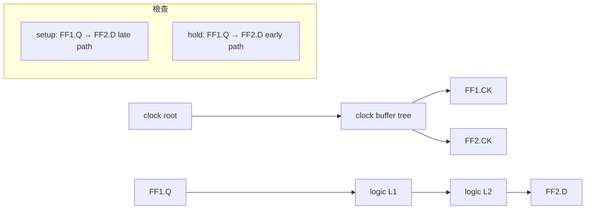

# 06.2 DAG 上的最長路徑：拓撲排序與 STA 的計算框架

如果說 Elmore delay 提供了 STA 的「原子」（單一 RC 網路的延遲數字），那麼靜態時序分析本身提供的則是「化學」：把幾十萬個 cell 的延遲原子，沿著數百萬條邏輯路徑組合起來，變成一次全域的違約報告。這個組合過程在演算法上出人意料地簡單——它是一個有向無環圖（DAG）上的最長路徑問題，用拓撲排序加一次線性掃描就能在 $O(V+E)$ 內解完。一個演算法課第二章就教過的問題，支撐起每年數十億美元的 EDA 時序工具市場。本節講清楚這個框架怎麼來、怎麼算、又為什麼在 1990 年代被商業化成 Synopsys PrimeTime 這樣的標準產品。

## 為什麼不是模擬：STA 誕生的工程與經濟背景

1970 年代的數位晶片設計用「事件驅動模擬」驗證時序：給定輸入激勵，模擬器逐事件算出每個節點的波形變化。這條路的根本困境是組合爆炸：要證明一個有 $n$ 個輸入的組合電路在所有輸入組合下都滿足時序，理論上要模擬 $2^n$ 種激勵。IBM 在 1970 年代設計 308x 系列大型主機時，面對的正是這個問題——每顆機器的邏輯圖以萬計，靠向量模擬逐一驗證時序在經濟上不可行。IBM 內部因此在 1970 年代末發展出「timing verifier」的路線：不驅動激勵，而是把整個網路當成一個帶延遲標註的圖，直接問「圖上最長的路有多長」。Stélios Xanthakis 等人的工作、以及 1980 年代 Ousterhout 在 Berkeley 發展的 Crystal（1984）與其後的 Timberwolf 生態系，都是這條路線的學術側代表。TI、Bell Labs、日系與歐系大廠（Toshiba 的 CVT、Philips 的 TIMA 等）在 1980 年代也各自有內部 STA 工具。共同的驅動力是經濟的：ASIC 與標準 cell 方法論在 1980 年代興起，委外設計（design center、ASIC vendor）模式要求一個「設計者與代工廠都能跑、結果可仲裁」的時序驗證方法，這只有不依賴激勵的靜態方法做得到——激勵是設計者的主觀選擇，圖結構是客觀事實。

STA 與模擬的關係不是取代而是分工：模擬（後來是 SPICE 級的電路模擬）驗證「功能與關鍵電路的行為」，STA 驗證「所有路徑的時序完備性」。這個分工最終被制度化了：模擬波形是除錯工具，STA 報告是 signoff（簽核）文件。

## 電路的圖模型：timing arcs 與約束

把邏輯網路變成圖的規則如下。每個 cell 的每個輸入腳到輸出腳之間是一條弧（timing arc），帶著延遲屬性；每個腳是一個節點。時鐘路徑從 clock root 經過 clock buffer 樹到各個 flip-flop 的 CK 腳；資料路徑從發射 flip-flop 的 Q 腳，穿過組合邏輯，到捕捉 flip-flop 的 D 腳。時序檢查分兩種：setup（建立時間）是 late/long-path 檢查，要求資料在下個時鐘沿之前足夠早到達；hold（保持時間）是 early/short-path 檢查，要求資料不要在同一個時鐘沿之後太快到達而破壞當前值。以最簡單的兩個 flip-flop 為例，setup 檢查寫成：

$$
t_{clk\to Q}^{FF1} + t_{comb} + t_{setup} \le T_{clk} + t_{skew}
$$

重排後，「路徑到達時間」（arrival time, AT）與「要求的時間」（required time, RT）之差定義為 slack：$slack = RT - AT$（setup，越大越好）；hold 則反號。任何一條 slack < 0 的路徑就是違約路徑，其中 slack 最小的那條叫 critical path。cell 庫的每條弧的延遲不是常數，而是一個查表函數 $\text{delay}(t_{in\,slew}, C_{load})$——這正是 6.1 節 Elmore 模型把繞線折算成等效負載後接上的介面。

## 拓撲排序與最長路徑：$O(V+E)$ 的計算

DAG 上最長路徑（含正權重）在一般圖上等價於 Hamiltonian path，是 NP-hard；但在 DAG 上，因為沒有迴路，可以沿拓撲序一次掃描完成。演算法用 Kahn 的 1956 年代碼版本（Kahn, "Topological sorting of large networks", CACM 1962——這個演算法原本是為了在通訊網路上排程而設計的，後來成了編譯器 build 系統與任務排程的標配）：

```text
# 計算所有節點的 arrival time（late analysis）
indeg[v] = 入度(v)
queue = {v : indeg[v] == 0}          # 主輸入 / clock root
AT[v] = 0 對所有 v
while queue 非空:
    u = queue.pop()
    for (u -> v) in edges(u):        # timing arc
        cand = AT[u] + arc_delay(u,v)
        if cand > AT[v]:             # 最長路徑 = 取 max
            AT[v] = cand
    indeg[v] -= 1
    if indeg[v] == 0:
        queue.push(v)
```

early analysis 完全對稱，只是把 max 換成 min、用 short-path arc 延遲。算完 arrival time 之後，再做一次反向掃描（沿逆拓撲序）計算 required time 與每個節點的 slack。總複雜度 $O(V+E)$，其中 $V$ 是腳位數、$E$ 是 timing arc 數，對百萬閘設計而言是秒級到分鐘級的計算——對照模擬的組合爆炸，這就是 STA 能成為迭代優化內核的原因：佈局演算法每移動一個 cell 就要重估時序，只有線性時間的 STA 撐得住每秒呼叫上百次。

實作上有兩個值得軟體工程師注意的細節。第一是圖的構建：組合迴路（例如無時鐘的 SR 閂鎖器、組合回饋）會讓拓撲排序失敗，STA 工具必須偵測迴路（對剩餘入度不為零的節點做強連通分量分析），要嘛報錯要嘛標記為 false path 忽略。第二是時鐘樹：時鐘不是一條邏輯路徑而是一棵樹，clock latency/skew 要先在時鐘樹上單獨傳播，再把 skew 併入各 flip-flop 的時間預算——這就是為什麼工具裡「propagate clocks」是一個獨立開關。



## 商業化：PrimeTime 與 STA 的標準化

1986 年 Kirk Guthaus 與 Aart de Geus 等人創立 Synopsys，最初的產品正是設計編譯器（Design Compiler）——把 RTL 綜合成網表，而綜合過程的內核就是 STA：每一次邏輯優化都要用 STA 評分。Synopsys 選擇了「timing-driven」這條路，等於把 STA 從驗證工具變成了優化引擎的一部分。1990 年代中期，Synopsys 推出獨立的 signoff 級 STA 工具 PrimeTime（約 1996 年），把圖構建、arc 查表、例外處理（false path、multicycle path）、報告格式標準化，迅速成為產業事實標準。同時代還有 Cadence 的 Pearl/Envisia 路線與 Matsushita、NEC 等廠的內部工具，但 Synopsys 贏在兩件事：一是 .lib（Liberty）格式成為 foundry 交付 cell 庫的通用介面，二是 DC/PrimeTime 構成「綜合與簽核同一套延遲模型」的閉環——設計者不再需要擔心優化用的數字和簽核用的數字對不上。

這段歷史的關鍵教訓是演算法經濟學：STA 的演算法本身（Kahn 拓撲排序 + 最長路徑）沒有任何專利壁壘，任何研究生一週就能寫出核心。PrimeTime 的護城河在於週邊：數百種 cell 庫格式的解析、例外約束語言（SDC）的語義、與綜合/佈局工具的資料一致性、以及 foundry 的 signoff 認可。換言之，STA 商業化的故事裡，純演算法只佔價值鏈的很小一部分，這是 EDA 產業的普遍規律。

## 框架的極限

$O(V+E)$ 的 STA 框架有一個隱含假設：每條弧的延遲是一個確定的數字。但隨著製程從 0.25µm 縮到 90nm 以下，同一個 cell 在同一顆晶片的不同位置、不同溫度、不同電壓下的延遲可以差到 30% 以上，「確定數字」這個前提開始動搖。EDA 產業的回應不是放棄 STA 框架，而是在框架上疊加一層又一層的「悲觀性修正」——CPPR、OCV、AOCV——這場時序收斂之戰，是 6.3 節的主題。
