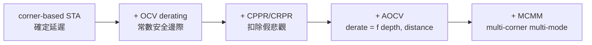

# 06.3 時序收斂之戰：CPPR、OCV 與製程變異

6.2 節的 STA 框架建立在一個樸素假設上：每條 timing arc 有一個確定的延遲數字，全晶片共用一套「corner」條件。這個假設在 0.25µm 以上的製程勉強成立，但隨著製程節點推進到 90nm、28nm、乃至 7nm，晶圓上的物理現象開始系統性地摧毀它。本節講的是 STA 框架的「補丁史」——CPPR、OCV、AOCV、multi-corner multi-mode——以及這些補丁背後的工程文化與商業競爭。理解這段歷史的鑰匙是一個簡單的洞察：與其發明新演算法，產業選擇在既有 $`O(V+E)`$ 框架上疊加悲觀性修正，因為框架本身（與它的介面標準）太值錢了，動不得。

## 為什麼製程縮小會打破「一個數字」的假設

三個物理因素在 2000 年代初集中爆發。第一是製程變異（process variation）：隨著特徵尺寸縮小，摻雜原子數的隨機起伏（RDF, random dopant fluctuation）、閘極氧化層厚度的原子級差異、以及微影曝光的系統性誤差（晶圓上的位置相關 CD 變異），使得同一張 layout 上兩個相同 cell 的延遲可以差到百分之十幾，而且同晶片內（intra-die）與晶片間（inter-die）的變異比例不斷擴大。第二是電壓與溫度的空間梯度：一顆 28nm SoC 上不同功能區塊的工作電壓與結溫可以相差可觀，wire delay 與 cell delay 對它們的敏感方向還相反（cell delay 隨電壓降低而變慢、隨溫度升高而變慢；wire delay 的 RC 卻隨溫度升高而略降）——這造成所謂「溫度反轉」（temperature inversion）現象，在同一條路徑上快慢的判斷隨製程節點反轉。第三是互連的耦合電容：相鄰繞線之間的耦合電容使得一條線的延遲取決於鄰線的切換方向（crosstalk-induced delay），最好的情況與最壞的情況可以差一倍。

EDA 產業的第一反應是 PVT corner：把製程（SS/TT/FF 等速度角）、電壓、溫度的組合離散成幾個極端點，每個 corner 交付一套 .lib，STA 在每個 corner 各跑一遍，取最壞。這是「最壞情況設計」的傳統思路，成本是 corner 數量的乘法——5 個 timing mode 乘 4 個 corner 就是 20 次全晶片 STA。但 corner 方法有一個更深的缺陷：它把所有最壞情況同時施加，而物理上這些最壞情況往往不會同時發生在同一條路徑上。由此產生了兩類「假悲觀」（pessimism），也正是本節兩個主角 CPPR 與 OCV 登場的原因。

## CPPR：同一條時鐘路徑上的假悲觀

考慮 6.2 節的 setup 檢查：發射 flip-flop 的 clock path 走過一串 buffer，捕捉 flip-flop 的 clock path 走過另一串 buffer。問題來了：這兩條 path 在 clock 樹的根部共享前段 buffer。如果我們對發射 path 用「快 corner」的數字、對捕捉 path 用「慢 corner」的數字（這是 setup 檢查下 OCV derating 的標準做法——發射要「晚」，捕捉 clock 要「早」，放大窗口），那麼共享的根部 buffer 會被同時計兩次相反的 derating，得出「根部 buffer 同時又快又慢」的荒謬結論，造成大量虛假的 setup 違約。這就是 clock path pessimism（時鐘路徑悲觀性）。

CPPR（Clock Path Pessimism Removal，Cadence 術語；Synopsys 叫 CRPR, Clock Reconvergence Pessimism Removal）的解法在演算法上是優雅的：對發射與捕捉兩條時鐘路徑求共同祖先（在 clock 樹上，即最近共同節點 LCA），把從 root 到 LCA 這一段共享路徑上因兩次不同 derating 造成的延遲差，作為「pessimism credit」加回去：

$$
\text{CPPR credit} = \sum_{v \in \text{root} \to \text{LCA}} \big(\text{delay}_{late}(v) - \text{delay}_{early}(v)\big)
$$

實作上就是 STA 引擎裡多存一份「共享節點集合」，在計算 slack 時做一次集合差。概念簡單，工程上卻魔鬼叢生：LCA 的判定在 gate-level clock tree 上要處理 generated clock、分叉後又匯合的結構（reconvergence 不只在根）、以及 latch-based 時間借用。 PrimeTime 與 Cadence Tempus 在 CPPR 語義上的細微差異，是 2000 年代後期 signoff 一致性爭議的常見來源——兩家工具給的 credit 略有不同，設計者就得決定用哪家的數字簽核。

## OCV 與 AOCV：從單一 derate 到統計化的表

OCV（On-Chip Variation）的做法是：在原本的 corner 之外，對 path 上的每條 arc 依其在 path 中的角色（data path 還是 clock path、late 還是 early）乘上一個 derating 係數，例如 setup 檢查下 data path 的 late arc 乘 1.05、捕捉 clock 的 early arc 乘 0.95。這是一個純經驗的安全邊際，由 foundry 在 signoff kit 裡規定數值——換言之，OCV 把「我不知道確切變異有多大」這件事，外包給 foundry 用一個保守常數表達。代價自然是悲觀性：路徑越長，累積的假 derate 越多，設計者被迫過度優化，多燒掉面積與功耗。業界對此的黑色幽默是，OCV 常被形容為「狗皮膏藥」——不精確，但貼上去就心安。

AOCV（Advanced OCV，約 2008 年前後由 Cadence 等推動並進入 foundry kit）的改進是讓 derate 不再是常數，而是路徑深度（depth，邏輯級數）與距離（distance，物理長度）的函數：物理上，隨機變異在統計上會隨路徑變長而平均掉（ $`\sigma \propto 1/\sqrt{n}`$ 的經典統計收縮），而系統性變異則隨距離相關地增長。AOCV 的 derate 表因此是二維的 $`D(\text{depth}, \text{distance})`$ ，由 foundry 用 Monte Carlo 模擬（對 3D 場解析的變異模型抽樣，跑上萬次 STA）預先產生。這是 SSTA 思想的「降維實用化」：不做逐晶片的統計分析，而是把統計的結論固化成一張查找表。深度與距離函數的引入，等於承認了變異有相關結構（spatial correlation），這正是 6.4 節 SSTA 要正面處理的問題。

## MCMM 與時序收斂的工程文化

MCMM（Multi-Corner Multi-Mode）是把上述所有維度組織成產業流程的名稱：多個 mode（functional/test/scan 等不同工作狀態，各有自己的 SDC 約束）乘多個 corner（如 fast/typical/slow 的 PVT 組合），構成一個「scenario」矩陣，佈局與綜合工具必須在所有 scenario 下同時收斂。MCMM 讓時序收斂（timing closure）從「調一個數字」變成「同時滿足一個高維約束空間」，也直接推高了 EDA 工具的複雜度與設計週期中 timing closure 所佔的比重——業界調查長期顯示，28nm 以後的專案有 40% 以上的設計工時花在 timing closure 與 signoff 迴圈上。

制度層面同樣值得寫一筆。Signoff 的標準化是 foundry 與 EDA 公司的合謀產物：foundry 交付 PDK 時附上 signoff kit，其中明文規定「用哪一版 PrimeTime 或 Tempus、哪些 corner、哪些 derate 表、哪些寄生參數抽取規則」才算合法簽核。這個制度把晶圓良率的責任鏈切清楚：設計公司對「在 kit 規定流程下簽核」負責，foundry 對「kit 描述的製程」負責。它也造就了 EDA 時序工具市場的雙寡頭格局——Synopsys PrimeTime 是簽核事實標準，Cadence Tempus（2013 年推出，整合自 Encounter Timing System 路線）以其 physically-aware 分析（如 fusion of extraction and STA，把抽取與 STA 串在同一引擎）爭奪「更準的簽核」定位；Mentor（後併入 Siemens EDA）的 Calibre 家族則在寄生抽取側相抗衡。工具競爭的勝負手不在 6.2 節那個 $`O(V+E)`$ 的核心演算法，而在 derate 表的精度、CPPR 語義的一致性、與 foundry kit 認證的覆蓋率——又一次證明了 EDA 產業「演算法是商品、介面與認證是護城河」的規律。

工程文化上，OCV 時代也改變了設計者的行為：時序收斂從「修 critical path」變成「管理 pessimism」——工程師會專門檢查 CPPR credit 有沒有被工具漏算、AOCV 表是不是用了過深的 depth 導致過度平均、以及那個 corner 的 derate 是否與 foundry 最新通知一致。設計審查會議上討論的不再是「路徑多長」而是「悲觀性扣了多少」。這種文化是對確定性流失的組織性回應：當物理世界不再給確定數字，工程團隊就把「對不確定性的會計」制度化。

OCV/AOCV 是用查找表「類比」統計，但既然延遲本質上是隨機變數，何不直接把機率引進 STA 引擎？這個更徹底的路線——統計靜態時序分析（SSTA）——在 1990 年代末到 2000 年代中期曾是學術界最熱的題目，卻始終沒有完全贏得商業市場。它為什麼在理論上正確、在商業上失手，正是 6.4 節要剖析的教訓。
