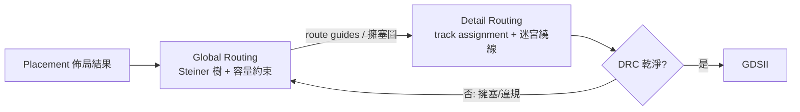

# 07.3 全域繞線：Steiner 樹與 Pattern-Ripup 的分工

## 把一個問題拆成兩半

迷宮搜尋再快，也改變不了它的格局：一次搜尋只服務一條線網的兩個端點，對整顆晶片的擁塞毫無全局視野。當晶片規模跨過數千、數萬條線網，繞線必須被拆解。拆法在 1970 至 1980 年代逐漸定型，成為延續至今的兩段式架構：全域繞線（global routing）負責「規劃」，決定每條線網大致經過哪些區域、走哪幾層；詳細繞線（detail routing）負責「落實」，在具體的軌道與格點上把線畫出來。兩者之間的介面是容量：全局繞線把晶片切成一格一格的 tile 或 gcell（global cell），每個 tile 之間的邊界有水平與垂直的線道容量，全局繞線的職責是在不超容的前提下，讓總線長與時序最優。



這個分工的經濟邏輯很直接：詳細繞線的搜尋空間是每格一個節點的巨大網格，只有在局部才是可控的；全局繞線把問題降維成「在粗格子上替每條線網找一棵樹」，才能做全局最佳化。而「替一條多端點線網找最短的連接樹」，正是 Steiner 樹問題。

## Steiner 樹：比 MST 更短的連接

對一個含 $`n`$ 個端點的線網，最短的連接結構不是最小生成樹（MST），而是 Steiner 最小樹（SMT）：允許在端點之外增加 Steiner 點，讓線在半路分岔。在曼哈頓平面上（RSMT，rectilinear Steiner minimal tree），加點帶來的縮短相當可觀——理論上 RSMT 相對 RMST 的縮短比最壞可到 $`2/3`$ ，平均約縮短 10% 上下。1966 年 Maurice Hanan 證明了一個關鍵定理：RSMT 必定存在於以各端點座標畫出的水平與垂直線所構成的格子上，這就是 Hanan grid。Hanan grid 把連續平面的無窮搜尋空間離散化成至多 $`(n-1) \times (n-1)`$ 的格點，是所有 Steiner 演算法的理論地基。

精確求解 RSMT 是 NP-hard，實務上用的是近似演算法。最經典的是 1981 年 L. Kou、G. Markowsky 與 L. Berman 提出的 KMB 演算法（也稱 Kou 演算法），複雜度 $`O(n^2)`$ （用堆積可到 $`O(n \log n)`$ ）：

```text
KMB(P):                     # P 為端點集合
    G := Hanan grid 上的完全圖，邊權 = 曼哈頓距離
    T := P 的最小生成樹（在 G 上）
    S := 將 T 的每條邊換成對應的 rectilinear 路徑後的子圖
    return Steiner(S)       # 剪去度為 1 的非端點葉、拉直
```

KMB 的近似比為 $`2`$ （即結果不超過最優的兩倍）；後來的改良如 Borah-Owen-Irwin（BOI，1994 年的邊交換法）以 $`O(n^2)`$ 到 $`O(n \log n)`$ 的時間達到約 1.5 以下的實測比值，成為工業界佈局後線長估計與全局繞線的常用選擇。順帶一提，若直接以每對端點的曼哈頓距離加總，得到的半週邊線長（HPWL, half-perimeter wire length）是業界最常用的快速估計量；對二端點線網 HPWL 就是精確值，對多端點線網 HPWL 是 RSMT 長度的下界，兩者差距正是「佈局工具的目標函數」與「繞線工具的現實」之間的系統性偏移——這個偏移是 1990 年代「繞線感知佈局」（placement with routing congestion awareness）研究的直接動機。

## 擁塞模型：容量與成本的語言

全局繞線的本質是一個多商品流（multi-commodity flow）式的大規模整數問題：每條線網是一個商品，要從端點流過 tile 圖；每條 tile 邊有容量 $`c_e`$ ；目標是最小化 $`\sum`$ 線長，約束是流不超容。精確求解不可行，1980 年代定型的實用做法是序列式：按某種順序逐條線網跑 Steiner/迷宮搜尋，搜尋的 cost 函數裡編入擁塞懲罰

$$
\mathrm{cost}(e) = \ell_e \cdot \big(1 + h \cdot \mathrm{pf}(e)\big)
$$

其中 $`\ell_e`$ 是邊長， $`\mathrm{pf}(e)`$ 是擁塞懲罰函數（例如 $`u_e/c_e`$ 的超額比率， $`u_e`$ 為使用量）， $`h`$ 是歷史係數。先繞的線網把邊用滿，後繞的線網在搜尋時就會因懲罰而繞開，全局上形成軟性的自我調節。但序列繞線有宿命：繞線順序決定成敗，先繞者占盡好路，後繞者無路可走，這就是所謂的 net ordering problem。

## Rip-up and reroute：拆掉重來的迴圈

解決衝突的機制是 rip-up and reroute（拆線重繞）：當某條線網找不到不超容的路徑時，把它先前占用的邊拆掉，改用帶擁塞懲罰的搜尋重繞一次，讓資源釋放給別人。整個流程是一個迭代收斂的迴圈：

```text
repeat:
    for each unrouted / violating net n:
        rip up n 的舊路徑
        reroute n（cost 含擁塞懲罰，允許暫時超容）
    更新使用量與歷史擁塞
until 全部線網 routed 且無 overflow 或迭代上限
```

所謂 pattern routing 是這個迴圈裡常用的快速繞法：在兩個 tile 之間只用少數幾種固定圖案（L 形、Z 形、U 形）選最短者，幾乎不用搜尋；繞不成再退回迷宮式搜尋。這種「先用便宜的 pattern 試、失敗才 ripup 重繞並升級為昂貴搜尋」的分層策略，是 1990 年代至今所有實用全局繞線器的骨架。模式快速、搜尋精準、懲罰調節、迭代收斂——四件事合起來，讓全局繞線能在數十萬線網的規模上運轉。

不過，這套「懲罰 + ripup」的機制在 1980 至 90 年代仍相當樸素：懲罰函數怎麼調、歷史怎麼記、迭代怎麼保證收斂，多半是各家工具的經驗秘方，缺乏理論。真正把「協商」變成一門有原理的科學的，是 1990 年代中葉從 FPGA 世界傳出的一個想法——PathFinder。它把擁塞懲罰從「啟發式補丁」升格為「有收斂保證的協商機制」，而且不是在 ASIC 上、而是在資源固定的 FPGA 架構上首次證明了自己的價值。下一節就講這個影響延續到今天的故事。

## 多層級化：box routing 與分層的尺度

規模繼續上升後，全局繞線自己也需要再分層。1990 年代末至 2000 年代，工具與學界把 gcell 圖再往上收拢，形成 box routing / tile routing 的多層級做法：先用相對粗的 box（涵蓋數十甚至數百個 gcell）規劃每條線網的大致走廊，確認宏觀擁塞分佈可行；再逐層細化到 gcell 與軌道。這種由粗到細的金字塔與佈局的多層級化（見第 04、05 章）是同一個時代精神的產物——當問題大到單層解析度無法兼顧全局視野與局部精度，就用層級結構把兩個尺度分開服務。多層級全局繞線的另一個好處是增量繞線：ECO（工程變更單）只需在受影響的 box 內重繞，不必全晶片推倒重來。

層數增加也讓「層指派」成為全局繞線必須回答的問題：不同金屬層的單位長度電阻電容差異極大，頂層厚金屬適合時脈與匯流排，底層細金屬適合短接線。全局繞線的 cost 函數因此要對「用哪一層」定價，將線長、delay 與層資源一起納入。這一步做粗了，詳細繞線就會在時序上全面翻車——全局繞線從此不再只是「幾何規劃」，而是時序規劃的前哨。
